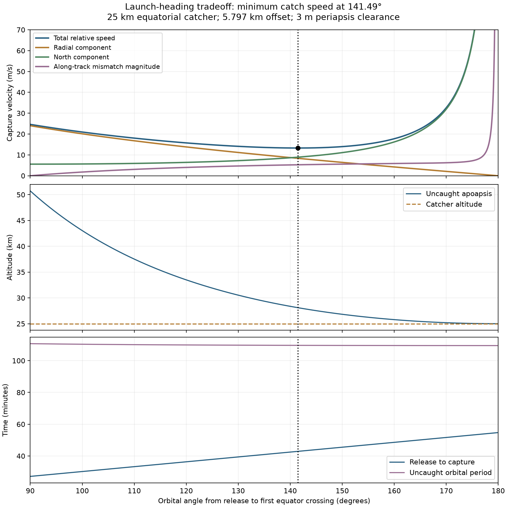

# Optimizing launch heading toward a near-apoapsis equatorial catch

**Completed and accepted:** start with [RESULT.md](RESULT.md) for the selected
reference-RPM optimum, exact numerical case and file map. This README explains
the exploration that led to it.


**The 90-degree crossing was a restriction of due-east/west release, not an
optimum.** Allowing a north/south launch component reduces both apoapsis and
relative catch velocity. The best horizontal-release solution for the current
25 km prograde catcher example crosses the equator at about **141.5 degrees**, with
**13.3 m/s** relative speed and **28.1 km apoapsis**.

The payload initially travels slightly **away from the equator** to postpone its
first crossing. For the southern prograde tip this means south of east, followed
by a northward crossing. The opposite tip has the mirrored geometry.

This is a new analysis; the prior node-at-90-degree plots and all terrain results
are preserved. Terrain work remains paused.

## Objective, fixed inputs and limitations of the optimization

Minimize the magnitude of the full vector difference between payload and
circular equatorial catcher velocity at their first intersection. This is a
useful proxy for capture impulse per payload mass and relative kinetic energy,
not a full optimization of catcher engineering or scheduling.

The primary sweep holds:

- Perfect spherical Moon, R = 1,737.4 km, central gravity only.
- Circular **25 km prograde equatorial catcher**, phased to meet the payload.
- Release position **5,796.553 m south** of the tower's radial axis.
- Illustrative **3 m release clearance**, retained for comparison with the prior
  example. Release velocity remains tangent to the local spherical surface.
- No payload propulsion after release.

The free variable is first-node orbital angle, equivalently horizontal heading.
Speed is solved to reach the specified catcher radius. RPM is not independently
fixed in this initial fixed-position sweep. An additional calculation below
retains reference RPM and solves the actual sling radius and release phase.

This is the best result within the bound, initially prograde, locally horizontal
first-node branch. It is not a claimed global optimum over tower height, radial
launch velocity, catcher altitude, inclined catcher orbits, or all possible
capture schedules. No new inward velocity or pitch is needed for this branch.
The 35 km retrograde case and a joint two-catcher scheduling objective have not
been optimized here.

## Results at fixed release position

| Angle to capture | Relative catch speed | Apoapsis altitude | Flight to catch |
| ---: | ---: | ---: | ---: |
| 90° | 24.634 m/s | 50.727 km | 27.165 min |
| 120° | 15.751 m/s | 33.493 km | 36.335 min |
| **141.492° optimum** | **13.301 m/s** | **28.099 km** | **42.911 min** |
| 150° | 13.972 m/s | 26.822 km | 45.517 min |
| 160° | 17.749 m/s | 25.789 km | 48.585 min |
| 170° | 32.601 m/s | 25.194 km | 51.658 min |
| 175° | 64.031 m/s | 25.048 km | 53.198 min |



The fixed-position optimum points **0.24025° south of east**, supplying about
**7.072 m/s southward velocity** at release. Orbital inclination increases from
0.19116° to **0.30702°**. Release remains periapsis, so minimum spherical clearance
stays **3 m**, including after a missed capture.

The minimum exists because two effects compete. Delaying the node toward
apoapsis lowers the payload's outward radial speed at capture. But increasingly
steep orbital-plane inclination is needed to delay the equator crossing, which
increases its northward velocity relative to the equatorial station. Near
180 degrees that second penalty becomes large. A nonzero off-equator release
point cannot be followed by an equatorial point exactly antipodal to it.

## Can the existing sling geometry supply this heading?

**Yes, in the ideal constant-radius horizontal rotation kinematics, by changing
release phase slightly.** It does not require a new lateral impulse at release.
The tip is released just before its southernmost position, so its circular
motion already has the desired southward component. The opposite arm can be
released simultaneously with the opposite component. Compatibility with two
different target altitudes still requires solving the two arms together.

Retaining **2.7796279 RPM**, independently optimizing release phase, and adjusting
arm radius to hit the 25 km catcher gives:

| Quantity | Reference-RPM optimum |
| --- | ---: |
| Orbital angle to catch | 141.557° |
| Relative catch speed | 13.2825 m/s |
| Apoapsis altitude | 28.0878 km |
| Flight to catch | 42.9305 min |
| Release phase before southernmost tip | 0.240709° |
| Horizontal sling radius | 5,778.275 m |
| Tip east offset from hub at release | −24.275 m (west) |
| Tip north offset from hub at release | −5,778.224 m (south) |
| Sling centripetal acceleration | 49.92385 Earth g |
| Orbital inclination | 0.306488° |
| Outward radial catch component | 8.3404 m/s |
| Northward catch component | 8.8939 m/s |
| Along-track catch component relative to station | −5.2689 m/s |

The radius changes by about 18.3 m from the previous 90-degree example. The
release plane is 6.609 m below the tower-foot tangent plane to preserve the
illustrative 3 m tip clearance. Tower height still depends on tether drop; this
is a kinematic check, not a new structural or cable-dynamics calculation. It
assumes payout/retraction velocity is zero at release and an ideal horizontal
tip circle. Detailed spool scheduling remains a separate work item.

The heading described in the first sweep is relative to the local east/north
basis at release. The release-phase angle is measured about the hub; they are
close but not identical. Output Cartesian states for the phase check explicitly
include the rotating Moon's velocity contribution and the off-axis release point.

## Timing and choosing a metric

The user's concern about the timing geometry is addressed by reporting it,
not by declaring catch-speed minimization a scheduling optimum. From 90 degrees
to the relative-speed optimum, release-to-capture time increases from 27.16 to
42.91 minutes. The uncaught payload's orbital period decreases only from
110.69 to 109.62 minutes. Catcher period is fixed by its unchanged 25 km orbit.
A full launch-window width or repeated-encounter schedule has not been calculated.

**150 degrees is a useful compromise** if capture nearer apoapsis matters: it
adds only about **5%** to the minimum catch speed, lowers apoapsis to **26.82 km**,
and moves capture to **45.52 minutes**. The table/curve allows an explicit maximum
apoapsis or desired catch-time constraint to be imposed rather than treating
relative speed as the only criterion. Going to 170 degrees makes apoapsis very
close to 25 km but more than doubles the minimum relative speed.

## Derivation

Let the southern release latitude magnitude be b, the orbital angle to first
node be theta, and heading beta be positive north of east. A horizontal unit
velocity q and initial radial unit vector rhat give position direction

```text
rhat(theta) = cos(theta) rhat(0) + sin(theta) q
sin(beta) = tan(b) cot(theta)              [node has z = 0]
e = (r_c - r0) / (r0 - r_c cos(theta))
p = r0 (1 + e)
v_release = sqrt(mu p) / r0
v(theta) = sqrt(mu/p) [-sin(theta) rhat(0) + (e+cos(theta)) q]
```

Subtract the circular equatorial station's vector velocity at that point to
obtain the objective. Release is periapsis because radial speed is zero and
speed exceeds local circular speed. Increasing theta beyond 90 degrees makes
beta negative: the payload initially moves away from the equator.

The full fixed-position search covers the allowed bound prograde horizontal
branch, approximately 13.68 degrees to 179.81 degrees, on 6,001 samples. All
interior sampled minima are refined and compared with endpoints. One minimum
is found. The plot focuses on 90–180 degrees, the region requested for the
near-apoapsis tradeoff. A separate release-phase scan checks the reference-RPM
solution, with numerical refinement near its minimum.

## Reproduce and validate

```bash
MPLCONFIGDIR=/tmp/lunar-sling-mpl-cache .env/hub/bin/python -m llo_catcher.analysis.heading_optimization.calculate
```

[Code](calculate.py), [exact results and checks](results.json),
[full angular sweep](sweep.csv), [vector figure](heading_tradeoff.svg).

Independent Cartesian integration checks the 90-degree case, optimum and
170-degree case against analytic catch position/velocity, with tolerances of
1 mm and 1 micrometre/second. The actual reference-RPM phase-shifted Cartesian
state is also independently integrated to confirm equatorial intersection,
25 km catch altitude and relative speed. The old 90-degree result is reproduced.

[Previous spherical baseline](../spherical_release/README.md) ·
[Work item](../../work_items/SPHERICAL_MOON_RELEASE_CLEARANCE.md)
