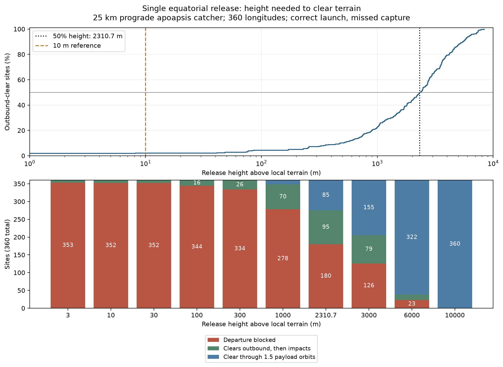
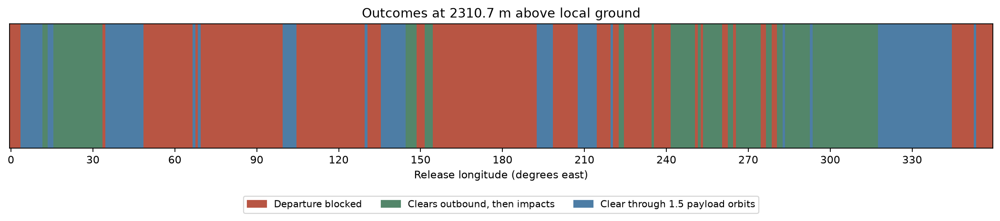
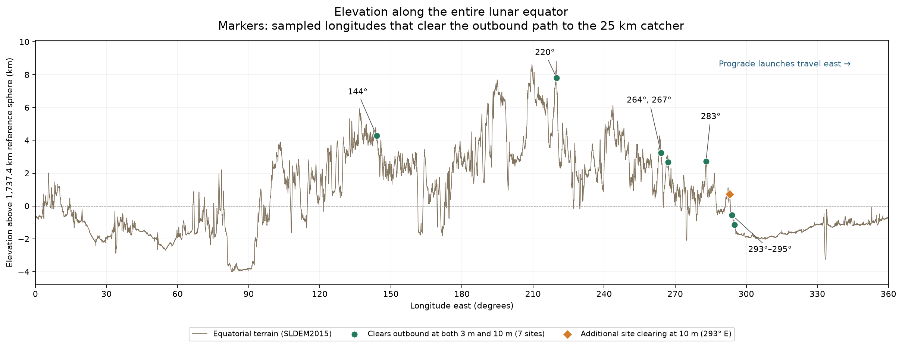

# Sub-analysis 1: single equatorial release — height and failed-capture survey

**This is the preserved initial height survey.** For the completed study's final
results and navigation, use the [launch-site checkpoint](../LAUNCH_SITE_CHECKPOINT.md).
The global height-percentage approach was abandoned; subsequent local corridors,
movable summit hubs and six-site east/west impact checks are now complete.
All original results and elevation graphs remain here.

**Completed initial survey, 2026-11-04.** This branch treats one useful payload
and a disposable counterweight. Only the useful payload's trajectory is
analyzed; its release point is exactly on the equator. The separate
[two-offset-payload branch](../dual_offset_release/README.md) remains deferred.

## Question and answer

How high above local ground must a horizontal equatorial release start for at
least half of 360 equally spaced longitudes to clear the terrain all the way to
a 25 km circular catcher? If capture fails, how many of those clear departures
then hit terrain before 1.5 payload orbital periods?

**The numerical 50% threshold is about 2.31 km above local terrain.** At the
selected rounded height of **2,310.7 m**, exactly **180/360** departures clear:

- **95/180 (52.78%)** of the clear departures hit terrain after the missed catch.
- **85/180 (47.22%)** remain unarrested through the 1.5-orbit cutoff.
- The other **180/360** strike terrain before reaching the catcher and are
  rejected departures, not successful arrests after a missed capture.

At **10 m**, **8/360 (2.22%)** clear outbound, and all eight subsequently hit
terrain before the cutoff. At the old **3 m** comparison height, 7/360 clear.
The ten-metre case is the reference aligned with the user's intended geometry;
three metres is retained only as a comparison.

## Height scan and classifications

“Outbound clear” means clear **until intended capture at apoapsis**, roughly
55 minutes after launch. It does not mean just clearing the first few seconds.
“Not arrested” means no contact through 1.5 payload periods; survival indefinitely
is neither simulated nor asserted.

| Release height above local ground | Clear outbound | Clear fraction | Then impact after missed capture | Not arrested at cutoff |
| ---: | ---: | ---: | ---: | ---: |
| 3.0 m | 7/360 | 1.94% | 7 | 0 |
| 10.0 m | 8/360 | 2.22% | 8 | 0 |
| 30.0 m | 8/360 | 2.22% | 8 | 0 |
| 100.0 m | 16/360 | 4.44% | 16 | 0 |
| 300.0 m | 26/360 | 7.22% | 26 | 0 |
| 1,000.0 m | 82/360 | 22.78% | 70 | 12 |
| 2,310.7 m | 180/360 | 50.00% | 95 | 85 |
| 3,000.0 m | 234/360 | 65.00% | 79 | 155 |
| 6,000.0 m | 337/360 | 93.61% | 15 | 322 |
| 10,000.0 m | 360/360 | 100.00% | 0 | 360 |

The last two columns partition only the outbound-clear cases. The graphic's
three colors instead partition all 360 sites, including blocked departures.





## What the equatorial elevation profile reveals



The line uses the full cached equatorial DEM profile, not merely the 360 launch
samples. Elevations are kilometres above the 1,737.4 km reference sphere; zero
is a reference datum, not ground level or a lunar sea level. Prograde departures
travel east, to the right on the plot, wrapping from 360° to 0°.

Green markers identify the seven sites clearing at both 3 m and 10 m:
**144°, 220°, 264°, 267°, 283°, 294° and 295° E**. The orange diamond is
**293° E**, which clears at 10 m but not at 3 m. These are successes among the
one-degree samples, not the only possible successful launch points along the
equator. The markers report outbound clearance; all eight subsequently hit
terrain after missed capture in the 10 m cases.

The profile suggests a useful physical interpretation: successful points tend
to have ground falling away toward the east, giving the shallow orbit room to
rise. Several sit on elevated terrain, but absolute elevation is not the whole
explanation. The sites at 294° and 295° are about **554 m and 1,151 m below the
reference datum**, respectively; both lie along the descent into a broad lower
region. Their outbound clearance is compatible with that downhill corridor.
A local downhill slope alone is not sufficient: the entire later outgoing
trajectory must still clear subsequent terrain.

[Closer view from 258° to 302° E](equatorial_elevation_detail.png) ·
[Full-profile SVG](equatorial_elevation.svg) ·
[Detail SVG](equatorial_elevation_detail.svg)

Reproduce these illustrations without rerunning trajectories:

```bash
MPLCONFIGDIR=/tmp/lunar-sling-mpl-cache .env/hub/bin/python -m llo_catcher.analysis.single_equatorial_release.plot_equator
```

The [plot script](plot_equator.py) reads the same cached terrain and saved
classifications used above. The height scan and trajectory results are unchanged.

## What drives the unexpectedly large height?

The 180th site's grazing threshold is **2,310.618553 m**, at release longitude
**48° E**. Its limiting terrain occurs at **78.577148° E**, about **927.2 km**
downrange and **552.16 seconds** after release. Relative to the ground at launch:

- Terrain rises **3,999.706 m**.
- The payload gains **1,689.088 m** of Moon-centered radius.
- The missing **2,310.619 m** must come from initial release height.

Thus the threshold measures **regional terrain relief along a shallow outgoing
orbit**, not just metre-scale roughness immediately beside the launcher. That
is why increasing three metres to ten metres changes the count only slightly.
The trajectory still starts at periapsis; the calculation does not introduce a
downward launch velocity.

For the sampled longitudes, strict clearance requires exceeding the grazing
threshold. The 180th and 181st sorted thresholds are **2,310.618553 m** and
**2,326.869500 m**. The selected 2,310.7 m rounds upward from the first to obtain
exactly 180 successes. Extra digits are numerical diagnostics, not physical
precision. This is an empirical fraction of the 360 evenly spaced sites, not a
statistical guarantee about an arbitrary future installation.

## Model and scope

- One launch at latitude **0°**, longitudes **0° through 359° E**, one-degree spacing.
- Due-east/prograde, locally horizontal release; launch is periapsis.
- Catcher is circular and equatorial at **25 km above the 1,737.4 km reference
  sphere**. Payload apoapsis equals that catcher radius. Catch is at 180° of
  inertial orbital travel. Catcher phase is assumed controllable.
- At every site and every release height, recompute launch speed to retain that
  same apoapsis. No RPM, arm length or hardware dimensions are imposed.
- Heights are radial metres above the **local DEM elevation at release**, not
  above the lunar reference sphere or above the highest hill downrange.
- Central lunar gravity plus uniform lunar surface rotation. Ground rotates
  beneath the orbital trajectory; its next periapsis is over a different longitude.
- SLDEM2015 terrain, bilinear interpolation; on the equator this reduces to a
  one-dimensional piecewise-linear profile through adjacent latitude rows.
- Correct launch, missed capture, first contact or **1.5 of that payload's own
  orbital periods**, whichever comes first. Counterweight disposal is excluded.

At 2,310.7 m, site-dependent capture times range from **54.70 to 54.98 minutes**;
relative catch speeds range from **3.54 to 6.37 m/s**. Release speeds differ
slightly with local terrain elevation. The full state metrics are in the CSV.

These calculations do not imply a 2.31 km tower is required for a selected site:
they answer the particular question of obtaining 50% coverage among arbitrary
sampled longitudes. Nor do they demonstrate that raising an actual sling tip by
this amount is structurally or operationally feasible.

## Relationship to the two-payload case

The result supplies a useful baseline, but **it is not a height that depends only
on terrain roughness**. It also depends on ground-track latitude, launch direction,
catcher altitude, the trajectory's rate of gaining height, the definition of
outbound clearance, and the required fraction of successful sites. A more
complex offset trajectory might give a similar scale; that remains a hypothesis.
Requiring both useful payloads to clear additionally changes the site criterion.
No new dual-payload calculation has been performed.

## Files and reproduction

| File | Purpose |
| --- | --- |
| [README.md](README.md) | This problem, result and scope checkpoint. |
| [METHOD.md](METHOD.md) | Equations, terrain-intersection method and validation. |
| [calculate.py](calculate.py) | Height thresholds, explicit height scan, outcomes and figures. |
| [test_calculate.py](test_calculate.py) | Independent physical/coordinate/intersection checks. |
| [results.json](results.json) | All numbers, model inputs, hashes and refinement results. |
| [site_thresholds.csv](site_thresholds.csv) | Per-site required height and the terrain point that sets it. |
| [height_scan.csv](height_scan.csv) | Counts at each sampled height. |
| [trajectories.csv](trajectories.csv) | 3,600 site/height cases with speed, timing and impact locations. |
| [Height figure SVG](height_scan.svg), [longitude figure SVG](longitude_outcomes.svg) | Vector versions of the figures. |

From the repository root, using the existing cached terrain corridor:

```bash
MPLCONFIGDIR=/tmp/lunar-sling-mpl-cache .env/hub/bin/python -m llo_catcher.analysis.single_equatorial_release.calculate
.env/hub/bin/python -m unittest llo_catcher.analysis.single_equatorial_release.test_calculate -v
```

The cache is excluded from Git. For a new checkout, follow the
[terrain access instructions](../terrain/README.md) or run
`.env/hub/bin/python llo_catcher/analysis/terrain/terrain_band.py` to obtain it.
Python dependencies are NumPy, SciPy and Matplotlib. The new analysis writes
only into this folder; the earlier terrain sweep, demo and spherical optimum
remain preserved.

[Parent analysis guide](../README.md) · [LLO study guide](../../README.md) ·
[Deferred two-payload branch](../dual_offset_release/README.md)
