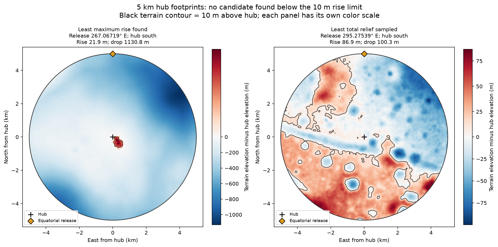

# Can the 5 km sling fit beside an equatorial release corridor?

The [movable-hub summit catalog](../summit_sites/README.md) gives signed decimal coordinates for six hilltops found by allowing a 2 km latitude adjustment, with separate terrain and trajectory checks.


**All 49 candidate corridors fail the 10 m maximum-rise requirement in the terrain model**, with the hub placed on either side of the equator. Their combined release arc is 90.727 km. The smallest maximum rise found was **21.9 m** for a hub south of the equator near 267.06719° E. A continuous check covers the spaces between the sampled hub placements. [Parent corridor survey](../local_corridors/README.md)

## What was measured

The requested screen compares the highest ground anywhere inside a 5 km radius with the ground elevation at the hub. A footprint passes when that rise is at most 10 m. We also report the deepest drop, because a high point can have little ground above it while the rest of the disk slopes steeply away.

The payload releases 10 m above local ground on the equator and travels due east. For each release longitude the two possible hubs lie on the same meridian, one north and one south. The tip is 5,000 m from the vertical rotation axis. The two placements use opposite senses of rotation to produce the same eastward velocity. This study fixes 5 km at the requested value. The published 50 g design and the earlier approximately 5.8 km orbital example use different radii.

## Results

| Placement | Release longitude E | Hub latitude | Maximum rise | Maximum drop | Highest to lowest |
| --- | ---: | ---: | ---: | ---: | ---: |
| Smallest rise found, southern hub | 267.06719° | −0.16466° | 21.9 m | 1,130.8 m | 1,152.7 m |
| Smallest rise found, northern hub | 143.85254° | +0.16448° | 28.9 m | 1,304.6 m | 1,333.5 m |
| Smallest total relief sampled | 295.27539° | −0.16500° | 86.9 m | 100.3 m | 187.2 m |

At 267.06719° E, the hub sits at 2,945.9 m elevation. A ground point about 0.47 km southeast reaches 2,967.7 m. Much of the disk lies far below the hub. That accounts for the small patch of red inside a mostly blue footprint on the left map. The release is near a grazing boundary of its orbital corridor.



The elevation colors are relative to each hub. Black terrain contours mark ground 10 m above the hub. The orange diamond marks the equatorial release point. [Vector map](footprint_maps.svg)

## How the full corridor was checked

1. The initial search sampled **3,215 release positions** at about 29.6 m spacing, with additional points just inside corridor boundaries and at interval midpoints. Testing both orientations gave **6,430 hub placements**.
2. For each of the 49 corridors and each orientation, we refined longitude near the best sampled placement. We checked terrain grid vertices throughout the disk and interpolated terrain around its rim, using 7,200 rim points in the refined evaluations.
3. We then partitioned both copies of the release corridors into **6,176 short longitude intervals**. For every interval we found one fixed terrain point guaranteed to stay in every corresponding disk. Even that one point exceeds the largest possible hub elevation in the interval by more than 10 m. The smallest such bound across the entire search is **21.8649757 m**. Every interval has a witness. [Summary](certificate.json) · [Per-interval coordinates and bounds](witnesses.csv)

For the continuous check, release elevation along the equator is piecewise linear in longitude. The endpoints and terrain interpolation knots bound the hub latitude because the tip radius fixes the hub offset. This produces a rectangle enclosing all possible hubs for each interval. Bilinear terrain elevation within a clipped grid cell attains its maximum at a corner, so checking all clipped corners bounds the highest possible hub ground. A bound on the change of the hub axis guarantees that the witness point stays inside the 5 km disk throughout the interval.

This result applies to the previously identified corridors and the interpolated SLDEM2015 surface. The dataset samples terrain at roughly 59 m along the equator and has metre-scale vertical uncertainty. The extra digits in the lower bound identify the numerical check.

## Separate horizontal tip clearance

The rise criterion uses hub ground as its reference. We also checked a horizontal tip circle passing through the equatorial release point. At the closest southern candidate, the equatorial ground is about **510 m lower** than the hub ground. With 10 m release clearance the horizontal tip circle would intersect terrain elsewhere around its rim by about **444 m**. Increasing the allowed terrain rise to 22 m would therefore leave a separate clearance problem at this site.

For release radius from the lunar center `r`, horizontal sling radius `L` and hub-axis offset angle `d`, the calculation uses `sin(d) = L/r`. The tip plane is at axial coordinate `r cos(d)`. A terrain point with lunar radius `r_g` and angular separation `a` from the hub axis lies inside the footprint when `r_g sin(a) <= L`. Its projected height along the axis is `r_g cos(a)`. The CSV gives minimum clearance along the tip ring and relative to a horizontal plane spanning the disk. Modeling tether droop or grading would require a separate engineering calculation.

## Data and reproduction

The previous terrain cache covered ±0.25° latitude. A 5 km offset hub and a further 5 km footprint reach about ±0.33°. We extended four longitude sectors to ±0.34375° using eight byte ranges from the same NASA PDS SLDEM2015 tiles. The extension uses 48 extra terrain rows on either side. The original overlapping rows matched and the downloaded strip hashes were verified. [Terrain manifest](terrain_manifest.json) · [Dataset notes](../../terrain/README.md)

From the repository root, with the parent terrain cache installed, run:

```bash
.env/hub/bin/python -m llo_catcher.analysis.single_equatorial_release.hub_footprints.terrain
.env/hub/bin/python -m llo_catcher.analysis.single_equatorial_release.hub_footprints.survey
.env/hub/bin/python -m llo_catcher.analysis.single_equatorial_release.hub_footprints.certify
MPLCONFIGDIR=/tmp/lunar-sling-mpl-cache .env/hub/bin/python -m llo_catcher.analysis.single_equatorial_release.hub_footprints.figures
```

The terrain arrays live in the ignored cache. The repo holds the [screening code](survey.py), [continuous check](certify.py), [full sampled placements](footprints.csv), [refined results](results.json), and terrain maps.
