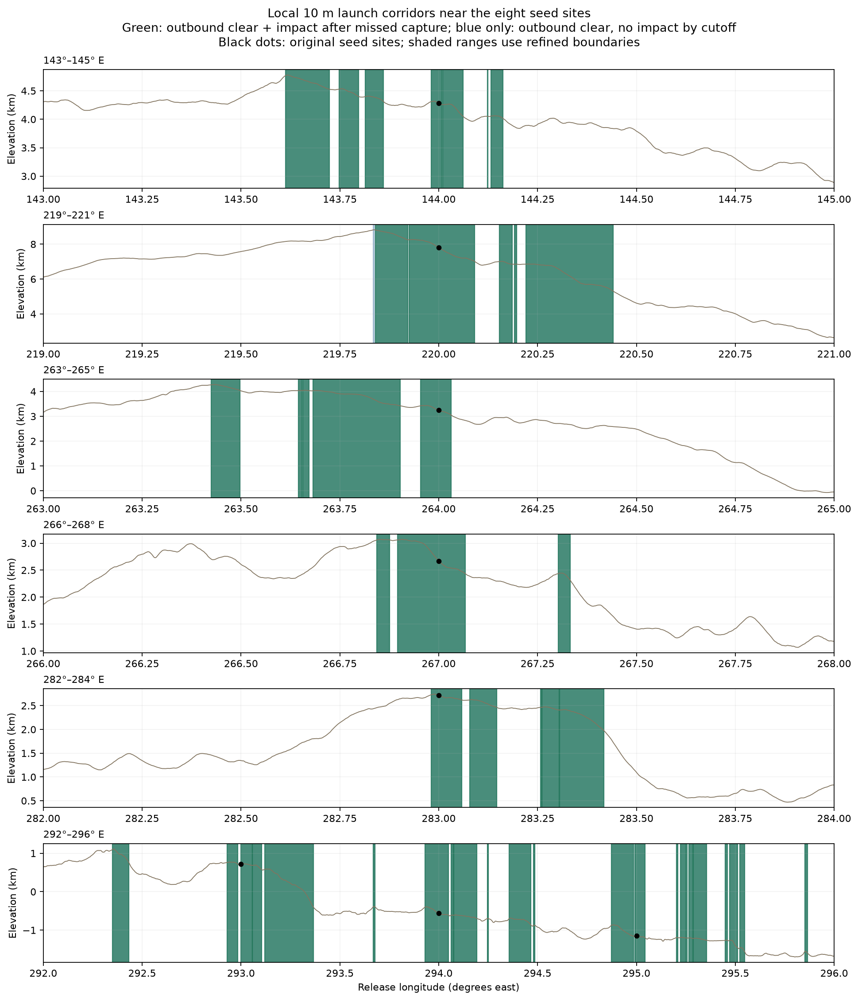
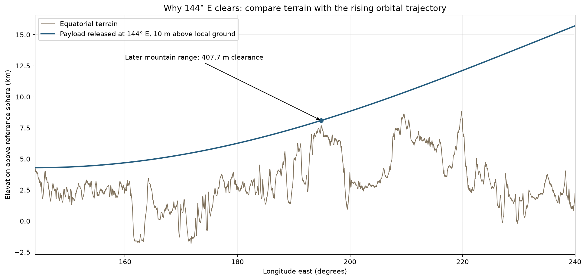

# Local 10 m launch corridors near the eight successful sites

The subsequent [5 km hub footprint screen](../hub_footprints/README.md) checks both hub orientations for every corridor here. The terrain exceeds the 10 m maximum-rise criterion throughout these corridors.


**Completed, 2026-11-04.** The global height-percentage approach is closed at the
user's request. Its [full-equator elevation graph](../equatorial_elevation.png)
and [documented results](../README.md) remain preserved. This new survey holds
release height at **10 m**, refines longitude around the eight successful
one-degree samples, and measures the horizontal extent of suitable stretches.

## Result

The **eight continuous intervals containing the original seed points total
22.604 km**. Additional disconnected intervals found in the surrounding search
windows bring the combined total to **90.727 km in 49 intervals**. Every interval
counted in those totals clears the terrain outbound and hits terrain after a
missed capture, before the **1.5-payload-orbit cutoff**.

The larger total is not eight continuous downhill slopes: it is the sum of all
49 disconnected intervals found locally. Search windows cover 143–145,
219–221, 263–265, 266–268, 282–284 and 292–296° E, totaling 424.53 km of equatorial
arc. These windows are one degree on either side of each seed, with overlaps
merged. All edges fail outbound clearance; none of the reported intervals is
clipped at an edge. This is a local survey, not a complete lunar site catalog.

## Continuous interval containing each original seed

Both criteria—outbound clearance and subsequent impact—hold inside these
model boundaries. Endpoint equality is grazing, not a physical safety margin.

| Original seed | Start longitude E | End longitude E | Horizontal length |
| ---: | ---: | ---: | ---: |
| 144° | 143.98077° | 144.00808° | 0.828 km |
| 220° | 219.92551° | 220.09101° | 5.018 km |
| 264° | 263.95410° | 264.03186° | 2.358 km |
| 267° | 266.89636° | 267.06719° | 5.180 km |
| 283° | 282.98135° | 283.05789° | 2.321 km |
| 293° | 292.99862° | 293.05689° | 1.767 km |
| 294° | 293.93136° | 294.04989° | 3.594 km |
| 295° | 294.99174° | 295.04243° | 1.537 km |

**Sum: 22.604 km.** These are numerical boundaries on the interpolated DEM;
the coordinate digits do not represent surveyed positioning accuracy.

## All suitable intervals found in the surrounding windows

| Search window | Separate suitable intervals | Combined horizontal length |
| --- | ---: | ---: |
| 143–145° E | 7 | 9.616 km |
| 219–221° E | 5 | 15.347 km |
| 263–265° E | 5 | 11.981 km |
| 266–268° E | 3 | 7.099 km |
| 282–284° E | 5 | 9.219 km |
| 292–296° E | 24 | 37.464 km |

**Sum: 90.727 km across 49 intervals.** The full list of longitude boundaries is
in [both_ranges.csv](both_ranges.csv).

If only outbound clearance is required, the combined extent is **90.900 km**.
About **0.173 km (173 m)** clears outbound but remains unarrested through the
cutoff. Thus the original eight points all satisfy the failed-capture condition,
but this does not extend to every nearby successful departure.



Green marks both criteria; any blue-only portion clears outbound but has no
impact within the time horizon. Black dots identify the original eight points.
Narrow regions may be difficult to distinguish at the full-figure scale; use
the [SVG](local_corridors.svg) or the CSV boundaries.

## Why 144° E really does clear

The original graph showed terrain alone. It omitted the payload's rising orbit
and compressed thousands of kilometres of horizontal travel into a short line.
The launch ground at 144° is **4.284934 km above the reference sphere**, so the
payload starts at **4.294934 km**, including the 10 m release clearance.

At the later ridge near **194.883789° E**, after about 1,543 km of eastward
travel, the payload is at **8.099024 km** and the terrain is at **7.691332 km**.
It clears by **407.692 m**. Independent Cartesian two-body propagation confirms
that clearance. By 220° E, the payload reaches **12.122 km**, above the local
**7.799 km** terrain by **4.324 km**.



A closer earlier obstruction at **145.821289° E** still has **267.471 m**
clearance. The trajectory starts at periapsis and rises; no initial downward
velocity is introduced. The original 144° seed also impacts after missed
capture, at about **106.524 minutes**, before completing its first orbit.
The entire outbound path is checked by the terrain-intersection solver, not
just these illustrative mountain checkpoints.

## Resolution and verification

Launch longitude was refined from approximately 59 m spacing to **7.4 m**.
Detected interval boundaries were then solved more precisely within the
interpolated terrain model. The last three refinement levels agree on the
summed lengths and interval counts:

| Launch-position spacing | Intervals meeting both criteria | Combined length |
| ---: | ---: | ---: |
| 59.23 m | 45 | 90.841570 km |
| 29.61 m | 49 | 90.726606 km |
| 14.81 m | 49 | 90.726606 km |
| 7.40 m | 49 | 90.726606 km |

The coarsest grid misses some gaps/intervals. The finer-grid agreement supports
the reported totals within the interpolated model, but cannot establish that
all sub-grid features are found. The terrain source itself is roughly 59 m
resolution; oversampling locates interpolation boundaries rather than creating
new terrain information.

All 98 outbound/combined intervals have ordered, non-overlapping bounds and
qualifying midpoints, with boundary clearance residuals below 0.001 m. All
eight original seeds were rechecked with half-cell terrain subdivision and
still have post-miss impacts. The 144° mountain clearance was independently
verified by Cartesian propagation. [Exact validation results](validation.json).

These are **candidate release-point corridors**, not proven construction
footprints for a complete sling. Length uses the reference equatorial arc,
not bumpy surface distance. Launcher dimensions, cable clearance and placement
of the disposable counterweight are outside this point-release calculation.

## Files and reproduction

| File | Purpose |
| --- | --- |
| [METHOD.md](METHOD.md) | Search domain, equations/criteria, resolution and limitations. |
| [survey.py](survey.py) | Reproduce local sampling, refined boundaries, totals and figures. |
| [validate.py](validate.py) | Independent orbit check and saved-boundary checks. |
| [results.json](results.json) | Full interval lists, convergence and 144° diagnostic numbers. |
| [samples.csv](samples.csv) | 57,350 final-grid release samples and classifications. |
| [both_ranges.csv](both_ranges.csv) | All 49 intervals meeting outbound and failed-capture criteria. |
| [outbound_ranges.csv](outbound_ranges.csv) | Intervals passing outbound clearance alone. |
| [Trajectory SVG](trajectory_144.svg), [corridor SVG](local_corridors.svg) | Vector figures. |

From the repository root, using the existing cached terrain and Python environment:

```bash
MPLCONFIGDIR=/tmp/lunar-sling-mpl-cache .env/hub/bin/python -m llo_catcher.analysis.single_equatorial_release.local_corridors.survey
.env/hub/bin/python -m llo_catcher.analysis.single_equatorial_release.local_corridors.validate
```

[Parent single-release study](../README.md) ·
[Orbital analysis guide](../../README.md) ·
[Deferred two-payload study](../../dual_offset_release/README.md)
