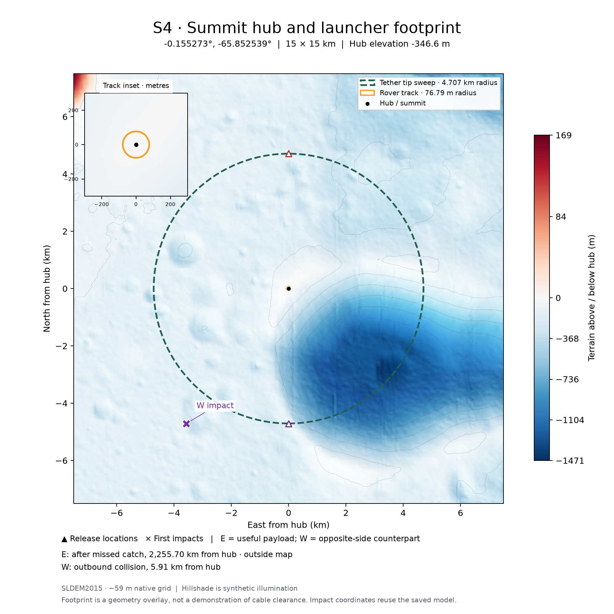

# Selected summit sites: terrain maps for the post

Created 2026-11-07. Regional maps trimmed to ±40 km after verifying all
previously shown impacts remain visible; the six local figures are unchanged. [Site catalog](../README.md) · [Saved impact calculations](../missed_capture/README.md) · [Study checkpoint](../../../LAUNCH_SITE_CHECKPOINT.md)

Six **15 × 15 km** maps show the saved summit hubs, a 76.79 m rover track,
the site-specific tether-tip circle, release points and first terrain impacts
where they lie within the view. Each comes as an SVG and a high-resolution PNG.
The track is true scale on the main map and enlarged in a 600 m-wide inset.
These are new views of the existing calculations, not a new site/trajectory sweep.

## Figures

| Hub | 15 km PNG | SVG | Additional 80 km context |
| --- | --- | --- | --- |
| S1 | [S1 local](S1_15km.png) | [SVG](S1_15km.svg) | [PNG](S1_80km.png) · [SVG](S1_80km.svg) |
| S2 | [S2 local](S2_15km.png) | [SVG](S2_15km.svg) | [PNG](S2_80km.png) · [SVG](S2_80km.svg) |
| S3 | [S3 local](S3_15km.png) | [SVG](S3_15km.svg) | Return impact is too far away: 601.17 km. |
| N1 | [N1 local](N1_15km.png) | [SVG](N1_15km.svg) | No additional impact falls within the larger square. |
| S4 | [S4 local](S4_15km.png) | [SVG](S4_15km.svg) | Return impact is too far away: 2,255.70 km. |
| N2 | [N2 local](N2_15km.png) | [SVG](N2_15km.svg) | No additional impact falls within the larger square. |



Blue terrain is below the hub; white is at hub elevation; red is above it.
Each map has its own color scale, centered on zero. Colorbar halves are scaled
separately, so equal red/blue intensities need not represent equal height
magnitudes. Contours are 200 m apart locally and 1,000 m apart regionally.
Shading is synthetic illumination for relief, not a photograph or a Sun-angle
prediction. The summit selection was a 5 km terrain screen; higher ground can
occur elsewhere in these larger squares. The tip radii vary from 3.935 to
6.602 km and are not identical to the 5 km search footprint.

## Which impacts are shown?

E is the saved useful-payload due-east release at the equator, 10 m above local
terrain, targeted at the 25 km catcher. W is the **same-plane mirrored** west
counterpart, independently targeted at the 35 km catcher. It represents the
opposite-side payload/countermass for this comparison; these two launch states
are not a validated common-RPM dual-release design.

- **S1 west (11.35 km) and S2 west (16.86 km)** are outside their 15 km squares
  but inside 80 km squares, so they receive larger maps. Both strike terrain
  **before** reaching the catcher. They are not successful departures followed
  by a Newton's-cannonball return.
- **S4 east and S3 west** are the genuine post-missed-capture impacts in the
  saved six-site comparison. They are beyond the requested 80 km map coverage,
  so no misleading cropped “return impact” maps were made for them.
- N1 and N2 mirrored west tips start below terrain: their release locations
  are drawn, but no impact location is invented. Other near impacts appear on
  their local maps; the footer gives the outcome and hub distance for each shot.
- An impact outside a circular sweep may still be inside the 15 km square.
  Conversely, hub distance alone is not the test for visibility in a square;
  both east/north map coordinates must fall within ±7.5 km or ±40 km.

Markers have enlarged symbol sizes for readability. No straight-line connectors
are drawn as flight paths. The S3 west return's brief projected sweep re-entry
is discussed in the [impact report](../missed_capture/README.md); the terrain
map alone does not establish cable collision or clearance.

## Geometry, terrain and limitations

The map projection is hub-centered **azimuthal equidistant on the 1,737.4 km
reference sphere**, north up, east right. Positions use the saved ME/PA DE421
coordinates; signed longitudes are positive east. The circular tip overlay
projects each saved horizontal arm radius at hub ground radius to the reference
sphere. It is a nominal footprint, not a calculated cable shape above terrain.

The **76.789 m track** comes from the published 50-g reference candidate and is
used as the requested illustrative hardware footprint at all six sites. It is
not a newly optimized track for each site's differing release RPM. The terrain
DEM cannot resolve construction-grade details of a 77 m-radius track.

Local maps reuse cached **SLDEM2015 at 512 pixels/degree**, about 59 m native
spacing, with metre-scale vertical uncertainty. Bilinear interpolation and an
enlarged inset do not create finer terrain information. See the existing
[terrain source/access guide](../../../terrain/README.md) and
[summit cache manifest](../terrain_manifest.json).

Regional maps use the LOLA team's [LDEM64 product](https://imbrium.mit.edu/DATA/LOLA_GDR/CYLINDRICAL/IMG/LDEM_64.LBL)
(version 3.1, 64 pixels/degree, about 474 m spacing) for landscape context only.
The product uses the same reference radius and ME/PA DE421 frame; its heights
are not substituted into the saved impact solver. Color zero uses the saved
SLDEM hub elevation, so small inter-product offsets can remain. Its
[archived label](LDEM_64.LBL) documents signed little-endian 16-bit samples at
0.5 m per digital number. [Download provenance](regional_source.json) records
the equatorial strip's byte range and SHA-256.

## Longitude figures to reuse

- **[Full 0–360° equatorial elevation profile](../../equatorial_elevation.png)**
  · [SVG](../../equatorial_elevation.svg).
- [Detailed longitude panels](../../equatorial_elevation_detail.png)
  · [SVG](../../equatorial_elevation_detail.svg).
- [Refined local launch corridors](../../local_corridors/local_corridors.png)
  · [SVG](../../local_corridors/local_corridors.svg).
- [144° launch: orbital height against terrain](../../local_corridors/trajectory_144.png)
  · [SVG](../../local_corridors/trajectory_144.svg).

## Reproduce and inspect

From the repository root, with the existing summit SLDEM cache installed:

```bash
.env/hub/bin/python -m llo_catcher.analysis.single_equatorial_release.summit_sites.maps.fetch_regional
MPLCONFIGDIR=/tmp/lunar-sling-mpl-cache .env/hub/bin/python -m llo_catcher.analysis.single_equatorial_release.summit_sites.maps.build_maps
```

The regional download caches only a 26.5 MB latitude strip, not the global file.
Raw terrain caches stay under the existing ignored `terrain/data/` directory.
[Map index](map_index.json) records marker coordinates, visibility decisions and
both impact outcomes. [Input hashes](inputs.json) identify reused scenario CSVs;
[validation](validation.json) records projection/height consistency checks.
The generated SVGs embed the raster terrain field while retaining vector labels
and overlays. No published diagrams or historical terrain plots are overwritten.

[Crop verification](crop_check.json) records exact east/north impact offsets and
hashes confirming the original local SVG/PNG files stayed unchanged.
