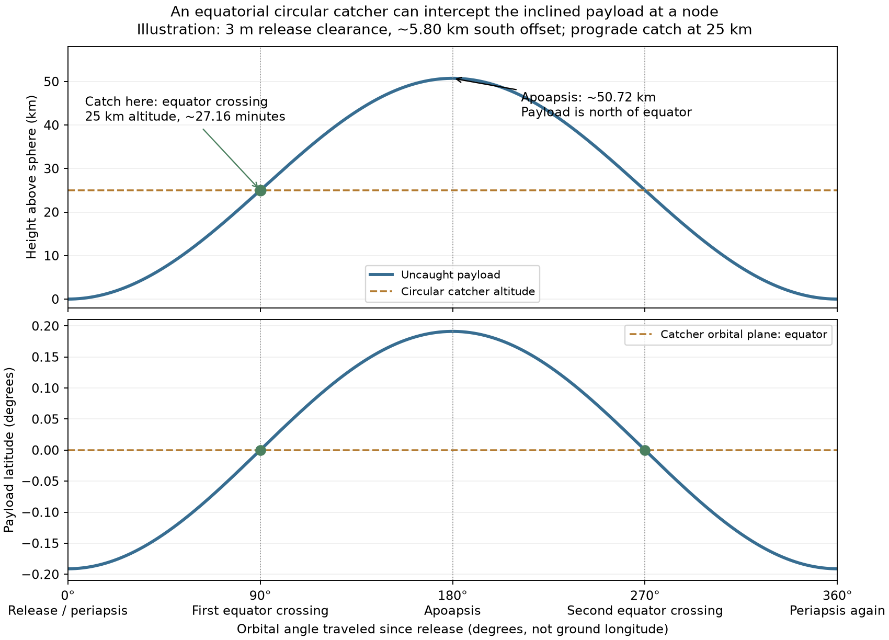

# Spherical Moon: catch at the equator crossing, not at apoapsis

**Heading optimization update:** [Varying launch phase/heading reduces catch speed to about 13.3 m/s and apoapsis to 28.1 km](../heading_optimization/README.md). The 90-degree case remains a comparison baseline.

**Terrain work remains paused.** This calculation uses no terrain data or terrain
code. It clarifies the interception geometry and answers the height-margin
question for horizontal east/west release from a finite north/south arm offset.

## The correction

The user correctly identified that a payload released horizontally from south
of the equator has an inclined orbit, crosses the equator after 90 degrees of
orbital travel, and reaches apoapsis north of the equator. Its apoapsis therefore
cannot coincide with an equatorial catcher for this release geometry.

**Capture need not occur at apoapsis.** Put the circular equatorial catcher at
the first node, and select the payload's release speed so that its radius there
is the catcher radius. Phase the catcher to arrive at the same time. The payload
is in an ellipse and the station is in a circle; the capture mechanism absorbs
the relative velocity. At release, an east/west velocity is perpendicular to the
Moon-centered radius even though the tip is north/south of the hub. No velocity
aimed toward the lunar center is required for this branch.

The recent terrain study already used this node condition. The orbital
inclination was included; explaining its geometry was the missing step. Its
outbound terrain collisions are not evidence that the node intercept is invalid.
Conversely, the original point-launch apoapsis calculation cannot simply be
applied unchanged to a finite-offset sling with equatorial catchers.

Basic terminology and the distinction between node, inclination and periapsis:
[NASA orbital-elements explanation](https://science.nasa.gov/learn/basics-of-space-flight/chapter5-1/).
The equations and numerical results below are derived in this repository.

## Worked example and diagram

The example uses a 1,737.4 km spherical radius, a **25 km circular equatorial
catcher**, and **2.7796279 RPM**. A **3 m release clearance is only an illustration**
for comparing against the prior calculations, not an imposed tower-height design.
The horizontal arm radius is solved from the catch condition.

| Quantity | Prograde example |
| --- | ---: |
| Southward horizontal tip offset | 5,796.553 m |
| Release clearance above sphere | 3 m |
| Inertial release speed | 1,691.896 m/s |
| Release speed relative to rotating surface | 1,687.272 m/s |
| First equator crossing / intended catch | 25 km altitude, 27.165 minutes after release |
| Relative catch speed | 24.634 m/s |
| Outward radial component at catch | 23.997 m/s |
| Northward component at catch | 5.565 m/s |
| Uncaught payload apoapsis | 50.727 km altitude, north of equator |



The plot continues past intended capture only to explain the orbit. The 90-degree
angle is measured in the payload's orbital plane; it is not the longitude of a
site on the rotating Moon. The opposite arm has the mirrored north-to-south
crossing geometry, with its own speed/target radius and station phase.

If one instead forces this offset payload's **apoapsis** to 25 km, its equator
crossing is only about **12.412 km** above the sphere and its apoapsis remains
off the equator. That is the mismatch the user identified. Increasing release
energy to put the **node** at 25 km resolves it, at the capture-speed cost above.

Exact velocity matching to the circular catcher is not claimed: a gravitational
trajectory through an off-equator release point cannot itself be an equatorial
circular orbit. Mechanical capture handles the difference. Retaining apoapsis
capture would require a different orbital/release geometry or a differently
oriented catcher orbit; a casual inward tilt is not a demonstrated substitute.

## Why the node condition works

Let r0 be release radius from lunar center, r_c = R + 25 km, and v_i the inertial
horizontal release speed. Zero radial velocity makes release periapsis on the
branch considered here. Its semilatus rectum is

```text
p = r0^2 v_i^2 / mu
r(theta) = p / (1 + e cos(theta))
```

At the first equator crossing theta = 90 degrees, so r = p. Therefore choose

```text
p = r_c
v_i = sqrt(mu r_c) / r0
e = r_c/r0 - 1
```

Surface rotation is included when relating v_i to the sling's speed. With d the
horizontal offset and x the release radius component along the tower's vertical,

```text
r0 = sqrt(x^2 + d^2)
v_i = omega_s d + omega_Moon x          [prograde]
v_i = omega_s d - omega_Moon x          [retrograde magnitude]
```

For an acceleration-driven input, replace omega_s d by sqrt(a_s d); solve d and
derive RPM. Never independently fix target altitude, arm radius, RPM and payload
acceleration when those quantities are coupled.

## No-hit condition and tower height

Because release is periapsis, **minimum clearance over the entire ideal bound
orbit equals release clearance**. Thus any strictly positive release clearance
avoids the perfect sphere. Equality is grazing contact, not an operating margin.

Tower height H still depends on the drop delta from apex to payload. If x is the
release radial component along the tower vertical, x = R + H - delta. Therefore

```text
H_grazing = delta + sqrt(R^2 - d_grazing^2) - R
H_for_clearance_c = delta + sqrt((R+c)^2 - d(c)^2) - R
```

For the 25 km prograde catcher:

| Held input | Grazing horizontal offset | Algebraic grazing tower height |
| --- | ---: | --- |
| 2.7796279 RPM | 5,796.563 m | H = delta − 9.669690 m |
| 50 Earth g centripetal acceleration | 5,806.053 m | H = delta − 9.701378 m |

Example: an independently specified **30 m tip drop** gives a grazing tower
height of **20.330 m** in the RPM branch. A 1 m higher tower produces almost 1 m
minimum orbital clearance. The 30 m drop is an example, not a new cable-design
result. Without a drop/arm-plane specification, RPM and catcher altitude do not
uniquely determine the tower height.

A negative algebraic grazing H does not require an underground tower: it means
this payload-only orbital condition imposes no positive tower-height minimum.
With zero drop and H=0, the RPM branch already gives about **9.6695 m** release
and orbital clearance because the tip extends laterally from the sphere's
tangent plane. Physical cable, ground and structural clearance are separate
conditions, not resolved by the point-payload orbital criterion.

## Does one extra tower metre buy one extra metre of margin?

Yes, to very high accuracy on this branch. At fixed offset and fixed drop,

```text
d(clearance)/dH = x / sqrt(x^2 + d^2)
```

This is about 0.999994 for a 5.8 km arm. Re-solving the arm radius to preserve the
catcher altitude and selected RPM/acceleration produces the following values,
starting from the algebraic grazing geometry with drop held fixed:

| Added tower height | Minimum clearance, fixed RPM | Minimum clearance, fixed 50 g |
| ---: | ---: | ---: |
| 1 m | 0.999983 m | 0.999972 m |
| 3 m | 2.999950 m | 2.999916 m |
| 10 m | 9.999832 m | 9.999720 m |
| 30 m | 29.999497 m | 29.999159 m |

Release clearance and minimum orbital clearance coincide here. These results
do not apply unchanged to a release with an inward radial velocity: then the
payload falls to periapsis after release, and that additional dip must be solved.
If a taller tower changes the cable drop, that change must also be included.

## Reproduction and checks

```bash
MPLCONFIGDIR=/tmp/lunar-sling-mpl-cache .env/hub/bin/python -m llo_catcher.analysis.spherical_release.calculate
```

[calculate.py](calculate.py) independently implements the spherical geometry;
[results.json](results.json) contains exact values and numerical checks;
[node_vs_apoapsis.svg](node_vs_apoapsis.svg) is the vector figure.

An independent Cartesian two-body integration reaches the analytic node and
returns to the initial position after one orbit with errors below 1 mm. Relative
capture speed also agrees with that integration. Height increments are checked
for both RPM and acceleration inputs. No terrain survey is run or overwritten.

[Work item](../../work_items/SPHERICAL_MOON_RELEASE_CLEARANCE.md)
