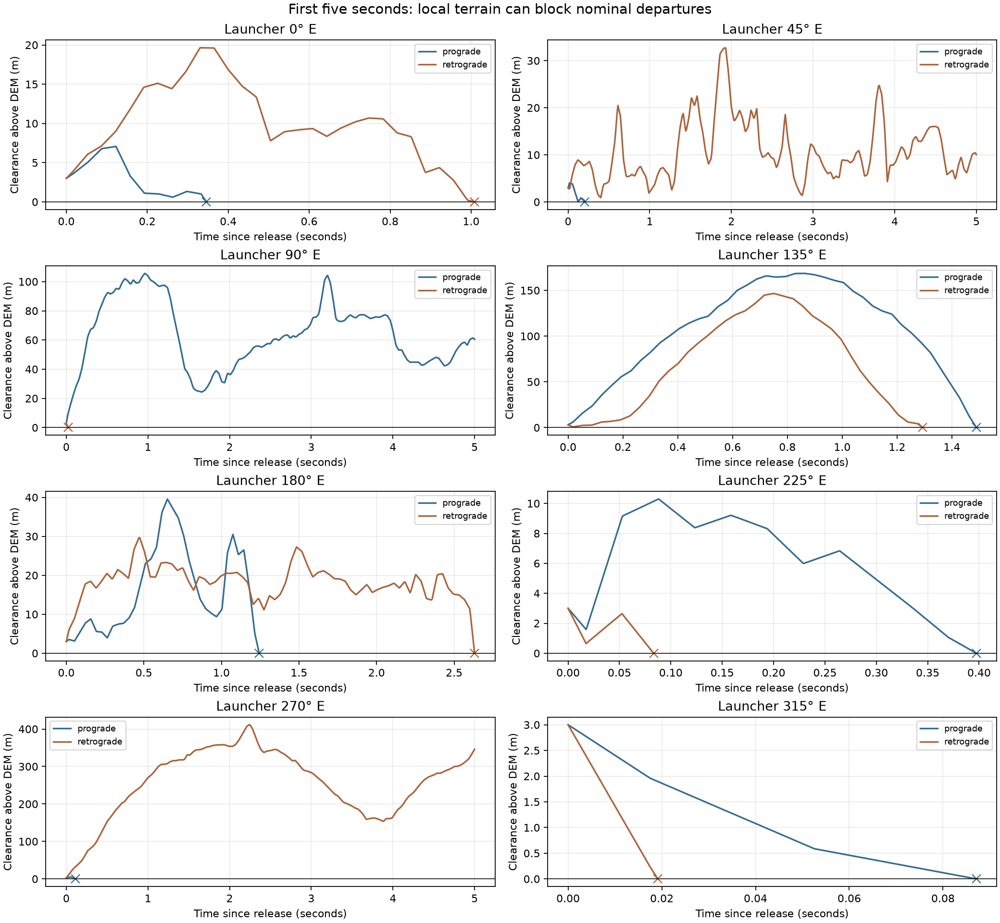

# Initial 25/35 km catcher demo

Eight demonstration longitudes, not a site-selection sweep. **No viable dual-direction site was found in this sample:** all 16 trajectories struck the interpolated terrain before their intended catch. These are rejected departures, not successful arrests after missed capture.

## Inputs and scope

- Prograde catcher: **25 km**; retrograde catcher: **35 km**, both circular and equatorial, relative to the **1,737.4 km DEM reference sphere**. This direction assignment is the stated demo interpretation and is adjustable.
- Sling rotation: **2.7796279 RPM**, held common to both arms. Arm radii are solved, not fixed at 5.787 km.
- Each release is **3 m above its local DEM surface**. Prograde leaves the southern arm; retrograde leaves the northern arm. East/west horizontal release, zero payout velocity at release, and an equatorial hub are assumed.
- Propagate each uncaught payload only to **first terrain contact or 1.5 of its own orbital periods**. An uninterrupted 1.5-period trajectory is `not_arrested`. No subsequent-orbit fate is inferred.
- Central gravity and uniform lunar rotation aligned with the DEM's mean-equator frame; no gravity harmonics, libration or third-body forces in this initial demo. Nominal catcher phase control is assumed.

## Solved geometry and relative catch speed

The finite north/south release offsets mean the payload meets the equator at a node, 90 degrees of orbital angle after release. We therefore solve semilatus rectum `p = catcher radius`, not an apoapsis-at-catcher condition. Relative catch speed is the full vector difference, including radial and north/south motion.

For a smooth sphere at zero DEM elevation (a control case, not a selected launch site):

| Quantity | Prograde | Retrograde |
| --- | ---: | ---: |
| Catcher altitude (km) | 25.000 | 35.000 |
| Arm radius from hub center (m) | 5796.553 | 5844.794 |
| Surface-relative release speed (m/s) | 1687.272 | 1701.314 |
| Inertial release speed (m/s) | 1691.896 | 1696.690 |
| Payload centripetal acceleration (Earth g) | 50.082 | 50.499 |
| Relative capture speed (m/s) | 24.634 | 33.966 |
| Radial component at capture (m/s) | 23.997 | 33.502 |
| Signed north component at capture (m/s) | 5.565 | -5.595 |
| Time to intended catch (min) | 27.165 | 27.200 |
| Payload orbital period (min) | 110.687 | 111.664 |

Both smooth-sphere trajectories are **not arrested** at 1.5 periods, as expected: their periapses remain 3 m above that sphere. The payload-only radial-balance estimate is `m_pro / m_retro = R_retro / R_pro = 1.008322`, putting a slightly heavier payload on the shorter prograde arm. This is not a completed loading specification: tapered cable self-load, asymmetry and support reactions must also balance. Payload mass does not change a ballistic trajectory at a fixed release state.

The retrograde arm is longer because lunar rotation subtracts from its inertial launch speed, and this demo also assigns it the higher catcher. The revised accelerations are about 50.08 and 50.50 g, not exactly 50 g; the published launcher snapshot is unchanged.

## Actual terrain cases

All coordinates below are DEM body-fixed coordinates with east-positive longitude. Arm dimensions and hypothetical capture speeds vary with local release elevation. Catch speeds are conditional on reaching the catcher; these particular shots do not.

| Hub longitude E | Direction | Arm radius m | Relative catch m/s | First contact s | Impact latitude deg | Impact longitude E deg | Outcome |
| ---: | --- | ---: | ---: | ---: | ---: | ---: | --- |
| 0 | prograde | 5798.97 | 25.32 | 0.3461 | -0.191317 | 0.019275 | outbound_collision |
| 0 | retrograde | 5847.50 | 34.75 | 1.0086 | 0.192928 | 359.943361 | outbound_collision |
| 45 | prograde | 5801.76 | 26.11 | 0.2041 | -0.191500 | 45.011377 | outbound_collision |
| 45 | retrograde | 5849.98 | 35.46 | 17.9656 | 0.193062 | 43.990229 | outbound_collision |
| 90 | prograde | 5809.05 | 28.19 | 20.9969 | -0.191941 | 91.173355 | outbound_collision |
| 90 | retrograde | 5857.77 | 37.71 | 0.0252 | 0.193608 | 89.998580 | outbound_collision |
| 135 | prograde | 5784.28 | 21.17 | 1.4893 | -0.190352 | 135.082519 | outbound_collision |
| 135 | retrograde | 5836.01 | 31.44 | 1.2939 | 0.192168 | 134.927622 | outbound_collision |
| 180 | prograde | 5786.76 | 21.87 | 1.2435 | -0.190514 | 180.068958 | outbound_collision |
| 180 | retrograde | 5835.94 | 31.42 | 2.6320 | 0.192163 | 179.852775 | outbound_collision |
| 225 | prograde | 5785.36 | 21.48 | 0.3974 | -0.190423 | 225.022026 | outbound_collision |
| 225 | retrograde | 5835.68 | 31.34 | 0.0833 | 0.192146 | 224.995342 | outbound_collision |
| 270 | prograde | 5794.64 | 24.09 | 0.1126 | -0.191032 | 270.006264 | outbound_collision |
| 270 | retrograde | 5843.83 | 33.69 | 8.9934 | 0.192678 | 269.495584 | outbound_collision |
| 315 | prograde | 5802.04 | 26.19 | 0.0871 | -0.191519 | 315.004857 | outbound_collision |
| 315 | retrograde | 5850.02 | 35.47 | 0.0191 | 0.193095 | 314.998925 | outbound_collision |

The coordinate digits describe the numerical result, not physical accuracy. A 3 m initial clearance is comparable to the DEM's typical vertical uncertainty; local features below its effective resolution are not resolved. These results do not qualify a launch site.



[Full pre-impact histories](clearance_cases.png) · [Vector figure](departure_clearance.svg) · [Machine-readable results](results.json)

## What the demonstration establishes

The chosen catcher altitudes and common RPM do close into distinct arm radii and vector catch speeds with only modest changes from the reference radius. Terrain access and first-contact evaluation also work. The first obstacle in this sample is the outgoing path: raising a nearly horizontal payload only 3 m above arbitrary local terrain does not make the neighboring terrain clear.

A candidate passes the requested test only if **both nominal paths reach their catcher locations unobstructed and, after missed capture, both impact before 1.5 periods**. Immediate outbound crashes must not count as success. No claim about all longitudes follows from these eight trials. The next, separately scoped sweep can apply an outbound-clearance screen before evaluating the missed-capture returns.

This is a release-state study, not a rebuilt sling design. It sets both endpoints relative to their own local terrain; common-apex packaging, intervening cable clearance and the full unequal-mass loading problem remain outside this calculation.

## Reproduction and numerical checks

```bash
.env/hub/bin/python llo_catcher/analysis/terrain/terrain_band.py
.env/hub/bin/python -m unittest llo_catcher.analysis.terrain.test_impact_demo -v
MPLCONFIGDIR=/tmp/lunar-sling-mpl-cache .env/hub/bin/python -m llo_catcher.analysis.terrain.impact_demo
```

The downloaded ±0.25-degree corridor spans all longitudes, but only eight hub longitudes were simulated. Data are cached outside Git under `../data/`; [the manifest](../band_manifest.json) records all source URLs and byte checksums.

Checks include release clearance and node intercept in both directions, agreement with independent Cartesian integration, longitude rotation after one orbit, a no-impact sphere, a synthetic outbound obstruction, and DEM seam/probe consistency. Every terrain case is run at 0.5 m and 0.25 m trajectory sampling; classifications agree and impact-time differences are below 0.001 s. Coarser 20 m/10 m sampling missed an earlier shallow intersection in the 315 E prograde case, illustrating why ordinary sample agreement alone can be misleading near grazing contact. Sampling convergence does not remove DEM uncertainty or prove absence of every possible grazing contact.

[Terrain sources and frame conventions](../README.md) · [Work-item scope](../../../work_items/EQUATOR_TERRAIN_AND_FAILED_SHOTS.md)
