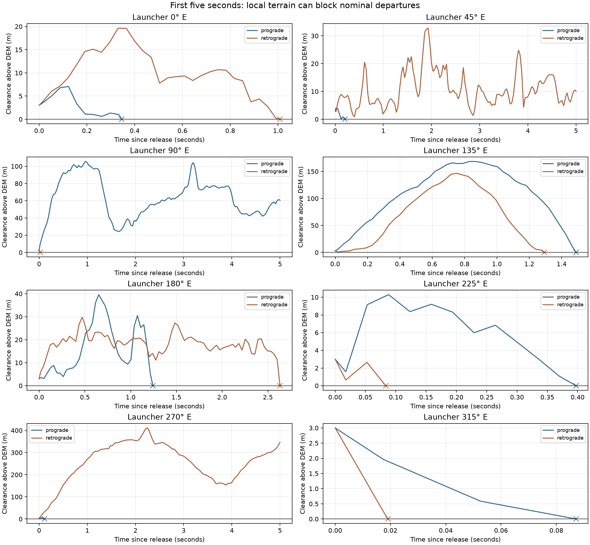
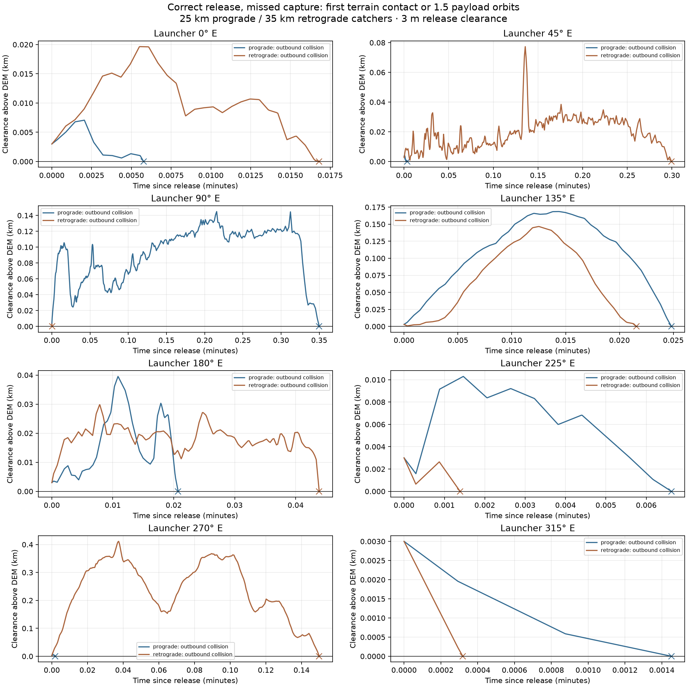

# Preserved initial eight-longitude demonstration

This is the first 25 km prograde / 35 km retrograde catcher demonstration,
before the 1-degree longitude sweep. Its eight sampled longitudes all produced
outbound terrain collisions. They were not usable launch sites, but the plots
show how sharply local terrain affects a 3 m release clearance.

The original outputs are preserved in `../demo_results/`. The sweep uses a
separate results directory and does not overwrite these files.

- [Original report and all impact coordinates](../demo_results/README.md)
- [Original numerical results](../demo_results/results.json)
- [First-five-seconds plot — PNG](../demo_results/departure_clearance.png) /
  [SVG](../demo_results/departure_clearance.svg)
- [Full pre-impact histories — PNG](../demo_results/clearance_cases.png) /
  [SVG](../demo_results/clearance_cases.svg)

