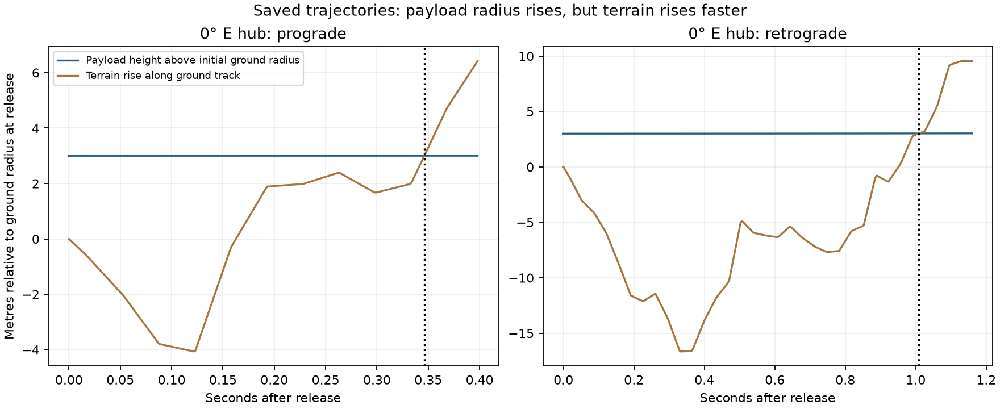

# Why the saved terrain trajectories struck the ground

**The saved initial velocity vectors do not launch downward: all 720 start at
periapsis.** The audit found no initial-radial-velocity error. It identifies
terrain rising into an extremely shallow outgoing trajectory in the inspected
examples. This is a model diagnosis, not confirmation that the real surveyed
locations are unusable.

## What was checked

[audit.py](audit.py) reads the saved 360-site sweep, checks that its source-code
hashes still match, and independently reconstructs radial speed and periapsis
from every release state's Cartesian position and velocity. It does not rerun
the sweep or change its outputs. Across all 720 states:

- Initial radial speed is exactly zero in the implemented Cartesian arithmetic.
- Periapsis reconstructed from angular momentum and the eccentricity vector
  matches release radius within **9.4 × 10⁻¹⁰ m**.
- Release speed exceeds local circular speed in every case, so zero radial
  velocity means periapsis, not apoapsis.

These tiny residuals describe numerical agreement, not physical accuracy.
Independent Cartesian integration also reproduces radial position at the saved
first impacts for both arms at the 0° E hub.

## An explicit example: ground rises while payload rises

| Saved 0° E hub case | Prograde | Retrograde |
| --- | ---: | ---: |
| Time to first impact | 0.346126 s | 1.008565 s |
| Ground-track distance **from release** | 584.49 m | 1,717.47 m |
| Payload's increase in Moon-centered radius | 0.001442 m | 0.017048 m |
| Terrain elevation increase along its path | 3.001442 m | 3.017048 m |
| Average rise angle over that distance | 0.2942° | 0.1007° |

The difference is exactly the starting 3 m clearance. The previously reported
roughly 5.8–6.1 km distances in these examples were **distances from the hub**;
they included the long sling arm and were not distances traveled after release.



At release the prograde radial acceleration is only **0.02407 m/s²**. Gravity
and the curvature-related v²/r term almost cancel:

```text
r_double_dot = v²/r − mu/r²       [zero radial speed at release]
radial_rise ≈ 0.5 r_double_dot t²
clearance(t) = 3 m + radial_rise(t) − terrain_rise(t)
```

Although the payload travels about 1.7 km each second, it gains only millimetres
to centimetres of radial height in the first second. A gentle rise of terrain
can therefore consume the clearance. A low-apoapsis orbit rises more slowly
near periapsis, so keeping a low apoapsis does not solve this departure problem.

## Which assumptions deserve reconsideration?

1. **The terrain sweep imposed 3 m above the DEM at each individual release
   point.** It did not inherit the installed tower height, cable drop and tip
   positions from a complete launcher placed on actual ground. Nor did it
   enforce a common rotation plane for the two independently terrain-adjusted
   endpoints. Its 3 m endpoint constraint cannot stand in for buildable site
   geometry or the full cable's clearance.
2. **Horizontal meant tangent to a Moon-centered sphere at release.** It did
   not mean tangent to the sloping terrain. If the intended launch orientation
   follows an uphill local slope, that is a different initial velocity with
   outward radial motion; it must be targeted and checked separately. Such a
   change is not an existing numerical correction to these saved states.
3. **The comparison sphere matters.** Some sites lie below the nominal reference
   radius. Flattening terrain for a control must use a concentric sphere at the
   release-ground radius, or reset the release consistently. Simply replacing
   the DEM by the nominal reference sphere while retaining the old state can
   put the starting point underground. On a concentric sphere at each site's
   own release-ground radius, these periapsis states stay at least 3 m clear.
4. **Three metres is a fragile clearance assumption for this DEM.** Existing
   source notes put typical vertical uncertainty around 3–4 m. Bilinear
   interpolation and unresolved terrain also affect very low clearances. The
   audit establishes what the stored model did, not the true first obstruction
   or a reliable engineering margin for an actual site.

The audit does not demonstrate that 10 m clearance, graded terrain or a different
release orientation would make both directions viable. It also does not establish
that all sites are hopeless: nine of the saved 720 departures cleared outbound.
The entire terrain sweep remains paused; no revised site survey was run.

## Reproduce and navigate

From the repository root, with the previously cached terrain corridor present:

```bash
MPLCONFIGDIR=/tmp/lunar-sling-mpl-cache .env/hub/bin/python -m llo_catcher.analysis.terrain.results.release_audit.audit
```

- [Exact audit numbers](results.json) and [vector figure](first_impact.svg).
- [Saved sweep](../sweep_1deg/README.md): original 360-site results.
- [Terrain source and limitations](../../README.md).
- [Accepted spherical launch optimum](../../../heading_optimization/RESULT.md):
  a separate geometry result, not a revised terrain-clearance result.
