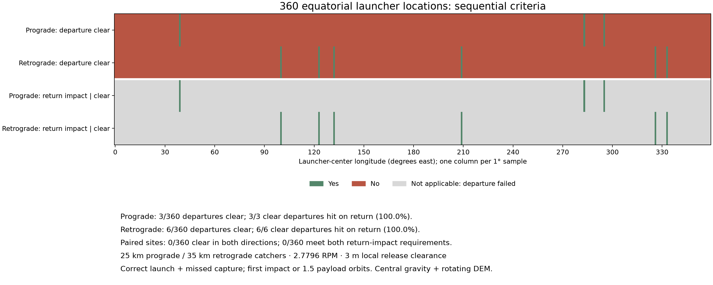
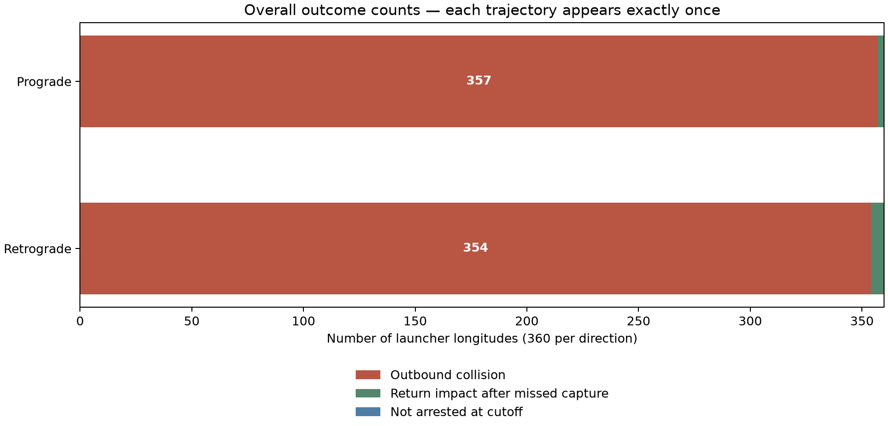

# One-degree equatorial missed-capture sweep

**360 hub longitudes, 0–359° E, with two trajectories each: 720 total.** All other inputs match the preserved eight-site demo. This is a uniform longitude grid, not every possible site.

## Sequential statistics

Departure success means the entire trajectory is terrain-clear up to its intended catcher encounter. Only then is return arrest evaluated. A return success means first terrain contact after missed capture and before 1.5 payload orbital periods. `Not arrested` means no contact by that cutoff; later fate is outside scope.

| Quantity | Prograde | Retrograde |
| --- | ---: | ---: |
| Total sites | 360 | 360 |
| Outbound collision | 357 | 354 |
| Departure clear | 3 | 6 |
| Return impact, conditional on clear departure | 3 | 6 |
| Not arrested at cutoff, conditional on clear departure | 0 | 0 |
| Departure-clear percentage of all 360 sites | 0.83% | 1.67% |
| Return-impact percentage of clear departures | 100.00% | 100.00% |

**Both directions clear:** 0/360 sites. **Both directions clear and both hit after missed capture:** 0/360 sites.



Green = criterion met; red = not met. Gray return cells mean the departure failed, so the conditional return criterion is not applicable. Each column is one longitude. A gray return cell is not a surviving orbit or a failed return arrest.



## Longitudes for follow-up

- **Prograde clear departures:** 39° E, 283° E, 295° E.
- **Prograde return impacts after missed capture:** 39° E, 283° E, 295° E.
- **Prograde not arrested at cutoff:** None.
- **Retrograde clear departures:** 100° E, 123° E, 132° E, 209° E, 326° E, 333° E.
- **Retrograde return impacts after missed capture:** 100° E, 123° E, 132° E, 209° E, 326° E, 333° E.
- **Retrograde not arrested at cutoff:** None.

**Paired clear longitudes:** None.
**Paired arrest longitudes:** None.

## Model, refinement and preservation

Catcher targets are 25 km prograde and 35 km retrograde, circular and equatorial above the 1,737.4 km DEM sphere. The common rate is 2.7796279 RPM; each arm radius is solved for its first equator-node intercept. Each east/west horizontal release is 3 m above its own local terrain, with zero payout velocity. The two-body Kepler trajectory is evaluated against the uniformly rotating, bilinearly interpolated SLDEM2015 corridor.

Terrain search skips only intervals proven above the maximum elevation anywhere in the downloaded corridor. It uses analytic orbital altitude bounds, not a coarser DEM. Each trajectory is checked at 0.5 m and 0.25 m spatial sampling near possible contact; classifications must agree and contact times must agree within 0.001 s. Detailed per-case refinement differences are in the JSON/CSV.

The earlier 20 m/10 m demo trials missed one shallow intersection, so the broad sweep retains the finer search. Finite sampling is not a proof about every grazing contact. Grid spacing (~59 m) and typical vertical uncertainty (~3–4 m) limit physical interpretation of the 3 m clearance. Gravity harmonics, libration, release errors, site grading and detailed launcher/cable clearance are not modeled.

No extra longitudes, altered clearance heights or redesigned launches were added to this sweep. The [initial demo snapshot](../INITIAL_DEMO.md) and all six original report/data/figure files were checked by SHA-256 before and after this run and remain unchanged.

## Data and reproduction

- [Full per-case states and outcomes](results.json)
- [720-row trajectory table](trajectories.csv)
- [Summary counts and longitude lists](summary.json)
- [Criteria chart SVG](criteria_by_longitude.svg)
- [Overall-count chart SVG](overall_counts.svg)
- [Data sources and coordinate conventions](../../README.md)

```bash
MPLCONFIGDIR=/tmp/lunar-sling-mpl-cache .env/hub/bin/python -m llo_catcher.analysis.terrain.sweep_equator
```

Raw terrain remains in the ignored local cache; the small results and figures are retained in this directory. The JSON includes source-code and terrain-manifest hashes.
