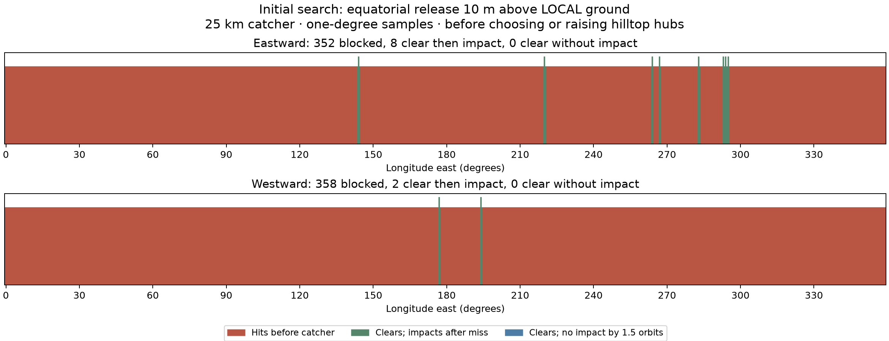

# Height-reference correction and first nine candidate hubs

[Broader LLO catcher topic](../README.md).

**Height-reference correction:** the old summit follow-up forced release to
10 m above the terrain at the equatorial tip. That could put the horizontal
tether plane hundreds of metres *below the summit hub*. It did not represent
an installation whose plane is set above the summit. The earlier statement that
only E-S4 could launch eastward therefore does not apply to that installation.

This page is the canonical reading order for the blog. Original calculations
remain in `analysis/` so scripts and historical links continue working; this
subfolder contains the current synthesis, height audit, outcome figure and
updated footprint maps.

## Blog figures and tables, in order

1. **[Elevation against longitude](../analysis/single_equatorial_release/equatorial_elevation.png)**
   ([SVG](../analysis/single_equatorial_release/equatorial_elevation.svg)):
   the full equator, with eastward and westward clear release seeds.
   [Detailed corridor views](../analysis/single_equatorial_release/equatorial_elevation_detail.png)
   distinguish direction and show the refined bands.
2. **[Search outcomes: red / green / blue](search_outcomes.png)**
   ([SVG](search_outcomes.svg)): the initial 360-longitude survey in each
   direction at 10 m above **local release ground**. Red hits before capture;
   green reaches the catcher then impacts after a miss; blue survives the
   1.5-orbit horizon. There are no blue cases at this height. This figure is
   intentionally the initial screen, before summit placement and raising the plane.
3. **[Candidate table with the corrected height reference](#hub-relative-height-diagnostic)**:
   coordinates, release height, each direction's result, and full-circle clearance.
   These are conditional candidates, not engineered installations.
4. **[Terrain-map gallery](maps/README.md)**: hub, track inset, tether circle and
   equatorial release point, with **no impact overlays**. These maps use the
   hub-relative diagnostic below, rather than the old below-hub plane.



## What −119.2 m actually meant

Two different plotted quantities were easy to confuse:

- **Terrain relative to hub:** `terrain elevation − hub elevation`. A negative
  number (blue on the maps) means the terrain is below the hub.
- **Tether-plane clearance:** `plane height − terrain height projected along
  the hub vertical`. A negative number means the terrain protrudes above the
  assumed plane. Positive means the plane is above terrain.

E-S4's old **−119.2 m** was the second quantity. The old plane was actually
**291.6 m below hub ground**, because it was anchored 10 m above much lower
terrain at the equatorial tip. It was not evidence that a plane above the summit
would collide by 119 m.

Using the go-kart tip height plus 0.5 m, **1.3768 m above the summit tangent
plane**, gives E-S4 about **303.0 m release clearance above local ground**
and **173.7 m minimum tip-circle clearance**. Its eastward shot reaches the catcher
and impacts after a missed capture. This is a changed geometry calculation,
not a reinterpretation of the old negative number.

## Hub-relative height diagnostic

This audit reuses the nine existing candidate coordinates. It does **not** rerun
or optimize hilltop selection. Use the go-kart fully deployed tip centerline height **0.8768157 m**,
plus the requested **0.5 m**, giving an ideal horizontal tip plane
**1.3768157 m above the hub tangent plane**. This replaces the earlier
10 m-above-hub diagnostic. Keep release exactly on the equator and on the hub's
meridian, allowing the radius to follow the actual hub latitude. Retarget each
direction independently to the same 25 km circular catcher. Stop at first impact
or 1.5 periods. Two-body gravity, rotating Moon and the same DEM are retained.

**All six east-search candidates now clear eastward; all three west-search
candidates clear westward. All nine intended-direction missed shots impact
before the cutoff. Reverse-direction shots remain blocked.** Eight also have
positive minimum clearance around the ideal horizontal tip circle. E-N1 does
not: its 6.6 km radius reaches beyond the 5 km hilltop-screen disk and encounters
higher terrain. This is a separate geometry limit to address.

“Clears + impact” below means reaching the catcher, then impacting if capture
fails. “Blocked” means collision before capture. Positive circle clearance is
only for the ideal circumference, not a simulated sagging tether or entire
rotating structure.

| Candidate | Hub latitude (°) | Hub longitude (°) | Release above local ground (m) | East | West | Min. tip-circle clearance (m) |
| --- | ---: | ---: | ---: | --- | --- | ---: |
| E-S1 | -0.196289 | 144.176758 | 424.8 | Clears + impact | Blocked | +150.3 |
| E-S2 | -0.176758 | -92.922852 | 583.5 | Clears + impact | Blocked | +137.3 |
| E-S3 | -0.194336 | -77.116211 | 303.3 | Clears + impact | Blocked | +188.0 |
| E-N1 | 0.217773 | -66.249023 | 613.3 | Clears + impact | Blocked | -132.1 |
| E-S4 | -0.155273 | -65.852539 | 303.0 | Clears + impact | Blocked | +173.7 |
| E-N2 | 0.129883 | -64.047852 | 363.2 | Clears + impact | Blocked | +131.9 |
| W-S1 | -0.208008 | -166.678711 | 2242.3 | Blocked | Clears + impact | +394.5 |
| W-N1 | 0.141602 | -166.571289 | 1247.6 | Blocked | Clears + impact | +50.7 |
| W-S2 | -0.186523 | -165.692383 | 343.9 | Blocked | Clears + impact | +227.5 |

[Numeric audit CSV](height_audit.csv) · [Audit JSON](height_audit.json) ·
[Calculation](audit_height.py) · [Validation](height_validation.json).
Coordinates are signed decimal degrees, positive north/east. E-/W- identify the
search direction; N/S identify the hub's side of the equator.

The tip height comes from the saved [go-kart scene inputs](../../sling_launcher/blender/scene_inputs.json),
consistent with the [design-at-a-glance description](../../sling_launcher/publication/DESIGN_AT_A_GLANCE.md#how-much-does-the-outward-tether-droop).
It is the loaded **tip centerline**, not the pole apex or the cable's underside.
The existing droop is already represented in that endpoint height; it should not
be subtracted a second time. This remains a tip-circle/ballistic approximation,
not a full sagging-rope terrain or structural calculation.
No claim is made that a kilometre of lateral displacement is always harmless:
terrain can change over much shorter distances. The important correction is
that the release altitude must follow the installation geometry rather than
being reset to 10 m local clearance after every move.

## Geometry and evidence

Let `R` be the reference radius, `z_h` the summit elevation, `phi` the hub latitude,
and `Z = R + z_h + 1.3768157 m` the plane's axial height. For release at the equator:

```
release radius = Z / cos(phi)
arm radius = Z * abs(tan(phi))
local release clearance = release radius − R − terrain_at_equator
                        = 1.3768157 m + curvature + (z_h − terrain_at_equator)
curvature = Z * (1/cos(phi) − 1)
```

At the original roughly 5.787 km arm radius, the reference 10.51 m spherical-ground
clearance becomes about **11.01 m after adding 0.5 m**. A fixed 10.5 m baseline
plus terrain elevation difference is a useful approximation, but the actual
curvature contribution changes with each site's arm radius. The CSV records
curvature and terrain elevation difference separately. This site study uses
the DEM's 1,737.4 km reference radius; the original illustration uses 1,738.1 km,
a difference of only a few millimetres in curvature at the reference arm radius.

The old calculation instead set `release radius = R + terrain_at_equator + 10 m`
and inferred `Z = release radius * cos(phi)`. That is why a summit did not provide
the expected benefit. North/south summit movement changes arm radius here; moving
to a different summit longitude also changes the departure terrain profile.

The circle check projects the interpolated terrain rim onto the hub vertical,
using 36,000 bearings. A positive value is encouraging but not a full tether
clearance certificate. Terrain resolution is approximately 59 m, and real survey
uncertainty and gravity anomalies remain outside this model.

## Supporting work and historical results

- [Initial equatorial survey](../analysis/single_equatorial_release/README.md):
  launch-height sensitivity and the original elevation data. Its 50%-clearance
  red/green/blue graph uses **2,310.7 m**, not the 10 m used by the blog figure above.
- [Eastward corridor refinement](../analysis/single_equatorial_release/local_corridors/README.md):
  49 locally refined missed-capture-safe intervals; the 144° terrain/orbit explanation.
- [Westward search and old local-height tables](../analysis/single_equatorial_release/directional_sites/README.md):
  separate westward search, 12 outbound-clear intervals and retained candidate coordinates.
  Its trajectory classifications apply to the old 10 m above local release ground.
- [Original hilltop search](../analysis/single_equatorial_release/summit_sites/README.md):
  5 km terrain-rise screen and ±2 km hub-latitude search allowance.
- [Historical six-hub maps](../analysis/single_equatorial_release/summit_sites/maps/README.md):
  the earlier opposite-tip impact geometry; not the corrected map gallery above.
- [Historical opposite-tip study](../analysis/single_equatorial_release/summit_sites/missed_capture/README.md):
  the second off-equator payload and 35 km catch target. This has not been recomputed
  with the hub-relative plane and must not be mixed with the current table.

Reproduce from the repository root:

```bash
MPLCONFIGDIR=/tmp/lunar-sling-mpl-cache OPENBLAS_NUM_THREADS=1 .env/hub/bin/python -m llo_catcher.site_selection.audit_height
MPLCONFIGDIR=/tmp/lunar-sling-mpl-cache OPENBLAS_NUM_THREADS=1 .env/hub/bin/python -m llo_catcher.site_selection.build_figures
```
