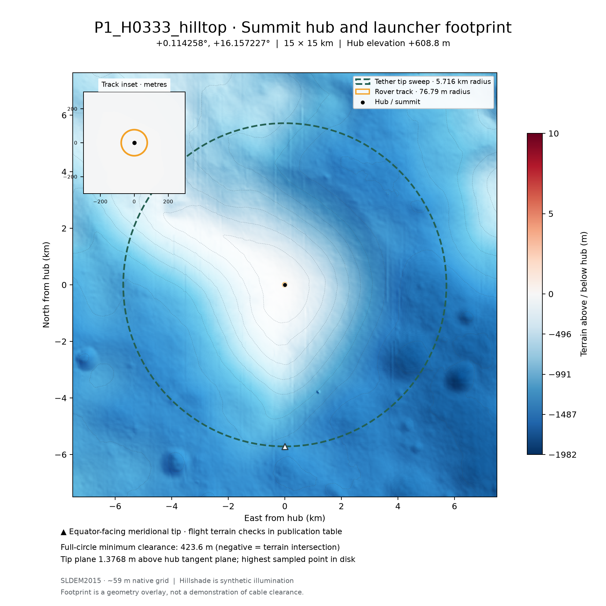
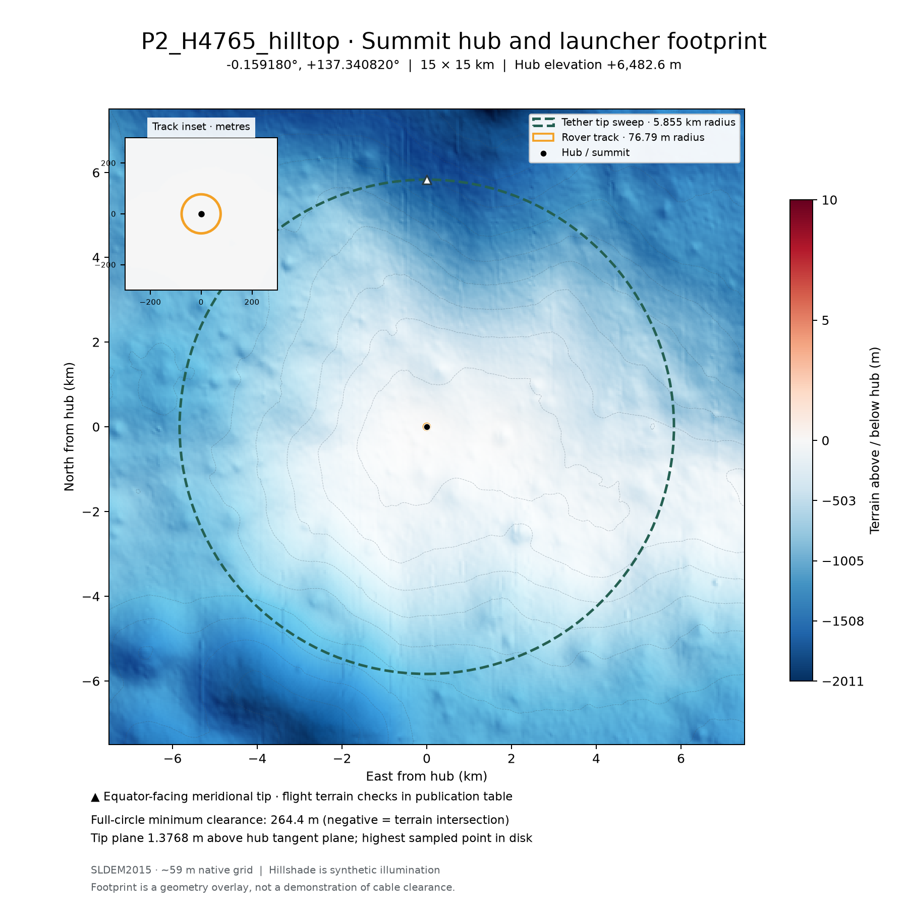
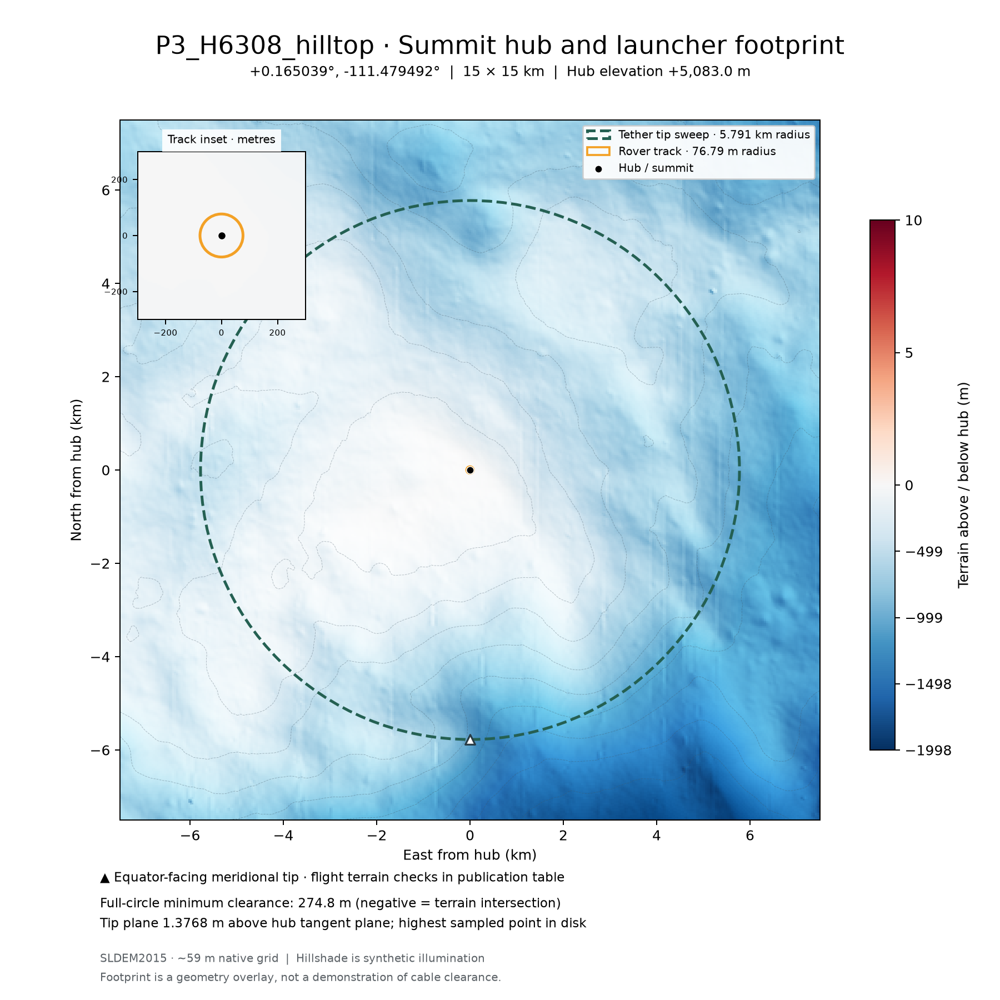
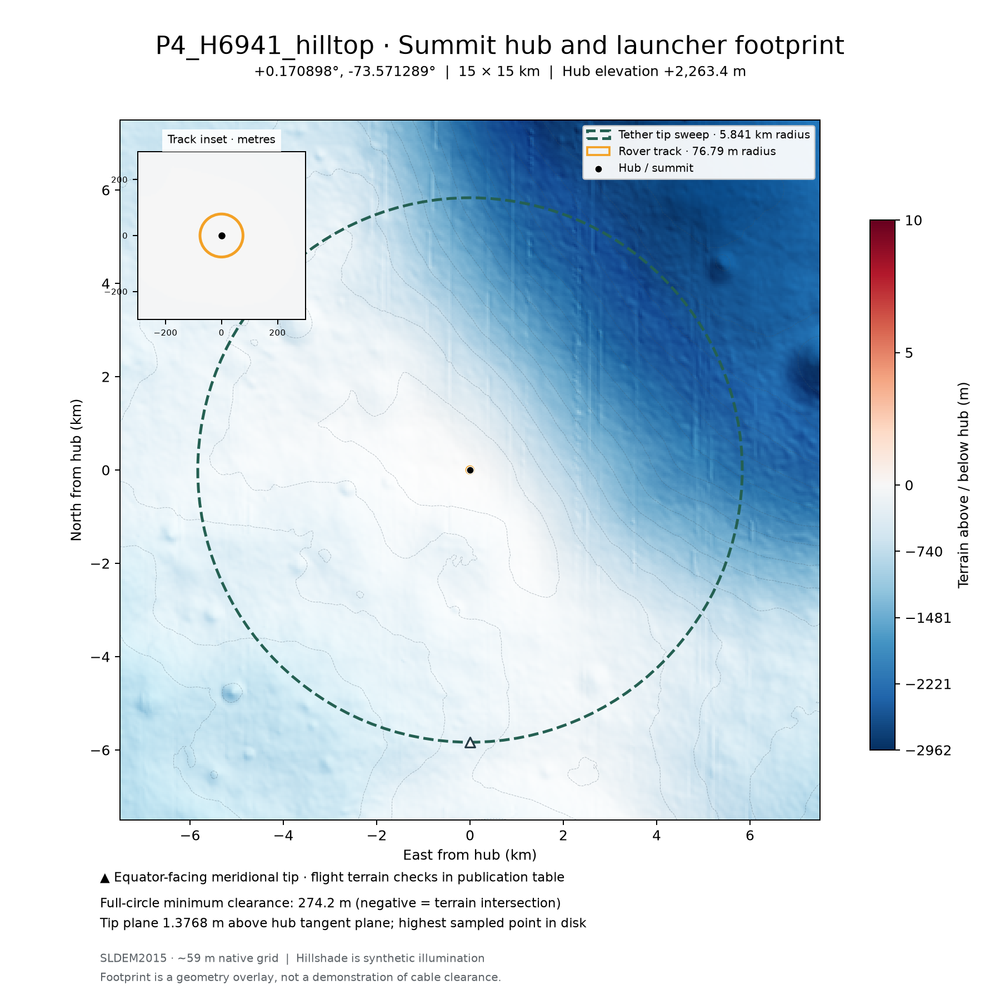

# Adjusted hilltop terrain maps

[Publication table and flight checks](../PUBLICATION.md) · [Coordinates and method](../README.md). Black dot: hilltop hub; orange circle: rover track; dashed green circle: tip sweep; white triangle: equator-facing meridional tip. Terrain colors are relative to the new summit elevation.

## P1_H0333_hilltop

[SVG](P1_H0333_hilltop_15km.svg) · [PNG](P1_H0333_hilltop_15km.png)

## P2_H4765_hilltop

[SVG](P2_H4765_hilltop_15km.svg) · [PNG](P2_H4765_hilltop_15km.png)

## P3_H6308_hilltop

[SVG](P3_H6308_hilltop_15km.svg) · [PNG](P3_H6308_hilltop_15km.png)

## P4_H6941_hilltop

[SVG](P4_H6941_hilltop_15km.svg) · [PNG](P4_H6941_hilltop_15km.png)
