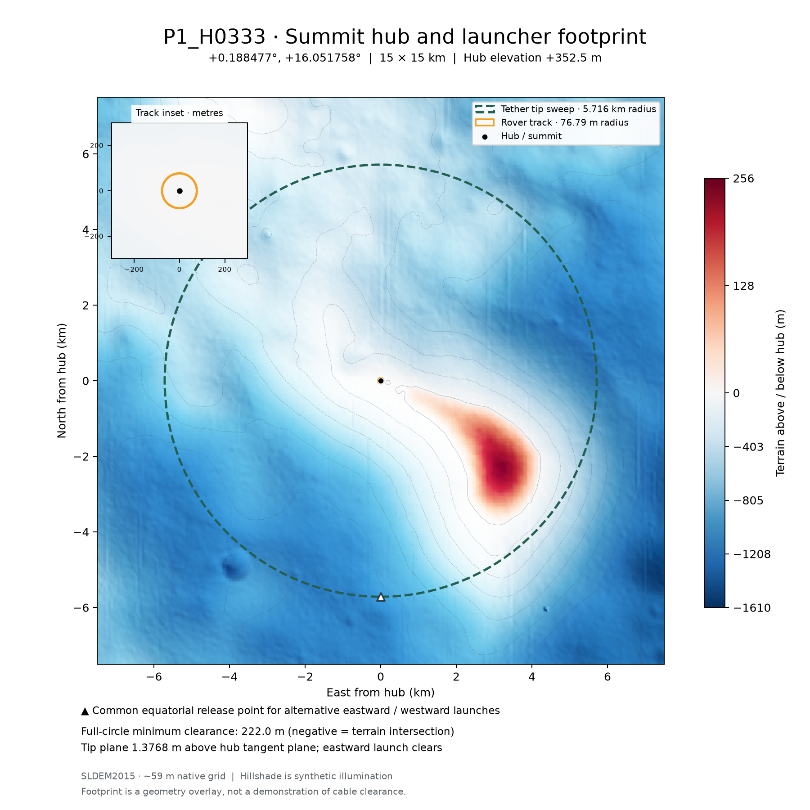
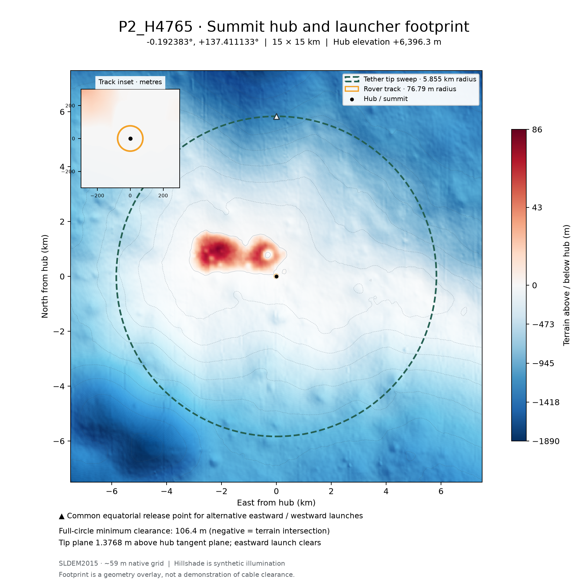
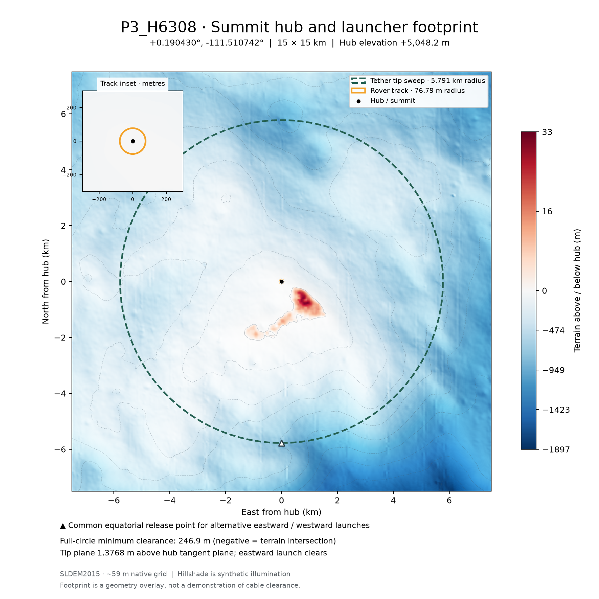
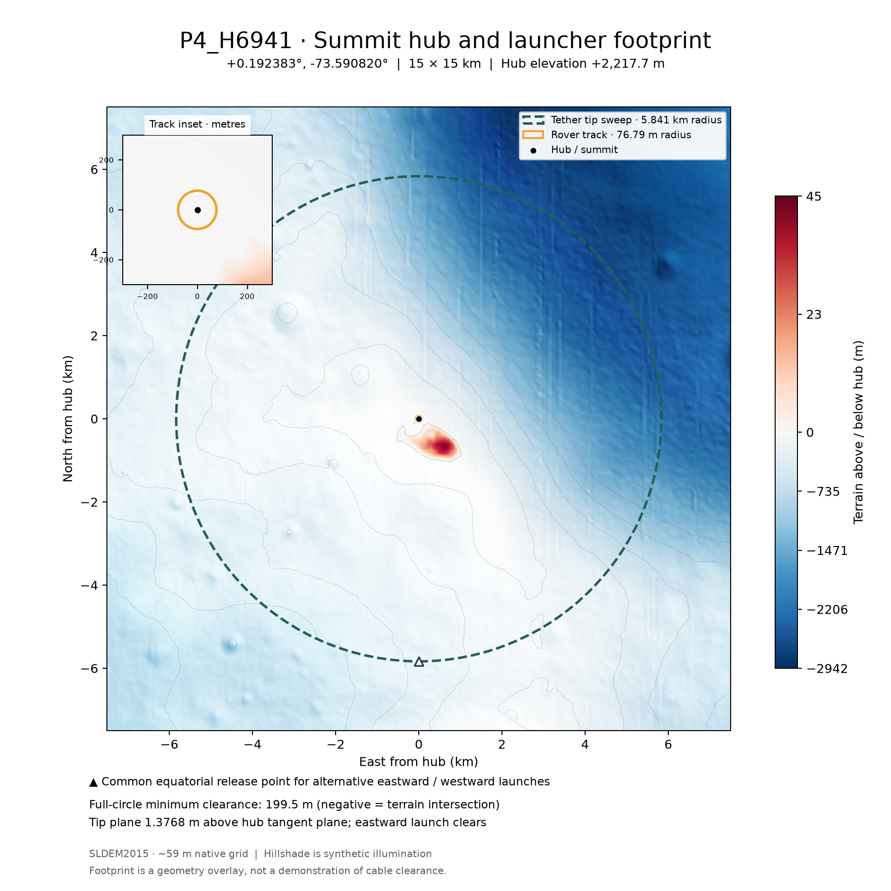

# Four featured east-launching hub maps

[Selection table and assumptions](../README.md). No impact overlays.

## P1 — H0333

[SVG](P1_H0333_15km.svg)

## P2 — H4765

[SVG](P2_H4765_15km.svg)

## P3 — H6308

[SVG](P3_H6308_15km.svg)

## P4 — H6941

[SVG](P4_H6941_15km.svg)

