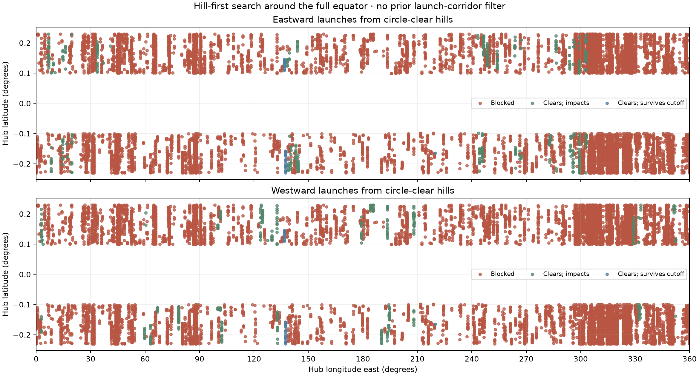

# Historical raw-peak and 7 km-spacing report

**Superseded for everyday use by the [non-overlapping catalog](README.md).** The 7 km subset did not exclude overlapping sweeps.

# Global hill-first equatorial launcher search

[Site-selection guide](../README.md). **Second pass, November 9, 2026.**
This search covers every longitude before testing any launch trajectory. It does
not use the previous 10 m-clearance release corridors to select neighborhoods.

## Results and counting rule

- **403,002 native-grid local peaks** were examined in the north/south hub bands.
- **17,572 candidate peak locations** clear the sampled complete tip circle.
- **793 locations** remain in a reproducible subset separated by at least 7 km.

A “peak” is a local maximum of the DEM's 3×3 native-pixel neighborhood, with
adjacent equal-height ties suppressed deterministically. Several small peaks
can lie on the same physical hill. The all-candidates table keeps every passing
peak; the 7 km subset is a practical installation-spacing count, not a geological
count of named hills. It is ranked by tip-circle clearance, independently of
launch outcomes, then greedily spaced. It is not a maximum-packing optimization.

| Outcome | All circle-clear peaks | 7 km spaced subset |
| --- | ---: | ---: |
| Total candidates | 17572 | 793 |
| Eastward clears to catcher | 502 | 54 |
| Westward clears to catcher | 412 | 45 |
| At least one direction clears | 881 | 96 |
| At least one direction clears then impacts after miss | 848 | 93 |
| Both directions clear then impact after miss | 0 | 0 |
| Both directions clear | 33 | 3 |
| Neither direction clears | 16691 | 697 |
| East: clears then impacts after miss | 469 | 51 |
| East: clears and survives 1.5-orbit cutoff | 33 | 3 |
| West: clears then impacts after miss | 379 | 42 |
| West: clears and survives 1.5-orbit cutoff | 33 | 3 |

The east and west counts overlap when both clear. Surviving the cutoff is not a
claim of permanent orbit. Departure failure and impact after a missed capture
are distinct outcomes. Each launch is independently aimed at a 25 km equatorial
circular catcher; “both” does not establish simultaneous opposite-tip operation.



## All candidate hills

- **[Launch-capable spaced shortlist](SPACED_LAUNCHABLE.md)**: the 96 selected hubs
  clearing at least one direction (use the generated table count if rerunning inputs).
- **[Complete readable table](ALL_CANDIDATES.md)**: every circle-clear peak, both
  launch outcomes and the 7 km selection flag.
- **[Complete CSV](all_candidate_hills.csv)**: signed floating-point coordinates,
  tip-circle clearance, release height, arm radius, catch-relative speed and
  impact time/longitude for each direction.
- **[Spaced subset CSV](spaced_candidate_hills.csv)**: same columns for the practical
  7 km subset; all rejected/nearby candidates remain in the full table.
- [Results and per-sector counts](results.json) · [Validation](validation.json) ·
  [Terrain/source provenance](manifest.json).

## Geometry and scope

All 360° of longitude are searched at native DEM resolution, including tile seams.
The hub band retains the prior **3–7 km arm range** (nominal 5 km ±2 km), on both
sides of the equator. It is not restricted by any initial launch-clearance test.
This is global in longitude, not a search over all lunar latitudes or arbitrary
launcher sizes. Sampling is approximately 59 m; subpixel summits are not resolved.

The go-kart loaded tip centerline is **0.8768157 m above the hub tangent plane**.
Adding the requested 0.5 m gives **1.3768157 m**. A horizontal ideal tip circle
at this offset intersects the equator on the hub meridian. Its radius and release
height follow from the hub latitude, elevation, curvature and local release terrain.
It is not reset to 10 m above the release ground. No artificial terrain preparation
or plane lifting is added to rescue a rejected hill.

Each peak first receives a 360-bearing rim screen, then surviving candidates
receive 36,000 bearings (roughly 0.5–1.2 m arc spacing). Candidates within 1 m
of zero clearance are rechecked with 72,000 bearings; below 0.1 m they receive
144,000 bearings and must retain at least a 1 cm numerical clearance guard.
This excludes ambiguous grazing cases rather than claiming millimetre-scale
terrain accuracy. Terrain is interpolated
from SLDEM2015; these sample spacings do not improve its physical resolution.
The rim calculation uses the same horizontal-circle geometry as the preceding
audit. Both launch directions are then propagated with spherical inverse-square
gravity, lunar rotation and DEM contact, stopping at first contact or 1.5 periods.

The acceptance test is **tip-circle clearance**, as requested. It is not the
older requirement that a full 5 km disk stay within 10 m of summit elevation.
Neither test alone proves clearance of the entire drooping tether, poles, track
or moving payload envelope. The 1.3768 m offset refers to a centerline, not a
payload underside. DEM uncertainties and mascons are not modeled.

## Reproduction

The terrain cache now includes all eight 45° sectors in the ±0.484° summit band.
The new sectors supplement existing public-source strips; their recorded byte
ranges and hashes are included in the manifest. Calculations and downloads are
separate so rerunning the search does not require network access.

```bash
MPLCONFIGDIR=/tmp/lunar-sling-mpl-cache OPENBLAS_NUM_THREADS=1 .env/hub/bin/python -m llo_catcher.site_selection.global_hills.search
MPLCONFIGDIR=/tmp/lunar-sling-mpl-cache OPENBLAS_NUM_THREADS=1 .env/hub/bin/python -m llo_catcher.site_selection.global_hills.validate
MPLCONFIGDIR=/tmp/lunar-sling-mpl-cache .env/hub/bin/python -m llo_catcher.site_selection.global_hills.select_nonoverlap
MPLCONFIGDIR=/tmp/lunar-sling-mpl-cache .env/hub/bin/python -m llo_catcher.site_selection.global_hills.report
```

The current report command produces the new non-overlapping selection, not the archived raw scatter plot.
