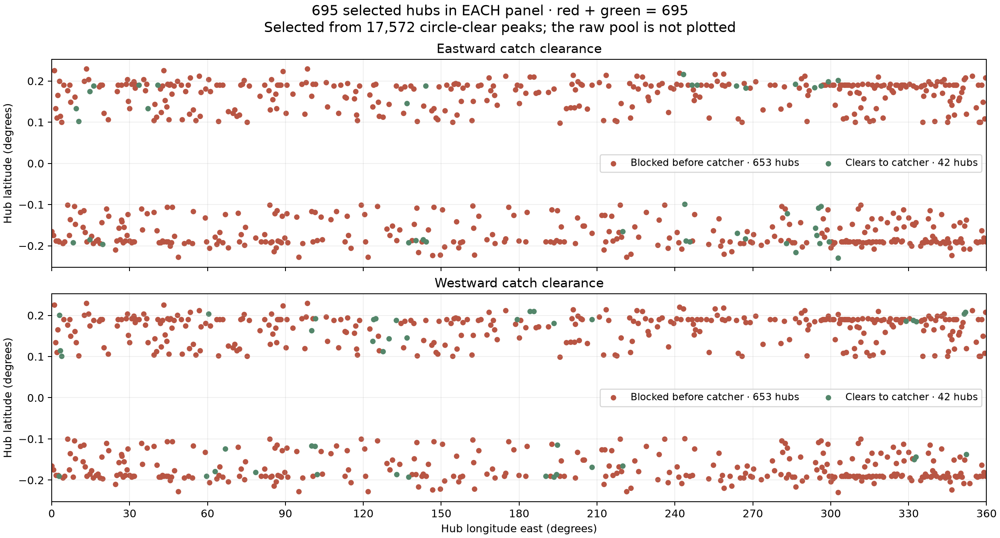

# Non-overlapping equatorial hub candidates

[Site-selection guide](../README.md). This is the default catalog and plotting
set. The raw peaks and old fixed-7-km selection are retained only in the
[archive](ARCHIVE.md); they are no longer the default analysis population.

**[Four featured hilltop sites and publication table](../featured_four/adjusted_hilltops/PUBLICATION.md)** give the subsequently adjusted summit placements and their new flight checks. The counts here describe the original global catalog, before those four local adjustments.

## Selection and counts

**695 hubs have non-overlapping projected tether-sweep disks.**
The exclusion uses both latitude and longitude, including longitude wraparound,
and each candidate's own arm radius. Two 6 km sweeps need approximately 12 km
between hubs, not the previous fixed 7 km.

### Search stages: what population is being counted?

| Stage | Locations | Meaning / appearance in the current graph |
| --- | ---: | --- |
| Candidate peaks whose tip circumference clears terrain | 17,572 | Initial pool, including many overlapping sweeps; **not plotted** |
| Select non-overlapping sweep disks, prioritizing equatorial alignment | 695 | **All dots in each panel**, red and green together |
| Of those selected hubs, launch clears in at least one direction | 81 | Green in one or both panels; not a separate plotted population |

The 17,572 count is candidate peak locations, not 17,572 independent installation
sites. Selecting 695 removes overlapping footprints; it does **not** select for
successful launches. A clear rotating tip circle and a clear outbound flight
path are different tests.

### Launch outcomes within the 695 selected hubs

These four categories are mutually exclusive and add up to 695:

| Launch outcome | Hubs | East panel | West panel |
| --- | ---: | --- | --- |
| East clears; west hits terrain before catcher | 39 | Green | Red |
| West clears; east hits terrain before catcher | 39 | Red | Green |
| Both east and west clear to catcher | 3 | Green | Green |
| Both east and west hit terrain before catcher | 614 | Red | Red |
| **Total distinct hubs** | **695** | | |

The last outcome was previously called “Neither clears.” It means neither
**launch direction** clears; it does not mean the tether tip hits the ground.
It also does not describe what happens after a missed capture.

Eastward clearance totals 42 = 39 + 3; westward clearance totals
42 = 39 + 3. There are 81 distinct hubs with at least one clear direction,
not 84, because the 3 both-clear hubs occur in both directional totals.

**[Main candidate table](CANDIDATES.md)** · **[CSV](nonoverlap_candidates.csv)** ·
**[Launch-capable shortlist](LAUNCHABLE.md)** · [Selection data](nonoverlap_results.json).



**Figure reading guide:** each panel shows the same 695 hubs. The east panel
has 42 green dots and 653 red dots; the west panel has 42 green dots and
653 red dots. Red and green encode flight outcome only. The initial
17,572 candidates are absent from this graph. Markers can visually overlap.
The two panels contain 1390 plotted markers but only 695 distinct hubs.

**Suggested caption:** “Of 17,572 candidate peaks with terrain-clear tip
circumferences, 695 non-overlapping launcher footprints were selected. Each
panel shows these same hubs: green indicates an outbound launch clearing terrain
to the 25 km catcher, and red indicates a terrain collision before capture.
81 hubs clear at least one direction; 614 clear neither direction.”

The original dense plot showed all raw peaks, which explains its vertical
clustering. The old 793-site subset did use full two-coordinate hub separation,
but its 7 km distance was insufficient to exclude overlapping variable-radius
sweeps. This selection replaces that rule and regenerates the default plots.

## Preference for an equatorial tip

Existing trajectories adjust each arm radius to reach the equator exactly; all
selected candidates therefore have zero ideal equatorial offset **at their
modeled arm radius**. That alone cannot rank them.

To apply the requested preference, rank by how close the **original go-kart arm
of 5787.088 m** would place the tip to the equator at that hub.
The candidate with the smallest reference-arm miss is considered first; greater
terrain clearance breaks ties. Keep it if its sweep does not overlap a previously
chosen sweep. Launch outcomes do not influence this ranking. The CSV reports
the reference-arm miss; actual trajectories retain their tested individual arm
radii and are not silently recomputed with the reference arm.

This is a deterministic greedy selection, not an optimization of maximum site
count or throughput. It spans all longitudes and retains the prior 3–7 km arm
range. No launch-corridor prefilter is used.

## Non-overlap geometry and validation

A ground-projected sweep fits inside a spherical cap centered on the hub, with
angular radius `asin(arm_radius / minimum_terrain_radius)`. The minimum terrain
elevation across the cached equatorial band is **-4080.488 m**;
using it for every cap conservatively encloses the projected circles despite
terrain-height variations. Require center angular separation to exceed the sum
of both cap radii. This excludes overlap of the disks, not only crossing of
their circumferences, and does not rely on vertical separation between machines.

Every selected pair was independently checked using haversine angular distance.
The smallest gap between these conservative cap boundaries is
**0.124 m**. No additional engineering spacing margin
has been imposed; this is geometric non-overlap in the DEM model, not a surveyed
installation-clearance guarantee.

The stored tip-circle and trajectory calculations are reused unchanged. Their
[validation](validation.json) includes independent contact propagation and recovery
of earlier sites. No new orbit integrations were needed to change selection.

## Interpretation of the missed-capture result

**User conclusion recorded, November 9, 2026:** the finding that candidates
clearing both directions survive the 1.5-orbit cutoff is theoretically expected;
the requested 1.5-orbit simulation was unnecessary for the intended selection
argument. It is no longer used as a selection or ranking criterion. Existing
return results are retained as historical checks, not presented as a new surprise.

For the ideal nonrotating, spherical-gravity geometry, reversing the periapsis
velocity traverses the opposite half of the same ellipse. Clearing outbound in
both directions therefore clears that ellipse's terrain crossings. The computed
model also rotates the Moon under the orbit, so exact ground-track time-reversal
symmetry is broken; this note records the intended ideal-model reasoning, not
a proof of permanent survival with rotation, gravity anomalies or perturbations.
No further 1.5-orbit runs are requested as part of this selection update.

The main plots and tables consequently emphasize **eastward/westward catch
clearance**. Historical return labels remain available in the CSV. Here the
3 two-direction candidates have no recorded impact in either
direction by the old cutoff; the remaining launch-capable candidates clear one
direction and have a historical return impact in that direction.

## Reproduction and archive

```bash
MPLCONFIGDIR=/tmp/lunar-sling-mpl-cache OPENBLAS_NUM_THREADS=1 .env/hub/bin/python -m llo_catcher.site_selection.global_hills.select_nonoverlap
MPLCONFIGDIR=/tmp/lunar-sling-mpl-cache .env/hub/bin/python -m llo_catcher.site_selection.global_hills.report
```

The selection reads the raw saved candidates once to choose representatives.
Default plots and summaries read only `nonoverlap_results.json`.
[Archived raw-peak search and old 7 km subset](ARCHIVE.md) retain the original
search method, complete data, counts, diagrams and reproduction instructions.
