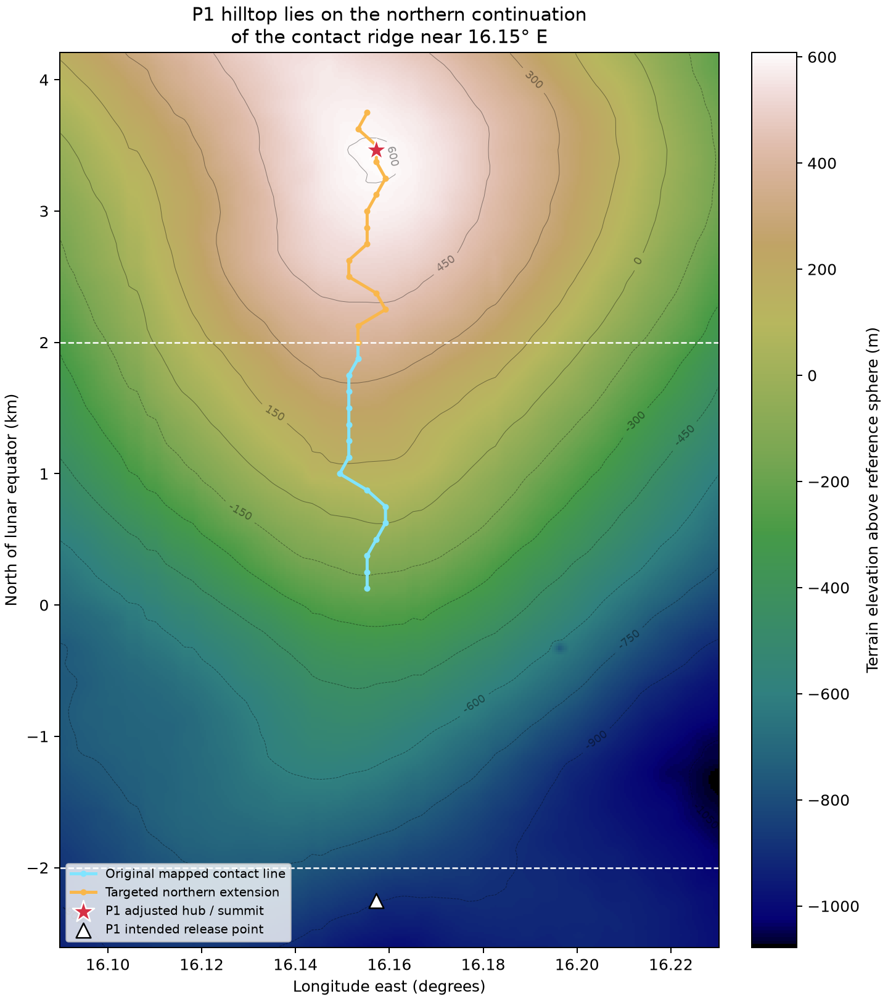

# Earlier comparison: the original regional ridge map

**Superseded by the [expanded search covering all four sites](expanded/README.md).** The coverage limitations below describe the first regional experiment.

[Launch-ridge investigation](README.md) · [Four adjusted sites and flight checks](../featured_four/adjusted_hilltops/PUBLICATION.md).

**P1 does: a small northward extension of the mapped contact ridge reaches its summit. P2–P4 are outside the regional search and cannot be assigned to any of its six groups.** The six groups are not a comprehensive lunar ridge inventory, nor formally named geological ridges.

| Site | Hub latitude | Hub longitude (signed east) | Relationship to the regional ridge map |
|---|---:|---:|---|
| P1 | +0.11425781 | +16.15722656 | On the northern continuation of the **16.15° E contact ridge** (second terrain panel) |
| P2 | −0.15917969 | +137.34082031 | Outside the searched longitude region; ridge association undetermined |
| P3 | +0.16503906 | −111.47949219 | Outside the searched longitude region; ridge association undetermined |
| P4 | +0.17089844 | −73.57128906 | Outside the searched longitude region; ridge association undetermined |

## P1: a direct numerical match after extending the latitude band

The original seed band extended only 2 km north and south of the equator. P1's **hub is 3.465 km north**, so the existing line could not literally contain the summit. The closest original contact sample was about **1.470 km** from the hub, near the northern edge of that band. Longitude agreement alone was insufficient to claim a match.

We repeated the same eastward, fixed-25-km-apoapsis height-envelope calculation using the **15° E seed meridian**, extending the seed band north from 2.0 to 3.75 km at 125 m intervals, plus a seed at P1's exact hub latitude. The contact line continues onto the P1 hilltop. The latter seed produces a contact at:

- Latitude **+0.11423438°**, longitude **+16.15722655°**.
- P1 hub: latitude **+0.11425781°**, longitude **+16.15722656°**.
- Surface separation: **0.71 m**, substantially below the roughly **59 m DEM grid spacing**.

This supports identifying P1 with the same topographic feature **at the resolution of this model**; it is not a claim of sub-metre geodetic accuracy. Contact points are calculated on the bilinearly interpolated DEM. The latitude changes slightly between seed and contact because the eastward trajectory follows an inclined orbital plane.



[SVG version](P1_ridge_match.svg). Cyan is the original line; orange is the targeted northern extension. The star is the adjusted summit hub. White dashed horizontal lines mark the original ±2 km band. This is a local extension of one existing contact family, not a new global survey.

## The hub and the launch point are different

The match above is to **P1's hub hilltop**. P1's intended payload release occurs about **2.250 km south of the equator**, roughly 5.7 km south of that hub. It is not on the traced 16.15° E contact segment. Its altitude is set by the elevated hub/tether geometry, so it need not sit directly above a terrain ridge to clear a launch.

All four adjusted hubs lie outside the original ±2 km release-search band: P1 is +3.465 km, P2 −4.827 km, P3 +5.005 km, and P4 +5.182 km from the equator. P2–P4's intended release points are within that latitude band, but their longitudes are outside this regional experiment. Therefore **“not mapped here” does not mean “not on a suitable ridge.”**

The original nine seed meridians were 12–24° E; their limiting terrain contacts fell between 14.53° and 38.59° E. P2, P3 and P4 are at 137.34°, 248.52° and 286.43° E respectively. Establishing comparable ridge identities there requires additional regional searches; no such identities are inferred from the six existing groups.

## Reproduction and data

- [Targeted comparison and closest-contact coordinates](featured_comparison.json).
- [P1 extension samples](P1_ridge_extension.csv).
- [Comparison and map generator](compare_featured.py).

Run from the repository root:

```bash
MPLCONFIGDIR=/tmp/lunar-sling-mpl-cache OPENBLAS_NUM_THREADS=1 .env/hub/bin/python -m llo_catcher.site_selection.launch_ridges.compare_featured
```

The original regional results and six-group maps are unchanged. This comparison does not change the four sites' previously calculated east/west flight outcomes.
