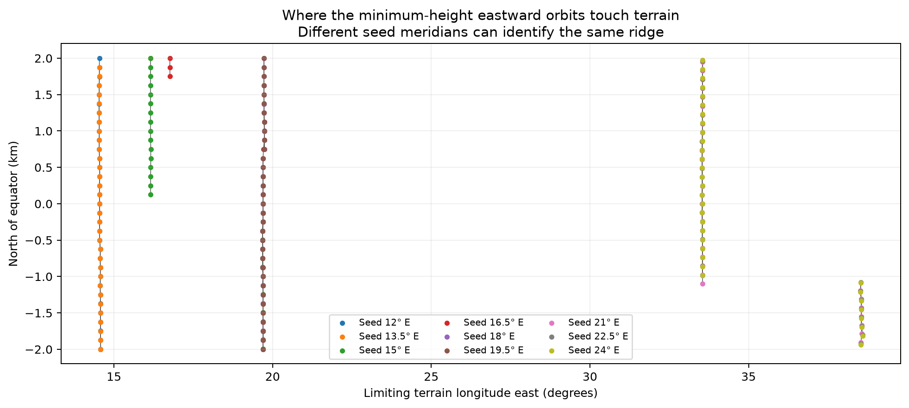

# Eastward launch ridges: a terrain-contact search

[Site-selection guide](../README.md).

**Question:** can we find launch ridges by raising an eastward, 25 km-apoapsis orbit until its last terrain obstruction disappears, instead of enumerating local hilltops?

**Initial result: yes, this produces coherent candidate contact lines.** Different starting meridians repeatedly identify the same narrow terrain features. Most sampled contacts also support a new horizontal launch with negligible added height. Some require additional height, reaching **225.6 m** in this initial sample. Each nominated contact therefore receives a fresh-launch clearance check.

The original demonstration below covers a regional seed grid. Its finite longitude coverage and sample spacing can miss qualifying ridges and narrow branches. The expanded search and named catalog build on this first experiment.

**[Expanded search and all-four-site comparison](expanded/README.md):** four longitude windows and a ±6 km latitude band now include all four adjusted summits. All four match independently discovered contact ridges within the DEM resolution. Use this for the latest ridge associations and maps. The [earlier P1-only comparison](FEATURED_SITES.md) is retained as history.

## Publication catalog and global context

- **[Named ridges and scalar table](catalog/README.md):** study names, representative coordinates, mapped north–south span and elevation ranges; includes the clean hilltop-to-ridge table.
- **[Twelve-row equatorial map](catalog/equator_strips.png):** mapped ridges across a full-longitude terrain background, with the sampled seed windows marked.

## Original demonstration maps

- **[Terrain maps of the ridge lines](ridge_terrain.png)** ([SVG](ridge_terrain.svg)): six geographic groups of contacts. White lines connect neighboring contact samples; marker outlines are green when a fresh launch needs at most 1 m above local ground, red otherwise. Marker fill gives the required height. Terrain contours are metres above the lunar reference sphere. The background colors show local relief; each panel scales independently.
- **[Overview by starting meridian](contact_overview.png)** ([SVG](contact_overview.svg)): shows how seeds converge onto common features. Colors identify seed longitudes. Many markers overlap.
- **[Orbit/terrain profiles](orbit_profiles.png)** ([SVG](orbit_profiles.svg)): two equatorial examples of the height-raising construction and its limiting terrain contact.
- [All contact coordinates and fresh-launch heights](ridge_contacts.csv), [full calculation output](results.json), and [traced segments](segments.json).



## Scope and results

| Quantity | Result |
|---|---:|
| Seed meridians | 9: 12° to 24° east, every 1.5° |
| Seed north–south positions | 33: −2 km to +2 km from equator, every 125 m |
| Seed orbits and independently checked contacts | 297 |
| Geographic groups of contact points in the map | 6 |
| Contact longitude range | 14.53°–38.59° east |
| Contacts requiring ≤0.1 m extra height for fresh launch | 283 / 297 |
| Contacts requiring ≤1 m extra height for fresh launch | 285 / 297 |
| Contacts requiring ≤10 m extra height for fresh launch | 286 / 297 |
| Largest extra height for fresh launch | 225.6 m |

These counts include repeated discoveries of the same ridge. The 1 m marker threshold is a display convention; continuous required heights are retained. Physical release margins require a separate allowance for terrain uncertainty and payload size. At exactly zero added clearance, a mathematical release touches the surface; positive physical payload clearance is still needed.

The six map groups are near **14.53–14.58°, 16.15–16.16°, 16.76°, 19.69–19.74°, 33.54–33.55°, and 38.53–38.59° east**. They are separated by gaps exceeding 0.25° in contact longitude. This grouping organizes the regional map by gaps between sampled contact longitudes. Some contacts lie far beyond the seed interval because the full outbound orbit is tested.

For example, seeds at 18° and 19.5° east repeatedly select the feature around 19.7° east. Seeds at 21°, 22.5°, and 24° select features around 33.54° or 38.56° depending on latitude. Changing the starting longitude can also change the limiting feature, so ridge identity is not universally invariant under moving the seed.

## Physical definition

At each seed latitude and longitude, release is horizontal and directly eastward, with no radial velocity. The speed is selected so release is **periapsis** and apoapsis is **25 km above the 1,737.4 km reference sphere**. The searched quantity is release radius; we report both reference-sphere elevation and height above local ground. We never require an underground release.

The trajectory is an analytic Kepler ellipse in spherical gravity. Lunar rotation is included when converting position to the terrain-fixed latitude/longitude. SLDEM2015 is sampled at the actual evolving latitude, using the existing ~59 m DEM and bilinear interpolation. An eastward shot from a nonzero latitude follows an inclined orbit and has the opposite latitude at apoapsis. Equatorial-catcher targeting is a separate step after this terrain-clearance calculation.

The limiting contact generally occurs after periapsis, when the orbit is climbing. Resetting periapsis to that contact point changes the orbit, including the latitude evolution and the rotating ground track. Accordingly, every nominated point gets a separate full outbound height search. Those fresh-launch heights, rather than the nomination alone, determine the green/red outlines.

## Height-envelope calculation

For fixed apoapsis radius `ra`, periapsis radius `rp`, and true anomaly `f`,

```
r(f) = 2 rp ra / [ra (1 + cos f) + rp (1 − cos f)]
```

If the terrain radius at that ground-track position is `q`, clearing it requires

```
rp >= q ra (1 + cos f) / [2 ra − q (1 − cos f)].
```

All sampled terrain is below the fixed 25 km apoapsis, so the denominator is positive. The maximum of this requirement over the outbound trajectory identifies the release-height envelope and its active contact. We also impose `rp >= local terrain radius`.

Terrain longitude depends slightly on `rp` through the flight time and lunar rotation. The implementation therefore updates the ground track and repeats the maximum calculation until the release radius changes by less than 0.002 m. The fixed-point iteration is checked for convergence at each sampled seed. All 297 seed and 297 fresh-contact searches converged in this demonstration.

Initial orbital samples are spaced by at most approximately 120 m of angular travel times apoapsis radius; the largest sampled height constraint is refined locally. The full final outbound trajectory is checked at approximately 30 m spacing and its minimum gap refined. A missed obstruction deeper than 0.1 m triggers a repeat of the height search at 30 m. This numerical interpolation tolerance is separate from DEM accuracy.

An independent check takes the equatorial seed and the worst fresh-contact case from each meridian (18 checks, with possible duplicates) and samples the full outbound path at 15 m. In every check, lowering the computed seed threshold by 0.5 m intersects terrain, while raising it by 0.5 m clears. See [validation.json](validation.json). This brackets representative seed thresholds at the available terrain resolution.

## What is—and is not—a line here?

The line tracing follows increasing seed latitude separately for each starting meridian. It connects successive downstream contacts only when their separation is ≤1 km, splitting at jumps between mountains. This gives **16 traces before deduplication**, several lying on the same feature. The connections are visual interpolation; intermediate latitudes have not all been verified. We do not sum their lengths or report 16 unique ridges.

The lines trace **orbital visibility boundaries**: terrain points that limit a particular family of launch orbits. Their location depends on launch direction, target apoapsis, rotation and seed location. A ridge can also have a launchable downhill strip rather than a unique infinitesimally thin line.

The calculation covers eastward departure under spherical gravity through first apoapsis. Hub placement, rotating tether clearance, gravity anomalies and post-miss impacts are separate investigations.

## Next steps after reviewing these figures

1. Refine the latitude and seed-longitude spacing around branch changes and deduplicate overlapping traces. Verify intermediate points before quoting ridge lengths or counts.
2. Test the proposed continuation construction (move periapsis ahead of the previous ridge while retaining an orbit through it) against this straightforward seed sweep. The continuation accelerator remains future work. Underground sections would be search devices only; every reported candidate still needs a fresh above-ground launch check.
3. Expand to all equatorial longitudes only after the regional branch tracing is stable. Current seed spacing can skip narrow features.
4. Apply an explicit usable release-height margin, catcher-targeting correction, and then hub/tether footprint constraints.

## Reproduce

Uses the cached eight SLDEM2015 longitude sectors already used by the global search; no new downloads. Dependencies are the existing NumPy/SciPy/Matplotlib environment.

```bash
export MPLCONFIGDIR=/tmp/lunar-sling-mpl-cache
export OPENBLAS_NUM_THREADS=1
.env/hub/bin/python -m llo_catcher.site_selection.launch_ridges.calculate
.env/hub/bin/python -m llo_catcher.site_selection.launch_ridges.validate
.env/hub/bin/python -m llo_catcher.site_selection.launch_ridges.report
```

Code: [calculation](calculate.py), [validation](validate.py), [figures](report.py). `validation.json` records the SHA-256 of the calculation results it checked. Existing DEM provenance is in [the global-search manifest](../global_hills/manifest.json).
