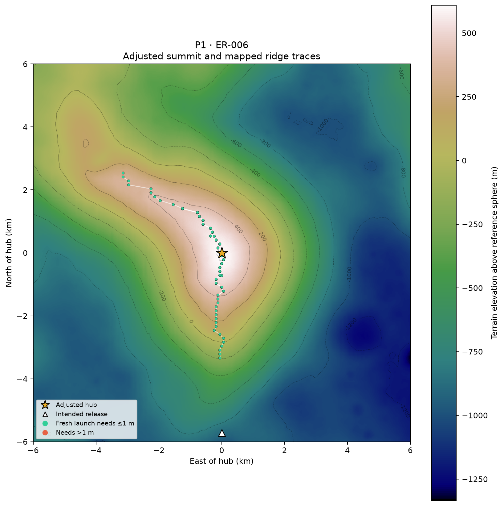
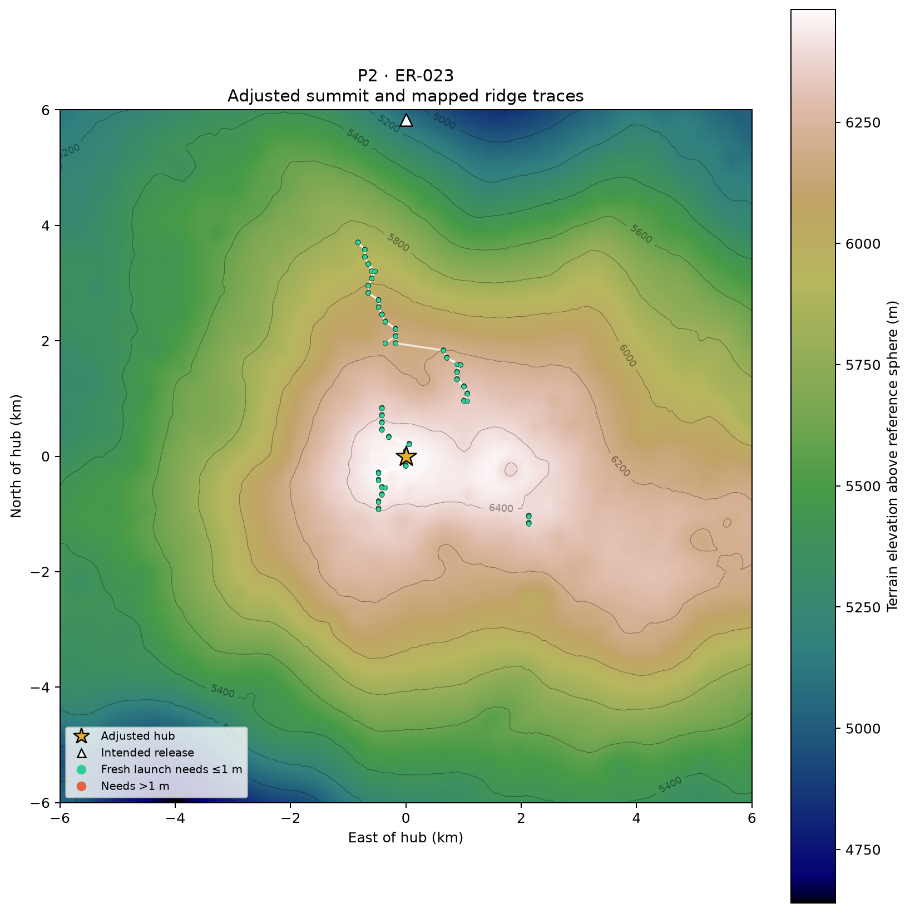
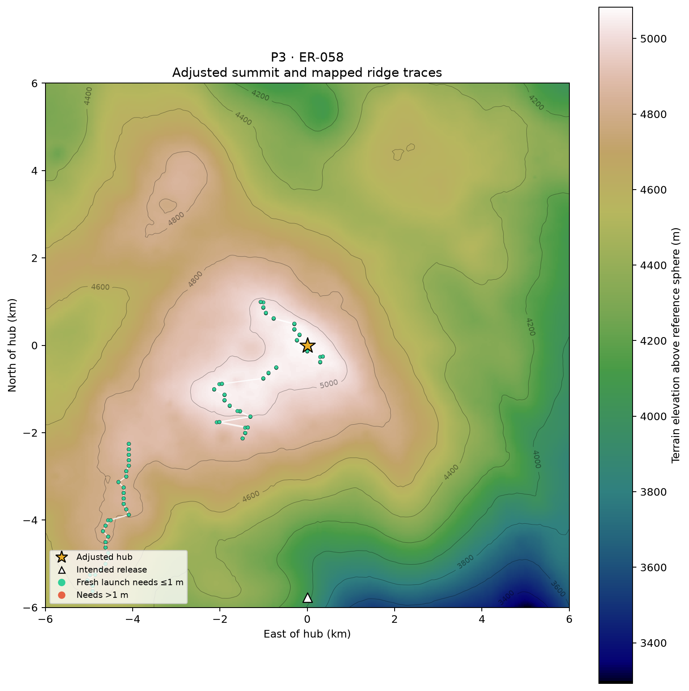
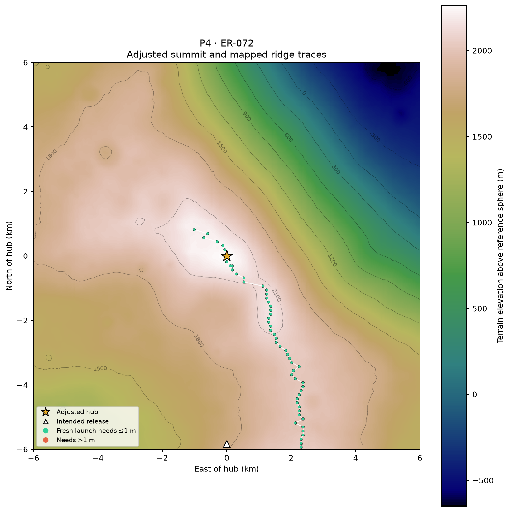

# Expanded ridge search: comparison with all four hilltop sites

[Ridge investigation](../README.md) · [Four-site publication table](../../featured_four/adjusted_hilltops/PUBLICATION.md)

The search now covers **four longitude windows and a ±6 km latitude band**, including all four adjusted hub summits. This replaces the earlier comparison in which only P1 was inside the regional search. The original six-group demonstration remains available for comparison; six was never a lunar ridge inventory.

**All four adjusted hilltops match independently discovered contact ridges within one native DEM cell.** The comparison required no changes to the hub coordinates.

## Which ridges contain the winning hubs?

| Site | Hub latitude | Hub longitude | Ridge |
|---|---:|---:|---|
| P1 | +0.11425781 | +16.15722656 | ER-006 |
| P2 | -0.15917969 | +137.34082031 | ER-023 |
| P3 | +0.16503906 | -111.47949219 | ER-058 |
| P4 | +0.17089844 | -73.57128906 | ER-072 |

[Named ridge catalog and scalar parameters](../catalog/README.md) · [Publication table CSV](../catalog/featured_hubs.csv). ER labels are study names, not official lunar place names. Numerical matching diagnostics are retained in comparison.json rather than in this publication table.

The comparison uses **independently discovered downstream contacts**, not seeds that simply rediscover their own clear starting point. Eligible contacts must require more than 0.1 m of release-height raising and lie more than 0.05° of orbital travel downstream. The nearest qualifying contact is selected geometrically, without moving any hub.

## Terrain maps

Each map is 12 × 12 km centered on the adjusted hub. The star is the summit; the triangle is the intended release point. Green contact samples need ≤1 m extra height for a fresh eastward launch; orange samples need more. White connections follow neighboring latitude samples from the same seed meridian, split at jumps over 1 km or missing latitude samples. Connections are visual interpolation, not continuous clearance certification.

### P1



[SVG](P1_ridge_match.svg)

### P2



[SVG](P2_ridge_match.svg)

### P3



[SVG](P3_ridge_match.svg)

### P4



[SVG](P4_ridge_match.svg)

## Expanded coverage

| Region | Seed longitude window (degrees east) | Seed meridians | Latitude samples per meridian |
|---|---:|---:|---:|
| P1 | 10.5–22.5 | 9 | 99 |
| P2 | 132–144 | 9 | 99 |
| P3 | 243–255 | 9 | 99 |
| P4 | 280.5–292.5 | 9 | 99 |

**3,564 seed trajectories**, each followed by a fresh-launch height search at its limiting contact. Each regional seed grid uses 1.5° longitude spacing and 125 m north–south spacing between −6 km and +6 km. The exact hub latitude and intended release latitude are added to each regional grid to avoid a sampling offset in the comparison. These latitude additions do not constrain the longitude of a contact or force a match.

[Regional contact overview](regional_contacts.png) ([SVG](regional_contacts.svg)) shows all independently nominated downstream contacts, including ones outside the seed windows. Every trajectory is followed to its first 25 km apoapsis; no longitudinal cutoff is imposed on terrain checking.

The orbit, terrain model, and release-height-envelope algorithm are unchanged from the [original method](../README.md#height-envelope-calculation): horizontal eastward periapsis release, spherical gravity, lunar rotation, bilinear SLDEM2015, and a fixed 25 km apoapsis above the reference sphere. Terrain is checked at actual latitude. An inclined shot reaching that altitude is not yet an equatorial-catcher rendezvous solution.

## Hubs versus release points

The ridge association table concerns **hub summits**. The intended release points remain displaced along their existing arm radii. A summit on a ground-contact ridge does not require the elevated payload-release point to sit over that same ground ridge. The independently recorded nearest contact distances to both hubs and release points are in [comparison.json](comparison.json). Existing four-site flight results are unchanged.

## Limits and checks

- This is expanded **regional coverage**, not a global or complete ridge catalog. Longitude and latitude sampling can miss narrow branches. We do not infer an exhaustive number of ridges from these traces.
- The original 30 m whole-outbound verification applies to every height search. For the four nearest summit contacts, additional 15 m path checks confirm that lowering the required seed release height by 0.5 m hits terrain and raising it by 0.5 m clears. [Validation](validation.json) records these checks and the result-file hash.
- The search does not certify track grade, tether footprint clearance, geological ridge identity, or terrain below the DEM resolution. The continuation algorithm proposed for accelerating a global search remains future work.

## Data and reproduction

- [Publication table CSV](../catalog/featured_hubs.csv), [diagnostic comparison CSV](comparison.csv), [comparison details](comparison.json), [all ridge contacts](ridge_contacts.csv), [full results](results.json).
- Code: [calculate.py](calculate.py), [report.py](report.py), [validate.py](validate.py), [write_summary.py](write_summary.py).

```bash
export MPLCONFIGDIR=/tmp/lunar-sling-mpl-cache
export OPENBLAS_NUM_THREADS=1
.env/hub/bin/python -m llo_catcher.site_selection.launch_ridges.expanded.calculate
.env/hub/bin/python -m llo_catcher.site_selection.launch_ridges.expanded.report
.env/hub/bin/python -m llo_catcher.site_selection.launch_ridges.expanded.validate
.env/hub/bin/python -m llo_catcher.site_selection.launch_ridges.catalog.build
.env/hub/bin/python -m llo_catcher.site_selection.launch_ridges.expanded.write_summary
```
