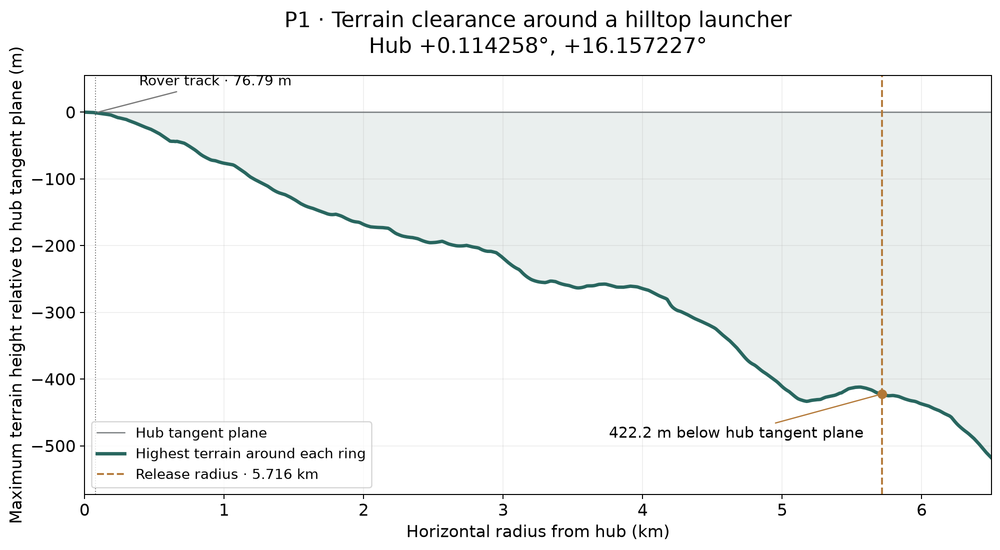

# Radial terrain envelope for the featured hill

[Publication packet](../publication/README.md) · [Separate sling sag/taper plan](../../../sling_launcher/sag_taper_trade/README.md)

**P1 is the selected terrain-profile illustration.** It has the greatest mean drop of the maximum-around-ring terrain envelope over the common comparison interval, from the 76.79 m track to 5.716 km. This terrain-only ranking describes how much vertical space the hill provides; the sling-design study will combine it with the cable shape and support loads.

**[Lowered-release check](LOWERED_RELEASE.md):** eastward departure tested after subtracting the reference pole height, and at 100, 200 and 300 m below the hub tangent plane.

## Publication figure



[PNG](selected_hill_terrain.png) · [SVG](selected_hill_terrain.svg) · [Four-hill comparison](four_hill_comparison.png) ([SVG](four_hill_comparison.svg)).

Each plotted value is the **highest ground point around the entire circle at that radius**, measured vertically relative to the hub’s tangent plane. Negative values put the entire sampled ring below that plane. Lunar curvature is included. The profile preserves intermediate rises, which may control cable clearance.

At P1’s 5.716 km release radius, the highest ground is **422.2 m below the hub tangent plane**. With the existing endpoint plane 1.3768 m above that reference, this recovers **423.6 m** of tip-circle clearance. At the rover-track radius the ring maximum is -0.90 m relative to the hub plane.

## Four-hill selection

| Hill | Mean ring drop over common interval (m) | Maximum ground at own tip (m relative to hub plane) | Own tip radius (km) |
|---|---:|---:|---:|
| P1 | 219.6 | -422.2 | 5.716 |
| P4 | 150.1 | -272.8 | 5.841 |
| P2 | 115.1 | -263.1 | 5.855 |
| P3 | 109.9 | -273.5 | 5.791 |

Mean ring drop is the radial integral of −T(r), divided by the comparison interval length. This common interval makes the terrain comparison independent of the slightly different tip radii. The curves can cross: the ranking is a scalar summary of available terrain drop. A final support-height ranking depends on the chosen tether profile and clearance requirement.

## Numerical method and checks

Use R = 1,737,400 m and the stored summit height h₀. At horizontal radius r, sample terrain elevation h at the spherical destination whose central angle satisfies r = (R + h) sin θ. The projected height is z = (R + h) cos θ − (R + h₀). Iterate the angle five times against bilinear SLDEM2015 terrain, then maximize z around the ring.

Radii extend from 0 to 6.5 km every 12.5 m, with the track and each tip radius included explicitly. Angular spacing is at most 15 m along the horizontal ring, with a minimum of 128 bearings. Refine the five highest sampled local peaks to resolve competing terrain maxima. A 30 m angular-spacing calculation checks the coarser radial grid and design radii.

The largest angular-refinement change across the four hills is 0.088 m. Changing radial spacing from 25 m to 12.5 m changes the mean-drop metric by at most 0.002 m. Tip-circle clearance agrees with the earlier independent rim calculation to within 0.006 m.

These checks measure numerical consistency on the interpolated DEM. The native grid is approximately 59 m; terrain uncertainty and unresolved obstacles require separate engineering margins. The r = 0 value is fixed to the summit reference. The spherical projection gives the expected downward curvature away from the tangent plane.

## Design handoff

For a cable drop d(r) below support datum H and vertical clearance allowance c(r), the steady geometric requirement is H ≥ max[T(r) + d(r) + c(r)] over the cable’s occupied radii. Pole lengths also depend on the terrain at their bases. The [sag/taper work item](../../../sling_launcher/sag_taper_trade/README.md) will calculate d(r), material stress, taper and support loads. This terrain figure supplies T(r).

## Files and reproduction

- Profiles: [P1](P1_profile.csv), [P2](P2_profile.csv), [P3](P3_profile.csv), [P4](P4_profile.csv). Columns include radius, maximum tangent-plane height, radial-elevation difference at that point, and controlling azimuth (clockwise from north).
- [Results, selection metric, convergence checks and source hash](results.json); [flat-sphere projection check](validation.json).
- Code: [calculate.py](calculate.py), [report.py](report.py).

```bash
export MPLCONFIGDIR=/tmp/lunar-sling-mpl-cache
export OPENBLAS_NUM_THREADS=1
.env/hub/bin/python -m llo_catcher.site_selection.radial_terrain.calculate
.env/hub/bin/python -m llo_catcher.site_selection.radial_terrain.report
```
