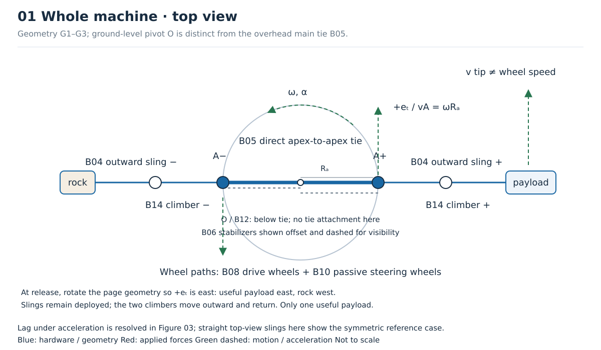
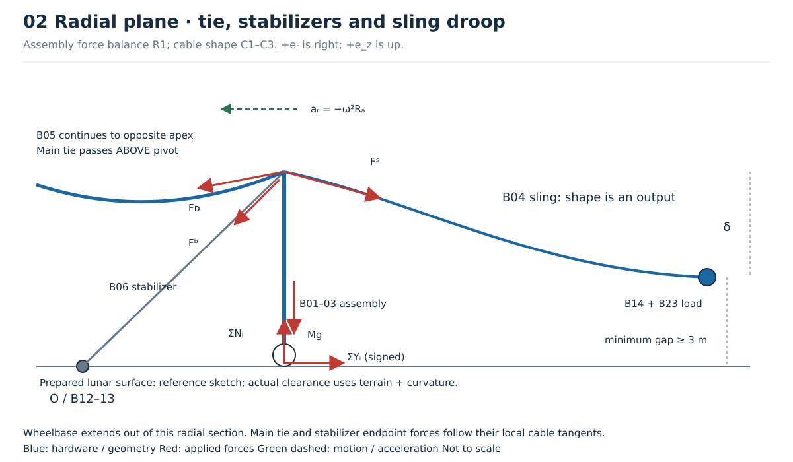
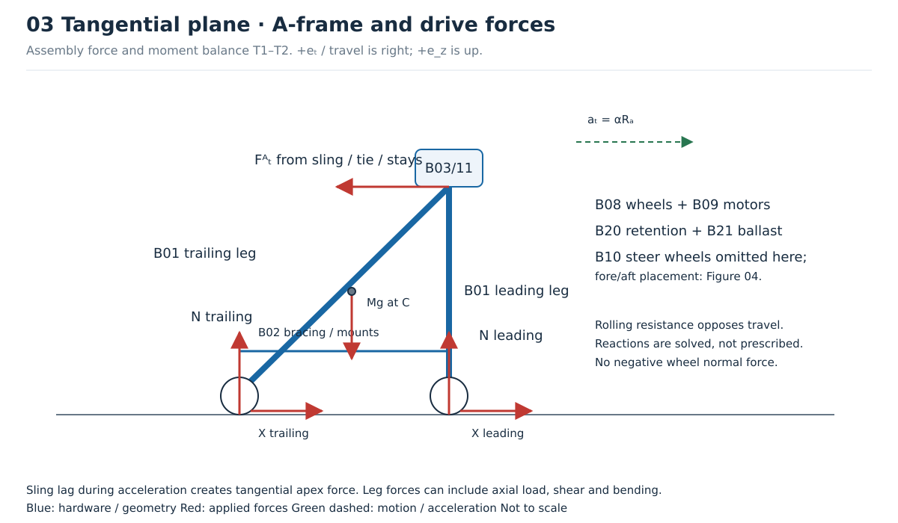
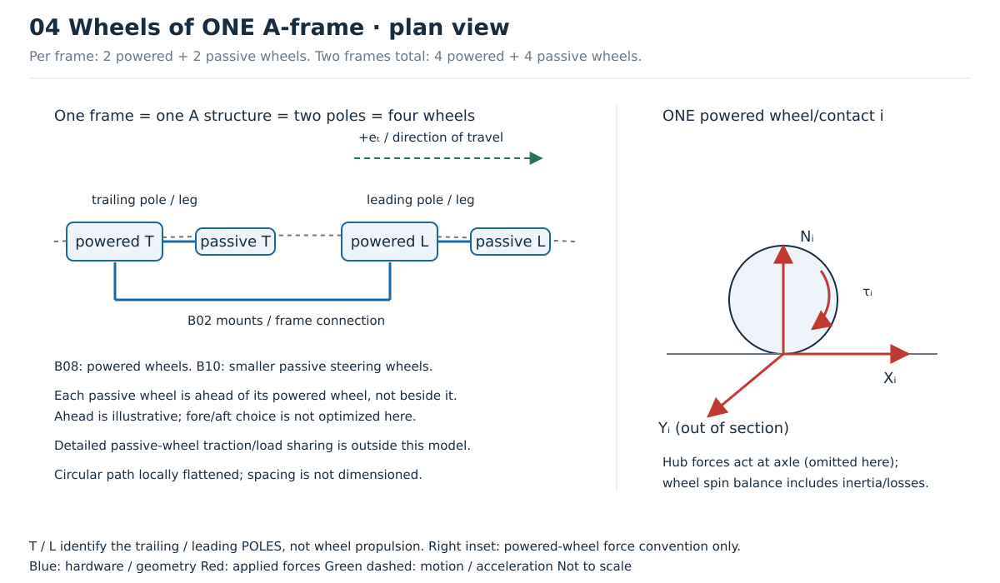
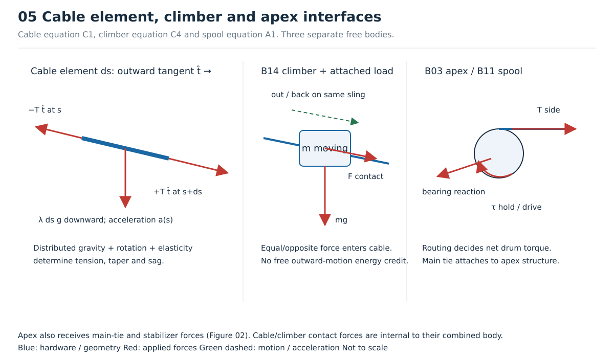
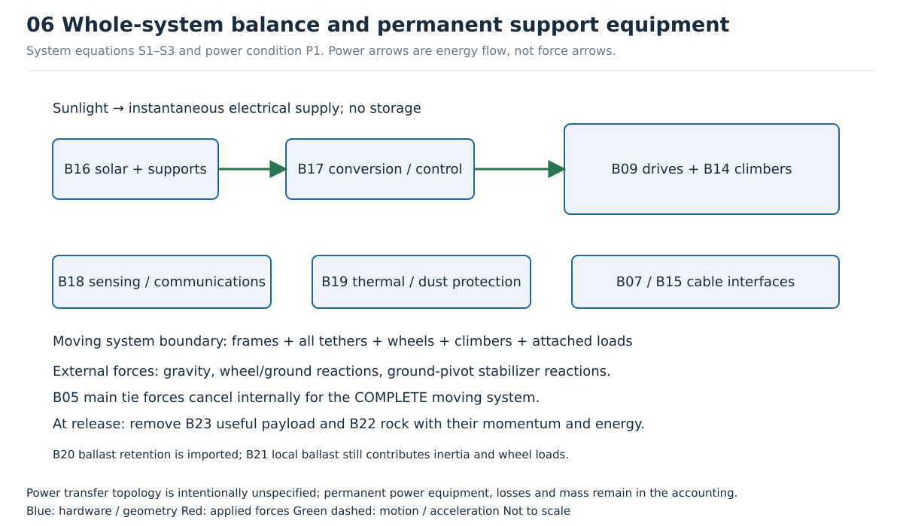

# Wheeled lunar sling: geometry, force diagrams and parts key

**For architecture review before numerical development.** These drawings are
schematic, not dimensioned candidate designs. The equations define the intended
calculation and checks; no numerical feasibility or material sizing is claimed.

The machine has two moving A-frames, joined directly apex-to-apex by a main
tension tether crossing above the center. Two separate, smaller stabilizing
stays connect the apexes to a **ground-level** central pivot. The main tie does
not terminate on the pivot. Its intended job is to transmit the principal
opposing radial loads between the frames. Stabilizer loads are calculated,
rather than set artificially low.

Both outward Kevlar slings stay extended during the operating cycle. Two
climbers carry one useful payload and one rock countermass outward, then return
after release. The initial rotation is approximately local-horizontal, with
eastward useful-payload release and westward rock release.

## Reading the drawings

Blue denotes hardware and geometry. Red arrows denote actual applied forces.
Green dashed arrows denote motion or acceleration, **not additional forces**.
Power arrows in Figure 06 denote energy flow. Arrow lengths are illustrative.
Signed reaction arrows can reverse when the equations are solved; tension-only
cables cannot reverse into compression.

At each assembly, \(+\mathbf e_r\) points outward from the center,
\(+\mathbf e_t\) follows travel, and \(+\mathbf e_z\) points upward.
These axes are right-handed: \(\mathbf e_r\times\mathbf e_t=\mathbf e_z\).
Symbols with subscripts + and − identify useful-payload and countermass sides.
The sides' radial and tangential basis vectors point oppositely in the common
top view.

| Symbol | Meaning |
| --- | --- |
| \(O,A_\pm,C\) | Ground pivot, two apexes, and the selected body's center of mass |
| \(R_a,R_{w,i},h\) | Apex radius, wheel-contact path radius, apex height |
| \(\omega,\alpha\) | Hub angular speed relative to the lunar site and its time derivative |
| \(L,s,\lambda,A,E,T,\hat{\mathbf t}\) | Deployed outward sling length, unstretched arc coordinate, reference line density, load-bearing area, axial modulus, tension, outward unit tangent |
| \(\mathbf F^S,\mathbf F^D,\mathbf F^B\) | Forces on an apex from outward sling, direct main tie, and pivot stabilizer |
| \(N_i,X_i,Y_i,\tau_i\) | Normal, tangential and radial contact forces on wheel \(i\), and its axle drive torque |
| \(m_p,m_c,m_k\) | Useful payload, rock countermass, and one climber mass |
| \(\zeta(s,t)\) | Cable vertical displacement relative to its apex; negative downward |
| \(z_g(x,y)\) | Terrain elevation relative to the central tangent-plane datum |

## 01 — Whole-machine geometry

**G1 — Positions.** In the straight, steady reference configuration,
\(\mathbf r_{A+}=R_a\mathbf e_r+h\mathbf e_z\), with the opposite apex obtained
by a half-turn about \(O\). A sling point has position
\(\mathbf r(s,t)=\mathbf r_A(t)+\mathbf u(s,t)\). The solved shape \(\mathbf u\)
includes droop and tangential lag; the main tie has its own shape solution.

**G2 — Speed distinction.** Only in the straight, fixed-length reference limit,
\[
v_{w,i}=\omega R_{w,i},\qquad
v_{\mathrm{tip,site}}=\omega(R_a+L),\qquad
a_{\mathrm{tip},r}=-\omega^2(R_a+L).
\]
For the actual geometry, differentiate the vector positions. The wheel contact
paths and apex radius need not coincide. Wheel speed is bounded initially by
the proposed 35.76 m/s target, subject to mechanical/contact feasibility.

**G3 — Moving climber.** For a radial, planar idealization with climber radius
\(r(t)\), acceleration components relative to a nonrotating local approximation
are
\[
a_r=\ddot r-\omega^2r,\qquad
a_t=r\alpha+2\omega\dot r.
\]
The second term in \(a_t\) matters even at constant hub speed. Sagged cable
motion requires the full vector derivative instead. These local expressions
omit lunar-site rotation; release states will include Moon rotation explicitly.

## 02 — Radial forces, droop and pole height

**R1 — Whole-assembly translation.** For one complete A-frame/wheel/ballast
assembly, excluding its cables and climbers, let total mass be \(M\).
With all wheel contacts included:
\[
\sum_i Y_i+F^S_r+F^D_r+F^B_r+Mg_r=M a_{C,r},
\]
\[
\sum_i N_i+F^S_z+F^D_z+F^B_z+Mg_z=M a_{C,z}.
\]
In the steady local approximation \(a_{C,r}=-\omega^2R_C\),
\(a_{C,z}=0\), and \(g_z=-g\). The outward sling force generally has a downward
component. A sagged main tie also pulls downward at its supports. Cancellation
of radial loads does not cancel their vertical components.

The main tie itself has distributed mass and needs centripetal acceleration.
Its force must not simply be set equal to sling tension. Each stabilizer pulls
from the apex toward its ground attachment along its **local** cable tangent.

**C1 — Cable shape and loading.** For any of the slings, main tie, or stabilizers,
use reference arc coordinate \(s\), position \(\mathbf r(s,t)\), reference line
density \(\lambda(s)\), and external contact load per reference length
\(\mathbf q(s,t)\):
\[
\frac{\partial(T\hat{\mathbf t})}{\partial s}
+\lambda\mathbf g+\mathbf q
=\lambda\frac{\partial^2\mathbf r}{\partial t^2},
\quad
\hat{\mathbf t}=\frac{\mathbf r_s}{|\mathbf r_s|}.
\tag{C1}
\]
Point climber contacts enter as point loads/jumps in \(T\hat{\mathbf t}\),
not as a fictitious uniform payload spread along the sling. A simple initial
axial constitutive law is
\[
T=EA\bigl(|\mathbf r_s|-1\bigr),\quad T\ge0,
\qquad \sigma=T/A\le\sigma_{\rm allow}.
\tag{C2}
\]
This law is for a taut cable; compression means slack and requires a different
branch. Finished-cable stiffness, working stress, taper, and creep/life
deratings still need sources. Protective sheath mass participates in \(\lambda\)
even if it supplies no load-bearing area.

**C3 — Required pole height.** For outward sling centerlines and their attached
equipment, solve the minimum height satisfying
\[
h_{\rm req}=
\max_{\text{cycle states},\,s,\,\text{both sides}}
\left[z_g(x(s,t),y(s,t))-\zeta(s,t)+b(s,t)+3\,{\rm m}\right],
\tag{C3}
\]
where \(b\) is the vertical distance from cable centerline to the lowest
attached hardware or cable surface. Geometry depends on height, so this is an
implicit clearance condition to solve consistently with cable equilibrium.
On locally level terrain with negligible attached depth, this reduces to maximum
droop plus 3 m.

Apply a separate ground-clearance check to the suspended main tie. The small
stabilizers necessarily reach ground level at \(O\) and are not required to have
3 m clearance there. The pivot-to-tie gap must accommodate the pivot hardware.
For a spherical reference surface,
\(z_g(\rho)=\sqrt{R_{\rm Moon}^2-\rho^2}-R_{\rm Moon}\) before adding local terrain;
this permits a direct check of whether curvature matters.

Loaded tips alone do not define the clearance envelope. Include climbers near
the apex, partway out, and returning; loaded tips; unloaded slings after
release; speed adjustment; and any shutdown condition requiring suspension.
The unloaded free-tip boundary is zero end traction unless the design contains
an explicitly counted retained tip mass. Do not invent that mass to keep a
calculation taut.

## 03 — Tangential forces, legs and overturning

**T1 — Tangential translation.**
\[
\sum_i X_i+F^S_t+F^D_t+F^B_t+Mg_t=M a_{C,t}.
\tag{T1}
\]
Lagging slings during angular acceleration or climber travel can pull backward
on the apex. The central tie is a radial load path in the symmetric ideal
geometry; it is not an assumed torque source for accelerating the payload.
Wheel traction supplies external driving torque.

**T2 — Moments.** In an inertial frame, about the body's center of mass,
\[
\sum_j(\mathbf r_j-\mathbf r_C)\times\mathbf F_j
+\sum_j\boldsymbol\tau_j
=\frac{d\mathbf H_C}{dt}.
\tag{T2}
\]
Project this on all three axes. The radial-axis projection gives tangential
overturning and load transfer between leading and trailing contacts. The
tangential-axis projection checks radial tipping; it cannot be established by
the tangential drawing alone. Include body rotational inertia and wheel spin
angular momentum, or keep separate body and wheel equations consistently.

Resolve apex, wheel-mount and brace loads into each leg's axial force, shear
and bending. Check combined stress, Euler buckling where applicable, local
buckling, joint capacity and deflection. An initially near-45° trailing leg is
a geometry candidate, not an assumed mass optimum. Extra bracing and radial
support width must be visible in the final mass and geometry.

## 04 — Actual wheel contacts and steering

Each frame is one A structure with two poles. Each pole has one powered wheel
and one smaller passive steering wheel, placed fore/aft along travel. Thus one
frame has four wheels and the complete machine has **four powered and four
passive wheels**. Figure 04 places the passive wheels ahead for illustration;
the final fore/aft choice remains open. Per the user's review, detailed passive
wheel traction and individual load sharing are omitted from the numerical model.
Aggregate frame contact/traction feasibility remains a necessary check; this
simplification cannot establish individual passive-wheel contact stability.

**W1 — Contact feasibility.** This is the general contact bound, retained for
reference; detailed passive-contact evaluation is outside the numerical scope:
\[
N_i\ge0,\qquad
\left(\frac{X_i}{\mu_{t,i}N_i}\right)^2+
\left(\frac{Y_i}{\mu_{r,i}N_i}\right)^2\le1.
\tag{W1}
\]
This is a proposed combined-traction bound, to use with sourced ranges and soil
applicability limits, not a validated regolith law. At \(N_i=0\), both traction
components must be zero. Later include soil bearing/sinkage and slip limits
as needed; a friction ellipse alone is insufficient to validate high speed.

**W2 — Wheel spin balance.** For a drive wheel, with consistent positive travel
and wheel-spin convention,
\[
\tau_i-r_{w,i}X_i-\tau_{{\rm loss},i}
=I_{w,i}\dot\Omega_{w,i}.
\tag{W2}
\]
Rolling resistance may be represented as a resisting moment here or a consistent
equivalent force in the assembly model, not counted twice. Passive wheel drive
torque is zero; passive contacts still contribute loads and losses.

**W3 — Steering and ballast.** A no-slip rolling direction is tangent to each
wheel's circle about \(O\); enforce lateral velocity constraints or model slip
explicitly. Steering wheels have their own radii and angles. Ballast adds
\(m_bg\) to weight but also \(m_b\mathbf a_C\) to inertial demand. The main tie,
stabilizers and contact forces together must supply centripetal acceleration;
unlimited ballast cannot be assumed to cure all traction failures.

## 05 — Climber, cable and apex interfaces

**C4 — Climber and attached mass.**
\[
\mathbf F_{\rm cable\to moving}+m_{\rm moving}\mathbf g
=m_{\rm moving}\mathbf a_{\rm moving}.
\tag{C4}
\]
Use \(m_{\rm moving}=m_k+m_p\) or \(m_k+m_c\) outbound, and \(m_k\) on return.
The cable receives the equal-and-opposite contact force in C1. Grip normal loads,
roller/motor capacity and allowable cable contact stress must support it.
Count electrical power and heat using the selected drive mechanism and its
efficiency; radial travel through a rotating system is not a conventional
vertical elevator calculation.

**A1 — Apex and spool.** The apex structure receives the three distinct cable
forces, spool bearing forces, self-weight and leg reactions. For the spool:
\[
\tau_{\rm drive}+\tau_{\rm hold}
+\sum_j(\mathbf r_j\times\mathbf T_j)\cdot\hat{\mathbf a}_{\rm drum}
-\tau_{\rm loss}
=I_{\rm drum}\dot\Omega_{\rm drum}.
\tag{A1}
\]
Cable routing determines the net moment and bearing force; a universal
\(\tau=Tr_{\rm drum}\) assumption is inappropriate for every routing. Slings
remaining deployed does not imply zero holding load or mass. The direct main
tie attaches to the apex structure, not automatically to the sling spool.

## 06 — Whole-system balance and electrical support

**S1 — Complete moving system.** Between releases, select all moving frames,
wheels, cables, climbers, ballast and attached loads as one material system:
\[
\frac{d\mathbf P}{dt}=\sum\mathbf F_{\rm ext},\qquad
\frac{d\mathbf H_{O_I}}{dt}=\sum\boldsymbol\tau_{{\rm ext},O_I}.
\tag{S1}
\]
Here \(O_I\) is a fixed inertial reference point; do not substitute a moving
ground pivot in this identity without the transport terms. Internal main-tie
forces cancel. Gravity, wheel-ground forces and pivot stabilizer reactions
remain external. In lunar-site coordinates, include site translation/rotation;
do not add centrifugal forces to the inertial equations.

For any frame whose origin has inertial acceleration \(\mathbf a_O\) and whose
axes rotate with angular velocity \(\boldsymbol\Omega\), the corresponding
transport identity is
\[
\mathbf a_I=\mathbf a_O+\mathbf a_{\rm rel}
+2\boldsymbol\Omega\times\mathbf v_{\rm rel}
+\dot{\boldsymbol\Omega}\times\mathbf r
+\boldsymbol\Omega\times(\boldsymbol\Omega\times\mathbf r).
\]
This defines how later code can include Moon rotation and hub rotation without
mixing real forces and fictitious forces.

**S2 — Release accounting.** For ideal instantaneous release without an added
impulse, positions and velocities remain continuous. The retained machine loses
the released bodies' momentum, angular momentum and energy:
\[
\mathbf P_{\rm retained}^{+}=\mathbf P_{\rm attached}^{-}
-\sum_{\rm released}m\mathbf v,\quad
\mathbf H_{\rm retained}^{+}=\mathbf H_{\rm attached}^{-}
-\sum_{\rm released}\mathbf r\times m\mathbf v.
\tag{S2}
\]
Use the same inertial reference for every term. Subsequent tension relaxation
and elastic waves are dynamic load cases; deleting a load is not proof of an
instantaneous rigid-body speed jump. Detailed release mechanism design remains
excluded. Test asymmetric masses and imperfect release simultaneity.

**S3 — Energy.** Track kinetic energy of every moving mass, gravitational and
elastic energy, external mechanical work, dissipative loss and departing mass.
The rotating machine necessarily has kinetic energy; do not assume a flywheel
buffer or regenerative electrical storage. If a proposed control trajectory
draws down rotational energy, expose that explicitly for review against the
no-buffer requirement.

**P1 — Direct solar condition.**
\[
P_{\rm solar,usable}(t)\ge
P_{\rm wheel,electrical}(t)+P_{\rm climber,electrical}(t)
+P_{\rm auxiliary}(t).
\tag{P1}
\]
Include simultaneous peaks and all efficiencies. No assumed braking credit.
Installed panel/support mass follows the actual incidence, derating, operating
window and peak demand, not energy averaged over an orbit or lunar night.
Power delivery to moving equipment is not designed here; its permanent
electrical equipment and losses still require explicit accounting.

## Complete named parts key

These IDs map one-to-one to the current [initial BOM](bom.md), in the same order.
“I” means permanent imported hardware, “L” permanent local material, “E” local
expendable per launch, and “P” useful captured payload. Small hardware is
identified here even when too small to draw individually.

| ID | Named part / complete-machine count | Class | Where it enters the diagrams and equations |
| --- | --- | --- | --- |
| B01 | Four primary legs: leading + trailing on each frame | I | Figures 02–03; R1, T1–T2, stress/buckling |
| B02 | Braces, cross-members and wheel mounts | I | Figures 03–04; load sharing and T2 |
| B03 | Two apex housings and joints | I | Figures 02–03, 05; R1, T2, A1 |
| B04 | Two tapered outward Kevlar slings | I | Figures 01–02, 05; G1–G3, C1–C3 |
| B05 | One main direct apex-to-apex radial tie | I | Figures 01–02; C1–C2, R1, S1 |
| B06 | Two small apex-to-ground-pivot stabilizing stays | I | Figures 01–02; C1–C2, R1, T2 |
| B07 | Cable terminations, guides and protective sheaths | I | Figures 05–06; cable mass, endpoint loads and A1 |
| B08 | Four powered wheels with hubs and bearings | I | Figures 03–04; W1–W3, S1–S3 |
| B09 | Four wheel motors and transmissions | I | Figures 03, 06; W2, P1 |
| B10 | Four smaller passive steering wheels and steering hardware | I | Figure 04; fore/aft placement shown; detailed passive contact calculation omitted |
| B11 | Two apex spools and tension-holding drives | I | Figures 03, 05; A1, P1 |
| B12 | Ground-level central pivot, bearing and rotating stay attachments | I | Figures 01–02; B06 resultant, S1 |
| B13 | Ground-level pivot anchors / optional local foundation | I + L separately | Figure 02; B06 resultant, anchoring capacity |
| B14 | Two complete reusable climbers, with propulsion/control/support hardware | I | Figures 01–02, 05–06; C4, C1 contact loads, P1 |
| B15 | Additional climber guidance and service hardware, if required | I | Figures 05–06; contact constraints, cable mass/load |
| B16 | Distributed solar panels and deployment/support hardware | I | Figure 06; P1 and installed mass |
| B17 | Power conversion, motor controllers and permanent electrical equipment | I | Figure 06; P1, losses and mass |
| B18 | Controls, sensors, communications and wiring | I | Figure 06; auxiliary demand and mass |
| B19 | Thermal/environmental protection: radiators, insulation, dust covers, shielding as needed | I | Figure 06; heat balance, auxiliary demand, cable sheath where applicable |
| B20 | Ballast retention and adjustment hardware | I | Figures 03, 06; T2, W3 and hardware mass |
| B21 | Local wheel ballast and optional foundation fill | L | Figures 03, 06; R1, T1–T2, W3; foundation fill is stationary |
| B22 | One expendable rock countermass per launch | E | Figures 01, 06; G3, C4, S2 and trajectory |
| B23 | One useful payload per successful capture | P | Figures 01–02, 06; G3, C4, S2; mass-ratio denominator |

Mixed-origin parts must be split in the mass ledger. Do not double count
climber motors/controllers in both B14 and B17, cable sheath in both B04 and
B07, or solar supports in both B16 and B02. The final itemized ledger will
assign each physical item once.

Loading and release mechanism hardware, prepared road construction, and the
orbital catcher remain outside the requested primary BOM. Their interfaces,
terrain assumptions and momentum consequences still constrain feasibility.
Dedicated permanent imported rock-handling equipment remains a scope decision,
not automatically free site infrastructure.

## What approval of this document enables

Review the architecture, force directions, parts list, and proposed load cases.
Numerical values are deliberately deferred. The next work after approval is
Python implementation of the cable-shape and assembly/contact equations, followed
by sourced inputs, droop-derived pole height, loads and mass/power bounds.
Orbital intercept and cycle timing will be reviewed before optimization.

The most important unresolved checks are three-dimensional stability, low
stabilizer loads, main-tie and unloaded-sling sag, wheel traction at speed,
climber/cable compatibility and release transients. Where this simple model
cannot establish feasibility, report a bound or unresolved condition rather
than inventing a precise result.

SVG sources are editable text and regenerate with:

    python3 lunar_slings/hub_study/docs/diagrams/draw_diagrams.py
