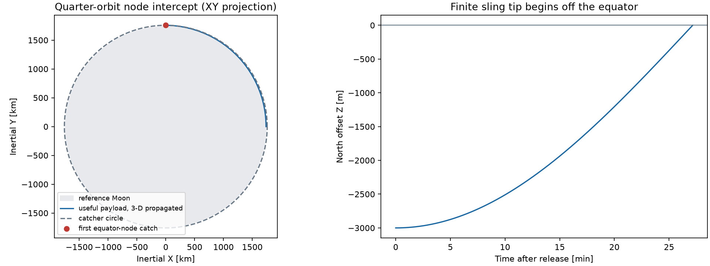
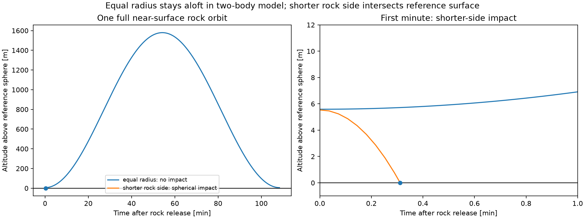
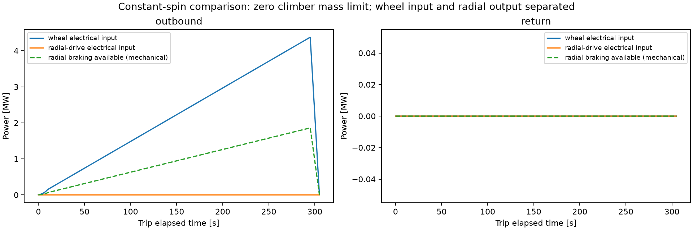

# Phase 4 review: orbital geometry and conditional cycle bounds

The wheel drawing has been corrected: **one A-frame has two poles and four
wheels**, one powered and one passive per pole, arranged fore/aft. The machine
has four powered and four passive wheels total. Passive wheels are shown ahead
for illustration. Detailed passive-wheel traction/load sharing is omitted per
the user's instruction; this does not establish individual contact stability.

The user approved the remaining force-diagram architecture and proceeding to
numerical work. This report supplies the next orbital/operations analysis.
It does **not** claim a feasible mass-sized launcher or permission to optimize.
Sling droop, frame sizing, actual climber mechanisms and final cycle control
remain subsequent physical work.

## Reproduce the calculations

From the repository root, with dependencies in the project environment:

    .env/hub/bin/python -m lunar_slings.hub_study.run_orbit_cycle
    .env/hub/bin/python -m unittest discover -s lunar_slings/hub_study/tests -v

- [Computed numerical tables](../results/orbit_cycle_tables.md)
- [Complete SI configuration and results JSON](../results/orbit_cycle.json)
- [Supporting executed notebook](../notebooks/02_orbit_cycle_feasibility.ipynb)
- Inputs: environment.py, config.py and study_inputs.py in the study root.
- Reusable calculations: orbit.py and cycle.py; plots/report: run_orbit_cycle.py.
- Exact environment: requirements-lock.txt. No original notebook is changed.

## Spherical reference and point-launch comparison

Use equatorial reference radius **1,738.1 km**, not the historical mean-radius
1,737.4 km, because this study specifies an equatorial site. Rotation is
655.720 hours sidereal; solar day is separately 29.53 Earth days. These rounded
values come from the [NASA Moon Fact Sheet](https://nssdc.gsfc.nasa.gov/planetary/factsheet/moonfact.html).
The gravitational parameter is **4.902800118 × 10¹² m³/s²**, from
[JPL DE440 parameters](https://ssd.jpl.nasa.gov/astro_par.html).

Derived surface gravity is **1.62291 m/s²** and equatorial rotational speed
**4.62630 m/s**. This remains a spherical reference, not real terrain.

For a zero-size launcher directly on the equator, a tangent periapsis-to-apoapsis
transfer to 20 km requires **1,679.689 m/s prograde relative to the site**
or **1,688.941 m/s retrograde** for the same inertial orbit-energy target.
The flight takes **54.655 min** and the prograde encounter mismatch is
**4.783 m/s**. These familiar point-launch numbers are comparisons, not the
finite horizontal-sling release solution.

The catcher orbital period is **110.248 min**, while its revisit interval
relative to the rotating site is **110.558 min**:

\[
T_c=2\pi/n_c,\qquad T_{\rm site}=2\pi/(n_c-\Omega_{\rm Moon}).
\]

An equatorial orbit can meet the rotating site's repeated launch geometry each
site-relative pass in the two-body model. One catch every *inertial* orbital
period does not preserve that geometry without additional changes.

## A finite horizontal sling releases away from the equator

At the instant of due-east release, the useful tip is north or south of the
hub; use the south side without loss of generality, so positive rotation is
about the upward local axis as in the force diagrams. In inertial coordinates
whose X axis passes through the hub meridian at release:

\[
\mathbf r_0=(x,0,-D),\quad
\mathbf v_0=(0,V,0),\quad
x=R_{\rm Moon}+H_{\rm tip},\quad
V=u+\Omega_{\rm Moon}x.
\]

Here \(D\) is **total hub-to-tip offset**, including track/apex radius,
and \(H_{\rm tip}\) is the tip's height relative to the hub tangent plane.
It is not the pole height. Pole height still comes from droop and the 3 m margin.
This release assumes the climber has reached the tip and radial travel stopped,
with a steady shape; nonzero radial or vertical release speeds need a different
trajectory branch.

The orbit inclination is \(i=\tan^{-1}(D/x)\), so its apoapsis does not lie in
the equatorial catcher's plane. With a purely eastward tangent release, the
first equator crossing is **90° along the orbit**, not 180° at apoapsis.
To put that node at catcher radius \(r_c\), choose:

\[
p=r_c,\quad V=\frac{\sqrt{\mu r_c}}{r_0},\quad
e=\frac{r_c}{r_0}-1,\quad
a=\frac{r_c}{1-e^2}.
\]

With \(E=\arccos e\), flight time is
\((E-e\sin E)\sqrt{a^3/\mu}\). Catcher phase at release must be
\(\theta_{c,0}=\pi/2-n_ct_f\).
At this node, the payload still has outward radial and cross-plane velocities:

\[
\mathbf v_p=v_c(-\hat{\mathbf r}_0+e\mathbf e_Y),\quad
\mathbf v_c=(-v_c,0,0).
\]

This is a **ballistic intercept**, not direct circular insertion. Catching
must accommodate the entire vector mismatch.

For illustration only, take \(D=3\) km and \(H_{\rm tip}=3\) m:

| Quantity | Calculated value |
| --- | ---: |
| Tip's altitude above reference sphere, including curvature | 5.589 m |
| Orbit inclination | 0.098894° |
| Site-relative tip release speed | 1,684.522 m/s |
| First node / catcher flight time | 27.1638 min |
| Encounter relative speed | 19.4253 m/s |
| Actual rotational centripetal acceleration at tip | 96.452 Earth-g |
| Maximum wheel-path radius at proposed 35.76 m/s bound | 63.686 m |

These are not optimized values or demonstrated hardware dimensions.
The 1, 3 and 10 km offset comparisons are in the generated tables.
For a catcher much more massive than the payload, momentum-restoration impulse
is approximately **19.425 N·s per useful payload kg** in the 3 km example.
For catcher mass \(M_c\) and perfectly inelastic capture of \(m_p\), its immediate
velocity change is
\(m_p(\mathbf v_p-\mathbf v_c)/(M_c+m_p)\). Capture also adds mass and changes
orbit; restoring the pre-capture state requires a separate catcher budget.
The nominal relative kinetic energy scale is about **188.7 J per payload kg**
in the large-catcher limit.

## The opposite rock does not automatically hit the Moon

For an equal-radius, simultaneous opposite release, use
\(\mathbf r_-=(x,0,D)\) and
\(\mathbf v_-=(0,\Omega_{\rm Moon}x-u,0)\).
The 3 km example's rock periapsis is **5.589 m above the reference sphere**,
and apoapsis about **1.579 km above it**. There is no spherical impact in this
two-body branch. Real terrain or gravity anomalies could change that outcome,
but cannot be used as a controlled disposal strategy.

As a sensitivity, keep the same spin rate but shorten the rock-side
**hub-to-tip radius** by 1%. This lowers the westward release speed, giving a
spherical impact after **18.702 s**, near latitude **+0.0979°** and longitude
**−1.0281°** relative to the hub meridian at release. Ground-relative impact
speed is about **1.668 km/s**. Those coordinates do not specify an actual site.

This demonstrates a kinematically realizable impact branch, **not safe disposal**.
It requires unequal sling geometry, a revised balance calculation and checks on
terrain, other station equipment and impact/ejecta exposure. Changing rock mass
alone cannot change its ballistic velocity at fixed radius and spin. The
slightly shortened-side example is not silently adopted as the approved design.

## Full-cycle timing as a conditional bound

The timing model has these explicit segments: load near the moving apex,
accelerate both loaded climbers radially, travel outward, decelerate at the
tips, hold until release phase, release, accelerate empty climbers inward,
return, decelerate near the apex, settle/restore, and await the next eligible
catcher window. The wheels never stop within this operating cycle.

For rest-to-rest travel distance \(L\), radial speed bound \(v\), and radial
acceleration bound \(a_r\):

\[
t_{\rm trip}=
\begin{cases}
2\sqrt{L/a_r},&L\le v^2/a_r,\\
L/v+v/a_r,&L>v^2/a_r .
\end{cases}
\]

These radial travel limits do not replace the total payload acceleration limit.
The illustrative sweep uses:

| Input | Illustrative assumption, not selected hardware |
| --- | --- |
| Hub-to-tip radius / apex radius | 3,000 / 50 m; outward travel 2,950 m |
| Useful payload / rock | 100 / 100 kg, illustrative absolute scale |
| Each climber | Unsized; primary comparison uses zero-mass limit, with mass-ratio sensitivities 0.01 and 0.10 |
| Radial travel acceleration limit | 1 m/s² |
| Wheel / climber efficiency | 0.85 / 0.80, unsourced sensitivity values |
| Loading time / post-return settling reservation | 60 / 60 s, unvalidated timing allowances |
| Wheel speed at 50 m path radius | 28.075 m/s at release spin |

This cycle example uses equal sling radii to isolate the travel/power trade,
and therefore has **no controlled rock disposal in the modeled geometry**.
It is not combined into a feasible design with the shorter-side impact example.
Spool payout is not part of the cycle.

At 10 m/s, one trip takes **305 s** and the stated minimum cycle takes
**730 s**, leaving about **5,903 s** of the 6,633.486 s site-repeat interval.
At 1 m/s, the minimum cycle takes **6,022 s**; at 0.5 m/s it takes
**11,921 s**, requiring at least every second eligible pass.
Loading and settling are included in these totals, but their selected times
are not demonstrated mechanism or elastic-restoration times.

The available hold/slack time can be allocated between waiting at the tips and
waiting near the apex. Allocating all of it at the apex permits a complete
load-to-release operation before each eligible catch window without holding
loaded tips for a long time. Actual allocation needs the dynamics/power solver.

### Rotation phase must also be restored

At fixed spin speed, the illustrative machine misses its identical release
orientation by **−1.1782 rad** after one site-repeat interval. Merely finishing
the climber cycle early does not solve synchronization.
The control profile must satisfy both the correct release speed and
\[
\int_{t_k}^{t_{k+1}}\omega(t)\,dt=2\pi N
\]
for an integer \(N\). Over the 10 m/s case's slack interval, a mean perturbation
of about **+0.0001996 rad/s** would supply the missing phase area. This is an
integral requirement, not a validated acceleration/ramp profile. Its torque,
peak power and tether response remain to be calculated.

Consequently **one catch per site-relative pass is a conditional geometric and
kinematic ceiling, not an achieved launcher cadence**. A justified physical
maximum requires the forthcoming tether/control and drive model.

## Power consequence of radial travel without recovery

In the constant-spin, straight-sling limit, for moving mass \(m\):

\[
F_r=m(\ddot r-\omega^2r),\qquad
F_t=2m\omega\dot r,\qquad
P_{\rm hub}=2m\omega^2r\dot r,\qquad
P_{\rm radial}=m(\ddot r-\omega^2r)\dot r .
\]

Outbound motion generally requires hub work and radial braking. Inbound motion
generally requires radial drive work and produces braking torque at the hub.
The model charges positive work through the relevant efficiency and dissipates
all negative work; it takes **no regenerative power credit**.
For isolated moving masses, integrated net mechanical work matches their
change in rotational/radial kinetic energy.

The initial 10 kg/climber, 10 m/s sensitivity peaked at **4.814 MW**, mainly
**wheel electrical input**, with about **769.7 MJ electrical demand per cycle**.
This was not a sized climber mass or an inherent outward-climber power demand.
The updated primary table uses a **zero-climber-mass limit**, with separately
reported mass-ratio sensitivities and separate wheel input, radial braking
output and radial-return input. Constant spin is an illustrative control choice,
not an imposed architecture requirement. See the
[radial energy clarification](radial_energy_review.md) for the variable-spin
identity and a potential payout comparison.
None of these figures includes rolling losses, auxiliary
power, tether deformation, actual climber grip losses or phase corrections.
The loads' initial kinetic energy on acquisition at the moving apex is also an
explicit loading-interface boundary, not a free fully modeled acceleration
from surface rest. The loading mechanism itself remains excluded by request.

This shows why travel speed/cadence and solar mass must be traded together.
No installed panel mass or efficiency has been selected yet. A necessary area
condition is
\[
A_{\rm PV}\ge \max_t
\frac{P_{\rm electrical}(t)}
{S\,\eta_{\rm net}(t)\,f_{\rm incidence}(t)}
\]
over allowed operation times, with all terms defined consistently. For a fixed
horizontal equatorial array, incidence is approximately the sine of Sun
elevation; tracking has a different incidence and support mass. Neither may
be assigned an assumed energy buffer.

## Sunlight and annual operation

As a first flat-horizon, zero-solar-declination calculation, operate only with
Sun elevation at least **10°**, giving fraction **4/9** of the 29.53-day solar
cycle: **13.124 days operating window**, followed by **16.406 days of darkness
or excluded low Sun**. The 10° threshold is an explicit illustrative operating
choice, not proof of adequate solar power. Fixed-horizontal arrays still have
only about 17.4% of their noon incidence at that threshold.

The illustrative one-pass cycle can fit 170 complete intervals into one such
window under the specified counting convention, or about **2,103 catches per
Julian year**, **210 t useful payload/year** at 100 kg per catch, and 210 t rock
per year for the illustrative 1:1 mass ratio.
These are conditional throughput arithmetic, not achievable performance claims.
Window phase may cost another opportunity; start-up/shutdown, solar sizing,
eclipses, terrain horizons, maintenance, successful capture and rock disposal
can all reduce it. No night operation or powered night-survival capability is
assumed. A solar-only night shutdown strategy remains required.

## Low-orbit sustainability and actual safety remain open

A two-body circular 20 km orbit remains circular forever by construction. This
does not establish a sustainable real lunar orbit. Research on extremely low
lunar orbits identifies strong irregular-gravity perturbations and eccentricity
growth as station-keeping drivers; the cited work's LRO-inspired sail-controlled
case is not validation of a 20 km equatorial catcher.
[Yarndley, Lantoine and Armellin (2026)](https://arxiv.org/abs/2606.05601)

NASA's reported 20 km LRO passes were in an orbit reaching approximately 165 km
over the opposite pole, not a circular 20 km equatorial orbit.
[NASA LRO orbit description](https://www.nasa.gov/missions/nasas-lro-moves-closer-to-the-lunar-surface/)

Before claiming sustainable operation, propagate the selected catcher with a
GRAIL gravity model, actual launch longitude, orientation and terrain; check
minimum altitude, nodal/eccentricity drift, capture perturbations and a bounded
station-keeping strategy. NASA's astrodynamics comparison guidance distinguishes
low- and high-degree GRAIL models and notes their embedded reference constants.
[NASA astrodynamics assessment](https://ntrs.nasa.gov/api/citations/20240013031/downloads/20240013031.pdf)
No station-keeping delta-v or lifetime has been invented here.

## Validation and decisions for the next implementation

The test suite covers bookkeeping and architecture rules,
analytic node solution versus independent Cartesian integration, integration
tolerance checks, energy/angular-momentum conservation, catcher phase and
site-repeat geometry, spherical impact events and nonimpact apsis bounds,
rest-to-rest motion, no regeneration credit and full-cycle timing.
Computed endpoint agreement is far below 1 mm in the ideal equations; this
is numerical consistency, not physical trajectory accuracy.

For review before the next physical implementation:

1. Keep the exact due-east finite-tip node intercept as the initial trajectory
   branch, or later compare release headings/phases allowing a different
   plane/intercept. Do not reuse the point-launch apoapsis mismatch for it.
2. Treat unequal rock-side radius as a candidate disposal branch, with both
   cable loads and balance recalculated. Equal mass alone does not fix disposal.
3. Proceed with the droop, tie/stabilizer, structure and actual cycle-control
   calculations using these release requirements; final cadence and power
   remain constraints to solve, not defaults.

No numerical optimization or final launcher mass ratio has been attempted.
