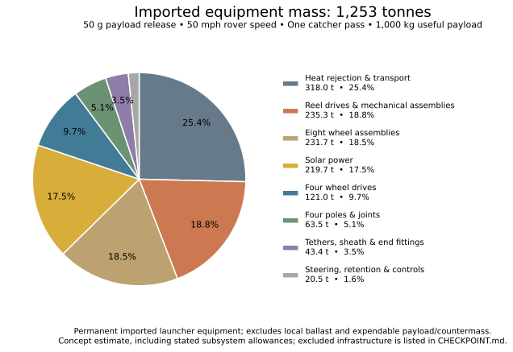
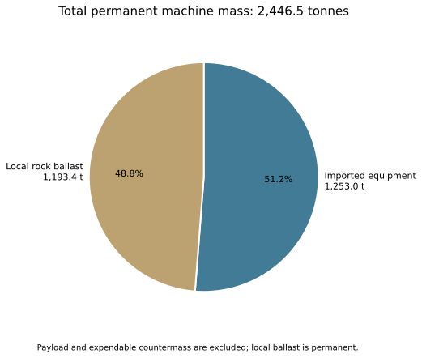

# A wheeled lunar sling: the 50-g publication checkpoint

**2026-11-01 — Concept-level mass estimate.** The selected case uses 50 mph
rovers, one launch opportunity per catcher revisit, and a 1,000 kg useful
payload. The lightest sampled reference configuration releases at **50 Earth g**.
Its track radius is **76.79 m**, and its estimated imported equipment mass is
**1,253 tonnes**. Including local rock ballast gives **2,446 tonnes** of permanent
machine mass.

These are launcher estimates under a declared component family and operating
schedule, not a tested machine or a fully optimized transport infrastructure.
The 50-g point is the reference sweep's sampled minimum, with 5-g sampling
near the minimum. The lighter and heavier component assumptions put sampled
minima at 55 g and 50 g respectively.

## What the machine contains

Two opposing A-frames travel around a flat circular track. Together they have
four structural legs, four powered wheels and four passive contact wheels.
Each pole foot carries a powered/passive pair arranged fore-and-aft. The
outward spooled tethers carry one useful payload and one equal rock countermass.

Two radial force paths are distinct:

1. An **upper apex-to-apex tie** carries the opposing payload/counterweight
   radial loads, outward cable loads and upper hardware reactions. Payload
   radial acceleration is not supplied by wheel traction.
2. A **low connection across the track** restrains the wheel assemblies and
   ballast on small tracks. On sufficiently large tracks, wheel-ground friction
   provides that inward turning force and the low connection is omitted.

At 50 mph, the adopted friction coefficient of 0.5 gives a road-only radial
threshold of about **616 m radius**. The selected **76.79 m radius is only
12.5% of that threshold**, so it clearly includes the low connection. This is
a choice of force path, not a radial-slip rejection of the design. No track
banking is assumed. Wheel traction still supplies the separate tangential
force needed for spin-up and payout.

## Selected dimensions and mass

| Quantity | Reference estimate |
| --- | ---: |
| Useful payload per successful launch | 1,000 kg |
| Expendable rock countermass per launch | 1,000 kg |
| Rover speed | 50 mph / 22.352 m/s |
| Payload release acceleration | 50 Earth g |
| Track radius | 76.79 m |
| Payload radius at release | 5,787.09 m |
| Pole apex height | 28.68 m |
| Vertical leg length, each frame | 25.44 m |
| Trailing leg length, each frame | 35.97 m |
| Four installed leg masses | 9.93, 21.84, 9.93, 21.84 t |
| Powered-wheel diameter | 6.48 m |
| Passive-wheel diameter | 3.74 m |
| Low-tie fiber plus end-connection allowance | 1.27 t |
| Imported permanent equipment | 1,253.05 t |
| Permanent local ballast | 1,193.41 t |
| Total permanent machine | 2,446.46 t |

Leg lengths begin at their axle attachment height, not at the lunar surface.
The low connection is an aggregate tether/bridle estimate for the opposing
feet. Its calculated cruise sag is about 7 mm; stopped-system preload and
specific attachment details are not yet laid out. Outward tether droop is
calculated from cable equilibrium, with a 3 m ground-clearance margin.

## Where the imported mass goes

Every imported item is assigned to exactly one slice. “Four wheel drives”
includes motors, inverters and reduction gearing. “Reel drives” includes both
reel motors, their inverters/gearing, and mechanical reel assemblies.
“Tethers” includes both outward cables, both upper/low cross-track fiber
budgets, sheath and end-fitting allowances. The [mass table](MASS_TABLE.md)
provides all grouped numbers and percentages.

Thermal hardware, reel systems, wheels and solar dominate this estimate.
The calculation includes load-sized wheels, power-and-torque-sized drives,
all four poles, heat rejection, and explicit allowances for smaller subsystems.
Manufacturer anchors and extrapolations are documented in the
[source register](../results/hardware_mass/SOURCES.md). Large lunar wheel and
multi-megawatt drive estimates extend beyond those anchors.

## Imported mass and local mass answer different questions

For each 1,000 kg useful payload, the permanent imported-mass ratio is
**1,253 kg/kg**, and the total permanent machine ratio is **2,446 kg/kg**.
These normalize the machine against **one launch**, not lifetime output.
Payload and expendable countermass are excluded from permanent machine mass.
Local ballast is a permanent inventory and is not replenished every cycle.

The imported-mass curve has a minimum near this candidate. The total-mass
curve has a broad plateau because reducing imported hardware often requires
adding local ballast to maintain tangential traction. See the
[full mass trade](../results/split_tie/mass_trade.svg).

## Mass payoff through repeated use

At 1,000 kg per successful launch, cumulative useful output first exceeds
imported equipment mass after **1,254 successful launches**. With one
110.558-minute catcher revisit per launch, this is **96.3 accumulated operating
days**, or about **193 calendar days** under an illustrative 50% sunlight
fraction with no additional downtime or failures.

With that same sunlight fraction, 80% availability during sunlight and 95%
successful capture, the expected benchmark becomes about **253 calendar days**.
These are throughput-based mass comparisons. They are not financial returns,
rocket-propellant savings, or evidence of a demonstrated lifetime and cadence.
The separate whole-machine comparison, counting local ballast too, takes
2,447 successful launches.

The [mass-payoff document](MASS_PAYOFF.md) gives the equations, exact inputs,
calendar scenarios, countermass handling and replacement-mass formula. Solar
power is direct: the continuous-operation figure is a mathematical lower bound,
not a claim of nighttime operation.

## What is included, and what remains outside this checkpoint

The imported budget includes the named launcher hardware, solar and thermal
systems, with explicit subsystem allowances rather than a generic contingency.
It excludes road construction, mining/loading infrastructure, complete
release/capture mechanisms, orbital catcher construction and momentum
restoration, and equipment delivery to the Moon. Central pivot/stabilizer mass
is excluded by instruction. Those exclusions matter when comparing with other
literature or extending payoff to the complete transport system.

Release transients, successful capture, expendable rock disposal, component
life and high-speed lunar wheel qualification are not demonstrated by the
mass model. The loading allowance is five minutes, with five minutes of timing
buffer and about 50.28 minutes each for payout and return inside a revisit.
This remains a planned operating cycle. No literature-normalized mass or cost
advantage is claimed here.

## Files for the post and the next illustration phase

Use this document and [MASS_PAYOFF.md](MASS_PAYOFF.md) as the current publishable
checkpoint text. The [publication index](README.md) links SVG/PNG figures and
exact underlying data. Earlier hub checkpoints describe earlier models and
are historical rather than alternate current answers.

The [Blender illustration](../blender/README.md), added after this numerical
checkpoint, now includes a Python-generated scene and five render views of
this exact 50-g case, using calculated geometry and drooping tethers over a
lunar surface. A companion axis-labeled plot makes the small sag readable.
