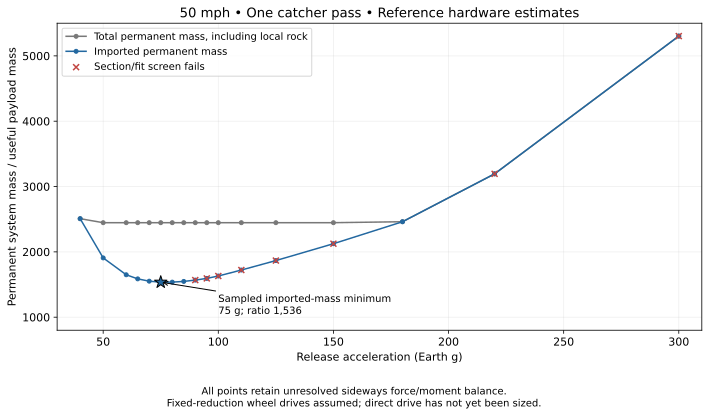

# Design focus: 50 mph, one catcher pass

> Superseded force path: see the [separate upper/low tie study](../split_tie/README.md).
> The earlier tipping ratio and 75-g candidate below describe the upper-only model.

Decision recorded 2026-11-01: use **50 mph and one catcher pass** for the next
candidate-design phase. Keep the other cases as sensitivity/history, not equal
candidates. The current reference minimum is a **75-g candidate** within the
selected component family; it is not yet a finalized design. Track radius
remains dependent on rover speed and release angular speed.

| Candidate metric | Current reference estimate |
| --- | ---: |
| Useful payload | 1,000 kg |
| Release acceleration | 75 Earth g |
| Track radius | 51.19 m |
| Release radius | 3,858.08 m |
| Apex height | 14.41 m |
| Imported permanent mass | 1,535.50 t |
| Remaining local ballast | 910.97 t |
| Total permanent mass | 2,446.47 t |

This graph extracts existing results; it does not rerun or change the physics.
The mass minimum is conditional on the selected sections, component mass
curves, drive layout and assumed force paths. In particular, choosing a new
way to turn the lower wheel assemblies could substantially change the poles
and the minimum. The whole-system mass curve includes local ballast, which
is why it can stay nearly flat while imported mass changes.

## What the tipping warning actually means

The payload pulls outward at a pole top. The main tie to the opposite pole
pulls inward at that same height. **That direct path is represented in the
model. The payload's main radial pull is not sent through the central pivot.**

There is a separate load: the rovers, poles and rock ballast must themselves
follow the circle. At 50 mph around a 51.19 m radius, their inward acceleration
is 9.76 m/s², about six times lunar gravity. Rock is light in lunar weight but
retains its full inertia when turned around the track.

The current calculation assumes that most of the force turning the lower
wheel/ballast assemblies reaches them through the poles from the upper tie.
Think of pulling a heavy trolley sideways by the top of a tall mast: the pull
can turn the trolley, but also tends to lean the mast and lift one side of its
wheel support. The fore-and-aft A-frame stance does not automatically provide
a comparably wide support footprint across the track.

The graph's ratio is:

    sideways tipping demand / estimated wheel-footprint resistance

For this candidate it is about **26.5**. A value below 1 passes this particular
simplified screen; above 1 means the assumed wheel footprint cannot balance
that demand by redistributing ground contact forces alone. It is not a mass
ratio, motor-torque ratio, or a claim that the payload force exceeds the main
tie's capacity.

Numerically, calculated demand is 71.58 MNm per frame, available wheel-footprint
resistance is 2.70 MNm, and the difference is 68.87 MNm. My previous phrase
“stabilizing moment” meant **that unbalanced tendency to tip sideways**. It
was not a calculation of torque which the ground pivot must absorb, and it
was not a derived force in either stabilizing tether. This is a reduced-order
screen under a declared force path, not a complete 3D equilibrium solution.

A different inward-force path could change this result. For example, a
separate low connection between the opposing wheel assemblies could deliver
inward force closer to the ballast height, while leaving the upper tie to
carry the payload loads. That is a possible modification, **not an assumed
part of the present concept or a completed fix**. Ground guiding or a different
radial support geometry would also require their own explicit load paths.
An apex-to-ground-center stay is not automatically a cure: its inward and
downward components must be checked with the actual contact geometry.

The important architecture question is therefore **where the lower assembly
gets its inward turning force**, not whether the main upper tie can connect
the two payload loads. Pole bending and the mass minimum depend on this.

## Why gears and inverters appeared

The selected wheel-drive family used a relatively fast electric traction
motor and one fixed reduction stage. It has no gear shifts. A real example is
the [Tesla Model 3 manual](https://www.tesla.com/ownersmanual/model3/en_us/GUID-E414862C-CFA1-4A0B-9548-BE21C32CAA58.html),
which specifies fixed single-speed reduction of 9.03:1 and variable-frequency
AC motor drives. That is evidence that electric drive does not itself remove
gears, not evidence that the launcher should copy a car drivetrain.

Direct drive is also real: [Protean's in-wheel motors](https://www.proteanelectric.com/protean-drive/)
integrate a direct-drive motor, inverter and controller. **Gearing is a design
choice, not a launcher requirement.** The current imported-mass minimum is
for the geared family; direct drive has not been mass-optimized here.

At the candidate point each 6.48 m powered wheel turns about 65.8 rpm at 50 mph
and needs up to 0.943 MNm shaft torque in the modeled cycle. The selected model
uses about 19:1 reduction. Removing that reducer requires a motor designed to
produce the wheel torque directly at wheel speed; keeping the current small,
faster motor mass while deleting its reducer would not be consistent.
A large-diameter direct-drive motor may exploit the large wheel envelope, so
merely multiplying the existing motor mass by the reduction ratio would also
be an unjustified substitute for sizing a direct-drive design.

The inverter supplies the controlled currents to the selected brushless/AC
motor windings from the DC supply. It controls torque and regenerative flow;
it is not just a voltage converter for the solar panels. A different motor
technology would need its own drive/controller estimate.

For all four powered wheels together, the current estimate is 44.26 t motors,
3.96 t inverters and 72.78 t reduction gearing. Wheel gearing is roughly 4.7%
of imported mass. The separate 295.04 t reel-gear estimate belongs to the two
cable reel drives, not the four wheels. Both gear estimates remain extrapolated
engineering estimates, not a supplier selection or demonstrated minimum.

Next candidate comparisons should keep speed/cadence fixed, establish the
lower-frame inward-force path, and compare geared versus direct-drive wheel
systems before freezing an acceleration and bill of materials. Center-pivot
and stabilizer mass remain excluded by instruction; no small-reaction claim
is inferred from that exclusion.
