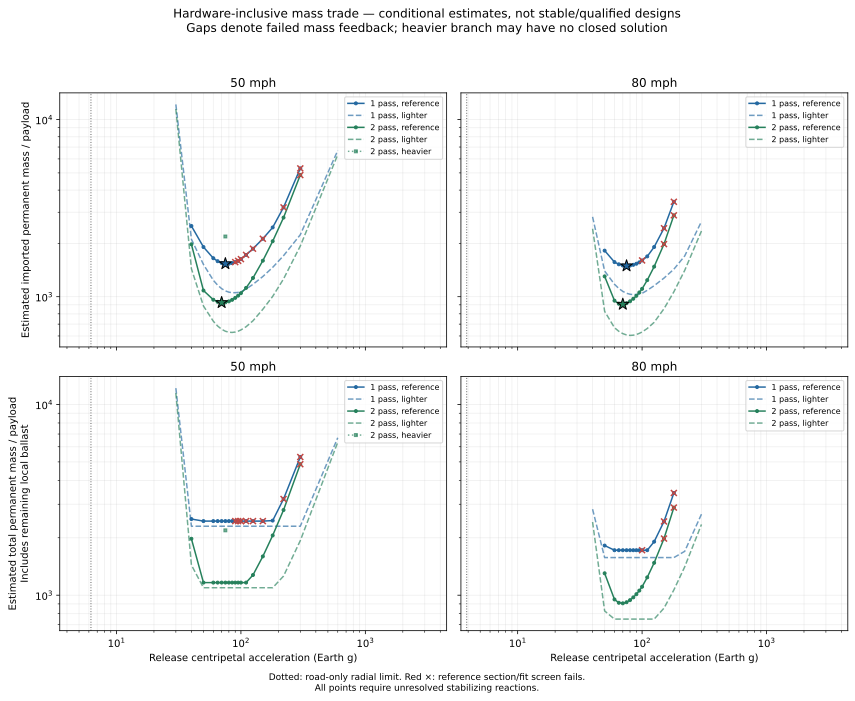
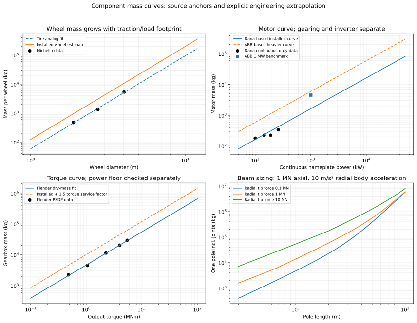
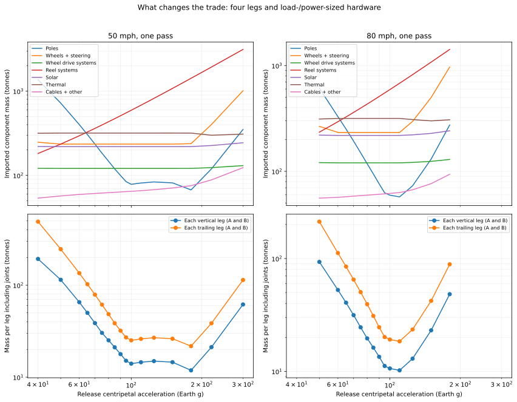
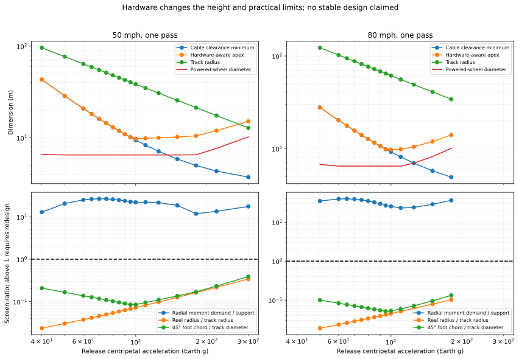

# Hardware-inclusive lunar sling mass study

> Superseded force path: see the [separate upper/low tie study](../split_tie/README.md).
> The earlier tipping ratio and 75-g candidate below describe the upper-only model.


**Current design focus: [50 mph, one catcher pass](FOCUS_50MPH_ONE_PASS.md).**
That note explains the sideways-tipping diagnostic and distinguishes the
assumed geared wheel drive from a possible direct-drive design.

**The poles, wheels and motors are now calculated and included in the mass
budget.** This replaces the earlier subtotal-only graph for estimating the mass
trade. It does not turn a failed contact/stability design into a buildable one.

[Manufacturer data, provenance and assumptions](SOURCES.md) ·
[Every reference scenario, including all four leg masses](SCENARIOS.md) ·
[Four-leg data, all profiles](four_leg_estimates.csv) ·
[Complete 300-case calculation](all_estimates.json) ·
[Sampled minima](sampled_minima.json)

## What the new trade says

Under the reference component assumptions, the **imported-mass curve has an
interior sampled minimum near 70–75 Earth g**, rather than declining indefinitely
with acceleration. These are conditional minima of the declared hardware
family and operating policy, not globally optimized or demonstrated feasible
machines. The sampling is 5 g near the minimum; its precision is much better
than the hardware estimate warrants.

| Rover speed | Catcher passes | Best sampled release acceleration | Imported mass / 1,000 kg payload | Total permanent physical mass / payload |
| --- | ---: | ---: | ---: | ---: |
| 50 mph | 1 | 75 g | 1,535.5 | 2,446.5 |
| 80 mph | 1 | 75 g | 1,493.2 | 1,721.1 |
| 50 mph | 2 | 70 g | 926.2 | 1,164.3 |
| 80 mph | 2 | 70 g | 906.4 | 906.4 |

“Imported” includes the permanent hardware and stationary solar/thermal supply.
“Physical” adds remaining permanent lunar ballast. Payload and expendable
countermass are not permanent machine mass. The last row needs no added
ballast in this model: the estimated hardware weight already supplies the
assumed aggregate normal load. This is an important feedback, not permission
to delete hardware inertia or traction requirements.

Including local ballast changes the interpretation of the optimum. Over much
of the range, lighter hardware is replaced by more rock, so **total physical
mass has a broad plateau** even when imported mass has a distinct valley.
Once hardware exceeds the needed traction mass, ballast reaches zero and
further hardware growth increases both totals. The plots show both objectives.



Stars mark sampled reference minima. Red crosses mark reference section/fitting screen
failures; gaps are cases whose mass iteration did not close. The dotted
road-only radial-friction boundary is an alternative restraint path, not a
universal cutoff for an apex-tie-supported structure. **All plotted points still
need the unresolved stabilizing reactions.** The detailed constraint curves
below quantify that issue instead of disguising it as an arbitrary vertical
acceleration cutoff.

## A concrete four-leg estimate

Reference case: **75 g, 50 mph, one catcher pass, 1,000 kg useful payload**.
Track radius is 51.19 m; release radius is 3,858.08 m. Apex height is 14.41 m.
Leg lengths start at the powered-wheel axle height, not at ground level.

| Member | Length m | Outside diameter m | Wall thickness mm | Bare member t | Member + allocated joints/bracing t |
| --- | ---: | ---: | ---: | ---: | ---: |
| Frame A vertical | 11.17 | 1.686 | 56.2 | 25.24 | 30.28 |
| Frame A trailing | 15.80 | 2.020 | 67.3 | 51.20 | 61.44 |
| Frame B vertical | 11.17 | 1.686 | 56.2 | 25.24 | 30.28 |
| Frame B trailing | 15.80 | 2.020 | 67.3 | 51.20 | 61.44 |
| **All four** | | | | **152.88** | **183.45** |

These are large fabricated steel tubes, not stock pipes. Each leg is checked
for axial stress plus amplified biaxial bending, Euler buckling reserve and
deflection, including its own lunar weight and centrifugal loading. The
material is a conservative Strenx-700-family property model, with diameter
minimized under the explicit diameter/wall and stiffness rules in the method
below. A lattice/composite redesign could change the result substantially;
this is a concrete member-family estimate, not a proof that steel tubes are
the lightest possible poles.

At 100 g in the same speed/cadence case, the corresponding installed leg masses
are **14.02, 25.13, 14.02 and 25.13 t**, total **78.31 t**. Nevertheless the
system is heavier there, because the reel torque/bend-radius penalty outweighs
the saved pole mass. The [scenario table](SCENARIOS.md) supplies the four distinct
member rows for every reference case that closes.

At 4 g and other failed low-acceleration points, a self-consistent hardware
budget was not found. The enormous pole masses increase required wheel loads;
larger wheels add mass, and the iteration grows rather than settling. The
initial-load four-leg estimates are retained in CSV/JSON with `converged=false`
for diagnosis, not presented as valid totals. This is an actual sizing failure
of this member/wheel family, not another omission of pole mass. Failure of this
iteration is not a theorem that no different structure could work.

## Wheels and motors are sized from forces and duty

For the 75-g, 50-mph one-pass case:

- Each powered wheel is approximately **6.48 m diameter**, **2.27 m wide**, and
  **49.42 t installed**, supporting roughly **581 kN** normal load. Four passive
  wheels are sized separately from the remaining normal load. All eight wheel
  assemblies total **231.65 t**.
- Each of the four wheel motors is estimated at **11.06 t installed**, with a
  **6.77 MW continuous-equivalent nameplate**. Its inverter adds **0.99 t** and
  its reduction gear estimate adds **18.19 t**. The nameplate covers both peak
  operating power and required torque; it is not an orbital-average rating.
- The wheel shaft envelope is about **0.943 MNm per powered wheel** with roughly
  **19.1:1 reduction** in this reference case. The model does not substitute
  extra powered wheels or assume a massless gearbox.
- The eight-wheel count is preserved. Wheel size follows normal force/traction,
  contact footprint, and an explicitly approximate terrestrial heat-work check.
  Wheel mass then follows the manufacturer-derived dimension curve.

The powered wheels exceed the largest 4.027 m tire anchor, and the motor
nameplate is about 26 times the 260 kW traction-motor anchor. Those are explicit
extrapolations, not claims that an off-the-shelf lunar wheel/motor exists.
The [source document](SOURCES.md) distinguishes manufacturer data from adaptation
factors, footprint assumptions and terrestrial-to-lunar limitations.



## Full itemized budget for that example

| Permanent imported category | Tonnes |
| --- | ---: |
| Four legs, including allocated joints/bracing | 183.45 |
| Eight wheel assemblies | 231.65 |
| Four wheel motors | 44.26 |
| Wheel inverters | 3.96 |
| Wheel gearboxes | 72.78 |
| Two reel motors | 46.36 |
| Reel inverters | 4.14 |
| Reel gearboxes | 295.04 |
| Reel shafts/rims/storage/supports | 51.10 |
| Passive steering hardware | 3.40 |
| Ballast retention | 4.55 |
| Cable fittings/sheathing allowance | 3.72 |
| Main apex-to-apex tie | 2.21 |
| Controls/harness allowance | 13.96 |
| Two outward cables | 37.24 |
| Solar at assumed installed 100 W/kg | 219.67 |
| Heat rejection and transport allowance | 318.00 |
| Central pivot and stabilizer mass | **Excluded as instructed** |
| **Estimated permanent imported total** | **1,535.50** |
| Local rock ballast, separate | **910.97** |
| **Estimated permanent physical total** | **2,446.47** |

No global contingency is added. Unknown detailed parts are represented by
named subsystem allowances; these allowances are estimates rather than measured
supplier masses. Loading/release mechanisms and road construction remain
outside scope. The capstan/storage layout is a stated reel-sizing assumption,
not a completed mechanical design. This estimated budget is substantially
more complete than the earlier cable/solar subtotal, with visibly lower
confidence for the adaptations and allowances.

The thermal estimate is large because peak calculated waste heat is **8.89 MW**.
At 330 K, the assumed radiator/sink/view geometry yields only about 268 W/m²
net rejection. Radiator mass includes the 20% transport allowance. A stationary
heat-transfer installation is assumed; integration with moving machinery is
not designed. The result must not be read as proof that an arbitrary local
lunar daytime site can supply that sink condition.

## Why a finite imported-mass minimum appears

At low acceleration, tall legs are expensive in bending, buckling and stiffness.
As acceleration increases they shorten, initially saving substantial mass.
However, required line tension increases, rope diameter increases, and a
bend-compatible capstan needs a larger radius. Their product drives up reel
torque and gearbox/shaft mass. At still higher acceleration, large wheels and
reels set the apex height above the cable-droop minimum, and the shrinking
track eventually cannot contain the hardware.

This model therefore produces a valley in imported mass. It is **not just
“increase acceleration until a speed limit”**: speed is fixed and track radius
is dependent. Nor is it proof of a feasible optimum: radial moment closure,
reel contact/bend life, wheel qualification and release transients still
constrain the design.



## Uncertainty and interpretation

There are three explicit assumption sets, not a statistical confidence band:

- **Lighter:** 250 kPa footprint assumption, lighter wheel adaptation, 20:1 bend
  diameter, lower gearing power floor and lighter/hotter thermal hardware.
- **Reference:** 100 kPa footprint, 40:1 bends, Dana-based motors, stated steel
  member policy and 330 K radiators.
- **Heavier:** 50 kPa footprint, larger wheel adaptation, ABB-like motor mass,
  50:1 bends, heavier gearing and cooler/heavier radiators.

The lighter branch's sampled imported minima occur near **80–85 g**. The heavier
branch often does not find a closed mass fixed point; only the 50-mph two-pass
set closes among its sampled cases, with its minimum at 75 g and ratio about
2,188. That is a warning about mass/load feedback and model uncertainty, not a
reason to draw a fictitious upper confidence band.

The reel reduction model is especially influential: at the reference minimum,
its service-factor torque is about 3.36 times the largest Flender mass anchor.
A different transmission/capstan solution could move or remove the apparent
minimum. Motor, wheel, radiator and pole-family alternatives deserve sensitivity
analysis before choosing a design, but their masses are now explicitly present.

## Stability: mass omitted, reactions retained

Pivot/stabilizer mass is zero in the budget, as requested. I have **not** assumed
that their reactions are small. The 75-g reference example leaves about
**68.9 MNm per frame** of radial moment beyond the estimated contact support
capacity. A stronger pole can carry internal bending but cannot create a
missing external balancing reaction. This is why the graph calls the minima
conditional and marks `feasible_design=false`.

The updated moment diagnostic distinguishes low-mounted wheels/ballast from
apex-mounted hardware and distributed pole mass; it is no longer the earlier
approximation that every gram sits at ground level. It remains a reduced-order
screen, not a full 3D wheel-contact solution. If the proposed stabilizing system
can supply that reaction, its actual force path must be specified even when
its mass is waived from this study.



## Calculation method and reproduction

The calculation retains the earlier cable/trajectory integrals, then iterates:

1. Permanent moving hardware changes normal load and rotational inertia.
2. Solve the signed traction inequalities for the remaining ballast throughout
   loading, payout, return and phase correction.
3. Size all eight wheels, derive wheel axle height and reel-envelope clearance.
4. Size all four legs for their axial, bending, Euler and deflection envelopes,
   including self-weight and radial body acceleration.
5. Size four wheel and two reel drive systems from power **and torque**, including
   gear reduction. Add wheel spin and drum/stored-cable spin energy to the cycle.
6. Recompute solar, rejected heat, stationary thermal mass and itemized hardware.
   Repeat until moving mass changes by less than 2e-5 fraction.

For a tube with area A, moment I, section modulus Z and length L, the checks use

    P_Euler = pi² E I / (K L)²
    amplification = 1 / (1 - N/P_Euler)
    stress = N/A + amplification * bending_moment/Z <= yield/2
    2N <= P_Euler
    amplified tip deflection <= L/150.

D/t<=30 and t>=4 mm define the preliminary local-section policy; diameter is
root-solved to the lightest admissible section within that policy. The two legs
in one frame take equal shares of the low-mounted radial restraint demand;
the trailing leg also includes transverse self-weight. Tangential truss loads
supply the axial envelope. The support reactions needed to realize those
internal loads remain a separate check, not invented fixed foundations.

The main tie terminates the radial payload/cable forces directly. Those forces
are **not** mistakenly sent through every pole as bending loads. The new pole
bending demand comes from the force needed to turn the low-mounted frame/wheel/
ballast masses and the poles themselves. Apex hardware adds vertical loading
and tie restraint directly. Higher imported weight can replace rock, preventing
double counting of required traction mass.

The earlier orbital release solution is retained while hardware raises the
apex if needed; outputs record the height increment and the estimated fractional
release-speed error of order increment/lunar-radius. This is small near the
reported minima but is not a new fully retargeted orbital solve. Underlying
release recoil and cable-lag limitations remain. There is no continuum or
finite-element analysis, and no claim of a certified fabrication design.

```bash
MPLCONFIGDIR=/tmp/lunar-sling-mpl-cache .env/hub/bin/python -m lunar_slings.hub_study.hardware_report
.env/hub/bin/python -m unittest discover -s lunar_slings/hub_study/tests -v
```

The source/version hashes are in [manifest.json](manifest.json). Manufacturer
anchors and fitted coefficients are in [source_anchors.json](source_anchors.json).
Tests cover monotone wheel sizing, torque-driven motor/gear sizing even at
zero mechanical power, all four pole checks, mass accounting, ballast
replacement, traction, convergence and rejection of unfinished mass totals.
