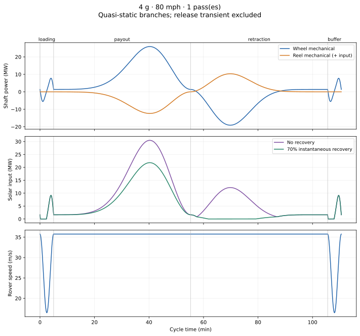
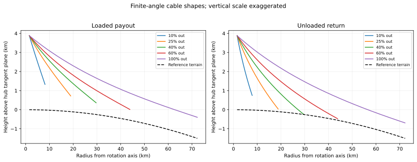

# 4 g, 80 mph, 1 catcher pass(es)

A conditional engineering scenario, **not a qualified buildable design**. Inputs and all outputs: [metrics.json](metrics.json). Full time history: [history.csv](history.csv). [Equations and limits](../../../METHOD.md). [All scenarios](../../../README.md).

Payload: 1,000 kg useful + 1,000 kg equal-radius rock countermass. Acceleration label means release centripetal acceleration; the vector peak is separately reported. Track radius is derived, never optimized independently.

## Geometry and mechanical demands

| Metric | Result |
| --- | ---: |
| Track radius (dependent) | 1,534.822 m |
| Release radius | 72,247.721 m |
| Each cable material length | 70,853.044 m |
| Apex height, including 3 m clearance | 3,882.316 m |
| Vertical leg / nominal pole height | 3,882.316 m |
| 45° trailing leg length | 5,490.425 m |
| Release tip speed relative to site | 1,683.458 m/s |
| Peak payload proper acceleration | 4.004 Earth g |
| Ballast, total two frames | 1,151,926.178 kg |
| Ballast lunar weight | 1,869,473.514 N |
| Ballast allocated per powered wheel | 287,981.544 kg |
| Powered-wheel normal load, average | 362,373.370 N |
| Powered contact area at assumed 100 kPa | 3.624 m² |
| Required compact-frame radial support half-width | 1,993.475 m |
| Extra inward ballast restraint per frame | 479,964.683 N |
| Main tie endpoint tension envelope | 787,559.843 N |
| Main tie sag estimate | 2.772 m |
| Fiber volume stored per spool (before packing allowance) | 12.735 m³ |
| Root cable equivalent solid diameter | 0.020 m |
| Empty cable tip equilibrium shift at release | 293.587 m |
| Two-cable release shape energy discontinuity | -17,161,157.430 J |
| Flight to catcher | 1,631.134 s |
| Catcher encounter relative speed | 71.719 m/s |

The 45° same-track geometric fit test **FAILS** (height must be smaller than track diameter). Passing is only a necessary condition; wheel size, frame interference, and contact moments remain unresolved.

## Mass composition

| Category | Permanent import kg | Local permanent kg | Status |
| --- | ---: | ---: | --- |
| B04: two outward Kevlar cables | 36,932.8 | — | Fiber only, static total-stress taper |
| B05: apex-to-apex main tie | 3,507.6 | — | Conditional tensile sizing; restraint geometry unresolved |
| B16: solar, no recovery | 304,932.5 | — | Assumed installed array 100 W/kg |
| B16: solar, 70% recovery (alternative) | 218,285.0 | — | Same W/kg assumption; instantaneous recovery only |
| B21: wheel rock ballast | — | 1,151,926.2 | Tangential traction model, no unsized hardware weight credit |
| B01–B03: poles, braces, apex joints | **Unsized** | — | Radial bending and tipping unresolved; old axial-only pole masses withdrawn |
| B06–B07: stabilizers, terminations, guides, sheath | Unsized | — | Small stabilizer force is not demonstrated |
| B08–B10: 4 powered + 4 passive wheels, drives, steering | Unsized | — | Capacity and speed qualification needed |
| B11: 2 operating reels and drives | Unsized | — | Cable inventory volume and power given; bend life and drums unresolved |
| B12–B13: pivot and anchors | Unsized | — | Stabilizing load path unresolved |
| B14–B15: climbers and their service hardware | Not used | — | This branch uses spooling instead |
| B17–B20: conversion, control, thermal, ballast retention | Unsized | — | These are not zero-mass equipment |

Accounted imported subtotal / useful payload: **345.4** without recovery, **258.7** with recovery. These are **incomplete subtotals, not launcher mass ratios**. Pole/total imported mass is explicitly null in JSON. Solar stays on the ground; other unsized moving hardware and this tie subtotal are not fed back into the cycle inertia/normal-load solution.

B22 rock expendable: 1,000 kg per release; B23 useful payload: 1,000 kg. Equal-radius rock **does not impact the reference sphere** in this calculation, so disposal is not closed. Loading/release machinery and prepared-road construction remain excluded.

## Timeline and power

| Segment | Minutes | Peak wheel input MW | Peak reel input MW | Available reel braking MW |
| --- | ---: | ---: | ---: | ---: |
| loading | 5.000 | 7.792 | 0.000 | 0.000 |
| payout | 50.279 | 25.919 | 0.000 | 12.378 |
| retraction | 50.279 | 1.380 | 10.353 | 0.000 |
| buffer | 5.000 | 7.775 | 0.000 | 0.000 |

Peak direct solar: **30.493 / 21.829 MW** (none / 70% recovery). Cycle solar energy: 51.492 / 30.510 GJ. Recovery has no effect on required mechanical traction. Four wheel drives share the wheel demand only under equal load sharing; two reels share the reel demand.

Peak ground force occurs in payout at 83.86% deployment. Rover speed is 16.467–35.763 m/s: cruise equals the specified operating speed; slowing during loading/buffer closes phase without exceeding it.

The release transient is **not fitted into this timeline**. The reported empty-cable displacement compares equilibria, not a predicted recoil trajectory. Its energy discontinuity is excluded from branch energy/power totals and could require a dwell or a slower cadence. Loading is a fixed 5-minute allowance, not a demonstrated service mechanism. Daylight only; no night operation or stored-energy credit.

