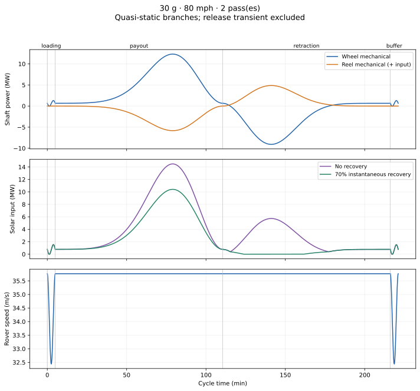
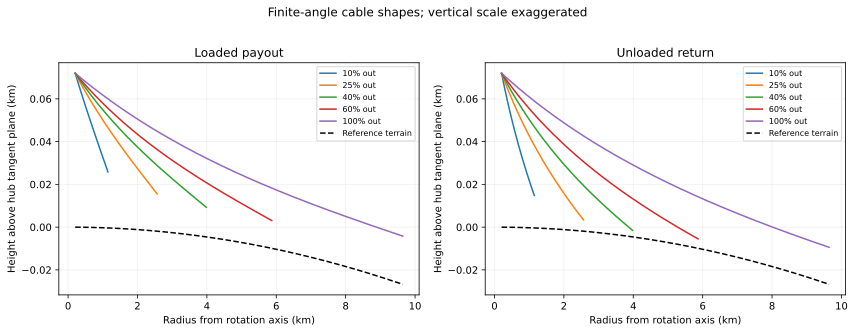

# 30 g, 80 mph, 2 catcher pass(es)

A conditional engineering scenario, **not a qualified buildable design**. Inputs and all outputs: [metrics.json](metrics.json). Full time history: [history.csv](history.csv). [Equations and limits](../../../METHOD.md). [All scenarios](../../../README.md).

Payload: 1,000 kg useful + 1,000 kg equal-radius rock countermass. Acceleration label means release centripetal acceleration; the vector peak is separately reported. Track radius is derived, never optimized independently.

## Geometry and mechanical demands

| Metric | Result |
| --- | ---: |
| Track radius (dependent) | 204.770 m |
| Release radius | 9,645.014 m |
| Each cable material length | 9,440.576 m |
| Apex height, including 3 m clearance | 71.956 m |
| Vertical leg / nominal pole height | 71.956 m |
| 45° trailing leg length | 101.762 m |
| Release tip speed relative to site | 1,684.505 m/s |
| Peak payload proper acceleration | 30.000 Earth g |
| Ballast, total two frames | 527,229.411 kg |
| Ballast lunar weight | 855,646.341 N |
| Ballast allocated per powered wheel | 131,807.353 kg |
| Powered-wheel normal load, average | 172,219.117 N |
| Powered contact area at assumed 100 kPa | 1.722 m² |
| Required compact-frame radial support half-width | 276.936 m |
| Extra inward ballast restraint per frame | 1,646,552.368 N |
| Main tie endpoint tension envelope | 3,946,541.800 N |
| Main tie sag estimate | 0.049 m |
| Fiber volume stored per spool (before packing allowance) | 12.666 m³ |
| Root cable equivalent solid diameter | 0.054 m |
| Empty cable tip equilibrium shift at release | 5.214 m |
| Two-cable release shape energy discontinuity | -304,976.278 J |
| Flight to catcher | 1,629.847 s |
| Catcher encounter relative speed | 21.314 m/s |

The 45° same-track geometric fit test **passes** (height must be smaller than track diameter). Passing is only a necessary condition; wheel size, frame interference, and contact moments remain unresolved.

## Mass composition

| Category | Permanent import kg | Local permanent kg | Status |
| --- | ---: | ---: | --- |
| B04: two outward Kevlar cables | 36,730.2 | — | Fiber only, static total-stress taper |
| B05: apex-to-apex main tie | 2,345.0 | — | Conditional tensile sizing; restraint geometry unresolved |
| B16: solar, no recovery | 144,920.2 | — | Assumed installed array 100 W/kg |
| B16: solar, 70% recovery (alternative) | 104,100.4 | — | Same W/kg assumption; instantaneous recovery only |
| B21: wheel rock ballast | — | 527,229.4 | Tangential traction model, no unsized hardware weight credit |
| B01–B03: poles, braces, apex joints | **Unsized** | — | Radial bending and tipping unresolved; old axial-only pole masses withdrawn |
| B06–B07: stabilizers, terminations, guides, sheath | Unsized | — | Small stabilizer force is not demonstrated |
| B08–B10: 4 powered + 4 passive wheels, drives, steering | Unsized | — | Capacity and speed qualification needed |
| B11: 2 operating reels and drives | Unsized | — | Cable inventory volume and power given; bend life and drums unresolved |
| B12–B13: pivot and anchors | Unsized | — | Stabilizing load path unresolved |
| B14–B15: climbers and their service hardware | Not used | — | This branch uses spooling instead |
| B17–B20: conversion, control, thermal, ballast retention | Unsized | — | These are not zero-mass equipment |

Accounted imported subtotal / useful payload: **184.0** without recovery, **143.2** with recovery. These are **incomplete subtotals, not launcher mass ratios**. Pole/total imported mass is explicitly null in JSON. Solar stays on the ground; other unsized moving hardware and this tie subtotal are not fed back into the cycle inertia/normal-load solution.

B22 rock expendable: 1,000 kg per release; B23 useful payload: 1,000 kg. Equal-radius rock **does not impact the reference sphere** in this calculation, so disposal is not closed. Loading/release machinery and prepared-road construction remain excluded.

## Timeline and power

| Segment | Minutes | Peak wheel input MW | Peak reel input MW | Available reel braking MW |
| --- | ---: | ---: | ---: | ---: |
| loading | 5.000 | 1.308 | 0.000 | 0.000 |
| payout | 105.558 | 12.318 | 0.000 | 5.831 |
| retraction | 105.558 | 0.655 | 4.869 | 0.000 |
| buffer | 5.000 | 1.297 | 0.000 | 0.000 |

Peak direct solar: **14.492 / 10.410 MW** (none / 70% recovery). Cycle solar energy: 49.957 / 29.180 GJ. Recovery has no effect on required mechanical traction. Four wheel drives share the wheel demand only under equal load sharing; two reels share the reel demand.

Peak ground force occurs in payout at 83.86% deployment. Rover speed is 32.439–35.763 m/s: cruise equals the specified operating speed; slowing during loading/buffer closes phase without exceeding it.

The release transient is **not fitted into this timeline**. The reported empty-cable displacement compares equilibria, not a predicted recoil trajectory. Its energy discontinuity is excluded from branch energy/power totals and could require a dwell or a slower cadence. Loading is a fixed 5-minute allowance, not a demonstrated service mechanism. Daylight only; no night operation or stored-energy credit.

