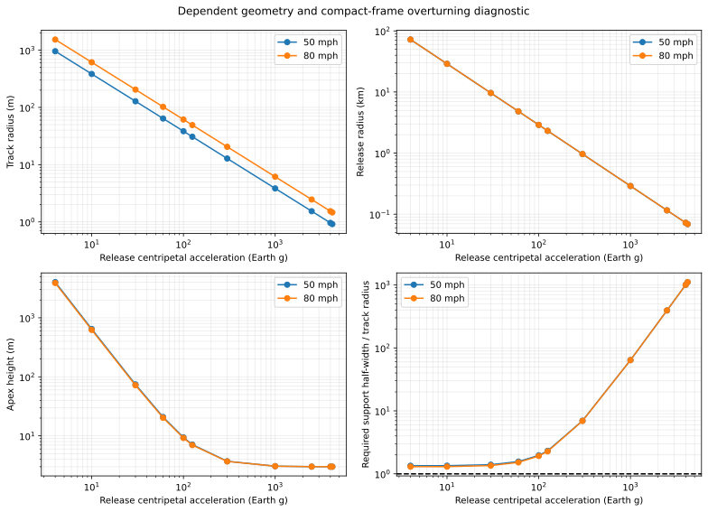
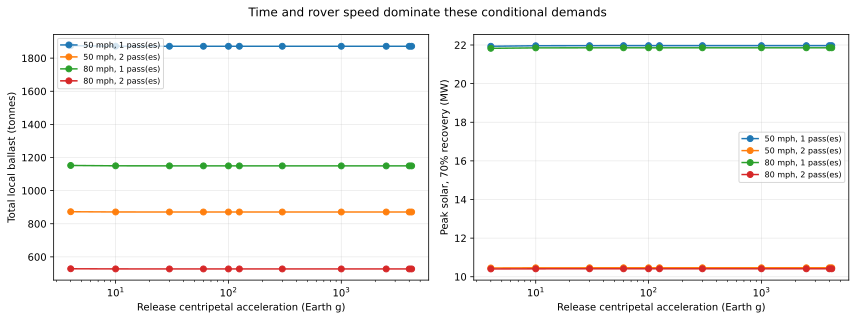
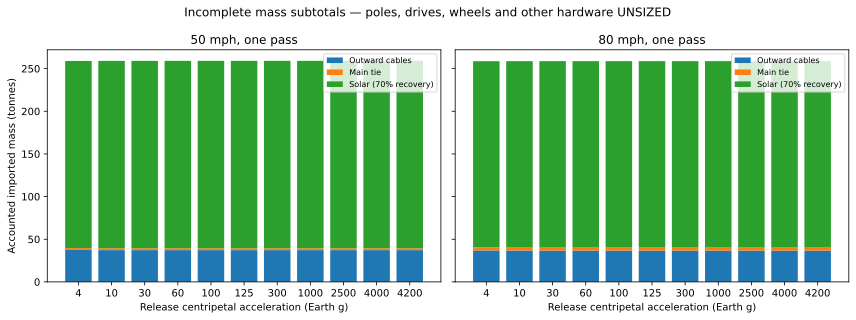

# Speed-constrained scenario catalogue

**Current numerical checkpoint.** Track radius is a dependent output. These are conditional scenarios, not feasible machine designs. [Higher-level checkpoint](../../CHECKPOINT.md) · [Method and limits](METHOD.md) · [JSON](all_scenarios.json) · [CSV](summary.csv) · [Reproduction manifest](manifest.json).

1,000 kg useful payload; 1,000 kg countermass; 50 / 80 mph; 4–4,200 Earth g (the highest rows deliberately bracket a geometric failure boundary); one / two catcher passes. All cases have a 5-minute loading allowance and a 5-minute final buffer. Cruise speed equals the chosen rover speed.

| Speed mph | Release g | Track radius m | Release radius km | Apex height m | Ballast t, 1 / 2 passes | Solar MW, 70% recovery, 1 / 2 passes | 45° frame fits track? | Detailed scenarios |
| ---: | ---: | ---: | ---: | ---: | ---: | ---: | --- | --- |
| 50 | 4 | 959.22 | 72.241 | 4016.91 | 1875.4 / 872.6 | 21.93 / 10.45 | **FAIL** | [one pass](50mph/004g/1_pass/README.md), [two passes](50mph/004g/2_pass/README.md) |
| 50 | 10 | 383.91 | 28.929 | 645.04 | 1872.1 / 871.2 | 21.96 / 10.46 | Necessary test passes | [one pass](50mph/010g/1_pass/README.md), [two passes](50mph/010g/2_pass/README.md) |
| 50 | 30 | 127.98 | 9.645 | 74.33 | 1871.6 / 870.9 | 21.97 / 10.46 | Necessary test passes | [one pass](50mph/030g/1_pass/README.md), [two passes](50mph/030g/2_pass/README.md) |
| 50 | 60 | 63.99 | 4.823 | 20.83 | 1871.6 / 870.9 | 21.97 / 10.46 | Necessary test passes | [one pass](50mph/060g/1_pass/README.md), [two passes](50mph/060g/2_pass/README.md) |
| 50 | 100 | 38.39 | 2.894 | 9.42 | 1871.5 / 870.9 | 21.97 / 10.46 | Necessary test passes | [one pass](50mph/100g/1_pass/README.md), [two passes](50mph/100g/2_pass/README.md) |
| 50 | 125 | 30.72 | 2.315 | 7.11 | 1871.5 / 870.9 | 21.97 / 10.46 | Necessary test passes | [one pass](50mph/125g/1_pass/README.md), [two passes](50mph/125g/2_pass/README.md) |
| 50 | 300 | 12.80 | 0.965 | 3.71 | 1871.5 / 870.9 | 21.97 / 10.46 | Necessary test passes | [one pass](50mph/300g/1_pass/README.md), [two passes](50mph/300g/2_pass/README.md) |
| 50 | 1000 | 3.84 | 0.289 | 3.06 | 1871.5 / 870.9 | 21.97 / 10.46 | Necessary test passes | [one pass](50mph/1000g/1_pass/README.md), [two passes](50mph/1000g/2_pass/README.md) |
| 50 | 2500 | 1.54 | 0.116 | 3.01 | 1871.5 / 870.9 | 21.97 / 10.46 | Necessary test passes | [one pass](50mph/2500g/1_pass/README.md), [two passes](50mph/2500g/2_pass/README.md) |
| 50 | 4000 | 0.96 | 0.072 | 3.00 | 1871.5 / 870.9 | 21.97 / 10.46 | **FAIL** | [one pass](50mph/4000g/1_pass/README.md), [two passes](50mph/4000g/2_pass/README.md) |
| 50 | 4200 | 0.91 | 0.069 | 3.00 | 1871.5 / 870.9 | 21.97 / 10.46 | **FAIL** | [one pass](50mph/4200g/1_pass/README.md), [two passes](50mph/4200g/2_pass/README.md) |
| 80 | 4 | 1534.82 | 72.248 | 3882.32 | 1151.9 / 528.3 | 21.83 / 10.40 | **FAIL** | [one pass](80mph/004g/1_pass/README.md), [two passes](80mph/004g/2_pass/README.md) |
| 80 | 10 | 614.26 | 28.930 | 623.62 | 1149.8 / 527.4 | 21.85 / 10.41 | Necessary test passes | [one pass](80mph/010g/1_pass/README.md), [two passes](80mph/010g/2_pass/README.md) |
| 80 | 30 | 204.77 | 9.645 | 71.96 | 1149.5 / 527.2 | 21.86 / 10.41 | Necessary test passes | [one pass](80mph/030g/1_pass/README.md), [two passes](80mph/030g/2_pass/README.md) |
| 80 | 60 | 102.39 | 4.823 | 20.24 | 1149.4 / 527.2 | 21.86 / 10.41 | Necessary test passes | [one pass](80mph/060g/1_pass/README.md), [two passes](80mph/060g/2_pass/README.md) |
| 80 | 100 | 61.43 | 2.894 | 9.21 | 1149.4 / 527.2 | 21.86 / 10.41 | Necessary test passes | [one pass](80mph/100g/1_pass/README.md), [two passes](80mph/100g/2_pass/README.md) |
| 80 | 125 | 49.15 | 2.315 | 6.97 | 1149.4 / 527.2 | 21.86 / 10.41 | Necessary test passes | [one pass](80mph/125g/1_pass/README.md), [two passes](80mph/125g/2_pass/README.md) |
| 80 | 300 | 20.48 | 0.965 | 3.69 | 1149.4 / 527.2 | 21.86 / 10.41 | Necessary test passes | [one pass](80mph/300g/1_pass/README.md), [two passes](80mph/300g/2_pass/README.md) |
| 80 | 1000 | 6.14 | 0.289 | 3.06 | 1149.4 / 527.2 | 21.86 / 10.41 | Necessary test passes | [one pass](80mph/1000g/1_pass/README.md), [two passes](80mph/1000g/2_pass/README.md) |
| 80 | 2500 | 2.46 | 0.116 | 3.01 | 1149.4 / 527.2 | 21.86 / 10.41 | Necessary test passes | [one pass](80mph/2500g/1_pass/README.md), [two passes](80mph/2500g/2_pass/README.md) |
| 80 | 4000 | 1.54 | 0.072 | 3.00 | 1149.4 / 527.2 | 21.86 / 10.41 | Necessary test passes | [one pass](80mph/4000g/1_pass/README.md), [two passes](80mph/4000g/2_pass/README.md) |
| 80 | 4200 | 1.46 | 0.069 | 3.00 | 1149.4 / 527.2 | 21.86 / 10.41 | **FAIL** | [one pass](80mph/4200g/1_pass/README.md), [two passes](80mph/4200g/2_pass/README.md) |

**No row establishes complete buildability.** Even where the 45° chord fits, compact-frame radial moment balance is not closed, release recoil is unresolved, and equal-radius rock disposal fails. High-g rows are useful diagnostics, not candidate designs.

