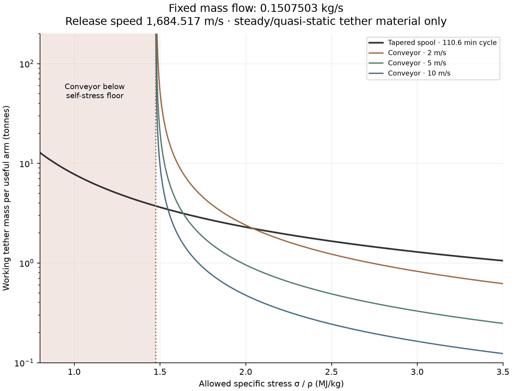
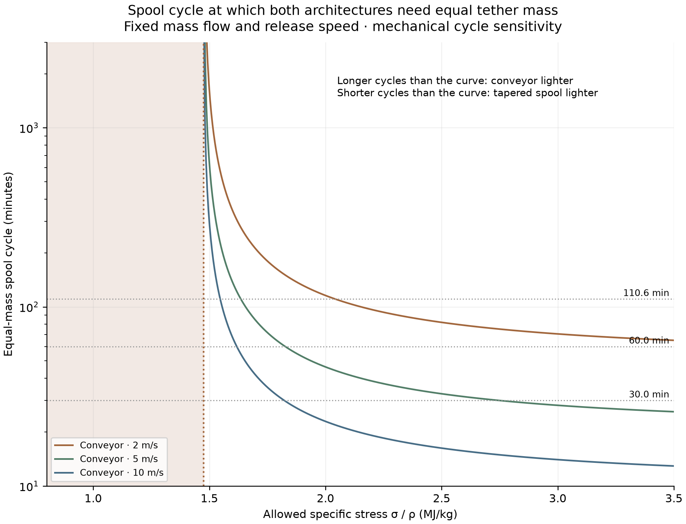
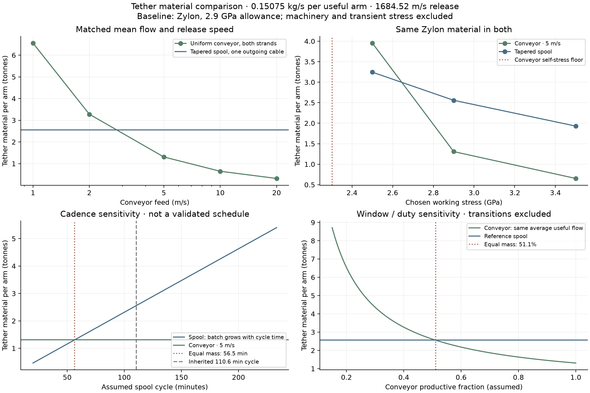

# Conveyor versus tapered spool: matched-throughput tether comparison

**2026-11-07 — steady/quasi-static material comparison, per useful-payload arm.**
[Launcher guide](../README.md) · [Conveyor calculations](../conveyor_loop/steady/README.md) ·
[Published spool design](../publication/README.md)

**[Short publication packet](publication/README.md):** technical note, accepted graph, fixed assumptions and numerical table.

## Updated conclusion: the mass–stress frontier

**Mass flow is a constraint, not an output to trade away: every new curve delivers
0.1507503 kg/s per useful arm.** Receiving logistics, catcher windows and productive
fractions are excluded from this update. Release speed is fixed at 1,684.517 m/s.
We ask how much working tether inventory is required to meet that flow as the
permitted stress changes.



**Blog figure:** [high-resolution PNG](results/fixed_mass_flow.png) ·
[editable SVG](results/fixed_mass_flow.svg). The separate
[cycle-crossover figure](results/cycle_crossover.png) is explained below.

**There is now a clear conditional conclusion:**

- **Below about 1.48 MJ/kg of allowed specific stress, this uniform single-loop
  conveyor cannot carry positive payload flow at any finite tether mass.** The
  tapered spool can, in the ideal model, at increasingly large mass and taper.
- **Just above that floor, the tapered spool is lighter.** The conveyor needs
  enormous area to leave even a small stress margin for its payload.
- **Farther above the floor, the conveyor can become lighter.** For a 5 m/s feed
  and the reference 110.6-minute spool cycle, the crossover is approximately
  **1.636 MJ/kg**. Below that value tapering wins; above it the conveyor wins
  within the sampled steady branch.
- Neither curve has an internal minimum as allowed stress increases: both use
  less material when permitted to work harder. Selecting a material/working
  allowance later determines where on this frontier the design may operate.

Specific stress means **κ = σ / ρ**, tensile stress divided by material density.
It has units J/kg. This removes the arbitrary choice of material from the ideal
mass comparison: at fixed κ, changing density changes the required fiber area,
but not the required fiber mass. To recover actual stress, multiply by density.
For example, κ = 1.636 MJ/kg corresponds to approximately **2.55 GPa at 1,560 kg/m³**
or **2.37 GPa at 1,450 kg/m³**. Those conversions are not material approvals.

### The requested matrix: fixed flow, different stress and feed

Working tether mass in **kg per useful arm**, including the conveyor's return
strand. The spool column retains a 6,633.486 s mechanical cycle and a 1,000 kg
batch. Values are rounded interpolations of the new solved curves.

| Allowed κ, MJ/kg | Tapered spool | Conveyor 2 m/s | Conveyor 5 m/s | Conveyor 10 m/s |
| ---: | ---: | ---: | ---: | ---: |
| 1.0 | 7,765 | No finite solution | No finite solution | No finite solution |
| 1.4 | 4,082 | No finite solution | No finite solution | No finite solution |
| 1.5 | 3,624 | 53,154 | 20,784 | 9,702 |
| 1.6 | 3,253 | 10,147 | 4,037 | 1,985 |
| 1.8 | 2,691 | 3,875 | 1,546 | 766 |
| 2.0 | 2,287 | 2,395 | 956 | 474 |
| 2.5 | 1,653 | 1,225 | 489 | 243 |
| 3.0 | 1,289 | 823 | 329 | 163 |

This is the taper tradeoff you described: lower permitted stress requires a
larger tip cross-section **and** stronger taper. In the planar model,

`root area / tip area = exp[Ω²(R² − a²)/(2κ)]`.

The tapered cable has no analogous positive self-stress floor: for every κ > 0
its mathematical mass is finite, although it grows exponentially and soon
becomes impractical. Merely increasing taper while holding all other dimensions
fixed is not the construction used here; the whole equal-stress profile is resized.

The conveyor has `M / m_dot = C/(u q)`, where C is full loop length, u feed speed
and q outbound payload/line density ratio. Approaching its unloaded stress floor
requires q → 0. With **positive m_dot held fixed**, that forces line mass and total
inventory toward infinity. The computed floors for 2, 5 and 10 m/s are respectively
**1.47641, 1.47590 and 1.47428 MJ/kg**. These describe the present single-loop
free-turn solution family, not all possible staged conveyor architectures.

### The remaining mechanical free variable: spool cycle time



[PNG](results/cycle_crossover.png) · [SVG](results/cycle_crossover.svg).

Mass flow alone does not specify a spool's batch: `batch mass = m_dot × cycle time`.
With no cycle-duration constraint, arbitrarily fast, tiny launches could make its
ideal tether inventory arbitrarily small. That would be an undefined comparison,
not a physical optimum. Likewise, unconstrained conveyor feed could drive down
its in-transit inventory without respecting machinery limits.

We therefore show **feed speed and spool cycle time explicitly**. The separate plot below gives the spool-cycle duration at which material masses are equal for every
stress. It does not require a receiving schedule: longer cycles favor the conveyor,
shorter cycles favor the tapered spool. At 5 m/s, the specific-stress crossovers are:

| Assumed mechanical spool cycle | Crossover κ |
| --- | ---: |
| 30 minutes | 2.749 MJ/kg |
| 60 minutes | 1.827 MJ/kg |
| 110.6 minutes | 1.636 MJ/kg |

At the reference cycle, changing conveyor feed moves the crossover to **2.042,
1.636 and 1.547 MJ/kg** for 2, 5 and 10 m/s respectively. These are interpolated
crossovers, not precision engineering thresholds. Faster spool cycles here mean
smaller batches at unchanged mean mass flow, not an increase in throughput.

Rotation and station radius remain inherited from the 50-g reference; the
**25 m feed-wheel radius and smooth unloading profile remain illustrative, fixed
model inputs**. They have not been optimized. Loop length adjusts slightly to
match actual unloading speed. No arbitrary material-strength cutoff is applied
to the new frontier. Physical control, bending and dynamic limits are still not
solved, so these are conditional material requirements.

All masses scale linearly with the specified m_dot in this model. For another
required rate, multiply the table by `new_m_dot / 0.1507503`; the stress floors and
architecture crossover boundaries stay unchanged. Thus the selected numerical
throughput is a normalization, not a hidden reason for one architecture winning.

### New calculations and reproducibility

[Stress sweep](stress_frontier.py) · [Plot generator](plot_frontier.py) ·
[Solved curve points and crossovers](results/stress_frontier.json) ·
[Matrix data](results/frontier_matrix.json) · [Checks](results/frontier_validation.json) ·
[Fixed-flow PNG](results/fixed_mass_flow.png) · [SVG](results/fixed_mass_flow.svg) ·
[Cycle-crossover PNG](results/cycle_crossover.png) · [SVG](results/cycle_crossover.svg).
The original combined figure is retained as `results/stress_frontier.png` / `.svg`;
the generator now exports the two standalone figures.

The sweep solves 13 loading points at each of three feed speeds, matching release
speed each time. Tapered masses use the analytic planar taper integral, checked
against the reused `Cable` model. Monotone interpolation is applied to loading
ratio and loop-length coefficient separately, preserving the infinite-mass limit
at the unloaded floor. Existing independently sized cases check the interpolation;
one reference crossover is also checked by a direct conveyor solve. This remains
steady/quasi-static analysis, with no dynamic simulation added.

```bash
MPLCONFIGDIR=/tmp/lunar-sling-mpl-cache OPENBLAS_NUM_THREADS=1 \
  .env/hub/bin/python -m sling_launcher.architecture_comparison.stress_frontier
MPLCONFIGDIR=/tmp/lunar-sling-mpl-cache \
  .env/hub/bin/python -m sling_launcher.architecture_comparison.plot_frontier
```

## Earlier material-specific comparison (preserved)

The earlier productive-fraction/receiving-window sensitivity below is retained
as historical context. It is **not a constraint in the new fixed-flow frontier**.

At the same release speed, average payload flow, material and working stress,
the **5 m/s conveyor requires 1.31 tonnes of moving tether**, versus **2.56 tonnes
for the tapered spool** on the inherited 110.6-minute launch cycle. This is a
**49% reduction in tether material**, not in complete machine mass. The result
reverses with sufficiently slow conveyor feed, shorter spool cycles or a tighter
material allowance. It also depends on how much conveyor transport can become
useful delivery within the catcher windows.



## The comparison contract

The earlier spool and conveyor examples used different materials, allowances,
and payload inventories. Comparing their raw masses would confound those choices
with the architecture. Here each row uses the **same material and working stress
for both**, matching these operating quantities:

| Quantity | Common input or explicit difference |
| --- | --- |
| Mean useful-arm mass flow | **0.1507503 kg/s**, equivalent to 1,000 kg per inherited cycle |
| Release speed | **1,684.5170 m/s**, in the nonrotating local-plane model |
| Machine rotation | **0.2910819542 rad/s = 2.779627912 RPM** |
| Feed-station radius / track speed | **76.78937 m / 22.352 m/s** |
| Reference material | Zylon HM, density **1,560 kg/m³** |
| Reference working stress | **2.9 GPa**, the prior provisional fiber-strength/2 screen |
| Spool cycle | **6,633.486 s**, one batch per inherited site-revisit interval |
| Spool loading / buffer | 300 s / 300 s |
| Spool payout / retraction | 3,016.743 s / 3,016.743 s |
| Conveyor feed | Free variable: **1, 2, 5, 10, 20 m/s** |
| Conveyor feed-wheel radius | **25 m**, inherited illustrative assumption, not sized hardware |
| Conveyor payload placement | Continuous mass on **outbound only**, unloaded before the free turn |
| Conveyor productive fraction | Reference **100%**; explicit sensitivity below |

“Mean flow” means during active machine operations, not a lunar-day average.
Common sunlight/availability factors would reduce both equally if applied.
The conveyor is credited with continuous useful transport in the reference;
**this is not proof that a catcher can accept that stream**. The spool has one
batch per revisit; the conveyor has smaller packets represented as continuous
mass. There is no common individual packet mass imposed.

Both calculations use the same horizontal-plane material screen. Vertical
sag, gravity, bending, splices, device/sheath mass, release impulses and transient
stress are excluded from the headline comparison. Thus “maximum stress” below
means the **calculated steady conveyor maximum or quasi-static spool maximum**,
not a certified maximum over startup, loading and release.

Count **all moving tether inventory**: one full tapered cable, even while stored,
versus the full circulating loop, including both strands and wheel contact.
Static cross-ties, counterarm, wheel, reel, frame and power-system masses are not
included. An identical opposite arm doubles both masses without changing their
ratio; it does not double the quoted useful-payload flow unless its releases
are also useful cargo.

## Reference result: equal throughput and equal working stress

| Per useful arm | Tapered spooling | Uniform conveyor, 5 m/s |
| --- | ---: | ---: |
| Tether material | **2,558.60 kg** | **1,307.60 kg** |
| Fiber volume, excluding packing voids | 1.64013 m³ | 0.83821 m³ |
| Payload supported at release / in transit | 1,000 kg batch | 172.15 kg in transit |
| Mean payload flow | 0.1507503 kg/s | 0.1507503 kg/s |
| Maximum modeled tensile stress | **2.900 GPa** | **2.900 GPa** |
| Fiber area | 169.08 mm² tip → 362.66 mm² root | 71.46 mm² everywhere |
| Taper area ratio | 2.1449 | 1 |
| Release speed | 1,684.517 m/s | 1,684.517 m/s at unloading-zone center |
| Release radius | 5,787.09 m | 5,782.52 m at unloading-zone center |
| Outermost line radius | 5,787.09 m | 5,871.03 m at free turn |
| Required wheel-friction proxy | Not evaluated in this comparison | 0.07486 |

The equal stress is **a sizing constraint**, not an independently discovered
coincidence. For each architecture we select tether area/taper to reach the
specified allowable under the modeled loading. The comparison therefore asks
how much material each needs to sustain the same flow at that stress.

For a second check, give both architectures the **same 2,558.60 kg of Zylon**,
while retaining the same average throughput, release speed and 5 m/s conveyor
feed. The conveyor's calculated maximum becomes **2.60783 GPa**, versus
**2.90000 GPa** for the tapered spool. See [equal-mass inputs/results](results/same_mass.json).

The strength-sized conveyor has outbound payload/line density **0.27045** and
about **7.60 times as much total line mass as onboard payload**. It does not
retain the earlier 3:1 whole-loop mass ratio, which exceeded the same stress
allowance. Here area is allowed to increase until the strength constraint is met.

## Feed speed can reverse the result

All rows retain the same release speed, average flow, Zylon and 2.9 GPa allowance.
The tapered spool remains 2,558.60 kg on its fixed cycle.

| Conveyor feed | Conveyor tether kg | Conveyor / spool mass | Equal-mass spool cycle |
| ---: | ---: | ---: | ---: |
| 1 m/s | 6,559.39 | 2.564 | 283.43 min |
| 2 m/s | 3,278.05 | 1.281 | 141.65 min |
| 5 m/s | 1,307.60 | 0.511 | 56.50 min |
| 10 m/s | 648.45 | 0.253 | 28.02 min |
| 20 m/s | 316.32 | 0.124 | 13.67 min |

Higher feed reduces the payload inventory resident on the arm. The resulting
conveyor mass falls approximately as 1/feed speed; shape changes add a smaller
correction. The 20 m/s result is a steady mathematical branch, **not a qualified
handling speed**, and no conclusion about practical optimal feed is warranted.
Bending lifetime, grip, attachments and power may constrain it.

For the 5 m/s case, a spool cycling **faster than 56.50 minutes** would need less
material at the same mean flow, because its batches would be smaller. A slower
cycle favors the conveyor. This cadence sensitivity is algebraic, not a new
operational solution: the prior loading, wheel-torque, payout-control and catcher
window requirements must still be satisfied. We have not demonstrated arbitrary
short cycles merely by plotting them.

## Working stress and material matter as much as architecture

At 5 m/s and fixed mean throughput:

| Material and allowance | Tapered spool kg | Uniform conveyor kg |
| --- | ---: | ---: |
| Zylon, 2.5 GPa | 3,244.35 | 3,954.86 |
| Zylon, 2.9 GPa | 2,558.60 | 1,307.60 |
| Zylon, 3.5 GPa | 1,929.48 | 652.46 |
| Kevlar 49, 1.5 GPa | 7,238.51 | No finite-area solution below the self-stress floor |
| Kevlar 49, original 1.0 GPa assumption | 18,618.98 | No finite-area solution below the self-stress floor |

For this matched-speed geometry at 5 m/s, the unloaded conveyor already reaches
**2.3024 GPa in Zylon**, or **2.1400 GPa in Kevlar 49**. Increasing area increases
both strength and self-mass proportionally, so it cannot remove that floor.
As the allowance approaches the floor from above, the payload-loading margin
shrinks and the required conveyor mass rises sharply. The taper distributes
area where it is needed and avoids this particular uniform-line limitation.

The two-stage shared-pulley Kevlar architecture has not been evaluated here.
The 3.5 GPa Zylon row is an allowance sensitivity, **not a recommended safe
rating**. Material properties and source links are retained in the
[prior conveyor material table](../conveyor_loop/steady/README.md#what-was-simulated).
The original spool's 1 GPa allowance remains a separate historical assumption;
it has not been silently replaced in the published design.

## Throughput and catcher-window dependence

For a fixed geometry, material and allowance, the material masses scale linearly
with average mass flow in these ideal models. Multiplying the common flow by
k multiplies both required tether masses by k, with unchanged stress, shape and
mass ratio. For example, at **1 kg/s** the reference pair becomes approximately
**16.97 t spool versus 8.67 t conveyor** per useful arm. Hardware size limits,
minimum rope dimensions and discrete packages can break that scaling.

If useful conveyor transport occupies only a productive fraction d of operating
time, its on-state flow must be `mean_flow/d`. The same strength-sized steady
branch then requires `reference_conveyor_mass/d`. At **d = 0.5111**, its material
advantage over the inherited spool disappears; at d = 0.5 it needs about
**2.62 t**, slightly more than the spool's 2.56 t.

This is a sensitivity to unavailable delivery time, not an implemented start/stop
schedule. Holding cargo, recirculating cargo, throwing away uncaught payloads,
or batching at release would each need its own mass accounting and control model.
No such mechanism is credited. Matching transport rate alone is insufficient to
prove matched delivered cargo to an actual orbital catcher.

## Why the mass difference exists

Write q for outbound payload mass per meter divided by bare-line mass per meter,
u for feed speed, C for full loop length, τ for spool cycle time, and K for tapered
cable mass divided by batch payload mass. Then, for productive fraction one:

```
Conveyor: payload density = mean_flow / u
          cable density   = mean_flow / (u q)
          cable mass      = mean_flow C / (u q)

Spool:    batch mass      = mean_flow τ
          cable mass      = K mean_flow τ

Equal tether mass when τ = C / (u q K).
```

The conveyor continuously sends small amounts outward instead of supporting a
full orbit's batch at once. That inventory benefit competes with its two strands
and uniform-section self-stress penalty. This is why there is no architecture
winner independent of feed, cadence and material allowance.

## Models reused and changed

**Spool:** directly reuse [Cable](../cable_shape.py), which integrates the
constant-stress taper, with gravity set to zero for this common planar screen.
For release radius R, root radius a, payload m, material density ρ and allowance σ:

```
A(r) = [m Ω² R / σ] exp[ρ Ω² (R² − r²) / (2σ)]
M_tether = integral(a..R) ρ A(r) dr
```

At fixed Ω, quasi-static partial deployment of this taper moves each deployed
material point inward relative to its release position, reducing centrifugal
loading. Unloaded retraction reduces it further. Thus full loaded deployment
sets the maximum in this reduced model. Payout acceleration, tangential load
components and wave stress are not included in that statement. The earlier
[cycle model](../spooling_cycle.py) and [payout-control experiment](../payout_control/README.md)
remain the sources for those separate limitations; this is not a new solution
of the complete spool trajectory.

The cycle duration is reused from `point_surface_reference(..., 20000)` in
[orbit.py](../orbit.py), as used by the prior spooling studies. The published
50-g candidate supplies reference radius and speed. This legacy 20 km timing
choice is a comparison clock, not a revision to the separate 25/35 km catcher work.

**Conveyor:** directly reuse the [free-turn moving-string BVP](../conveyor_loop/steady/model.py).
For each feed/material/allowance, solve for outbound loading ratio and loop size
so that peak stress equals the allowance **and actual unloading-center speed
matches the spool**. Then scale uniform fiber area to match mean flow. The smooth
outbound-only unloading profile is inherited unchanged. The radius at the
unsupported free turn differs from the unloading radius, which is why simply
copying the old 5,787 m loop size would not have matched speed.

The optimization is restricted to this steady branch and declared wheel/rotation
geometry. It is not a global machine-mass optimization. Neither release heading
nor orbital inclination, catcher intercept, vertical clearance or shared-pulley
stage balance is optimized here.

## Files, reproduction and checks

- [compare.py](compare.py): sizing, speed/flow matching, material and feed sweep.
- [plot.py](plot.py): four comparison panels from saved results.
- [validate.py](validate.py): saved-result checks and source-hash manifest.
- [Comparison inputs/results](results/comparison.json), [equal-mass result](results/same_mass.json).
- [PNG figure](results/comparison.png), [SVG figure](results/comparison.svg).
- Each feasible conveyor row has a `.npz` file with calculated shape and stress.
- [Source hashes and numerical environment](results/manifest.json).

From repository root:

```bash
MPLCONFIGDIR=/tmp/lunar-sling-mpl-cache OPENBLAS_NUM_THREADS=1 \
  .env/hub/bin/python -m sling_launcher.architecture_comparison.compare
MPLCONFIGDIR=/tmp/lunar-sling-mpl-cache \
  .env/hub/bin/python -m sling_launcher.architecture_comparison.plot
.env/hub/bin/python -m sling_launcher.architecture_comparison.validate
```

Checks verify matched flow, speed and stress constraint; independent integration
of spool centrifugal force reproduces the taper stress to better than 10⁻⁶
relative. Restoring lunar gravity and the original Kevlar allowance reproduces
the frozen publication's outward-cable mass. Tightening the reference conveyor
solver tolerance by 100× changes stress by less than 10⁻⁹ relative. The underlying
conveyor model's force-balance and positive-effective-tension checks also apply.
The equal-mass case provides a second comparison without setting both peak
stresses equal by construction.

These results establish a **conditional tether-material tradeoff**. They do not
compare total machine mass, power, cost, mechanical reliability, dynamic strength
or orbital-delivery feasibility, and they do not alter the published design.
