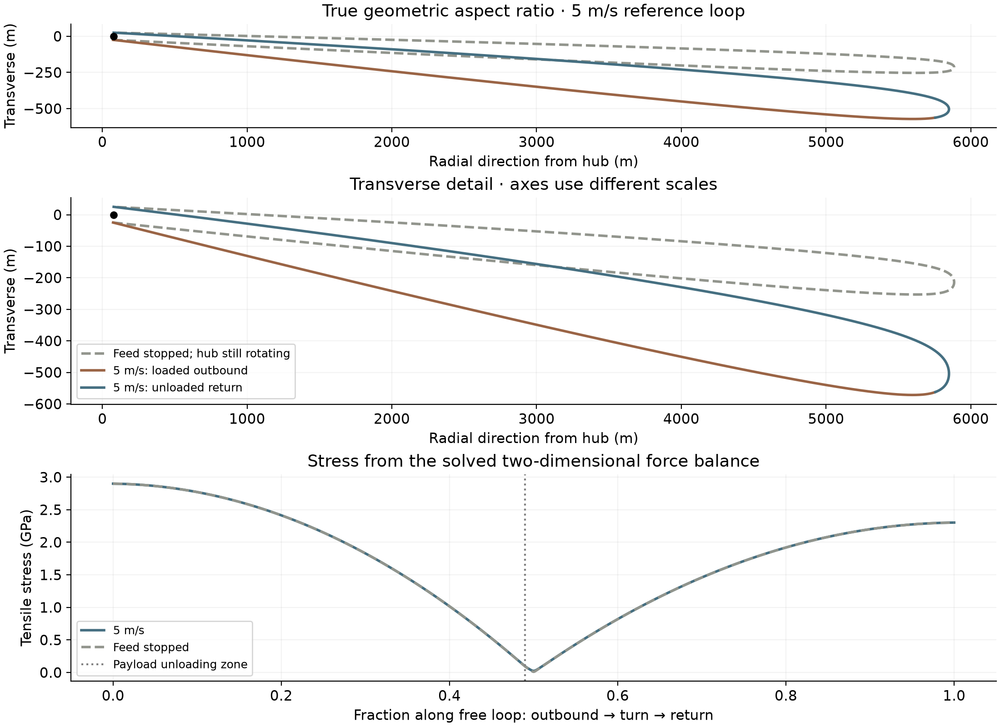

# The solved conveyor shape and its stress

[Publication packet](README.md) · [Technical note](TECH_NOTE.md)

**The 2D shapes supply the conveyor stresses in the published comparison tables
and fixed-flow frontier.** Each conveyor point solves the rotating-frame moving
string boundary-value problem, including centrifugal force, Coriolis force,
along-loop motion and outbound payload loading. Shape and tension are solved
together. The outer turn is free; the feed wheel provides the inner boundary.
The required material area is then scaled to meet the target mass flow.



[PNG](conveyor_shape_and_stress.png) · [SVG](conveyor_shape_and_stress.svg)

The highlighted 5 m/s case is the existing 2.9 GPa, density 1,560 kg/m³ example:
**1,307.60 kg of conveyor tether**, **172.15 kg of payload in transit**, and
**0.1507503 kg/s**. Its radius reaches 5.871 km. The full transverse span of the
moving free loop is **596.6 m**, about 10% of its radial reach. This span includes
the sideways displacement of the loop as well as the gap between strands.
The upper panel uses equal spatial scales; the middle panel enlarges transverse
detail. The geometry remains a slender, swept loop.

## Stop the conveyor feed while keeping the hub rotating

For each row, keep the **same tether length, cross-section, density, hub RPM,
feed wheel and total onboard payload mass**. Set feed speed to zero and solve
for the new equilibrium. Payload remains on the formerly outbound section,
with the same smooth distribution form. Its density is adjusted slightly to
conserve total payload as the wheel-contact arc changes. The stopped case has
zero throughput and serves as a force-balance diagnostic.

| Moving feed (m/s) | Moving peak stress (GPa) | Stopped peak stress (GPa) | Moving transverse span (m) | Stopped span (m) |
| ---: | ---: | ---: | ---: | ---: |
| 2 | 2.900000 | 2.900032 | 406.5 | 277.6 |
| 5 | 2.900000 | 2.900122 | 596.6 | 278.0 |
| 10 | 2.900000 | 2.900389 | 909.9 | 279.2 |

Moving peak stress is 2.9 GPa in each row because each original moving conveyor
was sized at that allowance. The corresponding stopped equilibria use the same
hardware and independently calculated stress. Across these examples the stress
change is below **0.014%**; at 5 m/s it is about **0.0042%**, slightly lower while
moving. The engineering result is the near equality. The small difference is
conditional on this steady branch and loading profile.

Centrifugal loading dominates the peak tension. At 5 m/s, feed speed is about
0.3% of tip speed; the local Coriolis-to-centrifugal acceleration scale near the
tip is about 0.6%. Transverse forces still alter the shape considerably, especially
near the low-tension outer turn, while changing the peak stress near the feed
wheel very little. The stopped, asymmetrically loaded loop also has a swept shape.

The steady boundary-value calculation establishes a shape and its tensile stress.
Its dynamic stability and transient response during loading, stopping and release
remain separate questions. This comparison concerns settled equilibria; it does
not model suddenly braking the moving conveyor.

## Reproduction and saved results

[CSV table](shape_comparison.csv) · [Detailed metrics and force residuals](shape_comparison.json) ·
[Generator](../shape_comparison.py) · [Moving-string equations](../../conveyor_loop/steady/model.py).
The `shape_2m_s.npz`, `shape_5m_s.npz` and `shape_10m_s.npz` files retain both shapes
and their full stress profiles. Moving stresses reproduce the existing comparison
within one part per million. Boundary and integrated force-balance checks pass;
total attached payload is conserved to better than one part per billion.

```bash
MPLCONFIGDIR=/tmp/lunar-sling-mpl-cache OPENBLAS_NUM_THREADS=1 \
  .env/hub/bin/python -m sling_launcher.architecture_comparison.shape_comparison
```
