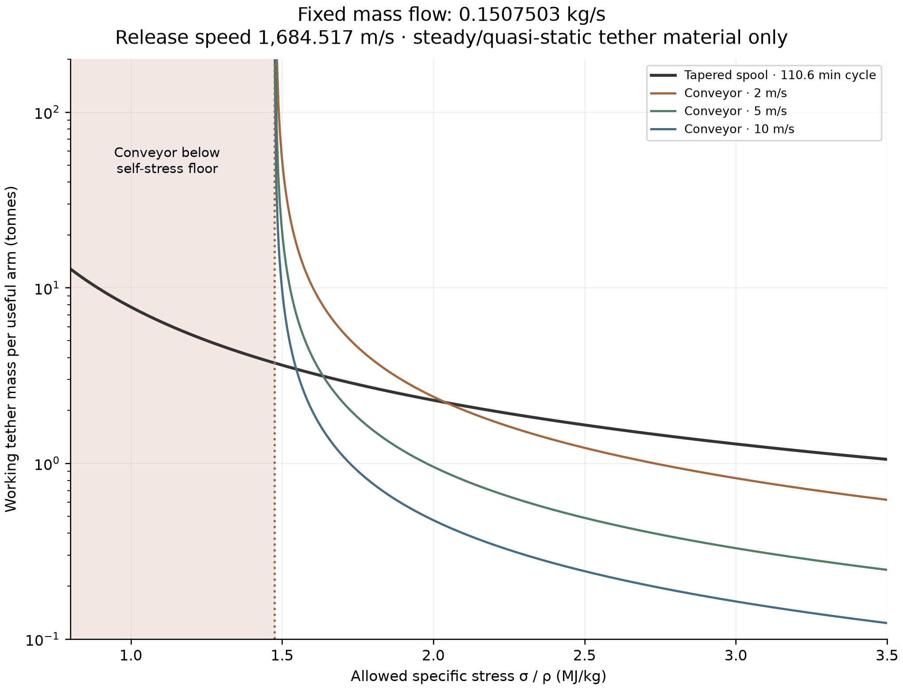

# How much tether does a lunar launcher need?

A tapered sling carries one payload outward on a cable, releases it, and reels
back the cable. A conveyor circulates a uniform tether loop, carrying payloads
on its outbound strand and returning the unloaded strand. At a given mass flow
and launch speed, which architecture needs less tether material?

The answer depends strongly on the tensile stress the material can sustain
relative to its density. Define **specific working stress** as κ = σ/ρ, measured
here in MJ/kg. Each point on the graph sizes both architectures to the same
allowed specific stress.

*Working tether inventory per useful arm versus allowed specific stress. All
curves deliver 0.1507503 kg/s at 1,684.517 m/s. The tapered sling launches a
1,000 kg batch every 110.6 minutes; conveyor feed speeds are 2, 5 and 10 m/s.
Conveyor inventory includes the outbound and return strands.*

## What is held constant?

| Quantity | Assumption |
| --- | --- |
| Mean payload mass flow during operation | **0.1507503 kg/s** per useful arm |
| Release speed | **1,684.517 m/s** |
| Rotation / feed-station radius | **2.77963 RPM / 76.789 m** |
| Spool batch / cycle | **1,000 kg / 6,633.486 s** |
| Conveyor feed speed | Separate curves at **2, 5, 10 m/s** |
| Conveyor feed-pulley radius | **25 m**, illustrative fixed input |
| Conveyor payload placement | Continuous outbound loading, smoothly unloaded before the free turn |
| Strength sizing | Same allowed κ for both architectures at each horizontal-axis value |

The spool uses an equal-stress taper. The conveyor uses a uniform section and
a solved steady loop shape. Both include their entire moving tether inventory.
The comparison holds release speed fixed while allowing the loop geometry to
adjust slightly.

## The result

The uniform conveyor has a **self-stress floor near 1.48 MJ/kg**. Below it,
centrifugal loading from the tether itself exhausts the permitted stress, even
before adding payload. Increasing its cross-section adds strength and self-mass
in the same proportion. Just above this floor, carrying the required flow demands
very large tether inventory.

Tapering puts more material toward the sling's root, where it supports more load.
It can accommodate lower working stress by increasing both taper and total mass.
Its ideal required mass grows steeply as the allowance falls.

At higher allowances, continuous transport becomes advantageous: the conveyor
carries a smaller payload inventory at any instant. For **5 m/s feed**, the curves
cross at approximately **1.636 MJ/kg**. The tapered sling uses less material below
that crossover; the conveyor uses less above it.

| Allowed κ (MJ/kg) | Tapered sling (kg) | Conveyor at 5 m/s (kg) |
| ---: | ---: | ---: |
| 1.5 | 3,624 | 20,784 |
| 1.6 | 3,253 | 4,037 |
| 1.8 | 2,691 | 1,546 |
| 2.0 | 2,287 | 956 |

Faster conveyor feed reduces the mass in transit. Shorter spool cycles permit
smaller batches at the same flow. Consequently, the stated crossover belongs to
the declared feed and cycle assumptions. Scaling throughput scales both tether
masses proportionally in this model.

## Interpretation

These are steady/quasi-static **tether-material requirements**. Whole-machine
mass, gravity-induced sag, dynamic stress peaks, bending fatigue, grip, loading
hardware and catcher acceptance schedules require further engineering. At a
density of 1,450 kg/m³, the 1.636 MJ/kg crossover corresponds to a working stress
of about 2.37 GPa; choosing a real cable requires an appropriate working allowance.

[Full equations, source models and validation](../README.md) ·
[Publication assets](README.md)
