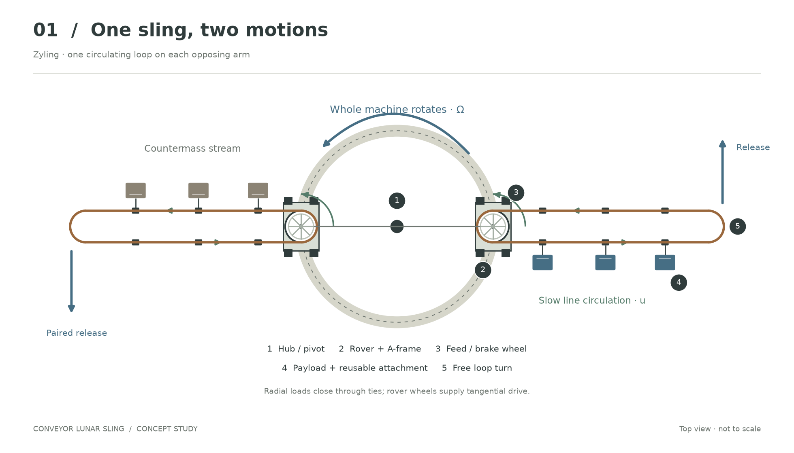
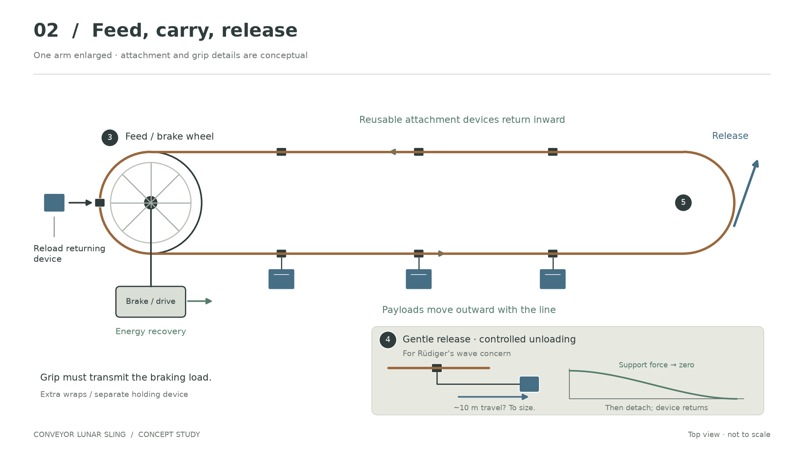
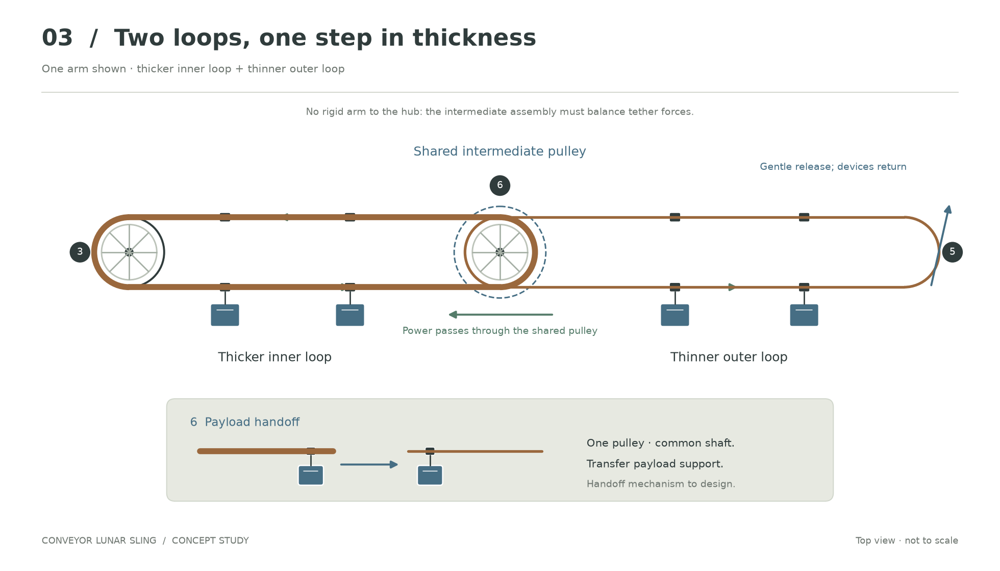
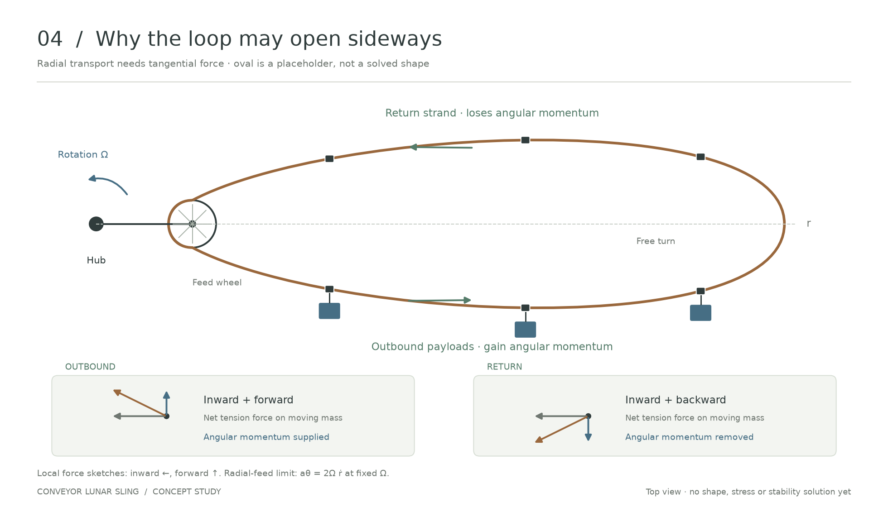

# Conveyor concept illustrations — published post

[Concept and research plan](../README.md)

Supporting figures for [Conveyor Belt Lunar Mass Sling](https://alanse.medium.com/conveyor-belt-lunar-mass-sling-7abc7bac7a05),
part of the [Lunar Mass Launchers collection](https://alanse.medium.com/list/lunar-mass-launchers-9a765f4e596a).
Publication recorded 2026-11-06. Editable SVGs and matching PNG previews follow.
Muted brown denotes tether, green denotes line transport/recovery, and blue
denotes payloads and overall motion. Numbered parts are consistent across views.

## 1. Overall machine

[Download SVG](01_system_overview.svg)



Shows the hub, rover track, opposing frames, cross-tie, feed wheels, free outer loop turns and paired
payload/countermass streams. The blue rotation arrow and green feed arrows
represent different motions. Small green quarter-circle arrows show both feed
wheels circulating counterclockwise, in the same sense as the hub. Countermasses
ride the upper left strand; useful payloads ride the lower right strand. Release arrows indicate the dominant tangential
launch direction, not a solved velocity vector. The line width, strand spacing,
track and wheels are enlarged independently for readability. The gray center
line summarizes static ties/supports in projection, not a cable running through
a feed spool. Individual pivot stays and separate upper/lower ties are omitted.

## 2. Feed wheel and attachment

[Download SVG](02_feed_and_attachment.svg)



The dark clip is a reusable attachment device: it returns on the upper strand
and receives a new payload halfway around the feed wheel’s inboard contact arc.
The left-side loader is intended to read as integrated with the rover/A-frame;
this placement is illustrative, not a selected loading mechanism. Payload icons are
offset from the line for visibility; their stems do not denote vertical hangers.
Brake/drive coupling is symbolic. Wheel passage and loading hardware are not
specified. There is **no wheel drawn at the free outer turn**. Its shape is
schematic; a dynamically sustainable wheel-free turn remains to be modeled.

The inset shows a controlled extension from attachment to payload: progressively
reduce support force, then detach. The suggested **approximately 10 m** stroke
is an unsized concept input, not a demonstrated sufficient release distance.
The little force curve is a desired qualitative profile, not simulation output.
The attachment remains with the line and returns for reuse.

[Rüdiger's tether-dynamics simulation](https://blog.klaehn.org/blog/lunar-sling-launcher-tether-dynamics/)
shows reflected release waves breaking his modeled tether and explores controlled
unloading and active damping. It motivates this feature, but does not validate
our conveyor or a 10 m stroke. His example uses different geometry and loading;
our release duration, stroke and remaining waves require simulation.

## 3. Two-stage conveyor

[Download SVG](03_two_stage_loop.svg)



Only one arm is shown. Return clips and the wheel-free outer turn carry over
from figure 2. **Both loops share one intermediate pulley with a common shaft**:
the inner loop wraps its outer half and the outer loop wraps its inner half.
The common rotating body mechanically transfers torque and power between loops;
these are not independently spinning wheels joined by a stationary bracket.
Separate grooves may accommodate the two line sizes, but their rotation is
locked together. The diagram uses equal effective contact radii, giving matched
line speeds under no slip. Groove/shaft bending is outside this 2D illustration.
It does not imply a rigid support from the hub. The transfer arrow represents
handoff of one payload, not two simultaneous copies or unsupported free flight.
Widths distinguish the two constant-section loops; they do not encode a sized
area ratio. Straight spans are schematic: no Coriolis shape or stress result is
claimed. A mirrored machine needs the corresponding opposite arm and release.

## 4. Coriolis / tangential-force picture

[Download SVG](04_coriolis_expansion.svg)



This additional illustration leaves 01–03 unchanged. An exaggerated oval shows
outbound material trailing and return material leading the hub's rotation.
The shape, width, symmetry and free turn are placeholders, not a solved
force-balanced loop. The cable must develop an appropriate nonradial geometry
to transmit tangential force; the force sketches show **net real tension forces**,
not a single strand's tension or the rotating-frame fictitious force.

At fixed machine angular speed Ω, radial motion still needs tangential
acceleration: in the ideal radial-feed limit, aθ = 2Ω ṙ. Outgoing material needs
forward torque to gain angular momentum; incoming line and attachment devices
need backward torque to lose it. Angular speed need not be increasing. In the
rotating frame the corresponding apparent Coriolis tendency is backward on the
outbound strand and forward on the returning strand. This motivates the spread
shown, separately from acceleration needed to turn the line around its own path.
Actual curved flow adds terms that the dynamics model must resolve.

Force insets use a local radial basis, not the page directions at every point
on the drawn oval. Arrow lengths are illustrative. The drive supplies torque
through the line; exact tensions depend on both adjacent segments, payload
loading and transport. Symmetry is not predicted for unequal loaded/return strands.

Reproduce **only this figure** with:

```bash
MPLCONFIGDIR=/tmp/lunar-sling-mpl-cache .env/hub/bin/python sling_launcher/conveyor_loop/figures/build_coriolis_figure.py
```

## Part key

| ID | Part |
| --- | --- |
| 1 | Central hub / ground pivot |
| 2 | Rover and A-frame assembly, viewed from above |
| 3 | Inner conveyor feed / regenerative brake wheel |
| 4 | Payload and line attachment device |
| 5 | Free outer loop turn (no tip pulley in this iteration) |
| 6 | Shared intermediate pulley/common shaft and payload-transfer interface |

## Reproduce

From the repository root:

```bash
MPLCONFIGDIR=/tmp/lunar-sling-mpl-cache .env/hub/bin/python sling_launcher/conveyor_loop/figures/build_figures.py
```

[Source](build_figures.py) writes all three SVGs and matching PNGs. SVG text stays
editable. These are the conveyor concept post’s supporting illustrations;
they do not change the separate published spool design.
