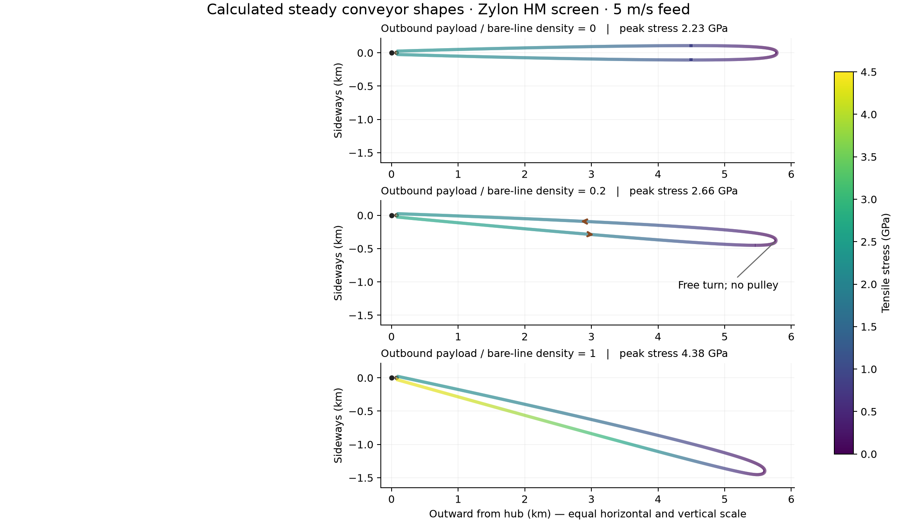
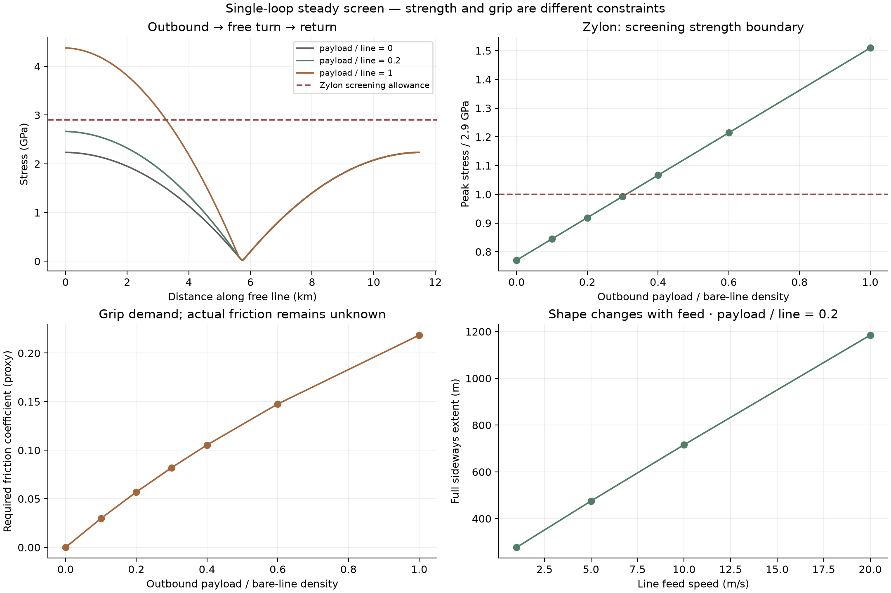
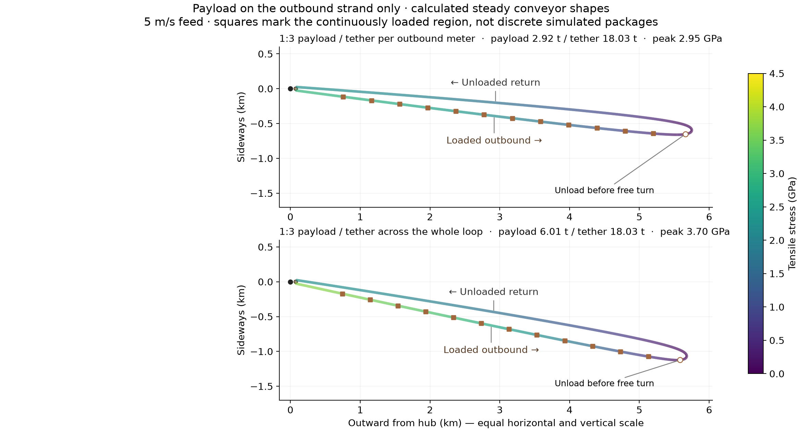

# First conveyor results: steady shape, strength and wheel grip

**2026-11-07 — initial steady screen, not a dynamically validated machine.**
[Conveyor guide](../README.md) · [Future dynamic model](../03_SIMULATION_STACK.md) ·
[Accepted point-mass prerequisite](../../payout_control/README.md)

A moving, constant-section loop can satisfy planar steady force balance with
**a free outer turn and no tip pulley** in this model. Outbound payload loading
makes the loop lean behind the rotating feed station. It raises outbound tension
and therefore both peak stress and the friction demanded at the feed wheel.
The shape below is calculated, not an imposed oval.



## What was simulated

One complete outward loop, with both outbound and return strands. The opposite
arm is assumed symmetric. The feed wheel travels counterclockwise around the
hub, and line circulates counterclockwise around the loop. Geometry is stationary
in the rotating frame, while material and payload mass flow through it.

| Input | Value / status |
| --- | --- |
| Hub rotation | 0.2910819542 rad/s = 2.779627912 RPM, inherited comparison point |
| Feed-wheel center radius | 76.7893704 m, inherited from the 50 mph track |
| Feed-wheel radius | **25 m**, illustrative new input; hardware not sized |
| Unloaded outer radius | 5,787.0884 m; used to select loop length at each feed speed |
| Reference feed | 5 m/s; additional 1, 10 and 20 m/s cases |
| Constant fiber cross-section | 0.001 m² = 1,000 mm²; solid-equivalent diameter 35.68 mm |
| Zylon HM density / nominal fiber strength | 1,560 kg/m³ / 5.8 GPa |
| Kevlar 49 density / nominal fiber strength | 1,450 kg/m³ / 3.0 GPa |
| Screening allowances | Nominal strength divided by 2: **2.9 / 1.5 GPa**; not qualified rope ratings |
| Payload density | Adjustable continuous mass per outbound meter; return payload density zero |
| Reusable device, sheath and splice mass | **Zero in this first screen**; must be added later |
| Plane / elasticity | Horizontal 2D, inextensible string, no gravity normal to plane |

Material properties: [Toyobo technical information, June 2005, p. 2](https://cn.toyobo-global.com/seihin/kc/pbo/zylon-p/bussei-p/technical.pdf)
and [Toray–DuPont Kevlar property table](https://www.td-net.co.jp/kevlar/data/),
accessed 2026-11-07. These are fiber properties, not finished-rope bend, fatigue,
splice, environmental or lifetime ratings. At the representative Zylon stress,
nominal elastic strain would be about 1%; neglecting extension is an initial
shape approximation, not precision geometry.

The 25 m wheel radius is a declared boundary condition, not an optimization or
a carried-over spool dimension. No wheel mass is claimed. The cable's loaded
radius is an output, so these runs do not impose exactly 50 g or optimize a
catch trajectory. For the feed-speed comparisons, loop length is reselected to
keep the same unloaded radius; all loading cases at a given speed share that length.

## Representative numbers and strength boundary

The Zylon reference has payload density **0.312 kg/m**, 20% of bare-line density.
Numbers below are **per arm / one loop**, not the whole mirrored installation.

| Output | Reference result |
| --- | ---: |
| Entire loop length, including wheel contact | 11,555.29 m |
| Bare line mass | 18,026.25 kg |
| Payload inventory in transit | 1,754.79 kg |
| Continuous mass flow | 1.56 kg/s = 5.616 t/hour |
| Loaded maximum distance from hub | 5,784.75 m |
| Center of modeled unloading zone: radius / inertial speed | 5,697.25 m / 1,659.69 m/s |
| Full sideways extent, including lean | 475.18 m |
| Peak free-line stress | **2.66396 GPa**, 91.86% of screening allowance |
| Outbound / returning wheel tension | 2.66396 / 2.23499 MN |
| Minimum free-line tension | 23.885 kN |
| Wheel contact angle | 3.08232 rad = 176.60° |
| Approximate minimum friction coefficient | **0.05696** |
| Ideal feed-brake power, before losses | **2.14488 MW** |

The mirrored pair would contain about **36.05 tonnes of bare line**, before
attachments, wheels, supports or drive/power equipment. Flow is transport
capacity under continuous feeding, **not demonstrated delivery to a catcher**;
phase windows and discrete release schedules have not been imposed.

At 5 m/s, loading alone produces this progression:

| Payload / bare-line density | Payload kg/m | Flow kg/s | Peak stress GPa | Required friction proxy |
| ---: | ---: | ---: | ---: | ---: |
| 0 | 0 | 0 | 2.2349 | 0 |
| 0.1 | 0.156 | 0.78 | 2.4495 | 0.0297 |
| 0.2 | 0.312 | 1.56 | 2.6640 | 0.0570 |
| 0.3 | 0.468 | 2.34 | 2.8784 | 0.0821 |
| 0.4 | 0.624 | 3.12 | 3.0927 | 0.1054 |
| 0.6 | 0.936 | 4.68 | 3.5212 | 0.1476 |
| 1.0 | 1.560 | 7.80 | 4.3775 | 0.2185 |

The provisional Zylon allowance is crossed near a density ratio of **0.31**
(interpolated, not optimized). Increasing cross-section at fixed payload/line
ratio increases mass and transport capacity proportionally, but does **not**
reduce stress: the line must also accelerate its own added mass. Increasing
area at fixed absolute payload density reduces the payload contribution, with
the unloaded self-stress remaining as a floor.

The **single-loop Kevlar** calculation gives **2.0773 GPa unloaded** and
**2.4761 GPa at density ratio 0.2**, both above its 1.5 GPa screening allowance.
This is not a finding against the **two-stage shared-pulley Kevlar** architecture;
that architecture has not been solved here.



## Outbound-only payload and the 1:3 ratio clarification



[Full-size PNG](results/ratio_shapes.png) · [SVG](results/ratio_shapes.svg) ·
[Plot generator](plot_ratio_shapes.py); regenerate with
`.env/hub/bin/python -m sling_launcher.conveyor_loop.steady.plot_ratio_shapes`.

**Payload is already confined to the outbound leg**, represented as continuous
mass density. It is removed before the free turn; the inbound strand has bare
line mass only. Reusable attachment mass is still omitted. Thus the outbound
leg is heavier than the inbound leg in every nonzero-loading scenario.

There are two different meanings of “three times as much tether as payload.”
The original plot labels use the **local density ratio on the outbound leg**.
Total tether inventory also includes the entire return leg and wheel contact,
so the **whole-loop inventory ratio** is approximately half that plotted ratio.
The precise factor includes the finite unloading zone and wheel contact.

Two additional steady cases keep the same 5 m/s feed, Zylon properties, area,
rotation and loop length. They test both interpretations explicitly:

| Metric | Outbound density: payload/tether = 1:3 | Whole-loop inventory: payload/tether = 1:3 |
| --- | ---: | ---: |
| Outbound payload / bare-line density | 0.333333 | 0.684835 |
| Total payload / total bare tether mass | 0.162244 | 0.333333 |
| Bare loop mass | 18,026.25 kg | 18,026.25 kg |
| Payload in transit | 2,924.66 kg | 6,008.75 kg |
| Payload flow | 2.600 kg/s | 5.342 kg/s |
| Peak stress | 2.94985 GPa | 3.70293 GPa |
| Required friction coefficient, proxy | 0.0901 | 0.1640 |
| Full sideways extent | 685.48 m | 1,149.93 m |

Both shapes converge in the steady model. The local-density interpretation is
about **1.7% above** the provisional 2.9 GPa allowance; the whole-loop inventory
interpretation is about **27.7% above** it. Neither therefore passes that
particular strength screen. This is a result for the present single-loop
geometry and allowance, not a rejection of other dimensions, materials or the
two-stage design. No time-dependent simulation has been added.

[Reproducible additional cases](ratio_cases.py) · [Inputs, outputs and checks](results/ratio_cases.json).
Run after the main report using:

```bash
MPLCONFIGDIR=/tmp/lunar-sling-mpl-cache OPENBLAS_NUM_THREADS=1 \
  .env/hub/bin/python -m sling_launcher.conveyor_loop.steady.ratio_cases
```

The whole-loop case solves for the loading ratio rather than rounding it to
2/3. Both additional cases pass force-balance and positive-effective-tension
checks; a 100× tighter solver tolerance changes peak stress by less than 10⁻⁶
relative. The earlier plots and scenarios are preserved.

## Feed speed and the shape

At payload/line ratio 0.2, increasing feed from 1 to 20 m/s increases full sideways
extent from **276.9 to 1,184.7 m**, while peak Zylon stress changes from **2.6521
to 2.7075 GPa**. Thus feed speed strongly affects geometry and throughput even
when peak tensile stress changes comparatively little. The 5 m/s unloaded loop
is already 215.6 m wide; loading adds a substantial overall lean. Width in this
report includes lean and should not be mistaken for strand separation.

These are steady solutions, not trajectories showing a loop safely spinning
up, nor a stability proof. In particular, a steady branch at 20 m/s does not
contradict the earlier point-mass constant-lag compatibility bound: a distributed
closed loop has two tension paths and a different force balance.

## Slippage and power: what the numbers mean

Use the first capstan estimate

`μ_required ≈ ln(T_out / T_return) / contact_angle`.

Both branches are highly tensioned. Consequently, the relevant grip demand is
their **ratio**, not the large absolute outbound force alone. At the reference
point a contact coefficient below about 0.057 would fail this simple grip screen.
No coefficient has been selected from experiments, so there is **no no-slip
verdict**. More wrap reduces this proxy; extra wraps also create routing, bending
and attachment-clearance questions.

This is a classical capstan proxy, not a contact simulation. It neglects the
small centrifugal corrections from line motion around the wheel and the wheel's
motion around the hub, and it assumes ideal flexible line with uniform friction.
Contact pressure, groove geometry, wear and finite bending stiffness remain
unmodeled. The bare-line transport term λu² is only 39 N versus meganewton-scale
wheel tensions here; global-rotation contact corrections are also small at the
reference point. Their small size does not establish a usable material interface.

`P_brake ≈ (T_out − T_return) u` is the ideal local feed-brake exchange, **not net
machine power or solar-panel demand**. The prescribed main rotation supplies
angular momentum and energy. Drive losses, loader work, attached-device return,
whole-machine power balance and recovery efficiency are not calculated here.

## Equations and release approximation

Let x(s) be the free-line position in the hub's rotating frame, s physical arc
length, t its unit tangent, J a 90° counterclockwise rotation, T tension, λ total
moving mass per length, Ω hub speed and u material speed relative to the shape.
With u constant, the inertial acceleration is

`a = u² dt/ds + 2Ωu Jt − Ω²x`.

The moving-string balance and its tangent/normal components are

```
d(Tt)/ds = λ a
x' = cos φ;  y' = sin φ
T' = −λ Ω² (x cos φ + y sin φ)
(T − λu²) φ' = 2λΩu + λΩ²(x sin φ − y cos φ)
```

The Coriolis term and line-transport curvature term are included. Boundary
conditions enforce tangency at **unknown** departure/arrival angles on the
circular inner wheel. Total loop length closes the problem. Nothing holds the
outer turn in place. The branch solved here has positive `T − λu²` throughout;
other branches and time stability have not been surveyed.

For unloaded uniform line, `T + λΩ²|x|²/2` is constant. A second angular first
integral supplies an unloaded seed; continuation in payload density then solves
the loaded boundary-value problem with SciPy `solve_bvp`.

Payloads are **smeared continuous mass**, loaded at the departure boundary and
removed using `λ_payload(s) = q λ_bare [1 − tanh((s/L_free − 0.49)/0.001)]/2`.
The 90%-to-10% removal zone spans about **25 m**, centered near 49% of free-line
arc length, before the free turn. This is an ensemble smoothing assumption,
not a demonstrated 25 m mechanical release device. Released mass leaves at the
local line velocity; there is no additional ejection impulse. With that
same-velocity mass sink, its momentum flux cancels the mass-loss derivative
and the stated local force balance remains applicable. Loading work at the
station is outside the free-span calculation.

The approximation does **not** model a particular payload's unloading force,
Rüdiger-type release waves, discrete attachment spacing, or reusable-device mass.
Those require the time-domain calculation. Interpreting this smooth steady
solution as proof of gentle discrete release would be incorrect.

## Reproduction, validation and next step

From repository root:

```bash
MPLCONFIGDIR=/tmp/lunar-sling-mpl-cache OPENBLAS_NUM_THREADS=1 \
  .env/hub/bin/python -m sling_launcher.conveyor_loop.steady.report
```

[Model](model.py) · [Report generator](report.py) · [All scenario inputs/results](results/summary.json) ·
[CSV summary](results/summary.csv) · [Validation](results/validation.json) ·
[Library versions](results/environment.json). Each scenario also has a compressed
NumPy file with shape, tension, velocity and mass-density profiles.

All 12 scenarios converge. Tightening solver tolerance by 100× changes the
reference geometry by less than **0.1 mm** and peak stress by less than 10⁻⁹
relative. An independent dense-grid integral of vector force balance closes
to below 8×10⁻⁹ in nondimensional force. The unloaded first integral stays
constant to 2×10⁻¹³ and the unloaded wheel has equal end tensions. These validate
numerical consistency of this idealized model, not hardware feasibility.

The next useful extension is to perturb this steady shape in a dynamic elastic
model, add reusable-device mass and discrete payloads, and resolve unloading
waves and wheel contact/slip. The two-stage model must preserve its **shared
intermediate pulley** and solve that assembly's force/torque balance. There is
no optimal-control algorithm, optimized conveyor design, full-system mass/payback
estimate or claim of dynamic stability in this checkpoint.
