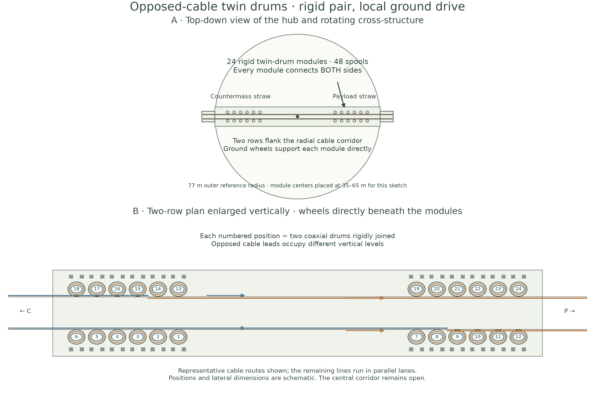

# Lunar Slider Straw: accepted paired-drum reference

[Launcher topics](../README.md) · [Detailed design, mass and first-year payoff](RING_REFERENCE.md)

The launcher uses rigid twin-drum modules connecting oppositely phased payload
and countermass tethers. Each module transmits its net torque through fixed gearing
to supporting ground wheels. A stationary main motor bank drives the 76.79 m
circular rim. The P1 hill permits low machinery supports.

**Current reference — 2026-11-11:** 24 rigid modules, **48 working tethers**, eight
one-tonne useful payloads per catcher orbit, and equal discarded countermass.
Paired holding adds **48 tonnes of working tether**, preserving 4.34 t/h useful
LLO throughput. A **1.5 MWh stationary battery** smooths the 13.8-minute electrical
cycle to approximately **4.27 MW** supply.

- **[Publication packets](publication/README.md):** conceptual multi-tether/straw introduction first, then the engineering reference; includes the separate top-down preparation and batch-release SVGs.
- **[Do we need the straw?](guide_comparison/README.md):** matched guide-free alternative, with retained mechanisms, direct mass credit and a dynamics comparison plan.
- **[Design and complete BOM](RING_REFERENCE.md):** approximately 1,729 t fabricated equipment plus 600 t local foundations; explicit local/imported allocation, thermal budget and annual mass payoff.
- **[Top-down layout](figures/04_paired_bank_layout.svg)** and **[rigid twin-drum module](figures/05_stacked_module.svg):** 24 modules distributed in two rows; no gears between paired drums.
- **[Schedule](results/reference/paired_schedule.png):** half an orbit moving, one orbit holding with one cable extended and its mate retracted.
- **[Battery and power](results/reference/battery_buffer.png):** cycle energy swing, converter power and constant-source operation.
- **[Industrial single-site scale-up](../industrial_scale/README.md):** the active 10 Mt/year study recovers both useful directions, night operation and catcher cadence before sizing the machine.
- **[Early-site replication baseline and go-kart comparison](RING_REFERENCE.md#early-site-reference-and-the-10-million-tonne-scale):** fiber and specialized-equipment inventories for 10 Mt/year, with the assumptions behind the changed machine budget.
- **[P1 tether/terrain technical note](../sag_taper_trade/publication/README.md):** acceleration, tapered-cable sag and full-circle terrain clearance.
- **[Supporting guide/material screens](screening/README.md):** retained scientific results and their limits for the revised inventory.
- **[Remaining engineering work](PLAN.md):** qualification and detailed design tasks for this reference.



## Reproduce the current results

```sh
MPLCONFIGDIR=/tmp/lunar-sling-mpl-cache OPENBLAS_NUM_THREADS=1 .env/hub/bin/python -m sling_launcher.lunar_slider_straw.reference
MPLCONFIGDIR=/tmp/lunar-sling-mpl-cache .env/hub/bin/python -m sling_launcher.lunar_slider_straw.module_layout
```

[Summary JSON](results/reference/summary.json) · [BOM CSV](results/reference/bill_of_materials.csv) · [Cycle arrays](results/reference/cycle.npz).

The central ground-fixed spool proposal, separate per-line reel-drive scheme and
common-shaft layouts have been removed from the active folder. The current model
sizes one ground-drive reduction per rigid pair and the updated holding inventory.
