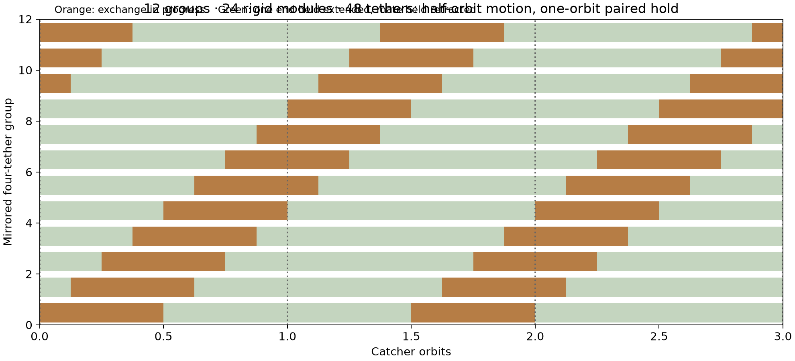
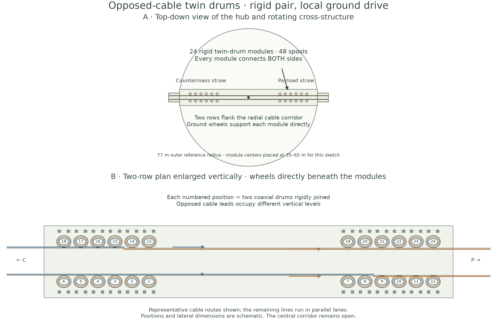
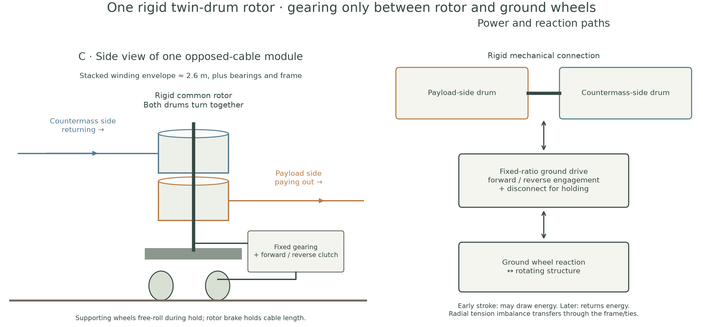
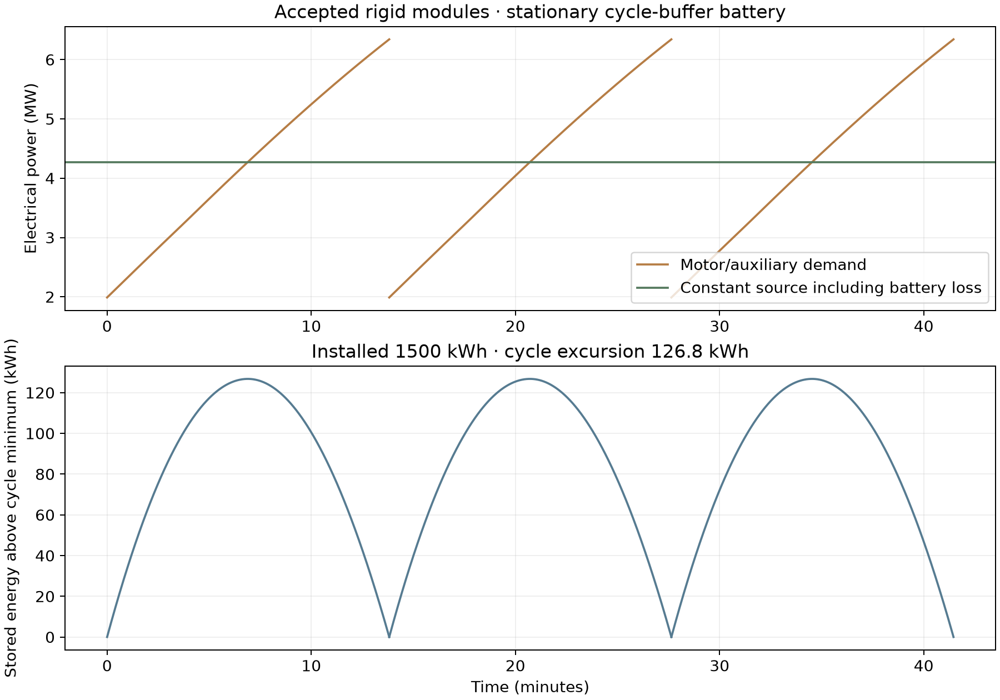

# Accepted P1 launcher: rigid paired drums, ground drive and battery buffer

[Overview and navigation](README.md) · [Numerical inputs/results](results/reference/summary.json) · [BOM CSV](results/reference/bill_of_materials.csv)

**Reference update — 2026-11-11.** This is the current mass calculation. Each rigid
twin-drum module connects a payload-side cable and a countermass-side cable.
There is no gearing between its drums. One fixed-ratio transmission connects the
rotor to wheels immediately below the module. A forward/reverse clutch enables
motion in either direction; a rotor brake holds the cables while the supporting
wheels roll freely. Eight stationary main motors drive the circular 76.79 m rim.

The updated reference contains **24 modules and 48 working tethers**. Fabricated
machine mass is approximately **1,729 t**, with a further **600 t local foundation
allowance**. Of the fabricated mass, **962 t is allocated to local manufacture**
and **767 t to imports** under explicit component assumptions. The **1.5 MWh,
15 t stationary battery** buffers a 127 kWh cycle excursion, giving approximately
**4.27 MW constant electrical supply** during normal operation.

These are best-effort conceptual estimates. Direct-load winding, the rim/rail
sections and wheel assemblies have specified geometry or mass allowances, while
structural qualification and fatigue design remain outstanding. Precision shown
in the numerical files describes reproducibility rather than engineering certainty.

## Paired holds and installed inventory

A mirrored group comprises **two rigid modules, four tethers**. While one module
extends a loaded payload and retracts an empty countermass cable, its mirror
extends a loaded countermass and retracts an empty payload cable. This preserves
symmetry of the machine and produces one useful payload and one discarded
countermass per exchange. The two cables within a module do not need equal tension;
frames and ties transfer the instantaneous radial imbalance.

| Schedule parameter | Accepted reference |
| --- | ---: |
| Catcher period T | 6,633.486 s = 110.558 min |
| Exchange duration | T/2 = 55.279 min |
| Paired hold after exchange | T = 110.558 min |
| Start-to-start interval for one mirrored group | 1.5 T |
| Full extension/return cycle of one tether | 3 T |
| New mirrored-group exchange starts | Every T/8 = 13.820 min |
| Installed mirrored groups | 12 |
| Installed rigid modules / working tethers | 24 / 48 |
| Moving at any time | 4 mirrored groups = 8 modules |
| Moving lines per geographic side | 4 outward + 4 inward |
| Held inventory per geographic side | 8 fully extended + 8 fully retrieved |
| Useful launch batch / counterweight batch | 8 × 1 t / 8 × 1 t |

Each module holds one cable fully extended and its mate fully retrieved for the
same one-orbit interval. The extended payload releases at the next integer catcher
window; the now-empty full cable continues waiting until its return slot. The
retrieved mate has a full orbit for its 300 s reload and wait. At the next exchange,
roles reverse. Thus the extra contracted holding inventory is explicitly present.



The earlier independently scheduled design had 32 working tethers. Pairing raises
this to **48**, adding **48 t of Kevlar working tether**: 96 → 144 t. The two 3 t
straw guides bring total working fiber to **150 t**. This is a 50% working-tether
penalty for the selected simple schedule, with unchanged payload throughput.

A uniform-start schedule needs at least **11 mirrored groups = 44 tethers** for
the worst catcher wait. Twelve groups provide an exact one-orbit paired hold and
additional timing room. This is a deliberate clean reference above the arithmetic
minimum. Eight groups/32 tethers cannot sustain the specified uniform half-orbit
exchanges and common-release timing: some extended loads would need to begin
returning before their catcher window. This result is specific to the retained
uniform starts, travel duration and catcher cadence, rather than a universal
minimum over all controls.

## Site, geometry and actual spool modules

Use the selected P1 hill, **latitude 0.1142578125°, longitude 16.1572265625°**.
Its [terrain envelope](../../llo_catcher/site_selection/radial_terrain/README.md)
provides the drop previously supplied by tall poles. The reference retains a
provisional low support datum around **5 m above the hub tangent plane**. Final
three-dimensional routing, the revised inventory and local foundations require
clearance checks. P1's earlier successful eastward trajectory used a 5.716 km arm;
this inherited sling geometry uses **5.787 km release radius**, so final catcher
targeting remains an integration task.





| Item | Value |
| --- | ---: |
| Main rim radius / tangential speed | 76.789 m / 22.352 m/s |
| Hub rotation | 2.77963 rpm |
| Active cable length beyond reference throat | 5,710.299 m |
| Cable mass / working stress | 3,000 kg / 2.438 GPa |
| Solid fiber diameter, root → tip | 24.401 → 16.003 mm |
| Rope diameter at 65% fiber fill | 30.266 → 19.849 mm |
| Drum core / fully wound radius | 0.6053 / 1.2175 m |
| Each drum winding width | 1.2106 m |
| Twin winding stack | 2.421 m, approximately 2.6 m with initial spacing |
| Module rotor speed in motion | 17.33 rpm |
| Module rows | Two, with centers at approximately ±35, ±41, ±47, ±53, ±59, ±65 m |
| Peak single-line tension | 1.140 MN |
| Peak net module shaft torque / power | 691 kNm / 1.254 MW |
| Preliminary twin rotor / ground reduction mass | 16.08 t / 6.80 t per module |

The winding geometry is included internally in the calculation so both drums
share one angular speed and complete the exchange together. There is no extra
line-speed controller or inter-drum differential in the reference. This changes
the detailed curve relative to the earlier constant-line-speed approximation,
while preserving stroke duration and delivered kinetic energy. Endpoint stopping
ramps and startup transients remain outside the cycle model.

### Rotor, wheels and structure mass basis

**Twin rotor:** two 80 mm-wall steel core shells, four 25 mm end flanges extending
0.10 m beyond the winding radius, a common approximately 304 mm shaft, and 50%
additional mass for stiffening, bearings and joints. The shaft has a 1.5 torque
service factor against the assumed steel allowable. This gives **16.08 t per
rigid pair**, including both drums. The heavy core and flanges replace the old
light low-tension-storage/capstan allowance. The shell dimensions are a trial
section, not a solved multilayer winding-pressure or external-buckling design.
Wound-rope damage and localized contact loads may require further changes.

**Ground gearing:** one reduction per module, sized from the **net** rigid-rotor
torque and power, using the inherited [Flender curve and installation factors](../results/hardware_mass/SOURCES.md).
The result is **163.2 t for 24 reductions**, down from 217.3 t in the independent
32-reduction estimate. No per-line electric motor, common inter-module drive
shaft, or gear train between the paired drums is included. For a 1.2 m ground-wheel
diameter, module ratios are approximately 9.4:1 at 35 m to 17.4:1 at 65 m.

**Module wheels:** four support/drive wheel assemblies at 1 t each and four smaller
capture rollers at 0.5 t each, including suspension/bearing allocations: **6 t
per module**. Diameters, contact width and Hertz/contact-fatigue capacity require
selection. At the inner module radius, peak nominal tangential demand reaches
approximately **123 kN**. At assumed friction coefficient 0.35 this requires
**352 kN aggregate preload**. Module weight alone supplies insufficient lunar
normal force. Captured/preloaded rollers reacting against anchored rails supply
the remaining force; toothed engagement is an alternative detail, not credited
as a free mass reduction. These are ordinary mechanical assemblies at large load.

**Fixed paths:** modules follow six distinct ground circles. Use an effective
12,000 mm² steel section along each path, with 30% joint/base allowance. This
produces **231.6 t of fixed reaction rails**, allocated to local fabrication.
The section is a preliminary volume allowance; anchor spacing and clamping loads
need structural analysis. Local rail diameters include the small transverse row
offset in the calculation.

**Main rim:** a 0.70 × 0.50 m steel box with 20 mm walls and 30% allowance for
teeth, joints and drive interfaces gives **228.5 t**. The larger section replaces
the previous 143 t ring allowance. Cross-structure and low supports add **100 t**,
and opposed ties/bracing add **20 t**. These structures are treated as locally
fabricable bulk material in the import split, while precision drives remain
imported. Dynamic loads, thermal distortion, manufacturing tolerances and joint
fatigue have not been structurally qualified.

The 26 t jacket/termination/guide allowance also covers preliminary lead-in cable
and routing hardware between the outboard modules and the two straw throats.
The radial cable-power model retains its 76.79 m throat reference; the shorter
lead-in spans from each actual module position are covered by the routing mass
allowance but their force geometry is not re-solved here. Detailed cable routing
and terminal loading machinery remain preliminary mechanical allowances.

## Power, battery and heat rejection

A stationary motor bank drives the moving rim. Each module separately exchanges
its net shaft power with the rotating structure through its ground wheels. The
battery and its converter sit on the stationary electrical bus, supplying peaks
and absorbing surplus from the constant source. Both charge and discharge are
included in the state-of-charge integral.

| Quantity | Mean | Maximum |
| --- | ---: | ---: |
| Ideal net launch power | 3.422 MW | 5.302 MW |
| Main electrical/auxiliary demand | 4.240 MW | 6.342 MW |
| Moving module heat | 327 kW | 357 kW |
| Stationary drive/auxiliary heat | 486 kW | 679 kW |
| Battery + converter heat | 33.5 kW | 68.5 kW |

Main-drive efficiency assumptions remain 97% motor, 96% reduction, 99% contact
and 98.5% inverter. Modules have 1% loss on gross cable-shaft power for winding
and bearings, then 96% efficiency on the **net** power exchanged through their
wheel gearing in either direction. Additional losses are 24 kW moving auxiliaries,
60 kW rolling/rim support, and 40 kW stationary electrical auxiliaries. These are
explicit engineering assumptions, requiring eventual measurements. They avoid
charging a separate reduction loss to each cable's full circulating power.

### Battery sizing from the energy integral

The repeat interval is **829.186 s = 13.820 min**. Solve a constant source power
such that the cell energy change over this interval is zero, with **97% charge
and 97% discharge efficiency** including the bidirectional converter:

`dE/dt = 0.97(P_source − P_load)` when charging,

`dE/dt = (P_source − P_load)/0.97` when discharging.

| Battery parameter | Result |
| --- | ---: |
| Constant source input | **4.273 MW** |
| Usable cycle energy swing | **126.8 kWh** |
| Energy-only capacity, 60% usable range and 25% margin | 264.1 kWh |
| Maximum charge/discharge bus power | **2.285 MW** |
| Converter design rating, including 25% margin | **2.856 MW** |
| Selected nominal battery, assumed 2C charge/discharge | **1,500 kWh** |
| Normal-cycle state-of-charge excursion | **8.45%** |
| Battery mass at 100 Wh/kg installed | **15.0 t** |
| Converter mass allowance | **1.43 t** |



The storage duration is modest; **power capability controls installed capacity**.
At 1C, the same margin would need about 2.9 MWh and 29 t; at 3C, about 1.0 MWh
and 10 t. The selected 2C is a design requirement, not an identified qualified
battery product. [NASA's power-system survey](https://www.nasa.gov/smallsat-institute/sst-soa/power-subsystems/)
and [planetary energy-storage review](https://science.nasa.gov/wp-content/uploads/2023/09/Energy_Storage_Tech_Report_FINAL.pdf)
provide the context for the conservative 100 Wh/kg installed-pack assumption.
The pack budget includes containment and battery management; the converter and
external radiator are separately listed.

At 50% duty there are approximately **19,016 shallow buffer cycles per year**,
about 1,607 equivalent full cycles at the predicted swing. High-power shallow-cycle
life, temperature control and replacement intervals need qualification. The pack
smooths normal operation; it does not provide lunar-night energy, emergency
spin-down capacity or startup reserves.

### Cooling and available area

The hot motor/gear loop uses 350 K radiators; the battery uses a separate **310 K**
loop. Both use emissivity 0.85, effective sink 250 K, sky-view factor 0.7 and 25%
margin over their respective peak heat loads. Hot radiator area is **3,458 m²**;
battery radiator area is **477 m²**; total **3,935 m²**. At the inherited 8 kg/m²
plus 20% heat transport/manifold allowance, radiator-system mass is **37.8 t**.

The 76.79 m ring encloses **18,525 m²**. A preliminary area budget can accommodate
approximately **7,870 m²** for panels plus spacing and about **7,550 m²** for six
4 m-wide circular wheel/service corridors, leaving roughly 3,100 m² for other
uses. Panels would occupy separated regions between tracks; this replaces the
previous unobstructed central-disk assumption. Actual module sweep envelopes,
shadowing, access, coolant routing and infrared view factors need a layout study.
The area fit is conditional on a shaded/view-managed 250 K effective sink,
particularly for the cooler battery circuit at equatorial P1.

Stationary motor/battery cooling is direct. Moving modules still need onboard
coolant collection and a central rotary fluid interface to stationary radiators.
The revised moving heat is materially lower than the independent-spool estimate,
but the rotary cooling interface remains in the mass allowance. Straw friction
is separately dissipated over the guide and remains outside the equipment radiator.

The solar array is sized to **5.13 MW** illuminated output (20% over the smoothed
source), approximately **51.3 t** at the inherited 100 W/kg assumption. Its estimated
20,512 m² collecting area belongs outside the machinery ring. Main motors remain
sized for peak shaft demand: **eight 1 MW motors**. Battery smoothing reduces
source/array rating, not the motors' instantaneous torque requirement.

## Complete bill of materials

The local fractions below are a **manufacturing scenario**, not proven present-day
lunar capability. Local fabrication remains part of total machine mass. The local
industrial plant, excavation fleet, catcher stations and LLO-to-L1 transport fleet
remain separate infrastructure budgets. Prepared foundations use local material.
The direct-winding and rail masses are substantial engineering allowances and
should not be read as supplier weights.

| Component | Mass (t) | Assumed local fraction | Basis and lunar-production challenge |
| --- | ---: | ---: | --- |
| 48 tapered working tethers | 144.0 | 0% | 48 × 3 tonnes; paired holding schedule. Import Kevlar fiber, coatings and quality-critical terminations. |
| Two straw guides | 6.0 | 0% | One 3 t fiber guide each side; provisional for new inventory. Import fiber; local assembly possible. |
| Jackets, terminations, straw opening hardware | 26.0 | 0% | 26 t allowance, including larger line inventory. Mixed polymers and precision contacts; imported initially. |
| 24 rigid twin-drum rotors | 385.8 | 70% | 80 mm core shells, 25 mm flanges, common shaft, 50% stiffening/bearings allowance. Bulk metal locally fabricated; bearings and qualified contact surfaces imported. |
| 24 module-to-ground reductions | 163.2 | 0% | One per module, net torque and net power; no inter-drum gearbox. Precision gearing and heat treatment imported initially. |
| Module clutches, brakes, reversers, levelwinds | 36.0 | 0% | 1.5 t per rigid module allowance. Precision mechanisms imported; no storage-follower drivetrain. |
| Module ground wheels and suspension | 144.0 | 50% | Per module: four 1 t support/drive units + four 0.5 t capture rollers. Bulk wheel bodies local; bearings, dampers and wear surfaces imported. |
| Six fixed circular ground reaction rails | 231.6 | 100% | 12,000 mm² effective steel per path, six radii, 30% joints/base allowance. Locally refined/fabricated metal; precision alignment remains demanding. |
| 77 m moving drive rim | 228.5 | 100% | 0.70 × 0.50 m steel box, 20 mm wall, 30% teeth/joints allowance. Local structural metal; finish machining and alignment required. |
| Rotating cross-structure and low machinery supports | 100.0 | 100% | 100 t fabricated allowance; 24 suspended modules. Local bulk metal and fabrication. |
| Opposed tension ties, anchors and lateral bracing | 20.0 | 50% | 20 t reserve for cable-force imbalance and radial machinery loads. Metal local; high-performance fiber and precision joints imported. |
| Loading, retention and synchronized release hardware | 45.0 | 25% | 48 line positions and two terminal staging banks. Bulk structure local; release actuators and controls imported. |
| Eight stationary rim-drive motors | 45.5 | 0% | Industrial 4.55 kg/kW anchor, 25% installation allowance. Electrical steel, windings, insulation and precision manufacture imported initially. |
| Main reductions and drive wheels | 34.4 | 20% | 2 kg/kW reduction floor ×1.4 plus 12 t wheels. Precision parts imported; wheel/frame metal partly local. |
| Main inverters and protection | 1.5 | 0% | Prior inverter curve. Imported electronics. |
| Stationary buffer battery | 15.0 | 0% | 1500 kWh at 100 Wh/kg; 2C power screen. Imported cells and battery management; installed pack allowance included. |
| Battery bidirectional converter | 1.4 | 0% | 0.5 kg/kW at 125% peak buffer power; allowance. Imported power electronics. |
| Radiators, rotary fluid transfer and manifolds | 37.8 | 50% | 8 kg/m² plus20% heat transport; two temperature circuits. Panel/pipe metal partly local; coatings, pumps and unions imported. |
| Electrical distribution and controls | 12.0 | 20% | 12 t allowance; auxiliary slip rings only. Conductors partly local; controls imported. |
| External solar generation | 51.3 | 20% | 100 W/kg illuminated output;20% over battery-smoothed source. Support metal partly local; cells/electronics imported. |
| Prepared local foundations | 600.0 | 100% | 600 t local aggregate/anchors allowance, not an excavation estimate. Local feedstock, grading and foundations. |

Totals: **1,728.9 t fabricated equipment**, comprising **961.8 t locally fabricated**
and **767.1 t imported**, plus **600 t local foundations**. Installed material totals
**2,328.9 t**. The largest items are the **385.8 t twin rotors**, **231.6 t fixed
rails**, **228.5 t rim**, **163.2 t module reductions**, and **150 t working fiber**.

The old 1,023 t machine estimate used lighter low-tension storage and a different
wheel/rail architecture. The new mass increase is not solely the 48 t hold penalty:
it also replaces that hardware with direct-load rigid drums, captured module
wheel supports, multiple reaction tracks and a larger rim. An illustrative ±50%
uncertainty on rotor, wheel, rail and major structural allowances spans hundreds
of tonnes. Resolving those sections is more important to total mass than reducing
the approximately 16 t battery-plus-converter package.

## First-year L1 mass payoff

Useful flow remains **1.206 kg/s = 4.342 t/h to LLO**, with an equal local mass
of discarded countermass. The prior transfer assumptions remain explicit: 450 s
specific impulse, 0.9 km/s LLO-to-high-orbit delivery allowance, 2.7 km/s descent
allowance, descent dry hardware 25% of landed imported mass, and 10% of each LLO
wet stack reserved as uncredited ascent dry hardware. This leaves **71.551%** of
caught mass as useful L1 shielding. The high-orbit Δv is a planning proxy; exact
L1 trajectories and suitable propellant production still require their own work.

At 50% operating duty over 365 days, the launcher catches **19,016 t useful mass**
and delivers **13,606 t shielding to L1**. Another 19,016 t of countermass is
consumed locally. Every working tether completes approximately **792 full cycles**
per operating year; service life and replacement inventory are not yet established.

| Fabrication scenario | Imported launcher mass landed | Initial L1 mass including descent | First-year L1 shielding / investment |
| --- | ---: | ---: | ---: |
| Explicit local-fabrication allocation | **767 t** | **1,768 t** | **7.70×** |
| All fabricated machine parts imported | **1,729 t** | **3,985 t** | **3.41×** |

Under the local-fabrication scenario, mass-only break-even is **569 operating
hours**, approximately **47.4 calendar days at 50% duty**, plus transfer latency.
First-year shielding exceeds the initial L1-equivalent imported investment by
approximately **11,838 t**. At 25% duty first-year output is 6,803 t; at hypothetical
100% duty it is 27,213 t. The present solar-only supply requires daylight; the
cycle battery does not enable the 100% scenario by itself.

This compares against leaving the same imported mass at L1 as direct shielding.
Earth-to-L1 delivery cancels at that common accounting boundary. It assumes an
operating year after installation, suitable lunar-derived ascent propellant and
existing supporting infrastructure. Local-metal production is not free: its
factory and energy costs need separate accounting. These numbers therefore
measure launcher mass productivity under the stated infrastructure assumptions.

## Early-site reference and the 10-million-tonne scale

**Replication baseline.** The active [industrial single-site study](../industrial_scale/README.md)
revisits the architecture: both useful directions, continuous power, additional
catcher windows and paired schedules. The table below preserves the earlier
unchanged-machine comparison.

This machine is an early-site reference. Later installations could upgrade drive
hardware, materials, service life, local manufacturing and loading logistics.
The following arithmetic uses **10 million metric tonnes per Earth year** as a
planning target supplied for this investigation. It scales copies of the current
reference, with the same **50% daylight operating duty** and discarded countermass.
It assumes no performance improvement from those future upgrades.

| Inventory or demand | 10 Mt/year useful at LLO | 10 Mt/year useful at L1 |
| --- | ---: | ---: |
| Current-machine equivalents | 525.9 | 735.0 |
| Working Kevlar tether inventory | 75,725 t | 105,833 t |
| Kevlar straw-guide inventory | 3,155 t | 4,410 t |
| **Total working fiber** | **78,880 t** | **110,243 t** |
| Imported/specialized equipment proxy, including fiber | 403,408 t | 563,806 t |
| All fabricated equipment, including local manufacture | 909,192 t | 1,270,693 t |
| Discarded local countermass per year | 10.00 Mt | 13.98 Mt |
| Electrical source demand while operating | 2.25 GW | 3.14 GW |

“Specialized” uses the current BOM's imported fraction as an explicit proxy. This
includes fiber, precision gearing, bearings, motors, electronics, cells and other
imported assemblies. It is an **equipment mass budget**; a chemical breakdown of
specialty materials has not been established. Fiber is already included in that
column, so the columns should not be added together. Descent propellant is outside
this landed-equipment inventory and remains included in the L1 payoff accounting.

The installed fiber is about **0.79% of one year's LLO delivery**, or **1.10% of
one year's L1 delivery**, at the respective target. Replacement consumption must
be added once lifetime is known. At a one-year fiber life, those same amounts would
also become annual replacement requirements. These inventories do not establish
where hundreds of machines fit, how catchers handle their batches, or how lunar
mining, processing and propellant production support the flow. Those ground and
orbital operations become major scaling questions.

The calculation is `reference inventory × target annual delivery / reference
annual delivery`. Numerical values are saved in
[scale_10million.json](results/reference/scale_10million.json), regenerated with
`python -m sling_launcher.lunar_slider_straw.scale`. At otherwise equal
100% operating duty the inventory per annual delivery would halve, but that
requires a power supply beyond this daylight-only reference.

## Comparison with the published go-kart reference

Both references use a one-tonne payload, equal discarded countermass, approximately
1.685 km/s release speed, 50 g acceleration and a 76.79 m outer drive radius.
The [published go-kart checkpoint](../publication/README.md) remains frozen.

| Feature | Published go-kart | Current paired-drum straw |
| --- | --- | --- |
| Useful batch per 110.56-minute orbit | 1 t | 8 t |
| Useful LLO delivery at 50% annual duty | 2,377 t/year | 19,016 t/year |
| Working payload/countermass tethers | 2 | 48, plus two guides |
| Material sizing | 1 GPa working-stress reference | 2.438 GPa for approximately 3:1 tether/payload mass |
| Support geometry | 28.68 m A-frame tops, spherical terrain datum | P1 hill and provisional 5 m machinery datum |
| Reel architecture | Capstan/storage and independently sized drives | Direct-load rigid paired drums, one ground reduction per pair |
| Tether energy exchange | 70% recovery assumption | Mechanical exchange within pair; 1% gross winding/bearing loss and 96% net wheel-drive efficiency |
| Ground support | Large rover wheels and lunar rock ballast | Captured module wheels, six reaction rails, stationary drive on moving rim |
| Peak demand / generation sizing | 21.97 MW peak solar | 6.34 MW electrical peak; 4.27 MW smoothed source; 5.13 MW array |
| Storage | No cycle battery | 1.5 MWh stationary cycle battery |
| Imported equipment | 1,253 t | 767 t under explicit local-fabrication allocation |
| Total equipment and local ballast/foundations | 2,446 t | 2,329 t |

The difference combines **higher allowed fiber stress, more effective assumed
mechanical recovery, scheduling, battery buffering, a favorable real hill and
local metal fabrication**. It cannot be attributed to the straw alone. The newer
heat-rejection model also uses a 350 K hot radiator loop versus the older 330 K
reference, with a separate 310 K battery loop. Those thermal assumptions affect
radiator mass substantially.

Local structure was previously represented principally by ballast. The current
reference credits local fabrication of precision-aligned bulk metal structures;
that requires a more capable site. Total fabricated equipment is now 1,729 t,
including 962 t assigned to local manufacture. Comparing only the two imported
mass figures would hide this change. Direct-loaded drum and reaction-rail masses
remain especially uncertain engineering allowances. Neither budget includes the
industrial plant needed to supply local products.

## Reproduction and checks

```sh
MPLCONFIGDIR=/tmp/lunar-sling-mpl-cache OPENBLAS_NUM_THREADS=1 .env/hub/bin/python -m sling_launcher.lunar_slider_straw.reference
MPLCONFIGDIR=/tmp/lunar-sling-mpl-cache .env/hub/bin/python -m sling_launcher.lunar_slider_straw.module_layout
```

The script verifies release batches, paired hold/reload feasibility, average
launch energy, instantaneous electrical/thermal balance and battery cycle-energy
closure. Winding radii are integrated numerically to impose a common rigid-rotor
speed and equal stroke duration. Fixed ground ratios differ by module radius.
No per-line motor or inter-drum gearing appears in the ledger. Startup, emergency
braking and finite endpoint ramps need a later transient model.

[Machine-readable summary](results/reference/summary.json) ·
[Full BOM](results/reference/bill_of_materials.csv) ·
[Power and battery arrays](results/reference/cycle.npz) ·
[Supporting material and shape studies](screening/README.md).
