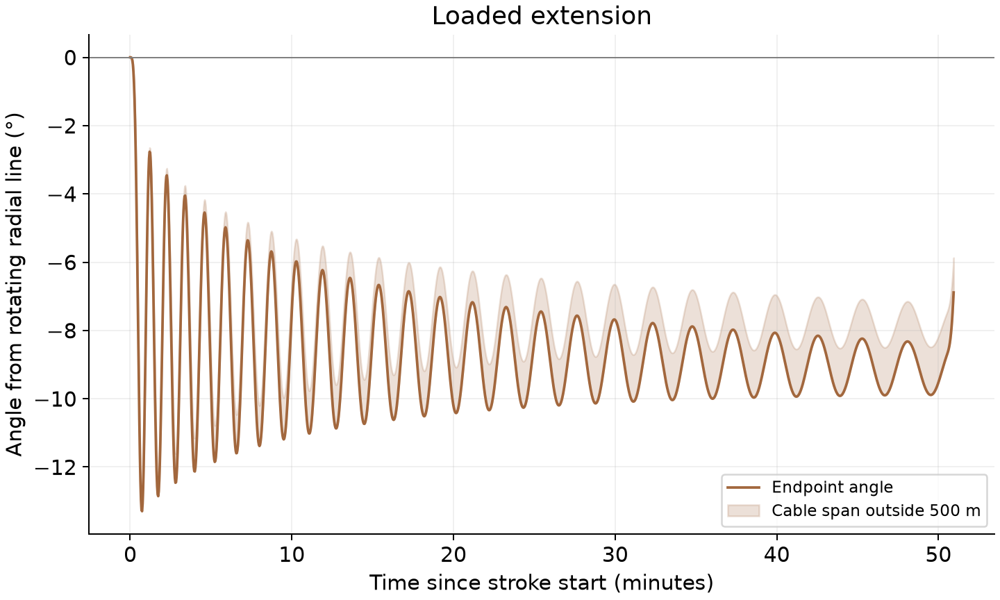
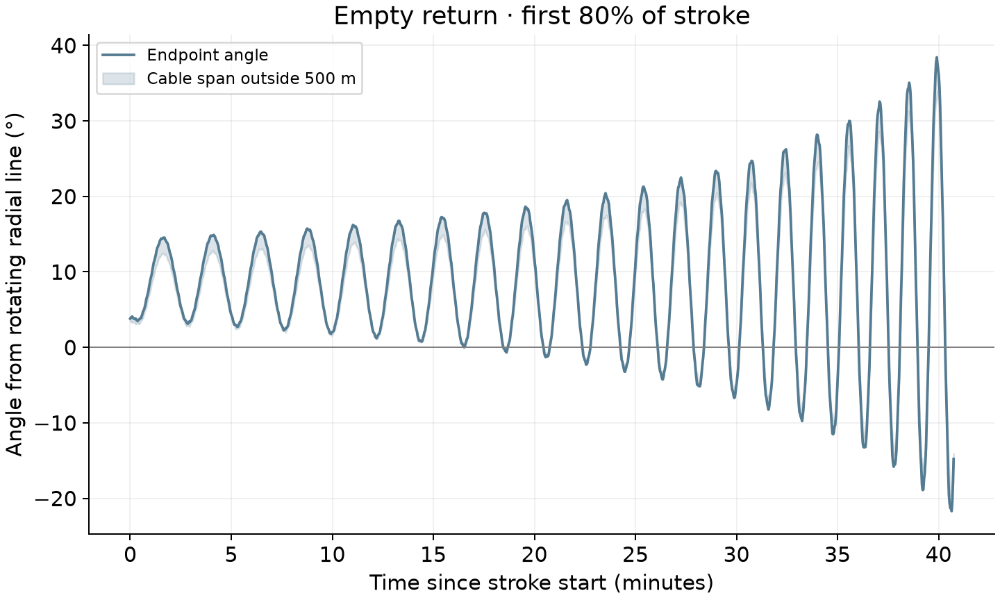

# Constant-speed free cables: angular deviation during payout and return

[Guide comparison](../README.md) · [Concept publication packet](../../publication/concept/README.md)

This experiment asks how independently moving tapered cables behave under the
constant-line-speed command proposed for the straw. Hub rotation and paid-out
length are prescribed; cable shape, payload angle, stress and angular motion
are solved dynamically. The continuous guide is absent.

## Results for the reference inputs

**Loaded payout averages -8.76° of lag during cruise**,
with a most-negative tip angle of **-13.29°**. Maximum sideways tip
displacement reaches **994 m**. After the length command stops,
the loaded hold still swings between **-8.30° and 8.30°** in
this run. Constant cruise speed therefore does not imply a fixed angle or a
settled payload at the end of the stroke.





The return panel shows the first 80% of its stroke. The [complete stroke and
stress figure](angular_deviation.png) retains the provisional final portion.

| Stroke time | Loaded extension tip angle | Empty retraction tip angle |
| --- | ---: | ---: |
| 12.73 min (25% of stroke) | -10.87° | 8.60° |
| 25.45 min (50% of stroke) | -7.46° | 20.57° |
| 38.21 min (75% of stroke) | -9.60° | 14.21° |

These are snapshots within oscillatory histories. During the first 80% of return,
the tip angle spans **-21.71° to 38.42°**.
The late-return and post-return orientation becomes much more sensitive and can
wind through whole relative revolutions in the contact-free model. The figures
retain that diagnostic behavior and mark the late return as provisional.

Both meshes complete the modeled extension and return without triggering the
3 GPa stop. The 64-cell peak stresses are **2.559 GPa during
extension** and **1.431 GPa during return**; abrupt release peaks
at **2.861 GPa**.
These are simulated fiber stresses under an assumed damping law, with material
qualification and neighboring hardware contact still outside the model.

| Mesh comparison, 32 versus 64 cells | Maximum tip-angle difference through first 80% | Maximum over full stroke |
| --- | ---: | ---: |
| Extend | 0.006° | 0.007° |
| Retract | 1.674° | 42.443° |

The stable publication conclusion is that this simple open-loop program has a
substantial payout lag and growing return oscillations. Two meshes help separate
the repeatable early/mid-stroke result from the sensitive late behavior. They do
not validate the damping or establish a converged hardware trajectory.

**What this says about the straw:** a shared guide has a concrete task—keeping
phased cables in a controlled common corridor through these changing demands.
The free-cable alternative would need separate corridors, more carefully shaped
commands, feedback, or another demonstrated way to preserve separation. This
experiment supplies a motivation for the guide; it leaves the comparative cost
and feasibility of those alternatives open.

## Matched design numbers and scope

- One 1,000 kg payload, 3,000 kg full tapered Kevlar cable and 10 kg retained end device.
- Hub attachment radius 76.789 m; hub speed 0.291082 rad/s, approximately 2.78 rpm.
- Full unstretched cable length 5,710.299 m; nominal reference tip radius 5,787.088 m.
- Constant cruise speed **1.72166 m/s** outward and inward, from full cable length divided by half the reference catcher period.
- Raised-cosine speed ramps lasting **30 s** at each start and stop. These avoid instantaneous velocity jumps; cruise occupies the rest of each stroke.
- Initial deployed length **500 m**, starting in loaded radial co-rotating equilibrium. The model ends return at the same length. Deployment and recovery inside this initial length remain outside the calculation.
- Loaded hold 300 s; instantaneous payload detachment; 60 s release settling with fixed commanded length, then empty return and a 120 s final hold.
- Elastic modulus 112.4 GPa, density 1,450 kg/m³; tension-only elastic elements and inherited 0.02 s axial relaxation parameter. The relaxation parameter is a numerical/material sensitivity assumption.

The modeled stroke lasts about 50.94 minutes, including ramps. The full-length
reference travel budget is 55.28 minutes; the difference comes from starting
with 500 m already deployed. Elastic stretch changes actual reach relative to
the nominal reference geometry. The material sizing includes the retained end
device while keeping total tether mass at 3,000 kg, giving a 2.453 GPa static
design stress versus 2.438 GPa in the carrier-free radial reference. Catcher
targeting has not been retuned for the elastic reach and angular motion.

This is a controlled constant-**line**-speed experiment. The accepted rigid drum
pair enforces equal angular speed, and winding radii would modify line speeds.
That detailed winding program is outside this comparison, as requested.

## Outputs

- [Extension angle PNG](extension_angles.png) / [SVG](extension_angles.svg): full payout.
- [Retraction angle PNG](retraction_angles.png) / [SVG](retraction_angles.svg): first 80% of return.

- [Angular deviation and stress histories](angular_deviation.png), with [SVG](angular_deviation.svg).
- [Full continuous angle history](full_cycle_angles.png), with [SVG](full_cycle_angles.svg).
- [Free-cable shape snapshots](free_cable_shapes.png), with [SVG](free_cable_shapes.svg).
- [Results and mesh comparison](summary.json); saved 32- and 64-cell histories retain positions, material velocities, stress and angles.

The solid curve tracks the endpoint's continuously unwrapped angle from the feed station's radial line
in the hub-rotating frame. Negative angles lag rotation; positive angles lead.
The shaded range covers the complete cable outside 500 m hub-centered radius,
including segment intersections with that cutoff. Angles beyond 360° in the full-history diagnostic indicate relative revolutions
in this contact-free numerical model. The final 20% of return is shaded as
provisional, and post-return winding around the hub is outside a valid hardware
interpretation. Angles are horizontal-planar
motion; vertical sag over terrain is a separate calculation.

## A simple scale check

For a payload-dominated free cable in approximately steady cruise, far outside
the hub attachment radius a, maintaining co-rotation while moving outward at u
requires tangential acceleration approximately 2Ωu. The root offset supplies a
torque lever, giving the small-angle scale `sin(|δ|) ≈ 2u/(Ωa)`. Here it predicts
about **8.86° of lag**. This approximate payload-only argument checks the order
of magnitude; distributed cable inertia, taper, finite reach and startup/stop
oscillations are included in the numerical histories instead.

## Interpreting the straw argument

A free cable can be narrow at any instant while its whole shape swings through a
large angle over the stroke. Both its time-dependent angle and its instantaneous
occupied span matter to a bank of phased cables. Individual angular excursions
alone do not demonstrate collisions: neighboring lines follow their own phases
and have finite payload sizes and different root positions.

The straw's candidate benefit is shared guidance and transverse load transfer.
This experiment tests the free-cable side of that argument. The earlier shared-
guide calculation imposed contact and a different inventory; it should not be
plotted as an equivalent dynamic result or as proof of stability. A matched
whole-bank comparison must evaluate spatial separation, contact loads, stress,
losses and required hardware at the same throughput.

The model prescribes unlimited hub-drive response and omits guide contacts,
neighboring lines, gravity perpendicular to the plane and 3D routing. An
instantaneous release carries positions and velocities continuously into the
unloaded state and excites an unloading wave. The 3 GPa nominal fiber-strength
threshold terminates a run rather than extrapolating through that event.
Late empty-return behavior was mesh/damping-sensitive in the earlier study;
any numerical termination or mesh disagreement must accompany the result.

## Reproduce

```sh
MPLCONFIGDIR=/tmp/lunar-sling-mpl-cache OPENBLAS_NUM_THREADS=1 .env/hub/bin/python -m sling_launcher.lunar_slider_straw.guide_comparison.constant_speed.simulate --nodes 32
MPLCONFIGDIR=/tmp/lunar-sling-mpl-cache OPENBLAS_NUM_THREADS=1 .env/hub/bin/python -m sling_launcher.lunar_slider_straw.guide_comparison.constant_speed.simulate --nodes 64
MPLCONFIGDIR=/tmp/lunar-sling-mpl-cache .env/hub/bin/python -m sling_launcher.lunar_slider_straw.guide_comparison.constant_speed.report
.env/hub/bin/python -m sling_launcher.lunar_slider_straw.guide_comparison.constant_speed.write_results
```

The runner extends the existing [moving-domain inertial tether model](../../../spooled_tether_2d/README.md).
The earlier [faster-start comparison](../../../spooled_tether_2d/CONTROL_COMPARISON.md)
used a 7.31 t tether and roughly 4.49 m/s cruise; its approximately −23° plateau
belongs to those inputs.
