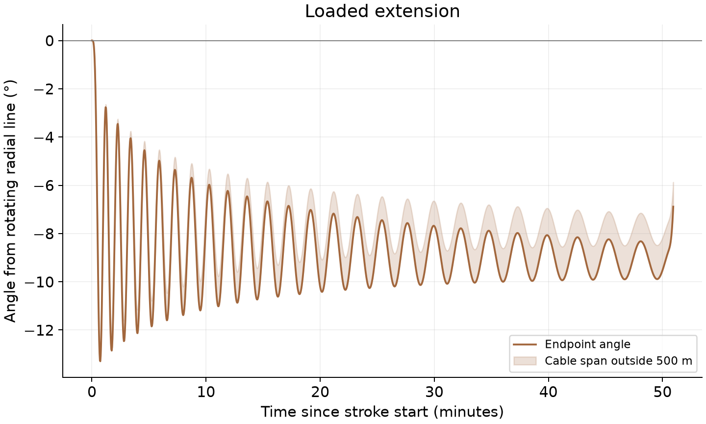
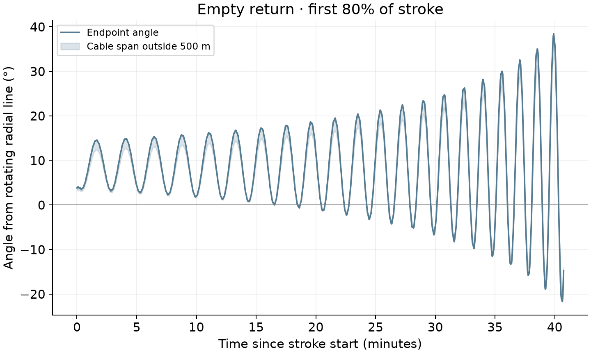
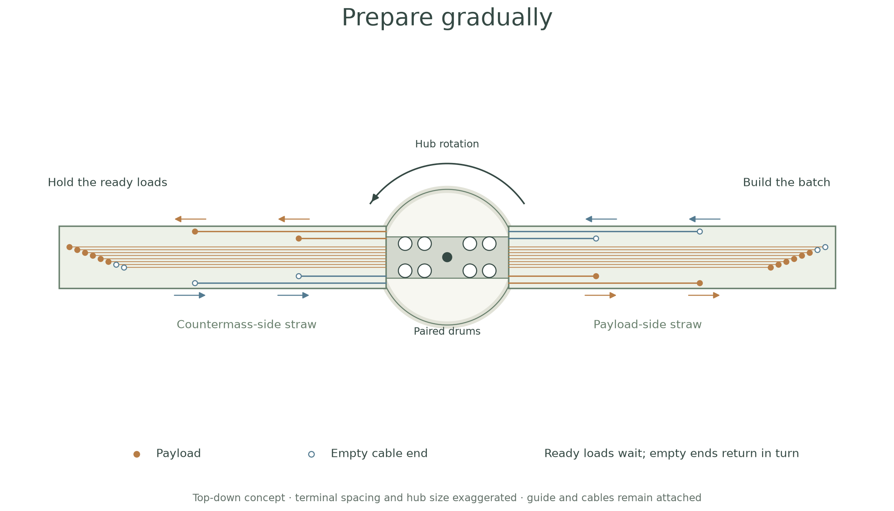
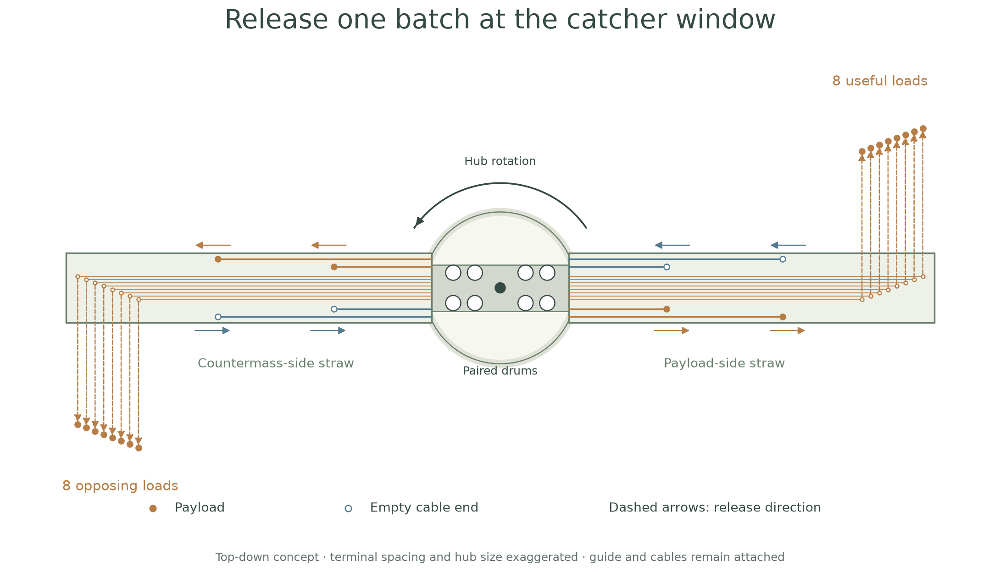
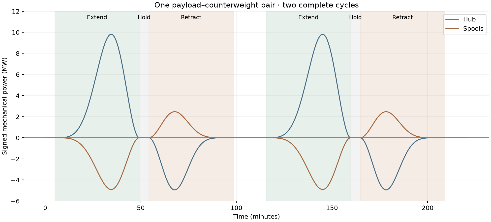
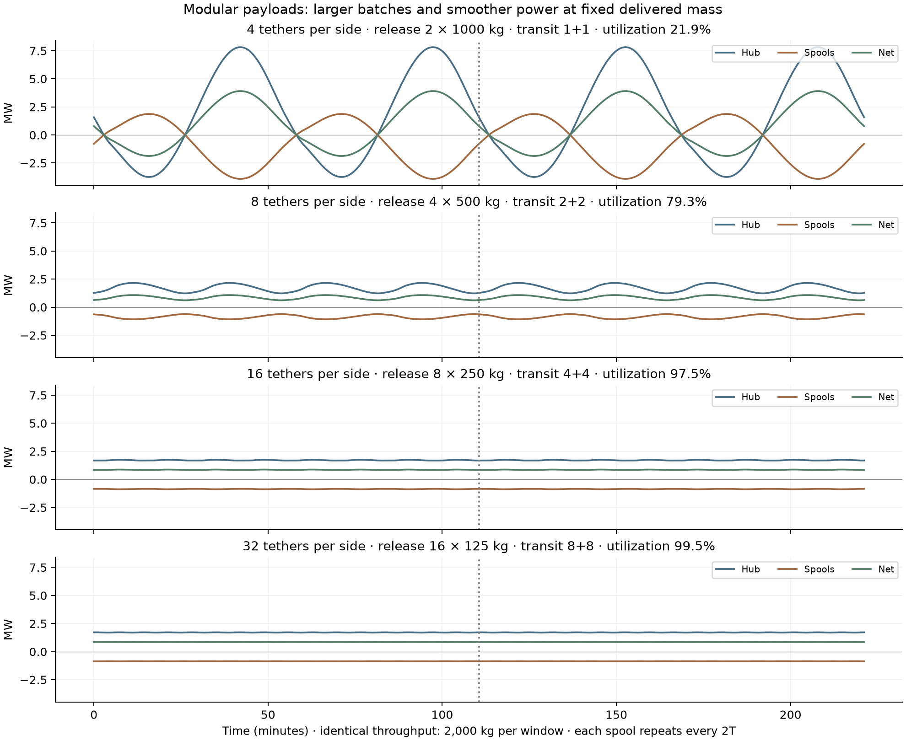
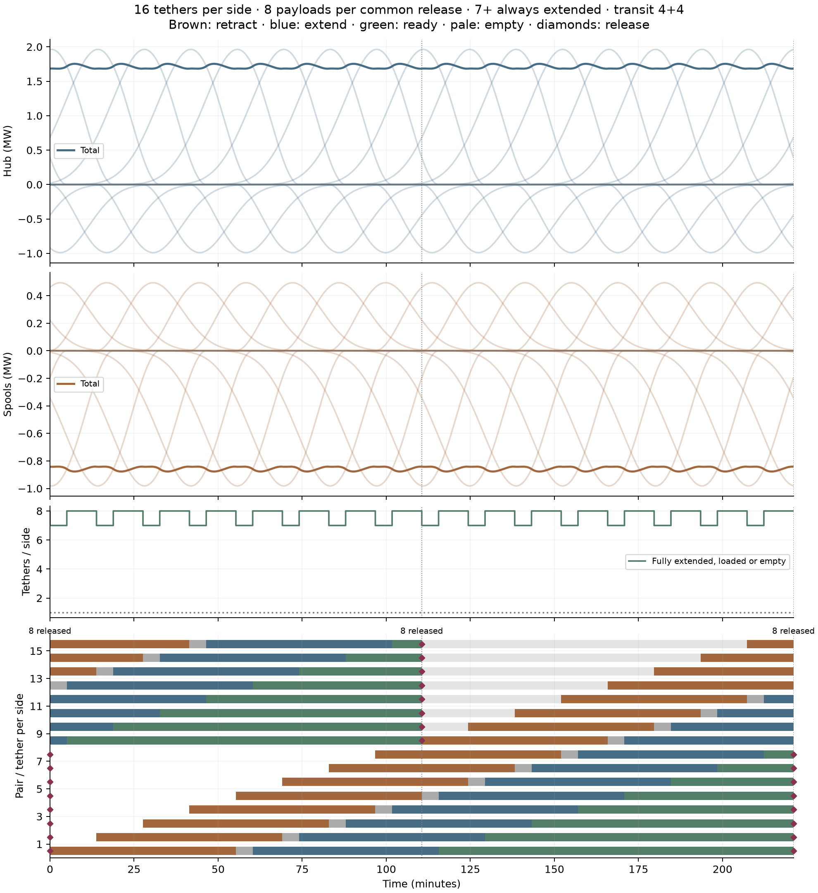

# Packet 1: from the go-kart's control problems to the slider straw

[Publication packets](../README.md) · [Engineering packet](../engineering/README.md)

**Reading order:** go-kart control problems and angular-deviation graphs → straw
preparation and release illustrations → multi-tether load smoothing and comparison table.

## Problems with the go-kart's free tethers

The [go-kart launcher](../../../publication/README.md) uses independently spooled
payload and countermass cables. Its operating cycle leaves two important control
questions: how to settle the distant payload for accurate release, and how to
recover the empty cable as its deployed length shrinks. These are the starting
point for the shared straw proposal.

The angular-deviation figures below examine that free-tether mechanism using the
follow-on **3 t tapered cable, 1 t payload, 1.72 m/s constant cruise and 2.78 rpm**
inputs. They investigate a problem inherited from the go-kart architecture; the
published go-kart's heavier taper and original control program remain a separate
frozen reference. [Simulation details and mesh checks](../../guide_comparison/constant_speed/README.md)
accompany the figures.

Loaded payout averages about **8.8° of lag**, reaches **13.3°**, and approaches
**one kilometer of sideways tip displacement** in this run. The important
questions are the terminal state after payout and the growing motion on return.

### 1. Reaching full extension and settling for release



**[Extension SVG](../../guide_comparison/constant_speed/extension_angles.svg)** ·
[PNG](../../guide_comparison/constant_speed/extension_angles.png)

The oscillation amplitude decreases during outward travel in this run. A better
initial feed or a controlled initial toss might reduce the startup transient.
The harder requirement is to arrive at full extension with the position and
velocity needed for the catcher trajectory. Stopping payout does not automatically
settle the payload: the subsequent loaded hold still oscillates through about
**±8.3°**. That hold is shown in the
[complete history](../../guide_comparison/constant_speed/full_cycle_angles.png).
The distant payload still has a restoring response through the tether, but
adequate damping and terminal control have not been demonstrated.

### 2. Retrieving the empty cable



**[Retraction SVG](../../guide_comparison/constant_speed/retraction_angles.svg)** ·
[PNG](../../guide_comparison/constant_speed/retraction_angles.png)

Empty return develops increasing angular excursions as the deployed system
shrinks. The changing moment of inertia and angular-momentum transport make the
last part of recovery particularly demanding. The cable exchanges torque with
the hub, so this is not an isolated body with exactly conserved angular momentum.
Dynamic spool control could improve the result; this simple constant-cruise
program does not demonstrate a controlled approach to the reel.

The plotted return ends at 80% of its stroke. The remaining portion becomes
more numerically sensitive; full histories and mesh comparisons are retained in
[the study](../../guide_comparison/constant_speed/README.md). The calculation
stops retraction at 500 m of deployed cable, so final ingestion into the spool
remains a further unresolved operation.

These two requirements—settling the loaded terminal state and controlling empty
recovery—are the principal motivation for shared guidance in the concept post.
They are unresolved control problems for the free-cable alternative. A matched
dynamic straw simulation must still show how much the shared guide improves them.

## Publication illustrations

A multi-tether launcher divides cargo among separate tapered cables and reels.
Several cables extend while others return, and completed loads wait at full
extension for the catcher window. A flexible tensile straw guides the cables
through a common corridor. Opposite-moving streams can exchange transverse
loads through contact with the guide.

The following drawings introduce that proposed arrangement: prepare gradually,
then release the ready batch together. Empty extended cables take their scheduled
return slots while preparation continues on other lines.




**[Preparation SVG](prepare_gradually.svg)** · **[PNG](prepare_gradually.png)**



**[Release SVG](release_batch.svg)** · **[PNG](release_batch.png)** · [Generator](draw_batch.py)

Suggested caption:

> Many independent cables prepare cargo gradually and hold ready loads for a
> common release window. A shared flexible straw guides each side of the rotating
> system. The two ready batches depart tangentially in opposite directions while
> preparation continues on other lines. The cables and guides remain attached.

The preparation view shows six loaded extended ends and two empty extended ends
per side, with the empty ends waiting for their return slots. On the countermass
arm these are the bottom two ends. The later release view shows a completed
eight-load batch departing on each side. Outgoing loads occupy the lower side of
the payload arm and the upper side of the countermass arm; returning empty ends
occupy the opposite sides. Release arrows are vertical and parallel within each
batch.

Both diagrams include two illustrative outgoing loads and two returning empty
ends per side. Every moving end has its own partial tether, terminating at its
filled or hollow circle. The moving tethers occupy distinct upper/lower lanes,
with the extended waiting lines between them. These reduced illustrative counts
keep the concept readable; the operating inventory is specified in the engineering
reference. Drum symbols represent the paired
mechanism rather than the installed module count. Retrieved inventory is omitted
for clarity. Lane and terminal spacing, guide width and hub size are expanded for
visibility. The drawing separates nearby departures so individual loads can be
seen. It is a diagram of the release concept; orbital flight paths, precise
terminal packing and catcher interception have their own calculations.

The early-site reference discards the opposing batch. The industrial architecture
investigates catching both batches. The illustration labels them useful loads and
opposing loads so it can introduce either use of that side.

Reproduce from the repository root:

```sh
MPLCONFIGDIR=/tmp/lunar-sling-mpl-cache .env/hub/bin/python -m sling_launcher.lunar_slider_straw.publication.concept.draw_batch
```

### Does this require a straw?

The multi-tether idea stands on its own: independent cables can extend, hold and
release in batches. Opposed rigid drums can also exchange shaft torque without a
continuous guide. The straw's proposed contribution is to couple transverse
loads and constrain relative cable motion. It introduces its own fiber, contact,
opening and friction costs.

The comparison must ask whether that guidance saves enough cable separation,
control effort or support hardware to pay for those costs. Independent tethers
might prove sufficient. That is an explicit design alternative, developed in
[the guide-free comparison](../../guide_comparison/README.md), and should appear
in the conceptual post rather than being left implicit.


## Power smoothing: the multi-tether motivation

This is a benefit of phased multi-tether operation shared by free-cable and
straw architectures. Divide the same delivered mass among smaller payloads and
start their preparation at staggered times. Individual power pulses overlap,
while ready payloads still release in a common batch.

These are the **original smooth-profile scheduling figures**, copied directly
from the [staged-bank study](../../../staged_spool_bank/README.md). They precede
the constant-speed straw and rigid paired-drum choices. They establish the power-
smoothing opportunity; later mechanism and control choices determine how much
of it a particular machine realizes.

### Start with one payload–countermass pair



[Single-pair SVG](power_smoothing/single_pair_power.svg) · [PNG](power_smoothing/single_pair_power.png)

Positive power supplies work and negative power is available for recovery.
During extension the hub supplies angular momentum while outward payout
regenerates through the spools. During empty retraction the spool pulls inward
while the hub can recover rotational energy. The tapered cable's own mass is
included in both terms. The graph shows a 1 t payload with a 1 t opposing mass,
3 t of cable per arm, and two complete cycles. Its illustrative travel phases
last 0.4T each; the bank comparison below uses 0.5T each.

### Subdivide the workload: 4 → 8 → 16 → 32



[Sequence SVG](power_smoothing/bank_reference_sequence.svg) · [PNG](power_smoothing/bank_reference_sequence.png)

**What stays fixed:** 2,000 kg useful delivery per catcher window, the same mass
on the opposing side, T = 110.558 minutes between windows, ~1.685 km/s release
speed, 2.78 rpm rotation and 3:1 cable/payload mass. Each outward and inward stroke
lasts 55.279 minutes. Each spool repeats every two windows. Reloading takes five
minutes; completed payloads wait for their common release boundary.

N counts tethers **per side**. Powers include both sides, while useful delivered
mass counts one side. The bank contains 2N working tethers. Every row has **24 t
of ideal working tether**, and the same **0.8554 MW average net shaft demand**.
Increasing N changes the overlap and the size of each module.

| Tethers per side | Released together per window | Payload each (kg) | Extending + returning per side | Net input utilization | Net minimum / maximum (MW) |
| ---: | ---: | ---: | ---: | ---: | ---: |
| 4 | 2 | 1000 | 1 + 1 | 21.88% | -1.8717 / 3.9092 |
| 8 | 4 | 500 | 2 + 2 | 79.30% | 0.6151 / 1.0787 |
| 16 | 8 | 250 | 4 + 4 | 97.55% | 0.8415 / 0.8769 |
| 32 | 16 | 125 | 8 + 8 | 99.50% | 0.8507 / 0.8597 |

[Download the comparison table](power_smoothing/comparison.csv).

**Utilization = average net shaft power / maximum net shaft power.** It measures
how fully the peak supply capacity is used, rather than conversion efficiency.
The 4-tether case has periods of net regeneration, which require another consumer,
storage or disposal. At 16 per side, net demand stays between 0.841 and 0.877 MW:
**97.55% utilization**, while eight 250 kg payloads release together each window.
At 32 per side, sixteen 125 kg payloads release together and utilization reaches
**99.50%**. Larger batches and nearly steady input coexist in these schedules.

The smoothness comes from overlapping preparation, while batching comes from
holding completed loads. The common release itself has no resolved shaft-power
pulse in this ideal model. Real release and cable transients remain a separate
engineering problem.

### Show how the overlapping pulses add up



The faint curves are individual contributions; the dark curves are their totals.
The schedule beneath shows eight payloads releasing together at each window.
This is a useful companion to the overview because it exposes the mechanism
behind the smoothing.

Individual original figures, including their schedules:

| Tethers per side | SVG | PNG |
| --- | --- | --- |
| 4 | [SVG](power_smoothing/bank_4_reference.svg) | [PNG](power_smoothing/bank_4_reference.png) |
| 8 | [SVG](power_smoothing/bank_8_reference.svg) | [PNG](power_smoothing/bank_8_reference.png) |
| 16 | [SVG](power_smoothing/bank_16_reference.svg) | [PNG](power_smoothing/bank_16_reference.png) |
| 32 | [SVG](power_smoothing/bank_32_reference.svg) | [PNG](power_smoothing/bank_32_reference.png) |

### What the comparison establishes

The travel commands are quintic smoothsteps with zero endpoint velocity and
acceleration. Radial co-rotation is imposed in the energy model, and ideal
regeneration is combined with hub demand. Losses, motor and reel hardware,
guide contacts, battery smoothing and transverse cable dynamics are outside
these original curves. The free-cable angle study addresses part of that missing
dynamics; the paired-drum straw reference has its own revised power history.

The common two-window cycle requires twice the cable inventory of one 2 t payload
pair with 3:1 cables completing a one-window cycle. Once that two-window inventory
is established, subdivision from 4 to 32 per side adds no ideal tether mass.
It does add reels, attachments and control channels. This is the conceptual
trade: more parallel mechanisms can reduce peak power while preserving delivered
mass and common releases.

These original plots establish the power benefit of multi-tether scheduling
shared by both free-cable and straw-guided architectures.
[Asset provenance](power_smoothing/manifest.json) records exact-copy hashes.
Regenerate this packet section and its copies with
`python -m sling_launcher.lunar_slider_straw.publication.concept.package_power`.

## Additional supporting assets

1. **Preparation and release drawings above:** introduce preparation, holding and common
   release before discussing mechanisms.
2. **[Straw passage and opening illustration](../../screening/results/shapes/passage_and_opening.svg):** explain where cargo and cables pass, and why holding a sleeve open can add contact force. The 16-line passage sketch belongs to the earlier screening layout; use it as a cross-section concept rather than a count of the current bank.
3. **[Paired module diagram](../../figures/05_stacked_module.svg):** optional closing
   illustration of opposite-moving cables connected through a rigid twin drum.
   Detailed dimensions and hardware mass belong in packet 2.
4. **[Multi-tether scheduling source](../../../staged_spool_bank/README.md):** background
   for the preparation/release distinction. Its earlier schedules and the later
   rigid-pair schedule have different inventory constraints.

Keep precise hardware masses and the industrial scale-up out of the conceptual
argument. The first post's central ideas are many independent cables, phased
preparation, common release and a possible shared load-transferring guide.

