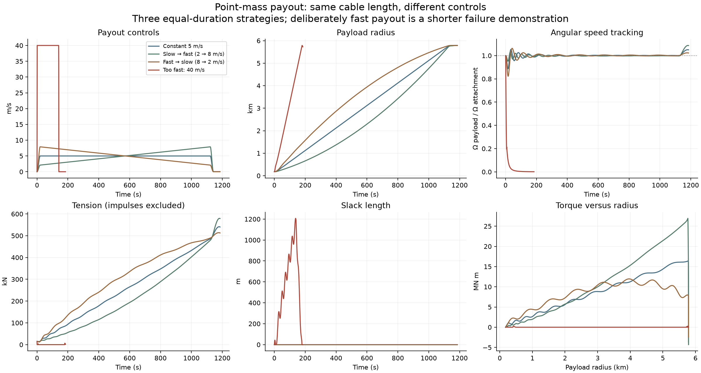

# Point-mass payout controls: prerequisite experiment

Implemented 2026-11-07. [Launcher guide](../README.md) · [Work queue](../../WORK_ITEMS.md)

The conveyor's cable-stress simulation is **on hold pending this simpler control
study**. Here the only moving load is a point mass attached to a prescribed
rotating attachment by a massless, infinitely strong, inextensible cable. It
has a paid-out length and can pull but cannot push. There are no cable segments,
kinks, elastic waves, bends, pulley-slip physics or material stresses.

## Watch the payout strategies

| Strategy | Animation | Intent |
| --- | --- | --- |
| Constant | [GIF](results/constant.gif) | 5 m/s payout between smooth start/stop ramps. |
| Slow then fast | [GIF](results/slow_then_fast.gif) | Rising speed, nominally 2 → 8 m/s, over the same deployment time. |
| Fast then slow | [GIF](results/fast_then_slow.gif) | Falling speed, nominally 8 → 2 m/s, over the same deployment time. |
| Deliberately too fast | [GIF](results/too_fast.gif) | 40 m/s with a 1 s start ramp: loses tension and rotation tracking. |



[SVG comparison](results/comparison.svg) · [Numerical summary](results/summary.csv)
· [Full metadata and events](results/summary.json) · [Validation](results/validation.json)

Animations show physical time explicitly but play faster than real time. The
main panel is inertial with automatic zoom, a one-attachment-revolution trail,
and a small rotating-frame attachment detail. The square is the moving
attachment; the dot is the payload. A dotted connector during slack depicts
only separation, **not a cable shape**. Pale shaded time intervals have zero
tension. The graphs show hub-centered radius and angular speed, which are not
independently prescribed. All GIFs have the same playback duration; the fast
case spans much less physical time. Results include two extra attachment
revolutions with cable length held fixed after payout; the payload is not released.

## First numerical comparison

All rows use the same mass, initial state and final paid length. The first three
also share deployment time. Values below are at the instant payout ends, before
the extra two-revolution hold. No capture/release criterion is imposed.

| Payout law | Deployment (s) | Radius (m) | Speed (m/s) | Payload angular speed / attachment | Slack at payout end (m) |
| --- | ---: | ---: | ---: | ---: | ---: |
| constant | 1142.06 | 5780.42 | 1709.78 | 1.01617 | 0.00 |
| slow then fast | 1142.06 | 5766.73 | 1719.38 | 1.02430 | 0.00 |
| fast then slow | 1142.06 | 5785.73 | 1700.31 | 1.00961 | 0.00 |
| too fast | 141.26 | 4567.51 | 32.26 | 0.00183 | 1156.90 |

The fast run re-tensions twice; impulses are approximately 21.74 and 27.97 kN·s
for this 1,000 kg payload. These are impulses, not peak forces. Its total slack
time is about 175.47 s including the hold, versus zero in the other three runs.
Which moderate law is preferable depends on the chosen phase, speed, torque
and timing objective; larger final speed is not automatically better.

## Declared setup

- Attachment follows a 76.7893704 m circle at 22.352 m/s (50 mph), inherited from
  the published hardware reference. Its angular speed is about 0.29108 rad/s,
  or 2.77963 RPM. Its drive is ideal and maintains that motion regardless of
  required torque; no installed power/traction limit is enforced in this test.
- Payload is 1,000 kg for readable force/torque numbers. Trajectory is independent
  of its mass under these prescribed controls; tension, work and torque scale
  linearly with mass.
- Begin with 100 m paid out, payload radially outward of the attachment and
  co-rotating. Initial hub radius is 176.789 m. This is a deliberately simple
  prepared state, not a simulation of loading or spinup from rest.
- Finish at 5,710.299 m paid out: reference 5,787.088 m tip radius minus attachment
  radius. This equals the reference hub radius only for radial alignment; actual
  payload radius is calculated, not forced to that value.
- The first three schedules take the same roughly 1,142 s to deploy the same
  length. Start/stop ramps last 20 s. The fast demonstration takes roughly
  141 s with 1 s ramps. Ramps make length, speed and acceleration continuous.
- All motion is in the local horizontal plane, without gravity or drag. Vertical
  support, lunar curvature/gravity gradients, terrain and catcher targeting are
  outside this control experiment. No orbital capture or release success is claimed.

“2 → 8” and “8 → 2” describe the speed bias before the smooth window is applied;
actual rates start and end at zero. There is **no phase controller** in these
first four prescribed payout laws. The comparisons establish a baseline for
future phase/lag feedback or torque-limited control, not a globally optimal law.

## Equations and unilateral constraint

Let the hub be the origin and the attachment position be
`a(t) = A (cos Ωt, sin Ωt)`. The payload is `x(t)`, its mass is `m`, and commanded
paid length is `L(t)`. Define `d = |x − a|` and `n = (x − a)/d`.

The cable imposes **d ≤ L**, **T ≥ 0**, and **T(L − d) = 0**. A straight taut
connection applies `F = −T n`. When `d < L`, `T = 0` and the payload flies
freely; it is not forced to co-rotate or to follow the commanded payout.

On a taut interval use attachment-centered polar coordinates:

```text
x = a + L (cos φ, sin φ)
q = (−sin φ, cos φ)
φ̈ = (−ä·q − 2 L̇ φ̇) / L
T = m (L φ̇² − ä·n − L̈)
```

This coordinate choice enforces taut length exactly without a stiff spring or
constraint drift. Hub-centered polar outputs are then
`r = |x|`, `θ = atan2(y,x)`, `ṙ = x·v/r` and `θ̇ = (x×v)/r²`.
The equivalent hub polar equations are
`r̈ − rθ̇² = F·e_r/m` and `rθ̈ + 2ṙθ̇ = F·e_θ/m`.
During slack flight the solver uses Cartesian coordinates, avoiding artificial
polar forces or an angle singularity near the origin.

A downward crossing of required tension through zero starts slack flight.
An outward crossing of `d − L = 0` starts re-tensioning. With an infinitely
stiff cable, a positive relative closing speed cannot be removed by a finite
force over zero time: **it produces an impulse**. This first implementation
uses a perfectly inelastic radial catch, removing only the relative radial
velocity that violates the cable-length rate. Tangential velocity is preserved.
Impulse, moving-boundary work and associated kinetic-energy loss are recorded
separately. This restitution choice is explicit and should be varied later if
these catches become part of a proposed operating strategy. No finite peak
snatch tension can be inferred from this idealization.

The continuous equations are integrated with SciPy DOP853 and event detection;
see [SciPy's event interface](https://docs.scipy.org/doc/scipy-1.18.0/reference/generated/scipy.integrate.solve_ivp.html).
Smooth polynomial payout schedules provide analytic L, L̇ and L̈. No material
stiffness or artificial damping is introduced to keep the system stable.

## What the geometry says about torque

Hub torque is **the rate of payload angular momentum**:

```text
H = m r² θ̇
τ = dH/dt = x × F = T A r sin(θ_attachment − θ_payload) / d
|τ| ≤ T A
```

The last bound is the perpendicular distance from the hub to the tension line:
it cannot exceed attachment-track radius A. If the attachment were exactly at
the center, cable tension could not change angular momentum about that center.

Thus the available *torque per unit tension* does not grow without bound with
payload radius. Total torque can increase as required tension increases and
as the lag angle changes. A purely geometric leverage argument needs both the
angle history and tension; the comparison plot shows the actual torque-radius
paths and their oscillations, including after payout stops.

A useful special case follows directly from the taut polar equation. If the
cable angle co-rotates at constant Ω with nearly constant lag
`β = Ωt − φ`, then:

```text
2 L̇ Ω = A Ω² sin β
L̇ = (A Ω / 2) sin β
```

At the chosen rover speed this gives **L̇ ≤ 11.176 m/s** for that steady,
constant-lag motion. It is not a universal transient speed limit or an
actuator limit. Faster transient payout can occur by accepting changing lag,
loss of angular speed, or slack. At 5 m/s the steady cable lag is approximately
26.6°. The limit is independent of length in this particular steady-motion
model even though the required torque can grow with radius.

## Energy and results interpretation

Continuous powers on the payload are `P_drive = F·ȧ = Ωτ` and
`P_spool = −T L̇`. Payout under tension therefore extracts energy at the spool
while the attachment drive can add it. Their sum is the change in payload
kinetic energy; re-tension impulses additionally carry moving-boundary work
and an explicitly recorded inelastic loss. No electrical efficiency or
energy-storage model is included.

The three moderate examples remain taut. Their speeds and phases differ, and
stopping payout excites oscillations even though there are no tether waves in
this model. The 40 m/s case goes slack, re-tensions, and has poor angular-speed
tracking. It is intentionally a failure illustration, not a competitive
same-duration optimization case. Values at the **end of payout** must be
compared separately from values after the two-revolution hold.

Working-strength margins are not outputs of this infinitely strong cable model.
It provides the **forces, torques, phase evolution, slack transitions and energy
flows** that the future conveyor material/dynamics simulator must accommodate.

## Reproduction and checks

```bash
MPLCONFIGDIR=/tmp/lunar-sling-mpl-cache .env/hub/bin/python -m sling_launcher.payout_control.report
MPLCONFIGDIR=/tmp/lunar-sling-mpl-cache .env/hub/bin/python -m sling_launcher.payout_control.validate
```

[Model](model.py) · [Reports/GIFs](report.py) · [Verification](validate.py).
Each `.npz` result includes a `columns` array and the sampled `history`.
JSON records every scenario input and slack/catch event. Regular tension/torque
peaks are sampled and exclude impulses; do not read them as hardware sizing
limits. The validation checks fixed-length analytic co-rotation, independent
Cartesian integration, slack free flight, constraint satisfaction, energy and
angular-momentum accounting, the torque lever bound, and smaller steps/tolerances.

This point-mass prerequisite is separate from the earlier paused full-machine
spool operations plan. It does not resume that operations plan. The conveyor steady study has now
[resumed separately](../conveyor_loop/steady/README.md).

## Accepted checkpoint and future control optimization

The initial study is accepted at this scope. **No optimal-control algorithm was
developed.** If revisited, define an objective (time, release-state error, peak
power/torque, energy or a weighted tradeoff), impose hardware and slack limits,
and optimize a payout/feedback law against those constraints. The relation
`L̇ = (AΩ/2) sin β` is a steady constant-lag compatibility condition, not a proof
of optimality, and its maximum is not automatically an optimal trajectory.
The conveyor study can now proceed independently of this deferred refinement.
