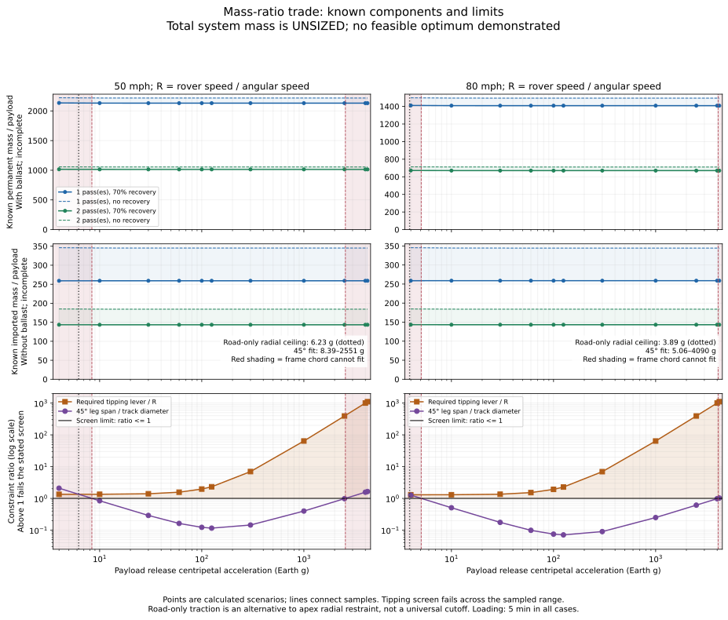

# Does the lunar sling have an optimum acceleration?

> Historical subtotal analysis. The [hardware-inclusive study](../hardware_mass/README.md)
> now estimates the previously unsized poles, wheels, motors and gearing.
> Its conditional mass curves supersede the subtotal-only conclusions below.

**The present model does not establish an optimum total-system mass ratio.**
The components calculated so far have an almost flat mass ratio across
acceleration. The structural masses most likely to change that result remain
unsized, and no configuration passes the current compact-frame feasibility
screen. This is not evidence that an optimum lies at the highest acceleration.

This is a separate analysis of the checkpoint, not a replacement for its
scenario records. [Numerical results and limits](analysis.json) ·
[SVG graph](mass_ratio_limits.svg) · [PNG graph](mass_ratio_limits.png) ·
[Underlying scenario catalogue](../speed_constrained/README.md).



## What the graph does—and cannot—represent

The requested total ratio is the mass of the permanent system divided by one
useful payload mass. The top row uses **all currently accounted permanent mass,
including lunar ballast**. The middle row excludes ballast to retain the
original mission's imported-hardware objective. Both exclude useful payload
and expendable rock from permanent machine mass. A loaded-machine snapshot
would additionally contain one payload and one equal rock load, adding 2 to
the ratio; that does not change the acceleration trend.

Neither row is a complete total. Both contain the two outward cables, a
conditional main tie and solar supply. The top adds the computed rock ballast.
The missing items are poles, bracing, apex structures, wheels, wheel motors,
reels and their drives, terminations, stabilizing/anchor hardware, ballast
retention, conversion/control equipment and thermal management. These remain
**unknown, not zero**. The machine-readable output preserves null total ratios.

The physical subtotal is not even a rigorous lower bound on a redesigned
machine: adding imported hardware weight can replace some of the required
ballast, and changing its force application points changes the frame problem.
A completed model must recalculate the ballast, structure and cycle together.
Simply adding a guessed percentage to the present curves would conceal that
coupling and could manufacture an optimum.

The graph shows the calculated 4–4,200 g samples, with straight connecting
segments on a logarithmic acceleration axis. The axis extends slightly below
4 g to show the 80-mph road-only traction boundary. No complete feasible
acceleration interval is established, and the extreme rows are rejection
checks rather than plausible operating designs.

## What the calculated part of the mass ratio says

For 70% simultaneous recovery, the ranges across the sampled accelerations are:

| Rover speed | Cadence | Known permanent physical mass / payload, including ballast | Known imported mass / payload |
| --- | --- | ---: | ---: |
| 50 mph | One pass | 2,130.7–2,134.4 | 259.01–259.12 |
| 50 mph | Two passes | 1,014.3–1,016.1 | 143.36–143.47 |
| 80 mph | One pass | 1,408.2–1,410.7 | 258.73–258.78 |
| 80 mph | Two passes | 670.4–671.6 | 143.17–143.31 |

Thus the physical subtotal changes by less than **0.2%** across the entire
sampled range. The imported subtotal is even flatter; small phase/shape effects
are not a useful basis for declaring a numerical minimum. The graph includes
no-recovery curves as dashed lines, making the solar/recovery assumption visible.

This near-cancellation has a physical explanation. At approximately fixed
release speed u, increasing acceleration A makes omega proportional to A
and all horizontal radii proportional to 1/A. Tether section area grows roughly
with A while length shrinks with 1/A, leaving fiber mass nearly constant.
Rotational energy is governed mainly by mass and speed, rather than radius.
For the same cycle duration, wheel power therefore changes little. At fixed
rover speed, the required tangential ground force is power divided by speed,
so ballast also changes little. Pole height and structural load paths do not
share that cancellation—and they are the crucial missing mass terms.

## The limits marked on the graph

The bottom row plots two dimensionless screens. A value above 1 fails the
stated screen. Red shading on every row marks the failed 45°-leg chord test;
the dotted vertical line marks a **different, road-only radial restraint path**.

| Screen | 50 mph | 80 mph | Meaning |
| --- | ---: | ---: | --- |
| Lowest acceleration where 45° leg fits the track chord | 8.39 g | 5.06 g | Below this, required pole height exceeds track diameter |
| Upper 45° chord boundary | 2,551 g | 4,090 g | Above this, the shrinking track cannot fit even the nominal leg |
| Road-only radial friction ceiling, mu=0.5 | 6.23 g | 3.89 g | Optimistic limit before allocating traction to spin-up |
| Minimum sampled compact-frame tipping ratio | 1.344 | 1.299 | Even the least demanding sampled value exceeds 1 |

**Frame fit:** both feet on one circular track imply that a 45° trailing leg's
horizontal span H must be smaller than the track diameter 2R. This is only a
necessary geometry test. Equality already puts its foot at the opposing frame;
wheel size, spool size and structural interference require additional room.
The red boundaries are consequently generous, not practical operating targets.

**Road-only radial traction:** if the road supplies the ballast's entire inward
force, omega times rover speed must be below mu times lunar gravity. At this
ceiling all friction is used laterally and none remains for spin-up; a combined
traction model would be stricter. More rock cannot cure that ratio. The ceiling
is below the lower frame-fit boundary at either speed, leaving no overlap for
this simplified road-only alternative under the stated assumptions.

**Apex restraint and tipping:** the current cycle instead assigns ballast's
inward restraint to the elevated main-tie/frame load path. That removes the
road-only ceiling, but produces a radial moment. For ballast concentrated near
the track radius and ground level, with the inward force applied at height H,
the required ground support lever is approximately

    b_required = H omega² R / g_moon.

The plotted ratio is b_required/R. Taking a support lever as large as R is
already generous for a compact fore/aft A-frame. Every sampled case exceeds it.
This is an explicit diagnostic of the assumed compact geometry—not a full 3D
proof that all possible frames or stay arrangements are impossible. A wide
frame, substantial stabilizer reactions, lower radial force application, or a
mixed road/tie restraint path would need its own force and mass calculation.
The road-only and apex-restraint screens must not be combined as if both were
mandatory universal limits on every architecture.

Tangential traction is already used to size the plotted ballast; it does not
create another acceleration cutoff by itself unless wheel load, contact size,
motor capacity or available ballast is bounded. Those practical capacities are
not specified, so the graph does not invent vertical lines for them. The old
fixed-50-m wheel-speed cutoff is omitted: with R=v/omega it no longer applies.

## Optimum versus a practical boundary

Three distinct conclusions are justified:

1. **Known mass terms:** approximately a plateau, not a strong reduction toward
   ever-higher acceleration. More time changes their scale substantially;
   acceleration changes their geometry much more than their subtotal mass.
2. **Full machine:** no defensible curve or optimum yet. Lower pole height may
   reduce structural mass, while tighter curvature and larger forces may
   increase frame, wheel, drum and retention mass. The net trend is unknown.
3. **Feasible optimization:** the present compact-frame model supplies no
   demonstrated feasible candidate to minimize. Selecting the smallest point
   on a conditional mass curve would optimize an unresolved or failed design.

The next calculation that can change this answer is a concrete radial
frame/contact/stabilizer load path, followed by simultaneous structural and
ballast sizing. Release recoil, wheel/drum practicality, and countermass disposal
also remain unresolved. Their limits are not numerically known, so they cannot
honestly be marked as precise acceleration cutoffs. Five-minute loading is
unchanged; the timing model still has no demonstrated allowance for release
settling. See the [checkpoint](../../CHECKPOINT.md) for those constraints.

## Reproduce

From the repository root:

```bash
MPLCONFIGDIR=/tmp/lunar-sling-mpl-cache .env/hub/bin/python -m sling_launcher.mass_ratio_trade
```

The mass curves use the existing 44 scenario records. Lower frame-fit and
road-only friction boundaries are independently root-solved using the current
finite-angle geometry/orbit model. Upper chord bounds come from the existing
boundary calculations. All assumptions are those of the
[scenario method](../speed_constrained/METHOD.md); no new material, motor or
structural mass assumptions were introduced to draw these curves.
