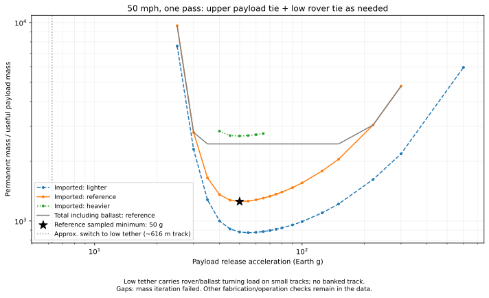

# Current reference: separate payload and rover radial restraints

For the blog-ready summary, pie charts and payoff calculations, see the
[publication checkpoint](../../publication/README.md).

**50 mph, one catcher pass, flat track.** This study implements the clarified
2026-11-01 architecture. It supersedes the previous upper-tie-only hardware
mass results and their sideways-tipping rejection criterion.

- The upper apex-to-apex tie carries the payload/counterweight radial load,
  outward cable loads, apex machinery and the upper share of pole self-load.
- On small tracks, a separate low diametral connection carries the ballast,
  wheel/motor hardware and the lower share of pole self-load. Wheel traction
  supplies no radial restraint for these loads in this branch.
- On large tracks, that low connection is omitted. Wheel-ground friction
  supplies the lower assembly's radial turning force instead.
- Neither branch sends the payload/counterweight radial force through wheel
  traction. Wheels still supply tangential driving force to spin up/deploy the
  system; this is a different force direction.
- The existing sourced motor + inverter + fixed-reducer mass model remains.
  No special transmission is added. Central pivot/stabilizer mass stays excluded.

## The switch is about 616 m, not a design cutoff

At 50 mph, v=22.352 m/s. Using the existing lunar gravity and friction coefficient
mu=0.5, the pure radial road-grip threshold is

    R_switch = v²/(mu*g_moon) = 615.70 m.

This agrees with the user's roughly 600 m estimate. The model includes the low
tether at and below this radius, and omits it above. A smaller radius is **not
rejected for radial wheel slip**: it simply gets the low tether and its mass.
No banked track is assumed.

On the road-only branch, simultaneous tangential drive and radial turning share
available friction. The ballast solve checks their combined demand through
the cycle. This changes required ballast; it is not a payload radial load or
an automatic requirement for a tether above the switch. If the specified
phase history cannot be bracketed for traction, it is reported as a cycle
calculation failure, not a proof that the architecture cannot operate.

## Updated mass minimum

[Why this minimum exists](../../publication/WHY_THE_MASS_MINIMUM_EXISTS.md)
compares the low-acceleration pole penalty with the high-acceleration reel
penalty, using this sweep's component masses.

The reference sampled imported-mass minimum moves from 75 g to **50 g**.
These are Earth-g units for the payload's release centripetal acceleration.
The grid spacing near the minimum is 5 g; the component estimates do not
justify claiming a precise continuous optimum.

| Metric | Updated 50-g reference candidate |
| --- | ---: |
| Useful payload | 1,000 kg |
| Track radius | 76.79 m |
| Release radius | 5,787.09 m |
| Pole apex height | 28.68 m |
| Four installed leg masses | 9.93, 21.84, 9.93, 21.84 t |
| All four legs | 63.55 t |
| Low cross-track tether fiber | 1.155 t |
| Low tether end fittings/bridles allowance | 0.116 t |
| Upper cross-track tether fiber | 1.056 t |
| Eight wheel assemblies | 231.65 t |
| Four wheel motors | 44.26 t |
| Wheel inverters and reduction gearing | 76.74 t |
| Two reel motors, inverters, gearing and mechanical assemblies | 235.30 t |
| Solar | 219.67 t |
| Heat rejection/transport | 317.98 t |
| **All estimated imported permanent equipment** | **1,253.05 t** |
| Local permanent ballast | 1,193.41 t |
| **Total permanent machine mass** | **2,446.46 t** |
| **Imported mass / useful payload mass** | **1,253.05** |
| **Total permanent mass / useful payload mass** | **2,446.46** |

The itemized JSON includes remaining cables, fittings, retention, controls and
steering; the abbreviated table above is not an exhaustive additive BOM.
Payload and expendable countermass are excluded from permanent machine mass.



The lighter assumptions give a sampled minimum of **55 g, ratio 873**; the
heavier assumptions give **50 g, ratio 2,682**. These are scenario assumptions,
not a statistical uncertainty interval. Imported hardware mass has a valley;
total mass including local ballast has a broad plateau because saved hardware
weight is replaced by rock needed for tangential traction.

## Why the change matters

At the old 75-g comparison point, all four legs fall from about **183.45 t to
11.71 t**, with about **1.06 t** of low-tether fiber. Imported mass falls from
about **1,535.50 t to 1,364.84 t** at that same acceleration. The upper-only
model had required the poles to transmit the lower assembly's inward force
from the apex. That is not the revised design.

The earlier 69 MNm residual and ratio greater than one were diagnostics of
that old force path. They are **not applicable to the new two-level restraint**.
The corresponding output fields are now null rather than presented as a
continuing rejection or a claim of a completed 3D stability analysis.

The updated minimum occurs at lower acceleration because less radial bending
allows taller, lighter poles than the old model. Lower acceleration then saves
reel torque/gear mass. Pole self-weight, axial loads, buckling, bending under
the poles' own radial acceleration and deflection are still sized.

## Explicit calculation changes

The low connection represents an aggregate full diameter of load-bearing fiber
plus a 10% end-connection/bridle allowance. This can be implemented as two
parallel ties to opposing pole feet, with loads divided between them; their
aggregate fiber mass is the same in the ideal equal-load geometry. Their exact
routing around the central pivot and foot attachments remains a local layout
item. No single attachment is assumed to magically restrain four unconnected feet.

For a half span x=0 at center to x=R at the endpoint, the horizontal tension is

    T(x) = T_end exp[rho * omega² * (R²-x²)/(2*sigma_h)]
    lambda(x) = rho*T(x)/sigma_h
    M = 2 integral(lambda dx), I = 2 integral(lambda*x² dx).

The horizontal sizing allowance sigma_h is 99.9% of the prior 1 GPa working
stress, reserving a small amount for sag-induced vertical force. This is the
existing Kevlar material assumption, not newly claimed fatigue qualification.
Tether self-inertia is included. Its angular inertia is integrated along the
span instead of placing its entire mass at wheel radius. Cable fiber mass is
not also charged as endpoint mass, avoiding double-counting self-inertia.

Upper endpoint load includes the cable/payload force plus apex hardware and
half of distributed pole radial load. Low endpoint load includes lower
hardware, ballast and the other half of pole radial load. These two radial
reactions support the poles' distributed inertia. The preliminary pole beam
model therefore uses radial support at both ends: maximum distributed-load
moment wL²/8 and deflection 5wL⁴/(384EI), while retaining the earlier conservative
axial/buckling and tangential-plane policies. Low-mounted mass does not become
a radial tip force on each pole. Endpoint attachment height is assumed to
match the effective height of the lower mass, near the wheel axles; a detailed
layout must preserve that force path.

At the new candidate the low tie transmits about **5.18 MN per opposing end**
and its estimated cruise sag is only **7 mm**, versus a modeled attachment
height of 3.74 m. These numbers support including it as a relatively light
part. Preload/clearance during startup or shutdown and actual end fitting
geometry still need detail; cruise sag is not a stopped-system calculation.

For large tracks, the combined-grip calculation uses only lower hardware,
ballast and lower pole reactions for radial road force. The useful payload,
counterweight and outward cable radial forces are explicitly absent. Normal
load may still include the vertical weight transmitted by those components.
Tangential demand includes the full machine's angular acceleration and payout
history, as before. The road-only calculation conservatively distributes
radial contact demand in proportion to normal force across the eight wheels.

## Scope, data and reproduction

The sweep has **81 cases** (27 accelerations, three hardware assumption sets),
all at 50 mph and one pass. Forty-three close the mass iteration. Failed
low/high-acceleration cases retain diagnostics but no invented mass total;
these failures can arise from pole/wheel self-mass or other hardware estimates,
not a blanket radial-traction cutoff. Manufacturer extrapolation, fabrication
screens and release/countermass-disposal checks remain separate in each record.
The low tether is not a claim that every other engineering check has passed.

[All reference scenarios](SCENARIOS.md) · [All case data](all_estimates.json) ·
[Sampled minima with individual parts](sampled_minima.json) ·
[Source hashes](manifest.json) ·
[Unchanged manufacturer anchors and assumptions](../hardware_mass/SOURCES.md)

```bash
MPLCONFIGDIR=/tmp/lunar-sling-mpl-cache .env/hub/bin/python -m sling_launcher.split_tie_report
.env/hub/bin/python -m unittest discover -s sling_launcher/tests -q
```

The legacy `upper_only` option is retained only to reproduce earlier reports;
`radial_policy='split'` is the default and selected reference architecture. Validation:
34 tests passed; all 43 closed budgets sum correctly and pass their calculated
pole-section and traction checks. Site/terrain qualification and a complete
transient/contact design are not implied by those algebraic checks.
