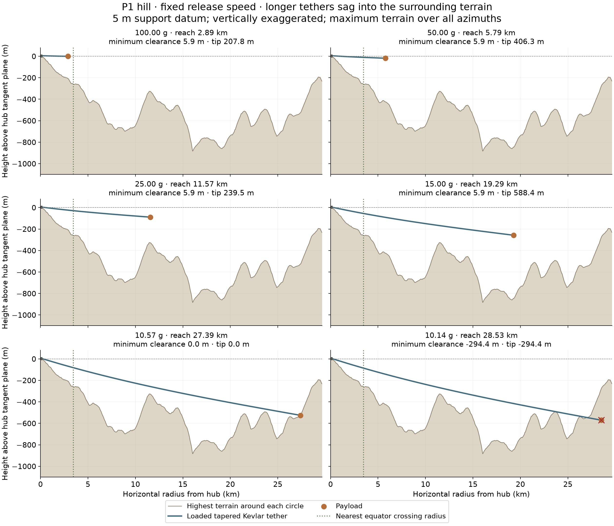

# P1: how tether length and sag fit above a lunar hill

[Launcher topics](../../README.md) · [Sag/taper investigation](../README.md) · [Paired-drum straw reference](../../lunar_slider_straw/README.md)

## Problem and result

A downhill launch site can provide the vertical space needed by a rotating tether.
At fixed release speed, reducing acceleration requires a longer tether. Its
smaller rotational acceleration also increases the downward angle needed to
support the payload and the cable's own weight. This note asks how far that trade
can proceed above the selected P1 hill with a **5 m support datum**.

For these fixed inputs, the first terrain-contact boundary encountered while
lengthening the tether is approximately **10.565 Earth g**,
at **27.387 km horizontal tip radius**. Contact occurs at
radius **27.387 km**. The plotted terrain is the
**highest elevation anywhere around each complete circle**. Consequently the
shape must clear every point on that envelope to clear its entire rotating sweep.



The final panel continues the unconstrained cable shape through terrain to show
where the design fails. Once contact occurs this steady free-cable solution
ceases to describe a physically available shape.

## One varied parameter, with the others fixed

| Fixed input | Value |
| --- | ---: |
| Hub latitude / longitude, degrees | 0.1142578125 / 16.1572265625 |
| Hub elevation above lunar reference sphere | 608.842 m |
| Useful payload | 1,000 kg |
| Release speed relative to hub | 1684.517 m/s |
| Support attachment radius | 76.789 m |
| Support height above hub tangent plane | 5.0 m |
| Kevlar density | 1450 kg/m³ |
| Equal tensile working stress | 2.438 GPa |

With release speed v fixed, **R = v²/a** and **Ω = a/v**. Acceleration determines
horizontal reach and rotation rate; force balance determines the sag and cable
arc length. The angle is an output. Material allowable stress, payload, height and
support radius must also be fixed before this becomes a one-variable study.
The 2.438 GPa working-stress assumption is inherited from the straw's 3:1 taper
screen. It requires material and cyclic-bending qualification.

The support radius stays fixed to compare the same hill and machinery datum.
Its tangential speed changes with Ω, so only the 50 g case reproduces the 50 mph
rim speed. These curves are a geometry study, with machinery and catcher targeting
to be redesigned if another operating point is selected.

## Numerical cases

| Acceleration (Earth g) | Tip radius (km) | Cable arc length (km) | Root downward angle | Tip height above hub plane (m) | Minimum sweep clearance (m) | Payload-point clearance (m) | Cable mass (t) |
| --- | ---: | ---: | ---: | ---: | ---: | ---: | ---: |
| 100.000 | 2.894 | 2.817 | 0.161° | -0.7 | 5.9 | 207.8 | 2.948 |
| 50.000 | 5.787 | 5.710 | 0.326° | -18.3 | 5.9 | 406.3 | 3.000 |
| 25.000 | 11.574 | 11.498 | 0.657° | -89.2 | 5.9 | 239.5 | 3.026 |
| 15.000 | 19.290 | 19.215 | 1.098° | -257.7 | 5.9 | 588.4 | 3.037 |
| 10.565 | 27.387 | 27.316 | 1.561° | -525.6 | 0.0 | 0.0 | 3.042 |
| 10.143 | 28.528 | 28.458 | 1.626° | -570.9 | -294.4 | -294.4 | 3.042 |

The mass stays close to three times payload mass across this family. At fixed
speed and allowable stress, the main taper exponent depends on v², while a
longer cable carries a smaller centrifugal end load and therefore needs a smaller
cross-section. The extra length largely offsets that reduced area. Vertical
weight and the finite support radius introduce smaller changes.

Clearance is measured to the cable centerline and payload point. Payload body
size, dynamic motion and construction margins consume additional clearance.
Near the support, a small clearance can control even while the payload sits high
above the surrounding ground.

## Reading the equator marker and the ground

The dotted vertical marker is the nearest equator crossing, toward geographic
south from P1, at approximately 3.466 km.
A radial envelope combines maxima from different azimuths; its peaks do not trace
one geographic cross-section. The marker locates the equator in the southward
meridian view, while the ground continues to represent the worst point around
all azimuths. Other azimuths meet the equator at other radii, or never meet it.
The plotted marker uses the hub-radius sphere; the cable's changing height shifts
the exact southward intersection slightly.

The terrain coordinate is height above the plane tangent to the reference sphere
at the actual hub elevation. For angular distance ψ and DEM elevation h:

`r = (R_moon + h) sin ψ`

`z_terrain = (R_moon + h) cos ψ − (R_moon + h_hub)`.

This includes lunar curvature directly. The terrain envelope is built from
[SLDEM2015 512-pixel/degree tiles](https://pds-geosciences.wustl.edu/lro/lro-l-lola-3-rdr-v1/lrolol_1xxx/data/sldem2015/tiles/float_img/),
with bilinear DEM interpolation and angular refinement of competing peaks on each
circle. Pixel spacing is approximately 59 m near the equator. Finer numerical
sampling resolves the interpolant; unresolved rocks, slopes and DEM errors remain.
The original [P1 radial profile](../../../llo_catcher/site_selection/radial_terrain/README.md)
is extended here using a saved local terrain patch and source byte hashes.

## Cable calculation

The cable is an inextensible flexible string in steady co-rotation about the
hub's local vertical. Let H and V be outward-horizontal and downward load
components carried by the string, T = sqrt(H²+V²), z its height, and A its area.
Equal total stress sets **A = T / σ** and arc-length factor **ds/dr = T/H**.
The inward integration uses:

```
dz/dr = −V/H
dH/dr = −ρ A (ds/dr) [Ω²r − μr/d³]
dV/dr = −ρ A (ds/dr) μ(R_hub + z)/d³
d = sqrt[r² + (R_hub + z)²]
```

At the tip, H and V equal the payload's effective radial and downward loads.
A shooting solve adjusts tip height until the root is exactly 5 m above the hub
plane. The calculation integrates cable mass and true arc length at the same time.
The central lunar gravity field acts on both cable and payload; its horizontal
component and vertical variation are retained. The surface curvature is handled
independently by the terrain projection above.

The scalar acceleration label is Ω²R, the kinematic acceleration of rotation.
The small inward component of lunar gravity reduces the part supplied by tension.
The Moon's slow rotation, solar/Earth gravity, elastic stretch, transient payout,
release waves, straw contacts and guide mass are outside this steady single-loaded-
tether model. It supplies a reusable terrain/shape comparison for spooled designs;
the assembled straw's coupled dynamics remain a separate calculation.

The contact threshold is found along a descending-acceleration sweep and then
refined numerically. It is the first boundary encountered in that sweep, rather
than an assertion of monotonic clearance at all possible radii. Mesh refinement
checks and the residuals are recorded in [results.json](results.json).

## Publication assets and reproduction

- **[Six-panel sequence, SVG](p1_tether_series.svg)** / **[PNG](p1_tether_series.png)**.
- Individual panels: [case 1](case_1.svg), [case 2](case_2.svg), [case 3](case_3.svg), [case 4](case_4.svg), [case 5](case_5.svg), [case 6](case_6.svg). Each has a PNG companion and saved shape arrays.
- [Scenario table](scenarios.csv), [full results](results.json), [terrain envelope](terrain_envelope.csv), [source provenance](terrain_provenance.json).
- `p1_dem_patch.npy` preserves the local DEM needed for reproduction.

From the repository root:

```sh
# Only needed to re-download the saved source patch:
.env/hub/bin/python -m sling_launcher.sag_taper_trade.publication.fetch_patch
MPLCONFIGDIR=/tmp/lunar-sling-mpl-cache OPENBLAS_NUM_THREADS=1 .env/hub/bin/python -m sling_launcher.sag_taper_trade.publication.calculate
.env/hub/bin/python -m sling_launcher.sag_taper_trade.publication.write_note
```
