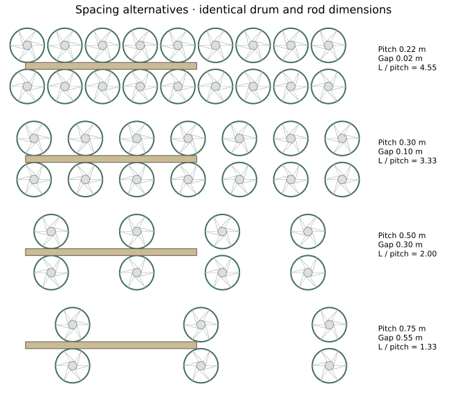
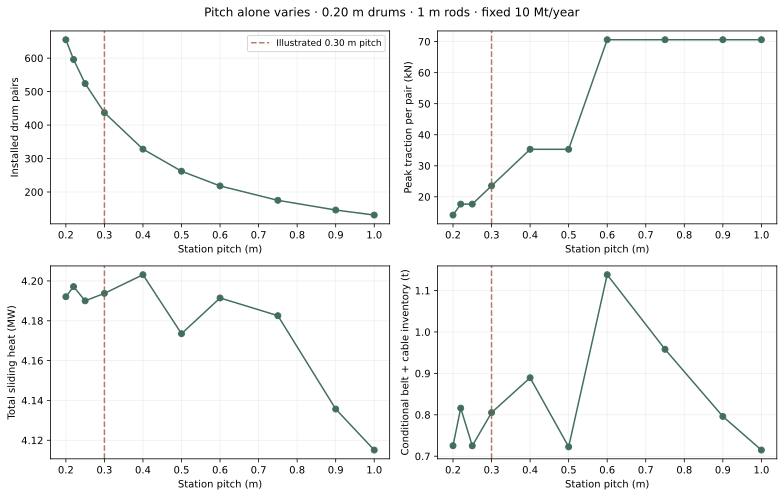

# Drum spacing: an independent design variable

**Historical development study.** The [current publication packet](publication/README.md) uses the selected thinner-plate iron case with full-sun solar. Values below retain this study’s original assumptions.

[Sling mill overview](README.md) · [Model](MODEL.md) · [CSV](results/pitch_sweep.csv)

Station pitch is independent of drum radius. Increasing it beyond 2R creates a physical gap while reducing the number of pairs. The original handoff example has 200 mm drums on 200 mm pitch; that remains the numerical validation case. The **system-pattern drawing now uses 300 mm pitch, giving a 100 mm clear gap**, with the same drums and rods. Its full parameter file is [config_spaced.json](config_spaced.json).



## Fixed inputs and measured consequences

This sweep holds drum diameter at 200 mm, hub radius at 25 mm, rod dimensions at 1 m × 60 mm × 40 mm, acceleration at 1,000 g, entry/exit speeds at 100/1,600 m/s, and throughput at 10 million tonnes/year. It changes only station pitch. Contact-patch integration resolution is increased with pitch so narrow edge transitions remain resolved.

| Pitch m | Clear gap m | Installed pairs | L/pitch | Peak pair traction kN | Sliding heat MW | Conditional fiber tonnes |
|---:|---:|---:|---:|---:|---:|---:|
| 0.20 | 0.00 | 655 | 5.00 | 14.12 | 4.192 | 0.725 |
| 0.22 | 0.02 | 596 | 4.55 | 17.65 | 4.197 | 0.816 |
| 0.25 | 0.05 | 524 | 4.00 | 17.65 | 4.190 | 0.725 |
| 0.30 | 0.10 | 437 | 3.33 | 23.54 | 4.194 | 0.805 |
| 0.40 | 0.20 | 328 | 2.50 | 35.30 | 4.203 | 0.889 |
| 0.50 | 0.30 | 262 | 2.00 | 35.30 | 4.174 | 0.723 |
| 0.60 | 0.40 | 218 | 1.67 | 70.61 | 4.191 | 1.138 |
| 0.75 | 0.55 | 175 | 1.33 | 70.61 | 4.183 | 0.958 |
| 0.90 | 0.70 | 146 | 1.11 | 70.61 | 4.136 | 0.796 |
| 1.00 | 0.80 | 131 | 1.00 | 70.61 | 4.115 | 0.715 |

L/pitch describes mean engagement in the uniform interior. Actual contact count is discrete, with fractional patch overlap at rod ends. For example, the 300 mm layout generally shares traction among three or four pairs. The force peaks reflect the moments with fewer engaged pairs.



## Interpretation

- **Fewer stations:** pitch increases reduce installed drum pairs, foundations and local mechanisms. Active acceleration distance, mass flow and ideal kinetic power stay fixed.
- **Higher individual loads:** fewer simultaneous contacts must still supply the same total rod acceleration. Normal force, torque and local belt/cable loads increase. Peak loads change unevenly as the discrete engagement pattern changes.
- **Slip heat remains close to the original value:** each station still contacts a passing 1 m rod. Rod length and acceleration govern much of the per-contact speed range. Station spacing changes the discrete sharing and edge details, producing smaller variations in total heat.
- **Longer unsupported rod spans:** bending and buckling checks worsen. The modeled Euler load scales as 1/pitch²; actual guide support and internal axial-force distribution must be resolved.
- **An engagement limit eventually appears:** the 1.10 m case has intervals with no contact for a 1 m rod and 20 mm patches. The constant-acceleration model rejects it. A different acceleration program with coasting could be studied explicitly.
- **The flexible-contact screen remains open:** fiber inventory and full hardware estimates retain the earlier panel-model limitations. Increasing pitch is permitted and useful to explore, but its larger per-drum loads do not automatically resolve contact support.

The 300 mm illustration is a clear example with space between drums. It is a candidate layout, with no optimum selected. [The complete CSV](results/pitch_sweep.csv) also gives normal loads, conditional system mass, motor ratings, belt thickness and buckling screens.

## Reproduce

```bash
MPLCONFIGDIR=/tmp/lunar-sling-mpl-cache OPENBLAS_NUM_THREADS=1 .env/hub/bin/python sling_launcher/sling_mill/pitch_study.py
```

The script regenerates this page, both pitch-study figures and the main system-pattern drawing. The main `run.py` also uses `config_spaced.json` for that drawing while retaining the original baseline for its numerical results.
