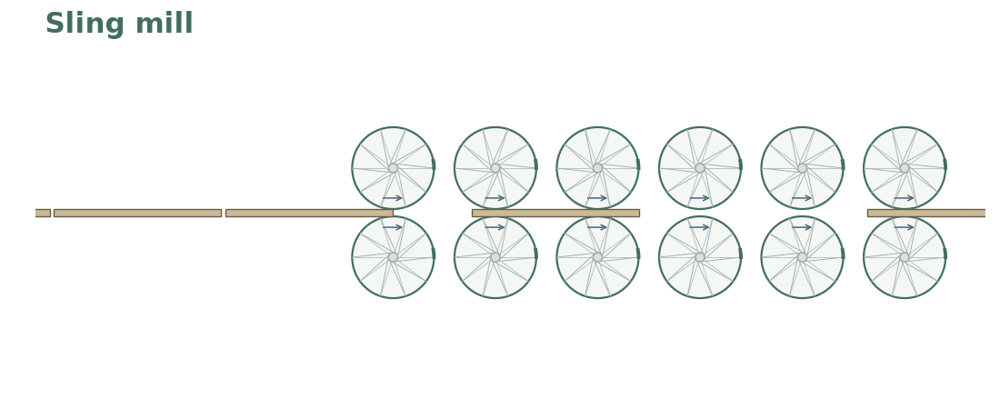

# Sling mill

**Structural audit update:** This reference assumes tapered radial and torque cables, reaching a 7.26:1 area ratio in the last roller. Hub-root packing and startup-support sizing remain unresolved; the recorded mass/payoff is a conditional development estimate. [Taper table and startup-support concept](blended/DRUM_TAPER_AND_STARTUP.md).

A straight mechanical launcher accelerates manufactured bars through opposed flexible-belt drums. The study asks whether one lane can deliver **10 million tonnes per operating year at 1,600 m/s**, and how contact mechanics, material strength and hardware mass set its dimensions.

The selected iron model uses **1.51 mm plates and a 1.407 km accelerator**. Its inventory is approximately **9,374 tonnes including full-sun solar**, giving a gross mass payoff of **8.21 operating hours** within the documented equipment boundary.

## Publication and selected results

- **[Publication article](publication/ARTICLE.md):** polished reference, materials, oxygen-cargo and architecture-comparison tables with the visual sequence.
- **[Publication packet](publication/README.md):** asset downloads, reading order and numerical provenance.
- **[Selected iron reference](blended/IRON_REFERENCE.md):** dimensions, mass ledger, verification and reproduction commands.
- **[Assumption review](blended/ASSUMPTION_REVIEW.md):** numerical bounds, fixed inputs, thinner/thicker cases and unresolved engineering.
- **[Technical notes and sources](publication/PAYLOAD_AND_PAYOFF.md):** tensile loading, material choices, entry spacing and payoff definitions.

The animation illustrates the mechanism. The selected reference supplies the modeled dimensions; the accepted introductory SVGs retain their original illustrative scale.

## Development and next work

- **[Historical studies](publication/archive/README.md):** early baselines, the hypothetical-material search, fixed-geometry iron audit and 5 mm checkpoint, each with its own assumptions.
- **[Model equations](MODEL.md):** original formulation and subsequent model additions; selected assumptions are collected in the current reference.
- **[Engineering plan](PLAN.md):** contact qualification, strip guidance, frame and drive detail, and upstream injection.
- **[Sources](SOURCES.md)** and **[original concept brief](BRIEF.md)** preserve background and provenance.

The current model uses Python, NumPy, SciPy and Matplotlib. Follow the [selected reference's reproduction commands](blended/IRON_REFERENCE.md#reproduction) for current results. Earlier scripts and outputs retain their paths for reproducibility and are indexed separately in the historical studies.
