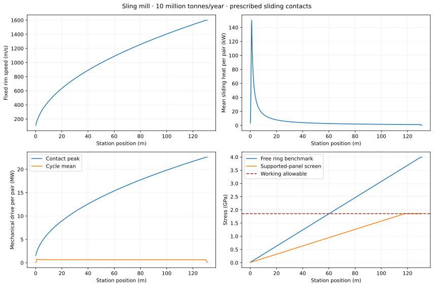
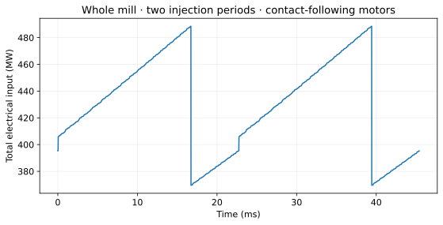
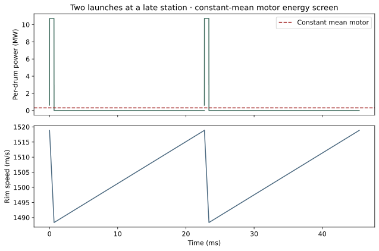
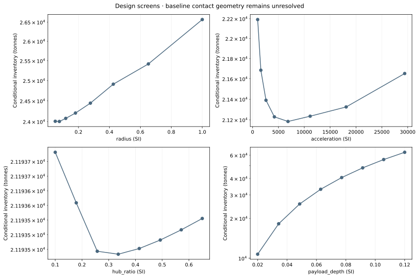

# Sling mill: first engineering results

**Historical development study.** The [current publication packet](publication/README.md) uses the selected thinner-plate iron case with full-sun solar. Values below retain this study’s original assumptions.

[Overview](README.md) · [Model and assumptions](MODEL.md) · [Figures](publication/README.md)

The reference reaches the requested flow in the prescribed-motion calculation. Flexible-belt contact and rotating-member dynamics remain open feasibility gates. The mass figures below are conditional diagnostic inventories.

## Flow, scale and energy

| Quantity | Result |
|---|---:|
| Annual launched mass | 10.000 million tonnes |
| Operating days | 365.000 days/year |
| Mass flow | 317.098 kg/s |
| Rod mass | 7.200 kg |
| Launch rate | 44.041 rods/s |
| Injection interval | 22.706 ms |
| Entrance occupancy | 44.041 % |
| Entrance clear gap | 1.271 m |
| Exit clear gap | 35.329 m |
| Acceleration distance | 130.014 m |
| Installed contact corridor | 131.034 m |
| Installed drum pairs | 655.000 pairs |
| Acceleration transit time | 152.957 ms |
| Final drum speed | 152,788.745 RPM |
| Peak pair traction, before dynamic factor | 14.122 kN |
| Payload kinetic power | 404.300 MW |
| Sliding heat | 4.192 MW |
| Mean electrical power | 429.991 MW |
| Whole-mill instantaneous electrical peak | 488.463 MW |
| Machine waste heat | 23.596 MW |
| Radiator effective emitting area | 22,566.581 m² |
| Bulk payload temperature rise | 8.263 K |

The rod is 1 m × 60 mm × 40 mm. Each drum has 100 mm operating radius and 25 mm hub radius. The 100 m/s entrance injector adds at least 1.59 MW of kinetic power and needs separate hardware. The radiator assumes 400 K, ε=0.85, a 250 K equivalent sink and half the slip heat entering the machinery.

## What limits the example

- **Contact support at low speed:** the panel envelope asks for a maximum 280.2 mm belt thickness, exceeding the 100 mm drum radius. Its thin-belt assumptions fail. A coupled contact/rotating-string solution is the next decision point; this scalar screen alone cannot reject every flexible-drum configuration.
- **Strength and load paths:** free-ring Zylon HM stress at the exit is 3.994 GPa, versus 1.856 GPa assumed manufactured working stress. Radial support changes the belt load path, which the separate panel screen attempts to represent. Torque members also experience transverse centrifugal loading and will curve.
- **Payload/contact:** dynamic-factor pressure reaches 14.71 MPa. The conservative end-loaded rod stress is 29.42 MPa. Surface heating, abrasion and flaw-sensitive strength require material-specific assessment.
- **Clearance:** 200 mm drums on 200 mm pitch leave zero clearance between adjacent drums. Real machinery needs a larger pitch or a revised layout.
- **Hub and bearings:** final hub speed is 400 m/s. High RPM, rotational stress and motor/shaft coupling need a dedicated design.

## Motor-supplied versus rotor-supplied contact pulses

Each motor can supply its contact pulse or recharge the drum steadily while rotor energy supplies the pulse. The baseline sum of individual motor ratings greatly exceeds simultaneous whole-mill power because most stations are between rods. The following mass allowance uses 2 kg/kW throughout, making this assumption explicit.

| Drive mode | Reserved speed drop | Mean electrical MW | Sum of drive ratings MW | Conditional total tonnes | Worst storage drop | Forward-slip energy screen |
|---|---:|---:|---:|---:|---:|---|
| contact_following | 0.0% | 429.99 | 10,463.66 | 21,193.4 | 3.16% | Pass |
| constant_mean | 0.0% | 429.99 | 429.99 | 1,126.1 | 3.16% | Fails |
| constant_mean | 3.0% | 443.29 | 443.29 | 1,186.1 | 3.25% | Fails |
| constant_mean | 4.0% | 447.91 | 447.91 | 1,206.9 | 3.28% | Pass |

The worst storage-drop column asks what the listed rotor inventory would do under constant-mean motor input, even in the contact-following row. Contact-following operation holds prescribed rim speed by supplying the pulse directly. Passing the energy screen is separate from passing the belt-contact and rotor-strength requirements. Added storage mass is recorded as an inertia lower bound in the CSV and excluded from the inventory until its support loads are re-sized.

## Conditional baseline component inventory

This is the contact-following drive case. The roughly 21,000-tonne total is dominated by the generic pulse-rated motor allowance. The alternative steady-drive inventory above is about an order of magnitude smaller. Neither should be used as a final system mass or a comparison winner.

| Component | Tonnes | Sizing basis |
|---|---:|---|
| outer belts | 0.566 | Conditional panel/cable forces and own rotating mass |
| radial cables | 0.116 | Conditional panel/cable forces and own rotating mass |
| torque cables | 0.044 | Conditional panel/cable forces and own rotating mass |
| rigid hubs | 0.207 | Torque-shell approximation |
| motors and drives | 20,927.329 | Peak electrical rating × assumed kg/kW |
| bearings | 12.927 | Declared load/unit/thermal allowance; see model |
| station frames | 3.175 | Declared load/unit/thermal allowance; see model |
| temporary startup supports | 2.620 | Declared load/unit/thermal allowance; see model |
| foundations | 131.000 | Declared load/unit/thermal allowance; see model |
| guides | 2.621 | Declared load/unit/thermal allowance; see model |
| cooling equipment | 112.833 | Declared load/unit/thermal allowance; see model |

## Sweeps and verification

The first 35 sampled cases vary radius with declared coupled dimensions, acceleration, hub fraction, rod depth and fiber material. 0 pass all basic screens. The conditional Pareto filter compares mass, length, heat and installed drive rating; it does not establish a physically feasible optimum.

Energy closure is at floating-point roundoff. Twelve physics tests cover exact geometry and torque sign, the baseline, discrete-edge work closure, analytic sliding work, forward-slip scheduling, cable self-mass, flow feasibility, independent pitch and uncovered-contact rejection, and doubled-resolution heat convergence.

Full numbers: [stage CSV](results/stages.csv), [mass CSV](results/mass.csv), [drive cases](results/drive_cases.csv), [sweep CSV](results/sweep.csv), [JSON summary](results/summary.json).

## Next useful result

Solve the contact-loaded flexible drum shape at several entrance and exit speeds. This will determine whether normal loads can be carried with practical belt geometry, how much torque-member curvature changes the leverage, and which mass estimates can be trusted. Payload recipes and drive design can then be selected against that resolved contact envelope.
