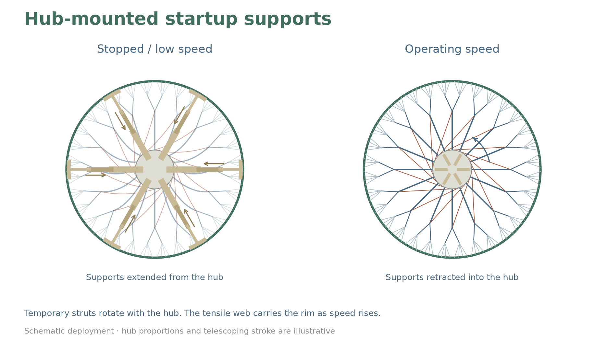
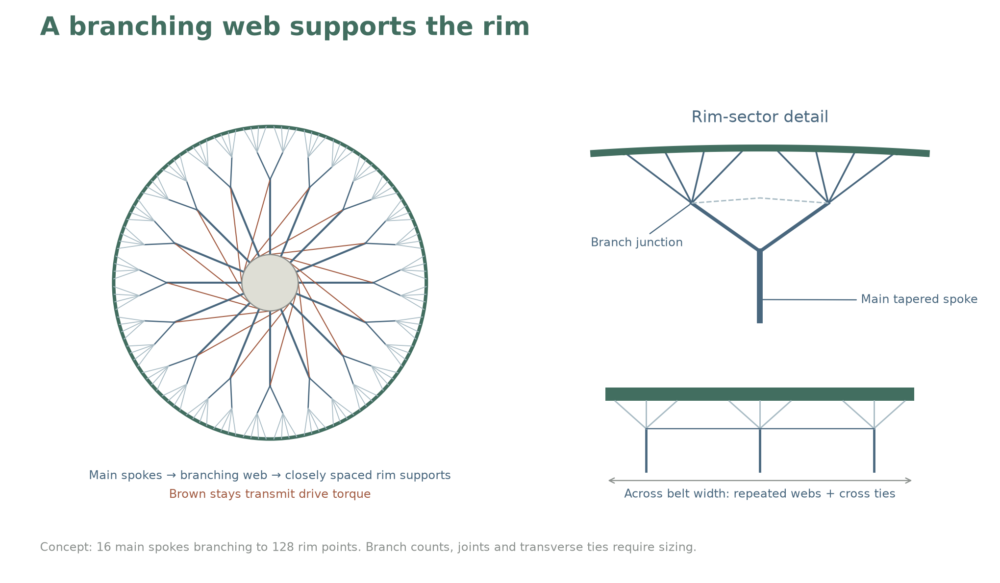

# Drum taper and startup-support audit

[Publication article](../publication/ARTICLE.md) · [Numerical taper table](search_results/drum_taper_audit.json) · [CSV](search_results/drum_taper_audit.csv)

The existing mill calculation already assumes **tapered radial and torque cables** inside each drum. This is a significant architectural choice that the publication comparison previously failed to expose. Its 1 GPa working-stress case depends on those tapered supports. The outer belt itself has constant thickness.

The 9,374-tonne / 8.21-hour inventory is retained as a conditional calculation for that architecture. Hub-root packing and the hub-mounted startup struts remain unresolved sizing issues, so that inventory should be treated as a development estimate.

## What the last roller actually computes

The payload leaves at 1,600 m/s; the last roller rim runs at **1,604.28 m/s**. Its radius is **386.38 mm**, hub radius **43.12 mm** and belt width **267.55 mm**.

The optimized belt carries approximately **18.3%** of the centrifugal support through circumferential tension; radial members supply most of the remaining inward force. The calculated belt stress is **0.910 GPa**. That number is possible because the belt is supported by the spokes.

For comparison, a free unsupported ring of Zylon at this speed requires `sigma = rho*u²`, or **4.015 GPa** from its own mass. Including the modeled contact layer raises the corresponding belt demand to **4.965 GPa**. The supported rim and the conveyor have different force paths; their working stresses cannot be compared without stating those paths.

For a straight constant-section radial cable running from hub radius h to rim radius R,

`sigma_root = F_tip/A + rho*omega²*(R²-h²)/2`.

Its own rotating mass produces a root-stress floor of **1.982 GPa** in the last roller. Increasing constant cross-section does not lower that self-stress term. The current 1 GPa case therefore requires tapering.

The constant-stress taper used in `structure.cable_mass` is

`A(r)/A(R) = exp[rho*omega²*(R²-r²)/(2*sigma_work)]`.

The same expression is used along the modeled straight hub-tangent torque member because its endpoints have the same hub and rim radii. A non-radial member also needs a transverse force/shape solution; the current torque-member calculation is an axial-load screen.

## Taper ratios through the machine

Working stress is 1 GPa and fiber density is 1,560 kg/m³. Ratios are root area divided by rim-end area. Equivalent diameters assume solid circular sections solely to communicate the area; actual construction may use ribbons or bundles.

| Payload speed (m/s) | Rim speed (m/s) | Root/tip area ratio | Root/tip diameter ratio | Uniform-cable self-stress floor (GPa) |
|---|---:|---:|---:|---:|
| 100 | 100.28 | 1.008 | 1.004 | 0.008 |
| 400 | 401.10 | 1.132 | 1.064 | 0.124 |
| 800 | 802.18 | 1.642 | 1.281 | 0.496 |
| 1200 | 1203.24 | 3.050 | 1.746 | 1.115 |
| 1600 | 1604.28 | 7.261 | 2.695 | 1.982 |

## Last-roller cable dimensions

| Member | Rim-end tension | Rim-end area | Hub-end area | Equivalent diameter, rim → hub |
|---|---:|---:|---:|---|
| Radial cable | 101.00 kN | 101.00 mm² | 733.32 mm² | 11.34 → 30.56 mm |
| Torque cable | 6.82 kN | 6.82 mm² | 49.49 mm² | 2.95 → 7.94 mm |

At 2.9 GPa allowable, a uniform last-stage radial member carrying this same tip load would need about **110.1 mm²**, under the radial self-mass equation. That is a local comparison only: changing members also changes mass, rotor storage and operating loads, so a complete uniform-member design needs a new solve.

## Root-packing check

The current layout assigns **128 radial roots** to a hub circumference of about **271 mm** and an axial width of **267.55 mm**. Their summed root areas occupy **129.5%** of that ideal cylindrical band area. This fails even the solid-area lower bound, before packing voids, terminations and torque-member attachments.

Radial roots alone require at least **346.5 mm of axial attachment width** at the present hub radius and perfect area packing. A real layout requires more room. Widening the root band, distributing anchors axially or revising hub/roller geometry changes the shaft and support calculations. This check was absent from the optimizer and must be included before selecting a buildable layout. Flattening the cables changes their shape but does not remove this area requirement.

## Startup and stopped support



[Editable SVG](../figures/07_startup_supports.svg) · [PNG](../figures/07_startup_supports.png) · [Drawing script](../draw_startup_supports.py)

Temporary supports **extend from the rotating hub** to hold the rim out at rest and low speed. As centrifugal tension establishes the operating shape, the supports unload and retract into the hub. They redeploy during controlled slowdown. The support structure rotates with the drum, so its pads have no intentional sliding contact with the rim.

The drawing uses illustrative telescoping struts and enlarged hub proportions to communicate the deployment. It does not specify the number of telescoping stages or demonstrate their packing inside the current 43 mm hub. Retraction against the struts' own centrifugal force, self-mass stress, actuation, latching, cable clearance and low-speed gravity support need sizing. Full startup/inertia torque is also a separate load case from steady payload acceleration.

The existing **2 kg per drum** startup allowance has not yet been replaced by a mass estimate for the hub-deployed supports.

## Rim circularity and the branching suspension web



[Editable SVG](../figures/08_rim_suspension_web.svg) · [PNG](../figures/08_rim_suspension_web.png) · [Drawing script](../draw_rim_web.py)

The previous drawing's roughly 16 spokes were a visual simplification. The calculation actually used **128 rim attachments**, giving a panel chord of about **19 mm** on the last roller. Its panel equations include centrifugal scalloping and contact deflection between those points; exact circularity is not established by that approximation.

The proposed structure uses main tapered spokes that branch into a dense near-rim web. Branches spread the load over many rim points; repeated webs and cross ties across the belt width provide transverse support. Brown hub-tangent stays illustrate drive-torque transfer into the same web. This is the suspension-web concept selected for further work.

The drawing shows **16 main trunks × 8 rim attachments = 128 points** as an illustrative topology. The current mass calculation instead has 128 separate radial members plus torque members. Keeping the same rim attachment count does not make these inventories equivalent. Branch-junction forces, load sharing, member taper, transverse ties and joints require a new web calculation. The previous 7.26:1 single-cable taper and root-packing result belong to the old independent-member model; a branched web must be evaluated along its own paths. Aggregating rim loads into fewer roots does not by itself eliminate the total root-area demand.

## Payload acceleration torque: what is already included

The code includes the tangential contact force, torque-member mass and hub torsion. The model's eight-way peak sharing is an assumption awaiting a network stiffness/load-sharing solution.

For one drum, with normal force N and friction coefficient mu:

- `F_t = mu*N` accelerates the payload.
- `tau = F_t*R` is the drum's contact torque.
- `P_contact = F_t*u = tau*omega` is instantaneous mechanical contact power.
- `P_payload = F_t*v`, with `F_t*(u-v)` dissipated as sliding heat.
- A hub-tangent member has moment arm h, so `T_torque = tau/(k*h) = F_t*R/(k*h)` for k effective members.

The torque member also pulls inward: its rim tangential component is `T_torque*h/R`, and its inward component is `T_torque*sqrt(1-(h/R)^2)`. The latter enters the contacted radial-anchor reaction screen. Separate radial and torque members are sized and included in the inventory; a new shared web must balance both components at its junctions.

For the **last lower drum while a bar is in contact**:

| Quantity | Value |
|---|---:|
| Forward traction | 6.085 kN |
| Contact torque | 2.351 kN·m |
| Instantaneous mechanical power | 9.761 MW |
| Instantaneous power delivered to the bar | 9.735 MW |
| Instantaneous sliding heat | 26.0 kW |
| Effective torque members sharing the peak | 8 |
| Rim-end tension per torque member | 6.815 kN |
| Inward component per torque member | 6.773 kN |
| Shaft torsional shear | 18.67 MPa against the 100 MPa screen |
| Hub rotational-stress benchmark | 250 MPa against the 250 MPa screen |

These are instantaneous per-drum loads. Motor mean rating and machine-wide mean power integrate occupancy across all stations; rotor energy storage bridges the contact pulses. Sizing cables from mean motor power alone would understate the peak transmitted load.

Hub radius is already a free search variable. It appears in torque leverage, shaft torsion/bending, taper geometry and rotational stress. In this candidate, shaft bending/solid capacity and rotational stress are nearly active, while shaft torsion has margin. The next web/support design must revisit those limits using the new force paths.

[Reproducible torque audit](audit_drive_torque.py) · [Numerical results](search_results/drive_torque_audit.json). The audit checks both `k*T*h = tau` and `P/omega = tau`.

## Reproduced reference with acceleration torque

The reference has been rerun at its selected geometry and throughput, with 641, 1,281 and 2,561 velocity nodes. The constraint checks pass at the recorded numerical tolerance. Acceleration torque was already included in the torque cables and hub sizing. The update adds a conservative local belt tension envelope, `T_peak = T_nominal + F_t`, and its corresponding radial reaction check. Nominal belt tension still sets contact compliance in this reduced model; the envelope checks the possible high-tension side of the contact. A resolved belt/web load-sharing solution remains future work.

| Last-stage quantity | Previous reference | Updated check |
|---|---:|---:|
| Peak belt stress | 0.9095 GPa | 0.9215 GPa |
| Belt stress divided by Zylon density | 0.5830 MJ/kg | 0.5907 MJ/kg |
| Cable working-stress allowance | 1.000 GPa | 1.000 GPa |
| Cable specific working-stress allowance | 0.6410 MJ/kg | 0.6410 MJ/kg |
| Cable root:tip area taper | 7.2608:1 | 7.2608:1 |
| Total included machine mass | 9,373.6 tonnes | 9,373.6 tonnes |
| Gross operating mass payoff | 8.2113 hours | 8.2113 hours |

The belt-stress increase is **12.0 MPa, or 1.32%**. Existing dimensions satisfy the stronger check, so no resizing or new optimization was needed. The mass estimate retains the root-packing and startup-support qualifications described above. The suspension web remains a conceptual drawing.

For the model's equal-working-stress cable sizing,

`A(r)/A(R) = exp[rho*omega²*(R²-r²)/(2*sigma_work)]`.

At fixed speed, endpoints and working-stress allowance, added end load scales both root and tip area together. Thus acceleration torque requires additional load-carrying material while the **area taper stays the same**. The working stress is an assumed allowable used to size the cable. Ultimate fiber strength is a separate material property.

A diagnostic removes the internal structural drive-load terms while retaining the same physical acceleration and power demand. Restoring them adds **777.1 kg of torque cables and 636.0 kg of hub material**, totaling **1,413.1 kg** across the machine. Those masses were already included in the previous reference. This diagnostic isolates the load-path contribution; its missing torque path makes it unsuitable as a design. The comparatively small increment follows the model's dense rim support and eight-member torque-sharing assumption and does not establish the mass of a future branching web.

[Reproduction script](reproduce_torque.py) · [All three cases](search_results/torque_reproduction.json) · [Architecture taper data](search_results/architecture_taper_comparison.json).

Run `MPLCONFIGDIR=/tmp/lunar-sling-mpl-cache OPENBLAS_NUM_THREADS=1 .env/hub/bin/python sling_launcher/sling_mill/blended/reproduce_torque.py` from the repository root. The historical nominal-belt checkpoint is retained in [the pre-update reference](search_results/iron_reference_before_traction_envelope.json).

## Publication comparison correction

The mill row must read **“Zylon, 1 GPa assumed with tapered drum cables”**, alongside the startup and attachment-geometry qualification. Go-kart and slider-straw designs both use tapered Kevlar; the straw's 2.438 GPa case follows its selected 3:1 cable/payload mass ratio. The conveyor uses a continuously circulating constant-section loop and retains its 2.9 GPa comparison case.

Reproduce the diagnostic with:

```bash
MPLCONFIGDIR=/tmp/lunar-sling-mpl-cache .env/hub/bin/python sling_launcher/sling_mill/blended/audit_taper.py
MPLCONFIGDIR=/tmp/lunar-sling-mpl-cache .env/hub/bin/python sling_launcher/sling_mill/draw_startup_supports.py
MPLCONFIGDIR=/tmp/lunar-sling-mpl-cache .env/hub/bin/python sling_launcher/sling_mill/draw_rim_web.py
.env/hub/bin/python sling_launcher/sling_mill/blended/audit_drive_torque.py
```
