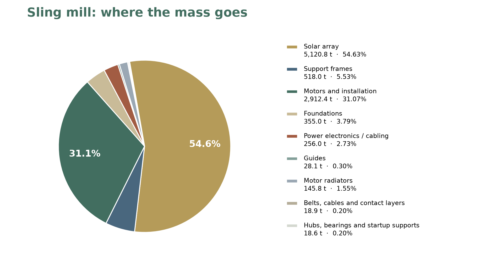

# Optimized iron sling mill

**Structural audit update:** Tapered drum cables reach a 7.26:1 root/tip area ratio. Hub-root packing and startup-support sizing remain unresolved; the mass/payoff is a conditional development estimate. [Audit](DRUM_TAPER_AND_STARTUP.md).

[Publication packet](../publication/README.md) · [Material choices and architecture comparison](../publication/PAYLOAD_AND_PAYOFF.md) · [Full numerical record](search_results/iron_reference.json)

The fixed-geometry [torque reproduction](DRUM_TAPER_AND_STARTUP.md#reproduced-reference-with-acceleration-torque) retains acceleration-torque cable/shaft sizing and adds a conservative belt traction envelope. Peak belt stress is 0.922 GPa; the 7.26:1 cable area taper, mass and payoff are unchanged.

The iron reference targets **1,600 m/s** and **10 million tonnes per operating year**. This search replaces the earlier fixed-geometry iron audit as the current mill comparison row and mass-chart source. It includes the height-aware frames, motors, foundations, guides, bearings, radiators, power electronics and a full-sun solar array. [Review of bounds and fixed assumptions](ASSUMPTION_REVIEW.md).

| Parameter | Result |
|---|---:|
| Exit speed | 1,600 m/s |
| Modeled inlet speed | 100 m/s |
| Useful mass flow | 317.10 kg/s = 10 million tonnes per 365 operating days |
| Maximum acceleration | 493.55 Earth g (4,840.09 m/s²) |
| Iron bar dimensions | 1.5855 m × 267.55 mm × 1.51 mm |
| Bar mass / feed frequency | 5.028 kg / 63.071 Hz |
| Roller diameter / pitch | 0.7728 m / 0.7928 m |
| Squeeze / structural Zylon thickness | 0.2644 mm / 1.8964 mm |
| Corridor / equivalent opposed pairs | 1.407 km / 1,775.0 |
| Mean electrical input | 426.73 MW |
| Sliding heat | 1.094 MW |
| Maximum average roller temperature | 450.00 K |
| Iron working allowable / axial demand envelope | 70 MPa / 60.32 MPa |
| Peak contact pressure | 14.44 MPa |
| Zylon working ceiling | 1.0 GPa |
| Accelerator hardware | 4,252.8 tonnes |
| Full-sun solar array | 5,120.8 tonnes |
| Total system inventory | 9,373.6 tonnes |
| Gross mass payoff | **8.211 operating hours** |

## What was optimized

Eleven variables: roller radius, hub-radius fraction, station pitch/radius, bar length/width/thickness, squeeze, structural belt thickness, hoop-support fraction, rotor speed reserve and motor pulse fraction. Iron density is 7,860 kg/m³, heat capacity 450 J/kg/K, working axial allowable 70 MPa, and declared modulus 207 GPa. Zylon working stress is fixed at 1 GPa. Contact-layer properties, friction coefficient, coating thickness, attachment counts, inlet/exit speeds and annual flow are fixed.

Forward traction increasing toward the leading end gives the blended bar a tensile internal load. The historical end-compression Euler limit is disabled. A conservative full-end-load axial envelope and a separate contact-pressure/allowable screen are retained. These scalar checks precede a combined local stress and fracture analysis.

The original optimized hypothetical payload used 100 MPa allowable, 70 GPa modulus and 3,000 kg/m³ density. The iron optimization uses the actual selected density and the 70 MPa working assumption throughout; it is distinct from merely substituting iron in the old geometry.

## Search domain and verification

The former 5 mm lower thickness bound was arbitrary. The revised search expands the plate domain to **0.10–120 mm**, broadens the other geometric bounds, removes the arbitrary 100 Hz launch-frequency cap, and permits **100% inlet occupancy**. Differential evolution (80 generations, population 80) followed by constrained refinement found an interior thickness near **1.51 mm**. Additional fixed-thickness searches and perturbed starts check nearby alternatives; some fixed-thickness runs reached their iteration limits, so their costs describe feasible candidates rather than proven minima. The verification table below applies to the selected reference.

At fixed flow and inlet speed, thinning the plate requires more width. Wider rollers increase shaft bending demand; available shaft section and hub rotational stress limit the response. Roller size, support mass, contact bonding and temperature complete the tradeoff. The winning thickness is well above the numerical 0.10 mm floor. Its depth is selected by the coupled model, while contact properties and engineering tolerances remain declared assumptions.

Active or nearly active limits include full inlet occupancy, average layer temperature, coating bond, rotor reserve, shaft bending/solid-section capacity, hub rotational stress, two-pitch engagement and string-panel applicability. Continuous fabricated frame sections retain the previous load factors and stiffness assumptions. Plate flexibility, guidance, exact joints and combined local contact stresses remain follow-up engineering questions.

[Search bounds and constraints](search_results/iron_reference.json) are explicit. The final solution was refined at 641 velocity nodes and checked at 1,281 and 2,561. Residuals below 1e-6 are accepted as numerical tolerance:

| Velocity nodes | Mass (t) | Payoff (h) | Largest normalized constraint residual |
|---|---:|---:|---:|
| 641 | 9,373.596 | 8.211270 | 1.5e-10 |
| 1281 | 9,373.595 | 8.211269 | 2.1e-08 |
| 2561 | 9,373.594 | 8.211268 | 6.7e-08 |

## Mass allocation



[Editable SVG](../figures/06_machine_mass_pie.svg).

| Component | Mass (t) |
|---|---:|
| Structural belts | 6.82 |
| Contact layers | 1.61 |
| Radial members | 9.71 |
| Torque members | 0.78 |
| Hubs | 6.95 |
| Motors | 2,912.44 |
| Bearings | 4.52 |
| Frames | 517.96 |
| Foundations | 355.00 |
| Startup supports | 7.10 |
| Guides | 28.14 |
| Motor radiators | 145.76 |
| Power electronics | 256.04 |
| Solar array | 5,120.77 |

Motors are sized from each stage's mean load plus 20% rating headroom, with rotor storage supplying contact pulses. The mass allowance is 4.55 kg/kW plus 25% installation; electronics/cabling add 0.5 kg/kW. Freestanding support frames retain the explicit stiffness assumption. The array is now included at **100 W/kg illuminated output with 20% generating headroom**, matching the earlier straw assumption. Full sunlight is assumed; no lunar-night storage is charged. At approximately 426.7 MW electrical demand, the rated array is about **512.1 MW**, with **2.05 km²** of collecting area at 250 W/m² (before spacing). The 0–100 m/s injector, bar production and the catcher remain additional infrastructure. At the same instantaneous flow, outages increase calendar payoff and reduce annual delivery.

## Feeder interpretation

The optimized bar stream occupies about **100.0%** of the modeled 100 m/s inlet cross-section in time. End-to-end feeding of these same bars would run at **100.00 m/s**, then the leading bars accelerate and open gaps before reaching 100 m/s. In this revised optimum, occupancy reaches 100%, so the bar train is end-to-end at the modeled inlet and then separates as it accelerates. The animation illustrates that sequence schematically.

## Reproduction

Run from the repository root:

```bash
MPLCONFIGDIR=/tmp/lunar-sling-mpl-cache OPENBLAS_NUM_THREADS=1 .env/hub/bin/python sling_launcher/sling_mill/blended/optimize.py --iron --solar --review-domain --iterations 80 --seed 43 --ceiling 1000000000 --label iron_thin_solar --depth-min .0001 --warmstart sling_launcher/sling_mill/blended/search_results/iron_5mm_reference.json
.env/hub/bin/python sling_launcher/sling_mill/blended/thickness_study.py
.env/hub/bin/python sling_launcher/sling_mill/blended/verify_iron.py
.env/hub/bin/python sling_launcher/sling_mill/blended/report_iron.py
MPLCONFIGDIR=/tmp/lunar-sling-mpl-cache .env/hub/bin/python sling_launcher/sling_mill/blended/mass_pie.py
```
