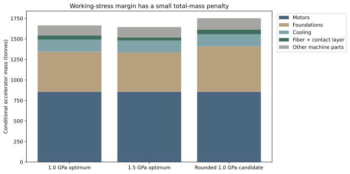

# Constrained search: first conditional system parameters

**Historical development study.** The [current publication packet](../publication/README.md) uses the selected thinner-plate iron case with full-sun solar. Values below retain this study’s original assumptions.

**[Current optimized iron reference](IRON_REFERENCE.md)** targets 1,600 m/s with iron payload properties, tensile bar loading and the expanded hardware budget. Its mass inventory supplies the publication pie chart.

**[Payload material and updated machine payoff](../publication/PAYLOAD_AND_PAYOFF.md)** records the iron selection, corrects the assumed end-compression constraint, and gives the fixed-geometry hardware audit and cross-design comparison. Earlier search numbers below retain their original assumptions.

[Blended model](README.md) · [Comparison CSV](search_results/comparison.csv) · [Rounded configuration and results](search_results/rounded_reference.json)

We now have numerical candidates from a constrained search over the connected blended model. The best 1.0 GPa candidate is about 1,665 tonnes, versus 1,645 tonnes at 1.5 GPa: **roughly 1.2% additional machine mass buys the lower Zylon working-stress ceiling**. These are conditional minima within the declared model and search domain.

## Readable candidate

The rounded candidate moves away from several tightly active limits at a modest mass cost. Its full precision inputs and constraint checks are saved separately; this table uses engineering display precision.

| Quantity | Rounded candidate |
|---|---:|
| Drum diameter | 1.120 m |
| Hub radius | 0.062 m |
| Station pitch | 1.140 m |
| Clear gap between neighboring drums | 0.020 m |
| Bar length | 2.300 m |
| Bar width | 260.000 mm |
| Bar depth | 20.000 mm |
| Imposed squeeze | 0.800 mm |
| Roller surface gap | 19.200 mm |
| Structural Zylon thickness | 2.700 mm |
| Assumed contact-layer thickness | 0.500 mm |
| Corridor length | 3.157 km |
| Equivalent station pairs | 2,769.692 pairs |
| Bar mass | 35.880 kg |
| Bar feed frequency | 8.838 Hz |
| Entry acceleration | 8.858 m/s² |
| Exit acceleration | 2,189.305 m/s² |
| Maximum structural-belt stress | 0.988 GPa |
| Reserved rotor speed loss | 0.390 % |
| Mean mill electrical input | 427.671 MW |
| Total friction heat | 1.988 MW |
| Maximum average roller temperature | 433.582 K |
| Conditional machine mass | 1,752.285 tonnes |
| Machine-only mass payoff | 1.535 operating hours |

Both search winners choose steady per-station motor input, with the rotor supplying contact-load energy. The averaged energy-budget calculation requires about 0.4% speed reserve. Thus the motor inventory is sized principally by mean power. This is a mechanical energy-storage result under the declared drive model; individual drives and controls still need design.

## Search and checks

Eleven continuous choices were searched: drum radius, hub fraction, pitch/radius, bar length/width/depth, squeeze, structural-belt thickness, hoop-support fraction, rotor speed reserve and fraction of contact pulse supplied directly by the motor. Attachment count (128), effective torque-sharing count (8), inlet speed (100 m/s), contact-layer thickness (0.5 mm), friction coefficient and other material properties stayed fixed.

Constrained differential evolution was followed by SLSQP refinement. The initial search pushed width to its boundary; expanding the width limit from 0.15 to 0.60 m found an interior candidate. The initial pitch-ratio bound was also relaxed, allowing the explicit 20 mm drum-clearance requirement to govern. The final candidates were refined with 641 velocity points and checked with 1,281. Four nearby perturbed local starts returned payoff values within about 0.14% of the 1.0 GPa result; some have small discretization-scale reserve residuals and are retained as diagnostic checks rather than replacements for the refined candidate. This supports local stability, not a proof of global optimality.

An added hub/shaft calculation sizes a hollow section for torsion and bending across the roller width. It uses a simply supported beam with a conservative concentrated load, 200 GPa modulus, and a 10 µm deflection limit. If even a solid hub of the chosen radius cannot meet the requirement, that candidate fails. A separate 250 MPa hoop-stress benchmark limits hub peripheral speed. These are explicit study assumptions.

The final mathematical minima lie against several constraints: Zylon working stress, mean layer temperature, rotor speed reserve, bar buckling, minimum drum clearance, two-pitch bar engagement and the thin-string-panel thickness limit. The last two are reduced-model applicability conditions, so those selected dimensions require particular care. The raw optimum should not be presented as a fabrication drawing.

## Where the mass goes



| Component | Rounded candidate, tonnes |
|---|---:|
| structural belts | 21.34 |
| contact layers | 3.55 |
| radial members | 27.78 |
| torque members | 5.65 |
| hubs | 14.09 |
| motors | 855.34 |
| bearings | 22.24 |
| frames | 28.05 |
| foundations | 553.94 |
| startup supports | 11.08 |
| guides | 63.15 |
| motor radiators | 146.08 |

The largest allowances remain motors at 2 kg/kW of rating, foundations at 200 kg per pair, and motor cooling at 5 kg/m² of effective radiator area. Real motor/drive, foundation and radiator designs could shift the optimum. Cable joints and attachment hardware are not yet separately sized; attachment topology was therefore held fixed.

## The scope decision before a whole-system payoff

The optimized mill requires about 427.7 MW continuously. Its inlet also assumes bars already moving at 100 m/s, which requires at least 1.59 MW of kinetic power plus injector losses. The current inventory includes accelerator machinery, foundations, guides and motor radiators. **It excludes the generating/receiving power plant, low-speed injector, payload-processing plant and their infrastructure.**

That is now the material boundary decision for the next design phase: use a dedicated continuous power plant and self-contained feed system, or treat power and preaccelerated bars as supplied industrial services. Dedicated nuclear generation and externally beamed/grid power imply different inventories. The distinction is needed before calling the short accelerator payoff a complete-system payoff.

The following is an arithmetic sensitivity, with hypothetical power-system mass intensities. It makes the boundary visible; it does not select or estimate a real plant. Injector kinetic power is included in the power total, while injector/processing hardware and power losses are still omitted.

| Assumed power-system mass intensity | Added power-system mass | Accelerator + that mass payoff |
|---:|---:|---:|
| 0.0 kg/kW | 0 t | 1.54 h |
| 1.0 kg/kW | 429 t | 1.91 h |
| 5.0 kg/kW | 2,146 t | 3.42 h |
| 10.0 kg/kW | 4,293 t | 5.30 h |

## Evidence and remaining engineering limits

The contact layer remains the hypothetical 1,400 kg/m³, 1 GPa compression-modulus material, with assumed 5 MPa tensile bond and 20 MPa shear limits and a 450 K mean-temperature ceiling. No named product has been qualified. The Zylon ceiling is kept fixed within each solve; lower stress is never obtained by changing fiber properties. The 1.0 GPa case is the preferred conservative candidate because its mass penalty is small.

The model preserves the requested averaged treatment. It uses no bar-arrival or roller-angle event simulation. Conditional feasibility also depends on the string-panel approximation, the diagonal-cable mass approximation, available radiation view, friction and wear behavior. Passing the reduced checks is distinct from material qualification or a buildability finding.

## Files and reproduction

- [1.0 GPa optimum](search_results/freehub_10gpa.json) and [1.5 GPa optimum](search_results/freehub_15gpa.json).
- [Rounded reference](search_results/rounded_reference.json), [verification](search_results/verification.json), [power-boundary sensitivity](search_results/power_boundary_sensitivity.csv).
- Earlier `initial`, `expanded` and `shaft` outputs record successive search stages. The two `freehub` files are the final optimized comparison.

```bash
MPLCONFIGDIR=/tmp/lunar-sling-mpl-cache OPENBLAS_NUM_THREADS=1 .env/hub/bin/python sling_launcher/sling_mill/blended/optimize.py --iterations 70 --seed 31 --ceiling 1000000000 --label repeat_10gpa --width-max .6 --pitch-min 2.01 --warmstart sling_launcher/sling_mill/blended/search_results/shaft_10gpa.json
.env/hub/bin/python sling_launcher/sling_mill/blended/verify_search.py
.env/hub/bin/python sling_launcher/sling_mill/blended/report_search.py
.env/hub/bin/python sling_launcher/sling_mill/blended/test_search.py
```
