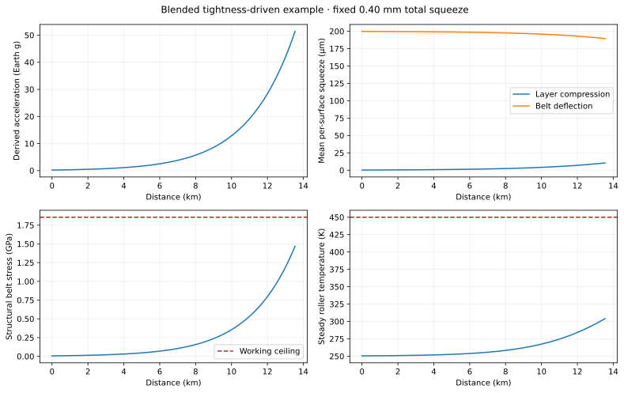
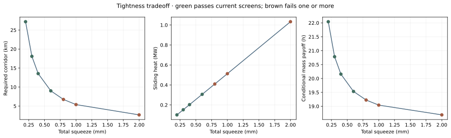

# Blended, tightness-driven sling mill

For the publication case, use the [selected iron reference](IRON_REFERENCE.md) and [article](../publication/ARTICLE.md).

## Historical development results

**[Current optimized iron reference](IRON_REFERENCE.md)** targets 1,600 m/s with iron payload properties, tensile bar loading and the expanded hardware budget. Its mass inventory supplies the publication pie chart.

**[Payload material and updated machine payoff](../publication/PAYLOAD_AND_PAYOFF.md)** records the iron selection, corrects the assumed end-compression constraint, and gives the fixed-geometry hardware audit and cross-design comparison. Earlier search numbers below retain their original assumptions.

**Next checkpoint: [constrained optimization results](OPTIMIZATION.md).** The
search now varies eleven continuous choices and adds a hub/shaft bending
screen. It provides conditional system parameters and a rounded candidate;
the illustrative example below remains the first closure demonstration.

[Study overview](../README.md) · [Publication tradeoff table](../publication/DESIGN_TRADEOFFS.md) · [Inputs](config.json) · [Result JSON](results/summary.json)

This is the first connected reduced model for the three next steps: **tightness → acceleration and machine length; flexible-belt load/deformation; and average heat plus component mass**. It uses steady loading and continuous station density. Individual bar arrivals and angular roller phases are averaged out.

The equations close numerically under the declared string-panel, compliant-layer and local speed-window assumptions. The results are candidate calculations for this model. Material qualification, detailed hardware sizing and full flexible-drum geometry remain open.

## Independent inputs and dependencies

The independent mechanical choices are drum radius R, hub fraction, pitch/R, bar L/W/D, total squeeze Δ, structural-belt thickness, contact-layer thickness, attachment counts and the fraction η of centrifugal support supplied by belt hoop tension. Material properties and working-stress limits are fixed scenario assumptions. Inlet/exit speeds and the 10 Mt/year requirement are mission inputs.

**Acceleration, normal force, contact length, local roller speed and corridor length are outputs.** The old independently prescribed acceleration and contact patch are absent from this configuration. Inlet occupancy and feed frequency follow from the required flow and bar dimensions.

Structural-belt thickness is independent here because it changes stiffness and traction at the same imposed squeeze. It is not redundant with a specified acceleration: that acceleration is now derived. The hoop-support fraction η describes how the radial load is shared between belt tension and hub-connected tensile members. It replaces a separately prescribed panel deflection. Its implied cable/belt rest lengths require a subsequent construction model.

### One local mechanical closure

For a belt with linear mass λ including its lamination, panel span ell and rim speed u:

```
ell = 2R sin(π/n)
λ = W (ρ_Zylon t_Zylon + ρ_layer t_layer)
T = η λ u²
C = t_layer / E_layer
δ_layer(N) = [3 N C / (4 W sqrt(2R))]^(2/3)
δ_belt(N) = N ell / (4T)
```

The last expression is the small-deflection response of a pretensioned string panel to a central normal load. Upper and lower contacts share the fixed squeeze and support the bar's lunar weight:

```
N_lower − N_upper = ρ_bar W D s g_moon
δ_layer(N_lower) + δ_belt(N_lower)
  + δ_layer(N_upper) + δ_belt(N_upper) = Δ
```

A scalar root solves the normal loads. When the lower roller would need all the available squeeze and more merely to support the weight, opposed contact is lost and the case is rejected. This is a direct loose-setting failure, in addition to the longer-machine penalty.

The local blended acceleration is then

`a = μ (N_lower + N_upper) / (ρ_bar W D s)`.

Bar length cancels between average engaged-pair count L/s and bar mass. L still affects feed frequency, engagement speed variation, payload stability and the stored-energy budget.

### Roller speed and length

The nominal rim speed has to exceed the speed at the later part of a bar's contact. With v referring to the center of that contact interval, a locally constant acceleration gives

`u = [sqrt(v² + a(u)L) + slip_margin] / (1 − reserved_speed_drop)`.

A second scalar root closes u and a together. The validity screen requires `aL/v² < 0.1`; the example is well within that limit. The final station retains a small conservative speed headroom beyond v_exit. The model integrates

```
dx/dv = v/a(v)
dt/dv = 1/a(v)
d(number of pairs)/dv = v/[a(v)s]
```

This retains the gradual acceleration profile without enumerating individual stations or entry/exit events. The number of pairs is an equivalent continuous count; a later hardware layout will round it and add entrance/exit margins.

## Belt stress and force balance

The structural-belt stress is `T/(W t_Zylon)`, including the coating's centrifugal load through λ. It must stay below the fixed working-stress ceiling. Increasing lamination thickness therefore raises the structural demand at the same belt thickness and speed.

The unloaded inward radial reaction per anchor is approximately

`λ u² ell/R − 2T sin(π/n)`.

At a loaded attachment, the normal-force share and the torque member's inward component reduce that reserve. A negative remaining reaction would require a compressive or outward-support element and fails this tensile-member architecture.

The model also checks the unloaded outward panel bow, contact deflection, thickness/span and contact-length/span. These are explicit validity screens for the reduced string-panel approximation. Upper/lower traction is handled separately for gravity balance; the larger normal load sizes the torque members and hub conservatively. Radial and diagonal cable masses retain the existing centrifugal taper formulas. Diagonal cable curvature and the associated true torque arm remain approximate.

## Blended heat and power

The occupied fraction at speed v is `φ(v)=ṁ/(ρ_bar W D v)`. Mean local pair heating is

`P_slip,pair = μ(N_lower + N_upper)(u−v) φ(v)`.

Integrating against station density gives total sliding heat. The reference assigns **50% to the bars and 50% to the roller layers**. The upper/lower heat split follows their respective traction loads. The bar calculation gives a bulk temperature rise. Roller temperature follows a steady radiation balance over the outer circumference:

`ε F σ (T⁴ − T_sink⁴) 2πRW = Q_roller + Q_external`.

The numerical reference uses view factor 0.7, emissivity 0.85, a 250 K equivalent sink and zero additional absorbed external flux. These are an environmental scenario, not a qualified radiator layout. A coating conduction-gradient scale is also exported. This is the agreed average thermal model; it does not resolve flash pulses or roller phases.

Motor inefficiency receives a separate radiator allowance. The current example supplies contact power directly from motors. An optional algebraic energy-deficit calculation can represent more of the pulse being supplied from rotor storage, using average occupancy and contact duration. It requires adequate reserved speed headroom. No phase-dependent control simulation is introduced.

## First solved example

This is a new illustrative configuration, rather than the earlier 200 mm-diameter validation example:

| Input or result | Value |
|---|---:|
| Drum radius / hub radius | 0.50 / 0.10 m |
| Station pitch | 1.50 m |
| Bar length × width × depth | 5 m × 60 mm × 40 mm |
| Structural Zylon belt thickness | 2 mm |
| Hypothetical contact layer | 0.5 mm; 1,400 kg/m³; 1 GPa compression modulus |
| Radial attachments | 128 per drum |
| Hoop-support fraction | 0.30 |
| Total imposed squeeze | 0.40 mm |
| Derived entry → exit acceleration | 2.07 → 503.91 m/s² |
| Corridor length | 13.54 km |
| Peak structural-belt stress | 1.468 GPa |
| Stress ceiling / utilization | 1.856 GPa / 79.1% |
| Payload kinetic power | 404.30 MW |
| Sliding heat / roller share | 0.203 / 0.102 MW |
| Mean electrical power | 425.79 MW |
| Maximum average roller temperature | 304.1 K under the stated environment |



The low inlet acceleration is a physical consequence of this selected model: at low rim speed, centrifugal pretension is weak, so the flexible belt absorbs much of the squeeze. Increasing radius, belt thickness, attachment count, inlet speed or squeeze changes that result. More attachments also require more joints and packaging; their hardware burden needs an explicit model before optimizing attachment count.

The low friction heat compared with the old 1,000-g example follows mainly from the much gentler acceleration and smaller speed increments. It is not simply a consequence of averaging the model.

### Tightness now gives both sides of the tradeoff

| Total squeeze | Required length | Sliding heat | Maximum mean roller T | Current screen outcome |
|---|---:|---:|---:|---|
| 0.10 mm | — | — | — | Cannot maintain opposed contact against gravity |
| 0.20 mm | 27.19 km | 0.101 MW | 266 K | Passes current reduced screens |
| 0.40 mm | 13.54 km | 0.203 MW | 304 K | Passes current reduced screens |
| 0.60 mm | 9.01 km | 0.306 MW | 347 K | Passes current reduced screens |
| 0.80 mm | 6.74 km | 0.409 MW | 389 K | Exceeds assumed bond-load envelope |
| 2.00 mm | 2.68 km | 1.033 MW | 596 K | Bond, thermal and inward-only support failures |



The layer and bond values remain hypothetical. The lower-force/longer-machine and higher-force/higher-heat tradeoff now follows from one connected set of equations. A green point passes these reduced screens; it is not a validated machine design.

### Strength margin is visible

The example needs 1.468 GPa in its structural belt. It fails ceilings of 1.0 or 1.25 GPa, nearly uses a 1.5 GPa ceiling, and uses 79.1% of the current 1.856 GPa ceiling. [The strength-ceiling table](results/strength_ceilings.csv) retains each outcome. The material remains Zylon HM; increasing the ceiling is a scenario change, not an optimizer escape.

The independent belt thickness and hoop-support fraction permit a later search to trade mass and stiffness against a lower stress ceiling. Manufacturing, joint, temperature and fatigue reductions still require defensible inputs.

## Mass accounting and what is still open

The component inventory includes belts, coating, radial/torque members, hubs, motors, bearings, frames, foundations, guides, startup supports and motor radiators. The same load- and power-based allowance laws apply at every velocity, integrated over station density. The mass table is in [mass.json](results/mass.json).

The reference's conditional inventory is about 23,009 tonnes, dominated by the retained generic **2 kg/kW of individual pulse-rated motors**. Its arithmetic payoff is about 20.16 operating hours at the target flow. This remains a hardware-cost diagnostic. Motor architecture, hub rotational strength, individual attachment mass, injector and power source are major unresolved inventory terms. No complete-site optimum is claimed.

The previous independent contact patch and backing-compliance inputs are replaced by the coupled string-panel/coating calculation. The three requested items have now advanced to a working reduced closure. Next steps are to test sensitivity to the support-sharing assumption, improve hardware allowances and choose credible material packages before a constrained parameter search. In particular:

- The model treats a short, centrally loaded, prestressed panel with small deflection. It needs comparison against a fuller flexible-drum equilibrium calculation.
- A constant normal gap implies a variable acceleration; that is intentional. A varying gap schedule could be introduced with a small number of additional parameters later.
- Throughput is imposed and checked against inlet capacity. At fixed site length, target speed imposes a further acceleration/length constraint. Available power and heat-rejection capacity can impose additional throughput limits.
- The present steady thermal balance needs a site/view-factor scenario and qualified temperature limits. It follows the requested blended treatment.
- The earlier discrete-contact and phase-resolved drive calculations are retained separately as historical diagnostics.

## Reproduce and verify

```bash
MPLCONFIGDIR=/tmp/lunar-sling-mpl-cache OPENBLAS_NUM_THREADS=1 .env/hub/bin/python sling_launcher/sling_mill/blended/run.py
.env/hub/bin/python sling_launcher/sling_mill/blended/test_model.py
```

Ten tests cover contact closure, upper/lower gravity balance, derived acceleration, rim-speed closure, energy conservation, the 50/50 heat split, loose-contact rejection, tighter-setting tradeoffs, width scaling, stress-ceiling rejection and grid refinement. Numerical gap residuals are below 10⁻¹⁰ m; the integrated kinetic-work identity closes at floating-point precision.

Additional outputs: [profile CSV](results/profile.csv), [tightness sweep](results/tightness_sweep.csv), [configuration](config.json). Outputs include both solved candidates and rejected cases.
