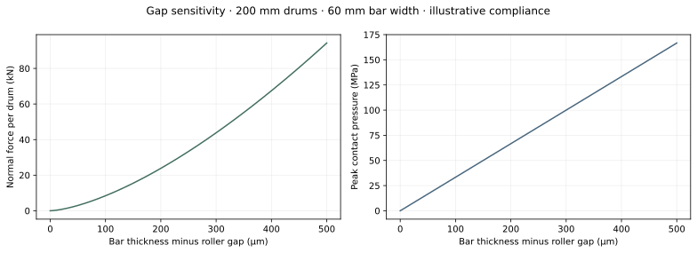
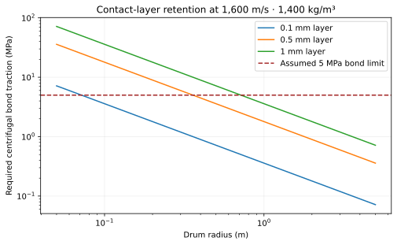

# Toward a constrained mass-payback optimizer

**Development update:** the [blended model](../blended/README.md) now closes a
reduced squeeze → load → acceleration → length calculation with average
thermal balance and material inventory. This folder preserves the earlier
variable register and separate contact audit. Its prescribed-patch mismatch
describes that earlier audit; the blended model derives its patch and uses
continuous station loading. Full drum geometry and hardware qualification
remain further work.

[Study overview](../README.md) · [Complete variable register](VARIABLES.md) · [Machine-readable variables](variables.json) · [Contact assumptions](assumptions.json)

The objective is the time required to deliver the machine's own mass. A successful design must satisfy contact, structural, throughput, thermal and operational constraints. This folder establishes the independent variables, an executable contact-layer/gap screen, explicit residuals and the mass-payback objective. **The model is still being closed before a constrained optimizer can select credible machine parameters.**

The accepted [spacing illustration](../figures/04_pitch_comparison.svg) is preserved, with its [PNG preview](../figures/04_pitch_comparison.png) and [publication draft](../publication/ARTICLE.md).

## Objective and accounting boundary

For operating flow ṁ, delivery fraction η and annual duty d:

```
t_gross,operating = M_machine / (η ṁ)
t_net,calendar = M_initial / [d (η ṁ − ṁ_replacement)]
```

`M_initial` includes the machine and the explicitly budgeted starting stock of contact material. The second expression charges subsequent replacement consumption against useful delivery. Both mass and flow use kilograms; time follows in seconds. Replacement consumption here means charged manufactured/imported material; locally manufactured replacement could be assigned a different accounting boundary later. A nonpositive denominator means no net mass payoff.

The reference remains 10 million tonnes/year, with 365 operating days. Changing operating days changes required operating flow for the fixed annual target. `successful_delivery_fraction=1` is a mission assumption. At 1,600 m/s, the existing mill model establishes launcher output; trajectory and catcher qualification are required to interpret all that output as delivered orbital mass.

Two boundaries are kept separate:

- **Accelerator payoff:** the earlier component inventory plus contact-layer mass, its extra structural loads/inertia, cooling and explicit wear stock.
- **Complete-site payoff:** additionally includes power production, electrical distribution, injection and payload processing. Power-source specific mass and injector/processing mass are `null` until selected. The complete-site objective remains unset.

A useful reference conversion is **1,000 tonnes / 317.10 kg/s = 0.876 operating hours**. Thus mass payoff can be short while the design remains physically infeasible. The current coated 300 mm-pitch contact-following example has a diagnostic accelerator payoff of about **20.57 hours**, driven by the existing generic pulse-rated motor allowance. It fails several screens and is not a selected design. Stored-energy drive architecture remains a separate discrete choice with different inventory and speed-headroom constraints.

## Independent design variables

The [full register](VARIABLES.md) classifies every current baseline and new contact input. The following is the useful solver parameterization:

| Family | Independent choices | Derived quantities |
|---|---|---|
| Drum geometry | R; hub fraction rₕ/R; pitch fraction s/R | Hub radius; pitch; clear gap; stage count; RPM |
| Payload | L, W, D independently | Mass; mass/length; launch frequency; spacing; inertia |
| Motion | Acceleration; entrance speed; nominal slip margin; reserved rim-speed drop | Corridor length; engagement histories; work; required torque |
| Flexible structure | Material choice; attachment counts; effective torque-sharing count; allowable shape-deflection ratio | Strength-sized belt/cable areas, taper, inventory and inertia |
| Contact layer | Thickness; material/attachment architecture chosen as a package | Mass; retention loads; compression; contact compliance; wear life |
| Contact width | Belt-width / bar-width ratio | Belt width; payload-contact width capped at bar width |
| Drive/thermal | Contact-following or stored-energy drive; permitted storage drop; radiator temperature within material limits | Motor ratings; required inertia; cooling area/mass |

Exploration bounds are recorded in `variables.json`. They delimit the first experiments; engineering constraints, rather than those bounds alone, decide feasibility. Integer attachment counts and material/drive choices require discrete enumeration or mixed-variable search. First solves should keep attachment count fixed until joint/termination mass and packing are sized.

The working strength, bond strength, friction coefficient, wear coefficient, contact thermal properties, safety factors and environmental losses are **uncertain inputs**. The optimizer must not improve a design by simply assigning them favorable values. Select defensible material packages and repeat solves across sensitivity cases. Manufacturing tolerances, maintenance interval, available power and site length are requirements or scenario assumptions.

### Width as the scale coordinate

Keep W independent of L, D and R. At fixed design shape and kinematics, per-rod mass and most contact forces scale with W. Define

```
linear mass = ρp W D
flow per width = ṁ/W
mass per width = M/W
frequency = ṁ/(ρp L W D)
```

For a family in which throughput also scales with W, many component masses scale with W, so the ratio M/ṁ can approach a constant. Fixed hardware and minimum dimensions then matter. At **fixed 10 Mt/year**, reducing W raises frequency and entrance occupancy; increasing W reduces frequency but increases pulse loads and usually pulse-rated drive inventory. This creates meaningful bounds without forcing an artificial interior optimum. Overhung shafts, cross-width belt support and frame bending will eventually limit a very wide roller; those require a shaft/frame model.

## Roller gap and pressure

The opposing surfaces squeeze the bar across its **vertical depth D**. Let g be the unloaded operating gap between contact-layer surfaces, and let Δ = D−g. For symmetric rollers each surface indents by δ=Δ/2.

The first screen treats the coating and backing as a local spring foundation:

```
C = t_layer/E_layer + C_backing                 [m/Pa]
p(x) = max(0, [δ − x²/(2R)] / C)
b = sqrt(2Rδ)                                  [contact half-length]
N = (4/3) W δ sqrt(2Rδ) / C                     [per drum]
δ_required = [3NC / (4W sqrt(2R))]^(2/3)
p_max = δ/C
```

This is a compliant-layer hypothesis. Belt membrane tension also affects deformation; the chosen backing compliance needs calibration against the rotating belt solution. Local peak pressure is 1.5 times the footprint-average pressure in this model. A contact interval crossing a rod end needs truncated pressure integration.

For the illustrative 1 GPa layer, 0.5 mm thickness and backing compliance 10⁻¹² m/Pa, C=1.5×10⁻¹² m/Pa. The 300 mm-pitch design's **peak structural load envelope**, including its 1.25 dynamic factor, corresponds to gaps about **39.770–39.810 mm** for a 40 mm bar. These are design-load capacity settings. The actual acceleration program requires a time-varying gap/normal-load command as the rod ends enter and leave contacts.



For fixed C, `N ∝ Δ^(3/2)`, so approximately `dN/N = 1.5 dΔ/Δ`. A 10 µm total-gap error around Δ=200 µm changes normal force by roughly 7.5%. The same error affects sliding traction if μ stays fixed. Smaller gap increases traction, pressure, shear, heat generation and deformation. Larger gap eventually loses traction and then contact.

**Choice of independent variables:** prescribe acceleration and calculate the required gap program, or prescribe the gap program and integrate the resulting motion. The first optimizer formulation uses acceleration as independent. Maximum permitted interference, gap tolerance and actuator authority constrain the derived program. It must also handle the small upper/lower normal-load difference needed for gravity support.

The legacy stage model still uses a prescribed 20 mm patch. This contact hypothesis produces a smaller patch, so `contact_patch_closure` explicitly fails. Its pressure-dependent and edge-truncated patches must be fed back into engagement, force sharing and slipping before an optimizer uses them as a closed model. The audit deliberately keeps this discrepancy visible.

## Wear layer: why radius and thickness matter

For a layer whose centripetal load is supplied by its bond:

```
σ_bond,centrifugal ≈ ρ_layer t_layer u²/R
M_layer = 2 N_stations (2πR W_belt t_layer ρ_layer)
ε_bending,screen ≈ t_layer/(2R)
τ_contact,peak ≈ μ p_max
```

The 0.5 mm, 1,400 kg/m³ hypothesis at 1,600 m/s needs **17.92 MPa** bond traction at R=0.10 m. A hypothetical 5 MPa tensile bond limit alone requires R≥0.3584 m, before shear, flaws or fatigue. This is a sensitivity example; no adhesive or wear material has been selected. A layer designed to carry its own circumferential tension, a segmented tread or mechanical retention would have different loads and additional mass.



An assumed combined-load envelope `(σ_bond/σ_allow)² + (τ/τ_allow)² ≤ 1` provides a first residual. The bending expression estimates a curvature-change strain scale for the layer itself. The bonded composite neutral axis and the actual contact flattening path alter it. A credible lamination design must add fracture energy, residual stress, flaw size, edge peeling and cycle-dependent degradation. The current stress envelope is a screening hypothesis, not an adhesion qualification.

Small R increases required retention stress, curvature-change strain and RPM. Thick coating provides wear stock, but increases retention load and mass and changes compliance. Thin coating reduces those loads while shortening wear life and imposing manufacturing/roughness limits. The optional coating mass now enters the existing belt force balance, cable loads and rotor inertia, in addition to the BOM.

### Heat and wear gates

The thermal screen applies a short surface heat pulse to a homogeneous half-space:

```
q'' ≈ heat_partition × μ p_max × slip_speed
t_contact ≈ contact_patch/u
α = k/(ρ cp)
ΔT_flash ≈ 2 q'' sqrt(α t_contact/π)/k
```

It combines peak pressure and peak slip as a conservative envelope, checks thermal penetration relative to coating thickness, and assumes constant properties. The hypothetical low-conductivity coating gives a temperature increment far beyond its assumed operating limit. At that point the numerical temperature is outside the material model's validity; the valid conclusion is that this hypothetical contact case fails the screen. Cooling away average megawatts does not by itself solve local contact heating.

The wear hypothesis is `V̇ = K N v_slip/H`. Under the existing Coulomb sliding model its cycle mean is obtained from `V̇ = K P_slip/(μH)`. Local drum life is coating thickness divided by mean surface recession, and the replacement mass rate enters net payoff. K, H and heat partition require measurements under the actual contact conditions. The illustrative worst-station life is only about **2.2 hours** at K=10⁻⁶; that value is a sensitivity result. Life varies inversely with K.

## Constraints in both directions

Use physical mass terms or explicit residuals, rather than adding arbitrary symmetric penalties solely to create a minimum.

| Variable direction | Consequence to constrain or include in mass |
|---|---|
| R smaller / larger | Retention, curvature and RPM / larger circumference, hub/support envelope, fewer contacts when pitch grows |
| Hub fraction smaller / larger | Higher torque-member tension / larger rigid hub and rotational-stress burden |
| Pitch smaller / larger | Drum clearance, many stations and foundations / fewer contacts, larger per-drum loads, longer unsupported rod spans and contact gaps |
| L shorter / longer | Higher launch frequency and fewer contacts / longer contact slip range, alignment and handling burden |
| W smaller / larger | Frequency and occupancy limits / larger pulse loads, cross-width bending and drive inventory |
| D smaller / larger | Payload strength, stiffness and occupancy / larger per-rod loads, handling and contact force |
| Acceleration smaller / larger | Longer corridor and site hardware / larger traction, pressure and dynamic loads |
| Entry speed smaller / larger | Occupancy and weak low-speed centrifugal support / injector mass/power; total ideal exit energy is unchanged |
| Layer thinner / thicker | Life, defects and roughness / retention force, compliance, inertia and mass |
| Roller gap wider / tighter | Traction loss / pressure, shear, heating and excessive deformation |
| More attachments | Reduced unsupported belt span; added terminations, joint mass, packaging and assembly complexity must be sized |
| More speed headroom | Greater stored-energy tolerance; increased sliding heat, retention and rotational stress |
| Higher radiator temperature | Less area; stricter material, bond and cooling-temperature limits |

Quantities whose mass law or limit remains missing are closure tasks. Lock them during an initial solve, or report an optimum at an exploration boundary as unresolved. In particular, the current frame/hub allowance does not support unbounded width or arbitrary attachment counts. Entry-speed optimization must include the injector rather than moving its burden outside the objective.

## Solver implementation contract

`audit.py` returns the objective quantities and named normalized residuals, where **residual ≤0 passes**. It checks flow, clearance, contacts, speed, belt validity, payload strength/buckling, coating retention, pressure, interference, tolerance, heat, life and contact-patch consistency. Invalid/nonfinite structural states must be rejected. A solver should use a small numerical tolerance for floating-point roundoff, while still exposing the raw residual.

A useful sequence is:

1. Close the contact/gap/engagement iteration and loaded belt shape; qualify a material-property scenario.
2. Fix a drive strategy and material package, initially fixing attachment topology too.
3. Search bounded continuous variables in logarithmic coordinates where appropriate; use explicit nonlinear constraints and retain all failed residuals. Compare discrete material/drive/topology cases outside that solve.
4. Use a global sampled or differential-evolution search followed by constrained local refinement. Repeat starts and tighten discretization on finalists.
5. Report active constraints, boundary hits, perturbation sensitivity and mass breakdown. Compare accelerator and complete-site payoff at the same delivery assumptions.

The current executable is a constraint audit, with `solver_ready=false`; it does not report an infeasible point as an optimizer result. Unknown power-source and processing costs keep the complete-site objective unset. The 20.57-hour diagnostic is consequently an arithmetic checkpoint, rather than the expected payoff of a buildable machine.

## Reproduce

```bash
.env/hub/bin/python sling_launcher/sling_mill/optimization/registry.py
MPLCONFIGDIR=/tmp/lunar-sling-mpl-cache .env/hub/bin/python sling_launcher/sling_mill/optimization/audit.py
MPLCONFIGDIR=/tmp/lunar-sling-mpl-cache .env/hub/bin/python sling_launcher/sling_mill/optimization/illustrate.py
.env/hub/bin/python sling_launcher/sling_mill/optimization/test_contact.py
```

Outputs: [audit JSON](results/audit.json), [contact stages](results/contact_stages.csv), [mass including layer and stock](results/mass_with_layer.csv). The uncoated baseline remains reproducible with the existing scripts.

## References and evidence level

The spring-foundation contact and centrifugal-layer equations above are derived from their stated assumptions. Contact material properties in `assumptions.json` are hypothetical inputs. [NASA's gear-wear study](https://ntrs.nasa.gov/api/citations/19890006043/downloads/19890006043.pdf) illustrates use of an Archard wear relation; it supplies no performance validation for this mill. [Thin-film fracture/delamination experiments](https://arxiv.org/abs/1412.1020) show why film stress and adhesion can interact with cracking; the proposed mill's bond requires its own characterization. The stress-only bond screen therefore remains an initial design filter.
