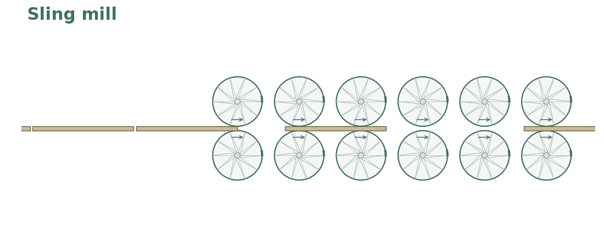
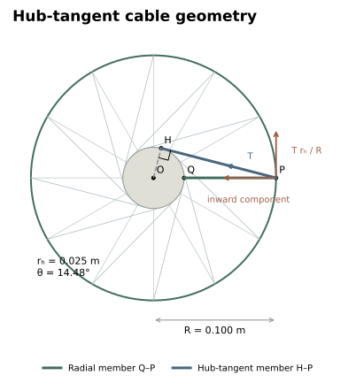
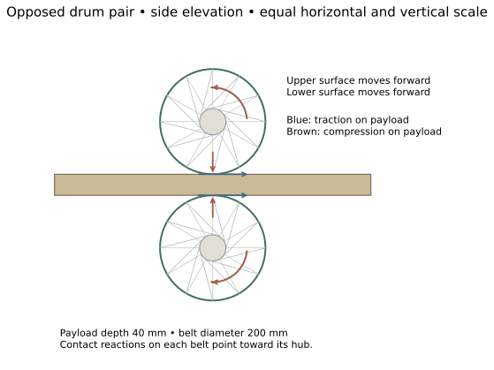
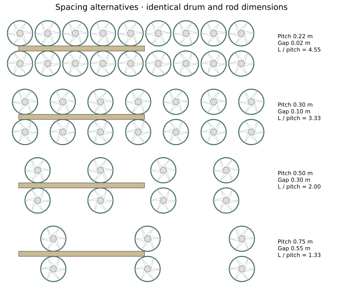
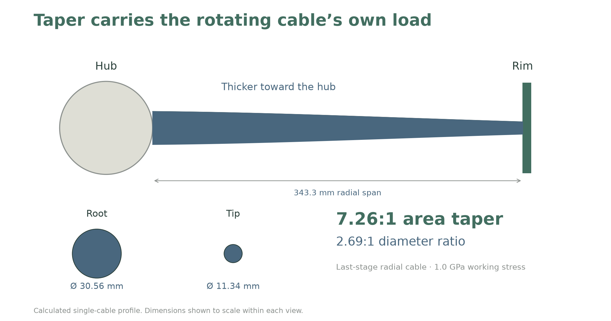
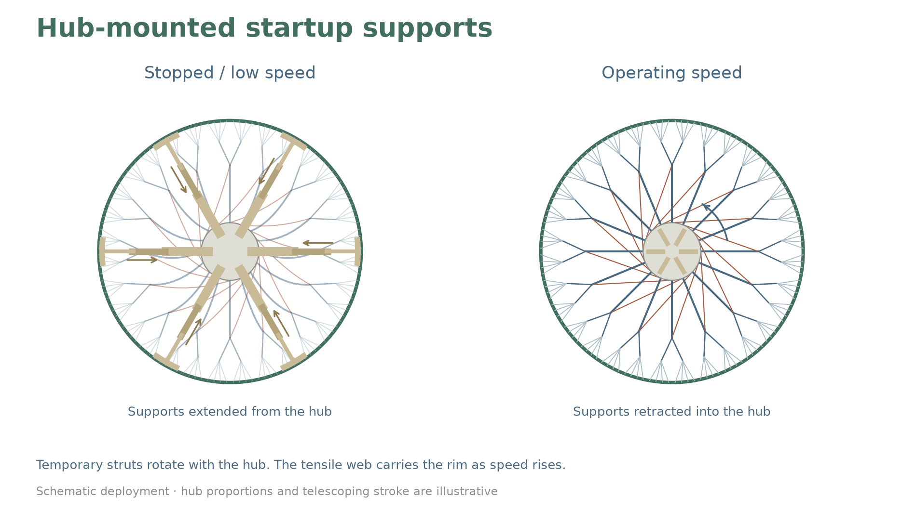
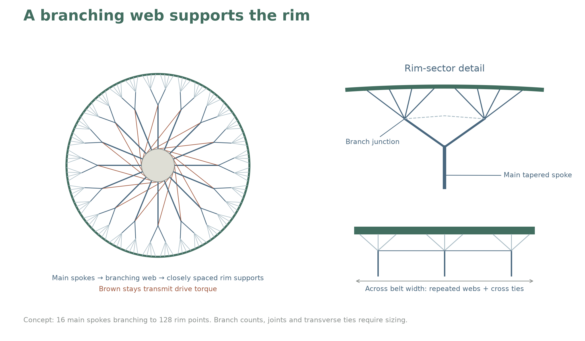
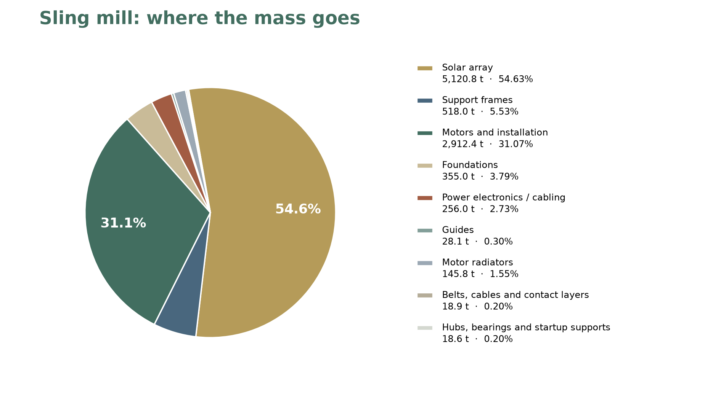

# The sling mill: accelerating lunar material through a row of rollers

A lunar launcher could accelerate manufactured metal bars through a straight line of opposed rollers. The **sling mill** combines that familiar arrangement with lightweight, tensile drum structures capable of high peripheral speed.

The current model targets **10 million tonnes per operating year at 1,600 m/s**. Its selected iron case uses about **9,374 tonnes of equipment including full-sun solar generation**, giving a gross mass payoff of **8.21 operating hours**. This is a conceptual engineering estimate with explicit material and hardware assumptions. Hub attachment packing and startup-support sizing remain open; the mass estimate is conditional on resolving them.

## How it works

One drum sits above the bar and another below. They rotate in opposite directions, moving both contact surfaces forward. Successive stations run faster as the bar accelerates. Bars arrive end-to-end and progressively separate downstream.

The contact surfaces slide over the bar, transmitting forward traction. With traction increasing toward the leading end, the blended model puts the bar in longitudinal tension. Opposed normal forces provide the grip and produce local contact pressure.

The animation is a slowed motion schematic with exaggerated bar thickness. The numerical dimensions are listed below.

## A flexible drum with a small hub

Each drum has a rigid central hub, an outer structural belt, radial tensile members and torque-transmitting members tangent to the hub. These members support the rotating belt while transmitting the drive force. A replaceable contact layer sits over the structural Zylon.

The hub size sets a tradeoff: a small hub needs greater cable tension to transmit torque, while a larger hub carries more rotating mass and experiences greater centrifugal stress.

Adjacent drums can also have gaps. Spacing changes the number of stations, contact coverage and load per station.

These geometry illustrations use introductory dimensions to show the mechanism. The optimized reference below defines the modeled machine.

## Tapering the drum cables

The last-stage radial cable grows from **11.34 mm equivalent round diameter at the rim to 30.56 mm at the hub**. Its **7.26:1 area taper** corresponds to a **2.69:1 diameter ratio**. The profile follows the reference cable-sizing equation over its 343.3 mm radial span. This illustrates the independent-cable calculation underlying the comparison table; the branching suspension web has its own future sizing work.

[SVG](../figures/09_radial_cable_taper.svg) · [PNG](../figures/09_radial_cable_taper.png)

## Supporting the rim

Temporary supports extend from the rotating hub while the wheel is stopped or turning slowly. They retract into the hub once the tensile structure carries the rim.

Main spokes branch into a dense suspension web near the rim, spreading loads between closely spaced attachment points. Repeated webs and cross ties support the belt across its width; hub-tangent stays transmit drive torque. This proposed topology needs a revised structural inventory. The current numerical checkpoint uses independent members and a small startup-support allowance. [Structural and torque audit](../blended/DRUM_TAPER_AND_STARTUP.md).

## Earth precedents: flywheels and centrifuges

Terrestrial rotating machinery provides a useful scale check. Sandia's 2015 flywheel survey gives **500–1,000 m/s** as the operating surface-speed range for high-performance carbon-composite rotors, and **200–400 m/s** for steel rotors. Its design limit comes from material stress with operating margin. [Sandia, *Flywheels*, p. 8](https://www.sandia.gov/ess-ssl/publications/SAND2015-3976.pdf#page=8).

| Application | Reported performance | What it establishes for this concept |
|---|---|---|
| Carbon-composite energy-storage flywheels | 500–1,000 m/s operating surface speed in the Sandia survey | A practical historical baseline for high-speed rotating structures. |
| NASA / University of Texas composite-arbor flywheel prototype | **1,337 m/s at 60,070 rpm in a 2003 burst test**; 0.424 m diameter | Higher speed has been demonstrated experimentally. The reported point is a burst-test result; sustained service needs its own margin and life qualification. [NASA Glenn report, pp. 234–235](https://ntrs.nasa.gov/api/citations/20050019494/downloads/20050019494.pdf#page=248). |
| Beckman Coulter Type 100 Ti ultracentrifuge rotor | 100,000 rpm and 802,000 g; **about 751 m/s at the maximum-RCF sample radius**, calculated from those specifications | Very high rpm and acceleration can coexist with a substantially lower peripheral speed. [Manufacturer specifications](https://www.beckman.com/centrifuges/rotors/fixed-angle). |
| JAERI centrifugal fusion-pellet injector | **700 m/s, 5 pellets/s for 10 seconds** demonstrated with 2 mm deuterium pellets; reported maximum capability 1,000 m/s | A direct precedent for feeding material into a rotating mechanism and releasing it at high speed. Its developmental problems included pellet motion and sublimated-gas interference. [JAERI research report](https://rdreview.jaea.go.jp/tayu/ACT01E/03/0305.htm). |

The mill's last rim runs at **1,604 m/s and about 39,650 rpm**. That is 20% faster than the cited flywheel burst-test point; centrifugal stresses at unchanged geometry and density scale with speed squared, a **44% increase**. Its rim material experiences about **679,000 g**, while the passing iron bar reaches **493.6 g** along the accelerator. These are different motions: the rim continuously turns in a tight circle, while the bar passes through the contact.

### What tapering changes

At fixed mass, radius and angular speed, moving mass toward the rim increases stored energy because `E = ½ omega² ∫r² dm`. But **tapering can also benefit flywheels** when allowable stress is the constraint: a shaped rotor distributes stress more efficiently and can operate at a different speed. Constant-stress, outward-thinning Stodola disks are an established flywheel design family. [NASA contractor report on isotensoid flywheels, section “The Stodola wheel”](https://ntrs.nasa.gov/api/citations/19720009370/downloads/19720009370.pdf).

The distinction proposed here is the design objective. The mill seeks a fast, load-bearing contact surface with low installed mass and continuous transfer of energy into departing bars. Its tapered radial members carry a relatively light rim. Rotor inertia still matters because it buffers individual contacts; the current model explicitly includes that requirement.

For an ideal freely rotating thin ring, `sigma = rho*u²`. At this model's Zylon density and final rim speed, that gives **4.01 GPa** before adding a contact layer. The mill's **1.0 GPa** sizing allowance therefore depends on inward support from the tapered cables and the resulting division of load between the rim and those cables. Its computed **0.922 GPa peak belt stress** belongs to that supported structure. This is the mechanical basis for investigating the geometry. The thin-ring relation is given in the [Sandia flywheel analysis](https://www.sandia.gov/ess-ssl/publications/SAND2015-3976.pdf#page=8).

The composite-arbor work is particularly relevant to the next engineering step: it treats the connection between a small shaft and a much larger composite rim, including radial compression, winding direction, shear and transverse properties. Those details affected durability and temperature range in the NASA study. For the mill, hub attachments, web load sharing, cyclic traction and contact-layer life remain the corresponding development questions. The cited precedents establish useful mechanisms and speed scales; a service-capable 1.6 km/s contact drum still requires demonstration.

## What material should the bars carry?

**Unalloyed iron is the reference payload.** It offers useful orbital feedstock and a plausible lunar extraction route with relatively simple composition control. Hydrogen-reduction experiments on lunar material have produced metallic iron from ilmenite. [NASA experimental record](https://ntrs.nasa.gov/citations/19950035561).

The other candidates depend on what the receiving industry wants to manufacture. Element diversity is useful when the delivered mixture suits that purpose: remelting preserves alloy chemistry, while separating its constituent elements requires further processing.

| Payload candidate | Elements delivered | Provisional axial working allowable | Manufacturing and orbital-use tradeoff |
|---|---|---|---|
| **Iron — reference** | **Fe**; optional C, Si | **Unalloyed: 70 MPa** +C (low-carbon steel): 120 MPa +Si (iron–silicon): 20 MPa | Recovered iron consolidated into sound bars provides structural feedstock. Alloy variants need composition control; silicon-rich grades can be brittle. |
| Aluminum | Al; optional Si, Mg, Cu | Unalloyed: 15 MPa +Si: 50 MPa +Mg +Si: 100 MPa +Cu: 100 MPa | Useful electrical, thermal and fabrication feedstock. Strength depends on refining, composition, porosity and processing; Cu-bearing stock requires a suitable copper supply. |
| Consolidated regolith or glass-ceramic | O, Si, Al, Ca, Mg, Fe; deposit-dependent | 5 MPa | Delivers chemically bound oxygen and other elements. Brittle bars need contact/fracture qualification and orbital extraction. |
| Iron-skinned oxide cargo | Fe shell; O and the core's mineral elements | Shell: 70 MPa Gross section: 70 × shell-area fraction MPa Example, 20% shell area: 14 MPa | Shell carries traction; core receives no tensile-load credit. Load transfer, confinement and roller pinch need their own checks. |

These values are **provisional working inputs** for screening. Iron's 70 MPa value is informed by terrestrial pure-iron data; the other values are assigned assumptions pending a chosen composition and process. Alloy additions identify candidate families; their strength depends on the resulting grade and treatment. The iron reference requires an axial-stress envelope of **60.3 MPa** and experiences **14.4 MPa** peak contact pressure. [Pure-iron property data](https://www.aksteel.nl/files/downloads/clf_productdata__armco_pure_iron_pdb_euro_final_072022_92.pdf); [material-selection notes](PAYLOAD_AND_PAYOFF.md).

Lunar regolith contains roughly **40–45% oxygen by mass**, bound in minerals and glass. Orbital processing could extract oxygen from the oxide options. An 80%-by-mass core containing 45% oxygen delivers **36% of gross cargo mass as chemically bound oxygen**, before extraction losses. Core mass fraction and shell cross-sectional fraction are distinct quantities. [ESA oxygen-extraction overview](https://www.esa.int/Science_Exploration/Human_and_Robotic_Exploration/Turning_Moon_dust_into_oxygen).

## The selected iron reference

The model derives acceleration from roller squeeze, structural compliance and sliding traction. It integrates that acceleration to obtain machine length, then sizes the rotating material, shafts, supports, motors, cooling and solar supply. The objective is installed mass divided by useful payload mass flow.

<!-- BEGIN REFERENCE_TABLE -->

| Quantity | Selected reference |
|---|---:|
| Useful delivery | 10 million tonnes per 365 operating days (317.10 kg/s) |
| Exit speed | 1,600 m/s |
| Iron bar dimensions | 1.586 m × 267.6 mm × 1.51 mm |
| Bar mass / feed frequency | 5.028 kg / 63.07 bars/s |
| Maximum acceleration | 493.6 Earth g |
| Roller diameter / station pitch | 0.773 m / 0.793 m |
| Accelerator length | 1.407 km |
| Mean electrical input | 426.73 MW |
| Structural Zylon working ceiling | 1.0 GPa; tapered drum cables assumed |
| Peak belt stress including traction | 0.922 GPa |
| Largest drum-cable area taper | 7.26:1 |
| Iron axial working allowable | 70 MPa |
| Accelerator hardware | 4,253 tonnes |
| Full-sun solar array | 5,121 tonnes |
| **Total included mass** | **9,374 tonnes** |
| **Gross mass payoff** | **8.21 operating hours** |

<!-- END REFERENCE_TABLE -->

The plate thickness emerged near **1.51 mm** after expanding the search down to 0.10 mm. Thinner plates require greater width to preserve flow at the inlet. Greater width increases shaft bending demand; a larger shaft then encounters its rotational-stress limit. Roller size, support mass, contact-layer bonding and temperature complete the tradeoff.

The result is conditional on the assumed contact material, friction, bond strength and stiffness tolerances. Plate guidance, combined local contact stress, wear and fatigue remain engineering work. The [technical reference](../blended/IRON_REFERENCE.md) and [assumption review](../blended/ASSUMPTION_REVIEW.md) give the equations, bounds and verification.

## Comparison with earlier lunar launcher designs

First compare structural working stress and taper, then compare the mill and conveyor at a common release speed, acceleration and useful mass flow. The final table provides context from the earlier complete-machine studies, whose delivery rates and inventory boundaries differ. Fiber values are modeled **working stresses**; payload strength is a separate requirement.

<!-- BEGIN COMPARISON_TABLE -->

| Design | Structural fiber | Working stress (GPa) | Specific working stress (MJ/kg) | Area taper, root:tip |
|---|---|---:|---:|---:|
| Sling mill | Zylon | 1.000 | 0.641 | 7.26:1 |
| Go-kart sling | Kevlar | 1.000 | 0.690 | 7.82:1 |
| Slider straw | Kevlar | 2.438 | 1.681 | 2.33:1 |
| Conveyor | Zylon | 2.900 | 1.859 | 1.00:1 |

Taper is the ratio of material cross-sectional **areas**. For a round cable, the diameter ratio is its square root. The mill value is the last-stage radial/torque cable ratio; its outer belt is constant-section. Specific working stress is working stress divided by fiber density. These are the sizing assumptions of each recorded case; the mill's computed peak belt stress is 0.922 GPa.

### Matched mill–conveyor comparison

Both calculations deliver **317.10 kg/s useful payload at 1,600 m/s**, with a **493.6 g maximum modeled loaded acceleration**. Conveyor circulation speed is the line speed through its feed pulley, in addition to the rotation of the entire launcher.

| Design | Conveyor circulation speed | Structural fiber mass | Fiber-only gross payoff |
|---|---:|---:|---:|
| **Sling mill** | — | **17.31 t** | **54.6 seconds** |
| Conveyor, opposed pair | 1 m/s | 1,667.71 t | 87.65 minutes |
| Conveyor, opposed pair | 5 m/s | 333.10 t | 17.51 minutes |
| Conveyor, opposed pair | 10 m/s | 165.96 t | 8.72 minutes |
| Conveyor, opposed pair | 20 m/s | 82.06 t | 4.31 minutes |

The conveyor uses uniform-section Zylon at 2.9 GPa and includes two equally loaded arms, with one arm delivering useful payload and the opposing arm carrying disposable countermass. The mill includes structural belts, radial cables and torque cables in both rollers at every station, sized at a 1.0 GPa working ceiling with taper. Contact layers, motors, structures and power supply are excluded from these **fiber-only** totals. A whole-machine conveyor estimate remains open. [Method, scaling and limitations](PAYLOAD_AND_PAYOFF.md#matched-acceleration-conveyor-comparison).

### Earlier complete-machine studies

These recorded cases use different flows and equipment boundaries.

| Design | Payload acceleration | Structural fiber working stress | Useful flow (kg/s) | Gross mass payoff | Included inventory |
|---|---|---|---:|---|---|
| **[Sling mill](../blended/IRON_REFERENCE.md)** | **493.6 g maximum** | Zylon, 1.0 GPa with tapered drum cables | **317.10** | **8.21 operating hours** | **9,374 t**: accelerator hardware, foundations, cooling and full-sun solar |
| [Go-kart sling](../../publication/MASS_PAYOFF.md) | 50 g at release | Tapered Kevlar, 1.0 GPa | 0.151 | 188 operating days | 2,446 t: equipment, solar and local ballast, within the source study's exclusions |
| [Slider straw](../../lunar_slider_straw/RING_REFERENCE.md) | 50 g at release | Tapered Kevlar, 2.438 GPa in the recorded 3:1 sizing case | 1.206 | 22.4 operating days | 2,329 t: installed machine, foundations, solar and battery |

<!-- END COMPARISON_TABLE -->

The mill uses a **70 MPa iron-payload working allowable**. The earlier sling and conveyor analyses treat payloads as attached masses and do not provide corresponding payload-material allowables.

The slider straw retains **tapered Kevlar**. Its historical 2.438 GPa sizing assumption was back-solved from a chosen 3:1 tether/payload mass ratio. Lower working stress is available through greater taper and tether mass, with corresponding drum and hardware changes. The 22.4-day payoff belongs to that recorded sizing choice.

At 5 m/s circulation, the new conveyor requires about **19.2 times** the mill's structural-fiber inventory. At 20 m/s the ratio falls to **4.7 times**. These are steady-operation material comparisons; catcher timing, downtime and replacements affect delivered service.

## Where the machine mass goes

Solar generation supplies the largest mass contribution. The budget assumes **100 W/kg illuminated output**, **20% generating headroom** and **full sunlight**. The approximately **512 MW rated array** has about **2.05 km² of collecting area** at 250 W/m², before spacing. The reference includes no lunar-night energy storage.

The hardware inventory includes flexible drums, shafts, bearings, support frames, foundations, guides, motors, drive electronics and motor cooling. Motors supply each station's mean power with rating headroom; rotating inertia supplies the short contact pulses.

The model begins at **100 m/s**. The upstream injector, mining, refining, bar production, orbital catcher and deployment are additional infrastructure. The quoted payoff is **total included mass divided by useful launched mass flow**. It measures gross mass delivery; maintenance replacements and infrastructure outside this boundary require further accounting.

## What this comparison suggests

The conveyor keeps a continuous path of high-speed structural material extending more than half a kilometer from its hub. Faster circulation moves a given payload flow with less payload and tether inventory along that path. Raising the allowable acceleration shortens it substantially, but its uniform-section loop still needs high working stress at orbital release speed.

The mill divides acceleration among many compact drums. Each drum can taper its radial cables, and only the final stages reach full rim speed. This produces a much smaller structural-fiber inventory in the matched calculation. The trade is a large collection of driven stations and a supply of sound manufactured bars. Its **54.6-second fiber payoff** becomes **8.21 hours** once the current hardware and full-sun solar budget is included.

This supports a specific conclusion: the mill is promising for reducing high-performance fiber inventory, while its practical mass is dominated by power generation and machinery. A full-machine conveyor comparison needs its own motor, pulley, structure and power-system budget.

The principal structural work is fitting the tapered roots at the hub, sizing the branching rim web and retractable startup supports, and qualifying contact-layer wear and bonding. The current inventory represents independent radial and torque cables. [Structural audit and torque reproduction](../blended/DRUM_TAPER_AND_STARTUP.md).

The [Earth precedents](#earth-precedents-flywheels-and-centrifuges) establish several ingredients: high-speed composite rotors, engineered shaft-to-rim connections and repeated centrifugal launching. The proposed contribution is their combination into a staged, continuously fed accelerator. The calculations identify a potentially attractive operating regime; demonstrating a durable, traction-loaded drum is the central engineering challenge.

**Showing that a drum spins at the required speed is one milestone. Showing that it survives repeated loaded contact is the decisive next milestone.** During each pass, the drum must transmit traction, resist local deformation and retain its contact layer. The bar and rim travel in the same direction at nearly the same speed, so their sliding speed is much smaller than the rim's 1.6 km/s speed. That helps the frictional-heating budget, while cyclic loading, bonding and wear still determine service life.

The most informative experiment would be a representative opposed drum pair repeatedly accelerating bars, with measurements of traction, deformation, temperature and wear. It would test whether the modeled load path and contact behavior can coexist in working hardware. A machine that succeeds physically could still require heavier supports, frequent surface replacement or more conservative operation, changing its mass payoff substantially. The present result makes that experiment worth investigating; repeated loaded-contact performance would establish how much of the calculated advantage survives in practice.
