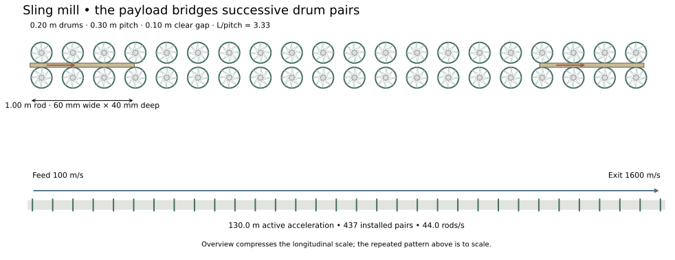
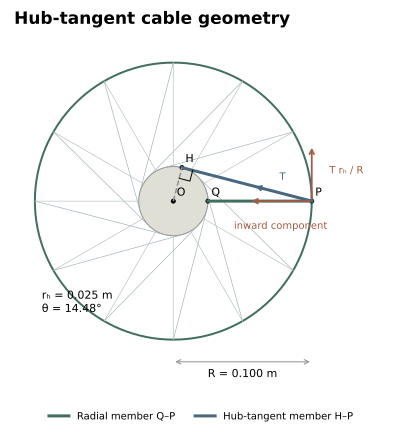
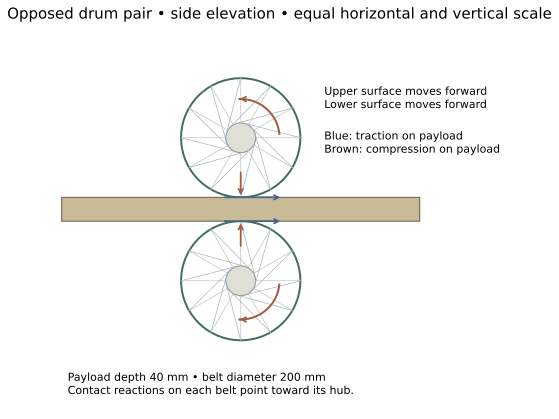
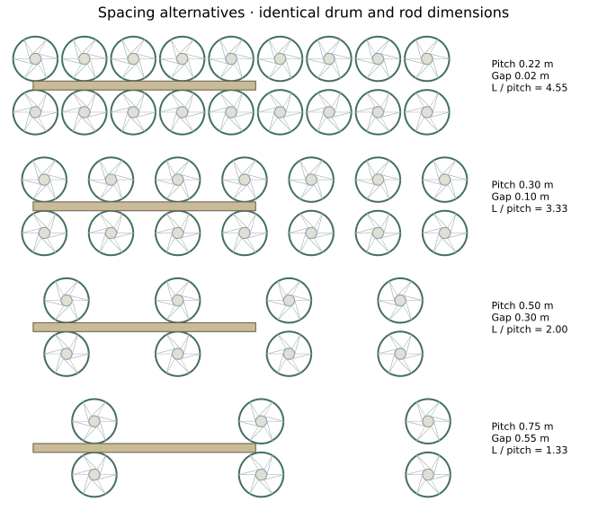
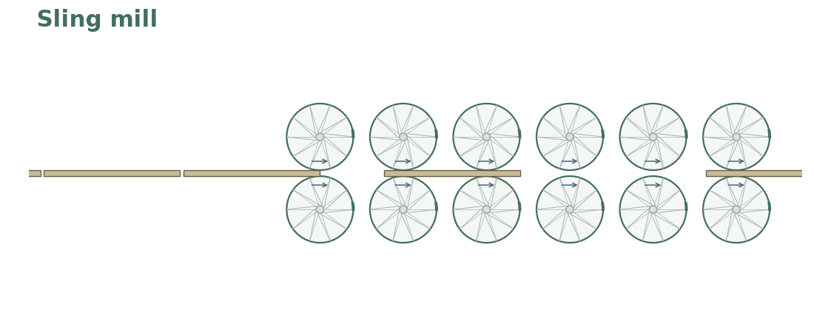
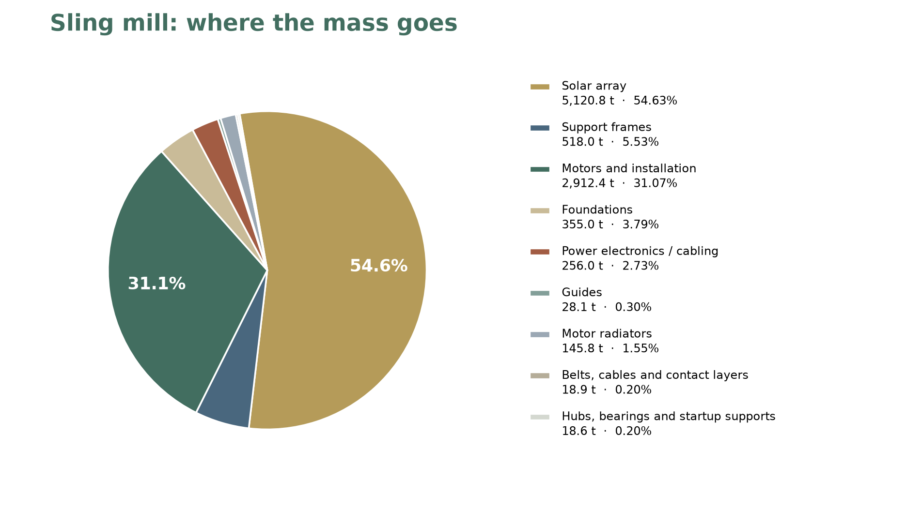

# Historical article draft

This preserved draft mixes early illustrative cases and intermediate calculations. Use the [current article](../ARTICLE.md) for publication.

# The sling mill: accelerating lunar material through a row of rollers

**[Payload material and updated machine payoff](../PAYLOAD_AND_PAYOFF.md)** records the iron selection, corrects the assumed end-compression constraint, and gives the fixed-geometry hardware audit and cross-design comparison. Earlier search numbers below retain their original assumptions.

*Working blog-post draft and asset sequence. The architecture is an investigation; a final machine design and mass-payback result are still being developed.*

## A different kind of mechanical launcher

The sling mill accelerates a long, rectangular bar through a straight row of opposed drums. One drum sits above the bar and another below. They rotate in opposite directions, moving both contact surfaces forward. Successive stations run faster as the bar gains speed.

The contact surfaces deliberately slide over the bar. Their friction supplies its forward acceleration. A long bar can engage several stations at once, distributing the force across them.

The illustrated system has 200 mm diameter drums on 300 mm pitch, leaving 100 mm between adjacent drums. The bar is 1 m long, 60 mm wide and 40 mm deep. These are adjustable dimensions; the drawing makes their relative scale visible.

## A flexible drum with a small hub

The drum has a rigid central hub, a circumferential structural belt, radial tensile members and separate torque-transmitting members. The torque member is tangent to the hub at its anchor. Its pull on the outer belt has both inward and circumferential components.

A smaller hub increases the cable tension required for a given drive torque. The outer belt must also maintain a useful contact shape while supporting its own rotating mass and the contact layer.

## Spacing is a design choice

There is room to separate the drums. Wider spacing reduces the number of stations, while increasing the force carried by each engaged pair. It also increases the unsupported length of the bar.

**Preserved publication asset:** [editable SVG](../../figures/04_pitch_comparison.svg) · [PNG](../../figures/04_pitch_comparison.png). This accepted illustration remains the spacing comparison for the article.

At fixed 10 million tonnes/year, drum diameter and bar dimensions:

| Pitch | Clear gap | Installed pairs | Peak traction per pair |
|---|---:|---:|---:|
| 0.20 m | 0 m | 655 | 14.12 kN |
| 0.30 m | 0.10 m | 437 | 23.54 kN |
| 0.50 m | 0.30 m | 262 | 35.30 kN |

The [complete spacing study](../../PITCH_STUDY.md) includes more cases and the limit where the bar passes through intervals with no drum contact.

## The production scale

Ten million tonnes/year corresponds to 317 kg/s under continuous operation. The illustrative bars weigh 7.2 kg, giving about 44 bars per second. Acceleration from 100 to 1,600 m/s at 1,000 Earth g takes approximately 130 m.

Ideal payload power is about 404 MW. The first discrete-contact calculations add roughly 4.2 MW of sliding heat. The [model results](../../RESULTS.md) distinguish average power, individual motor pulse ratings and rotor-stored energy. The surface-injection system and payload processing need their own budget.

## The bar is part of the machine's load path

The bar must tolerate traction, compression, bending, heat and contact wear. Manufactured metal, consolidated mineral/oxide material, or a structural carrier are possible material families. Their mechanical properties and surface behavior determine which cargo can be handled. Ground processing and inspection belong in the eventual system comparison.

## What controls the optimum?

The [design-tradeoff table](../DESIGN_TRADEOFFS.md) records the physical consequences
of moving each major variable toward either extreme. The first
[blended calculation](../../blended/README.md) now connects imposed squeeze to
derived acceleration, required length, average friction heat and Zylon stress.

The next analysis adds a replaceable contact layer, its attachment to the structural belt, and the roller gap. Reducing the radius raises RPM and the inward force needed to retain that layer. Squeezing the bar more tightly increases traction together with pressure, shear and local heating.

The design objective is **mass-payback time**: how long the useful delivered flow takes to equal the installed system mass, with replacement material and operating availability accounted for. The [optimizer framework](../../optimization/README.md) separates geometry choices from uncertain material properties and identifies the physics that must be closed before selecting a minimum.

*To finish before numerical publication: resolve the contact-loaded flexible shape, reconcile contact pressure and engagement length, choose credible contact/bond properties, and settle the power-source/injector/processing boundary. The current conditional mass totals should remain development diagnostics.*

## Motion asset

Opposed, spaced drums accelerate metal bars. Motion is slowed and speed-graded for visibility, and bar thickness is exaggerated. [SVG still](../../figures/05_mill_motion.svg). [Payload chemistry and updated payoff](../PAYLOAD_AND_PAYOFF.md).

## Current numerical reference and mass allocation

Use the [optimized iron result](../../blended/IRON_REFERENCE.md) for dimensions and payoff.

[Editable SVG](../../figures/06_machine_mass_pie.svg). The frame stiffness and external power/injection boundaries accompany the numerical reference.
